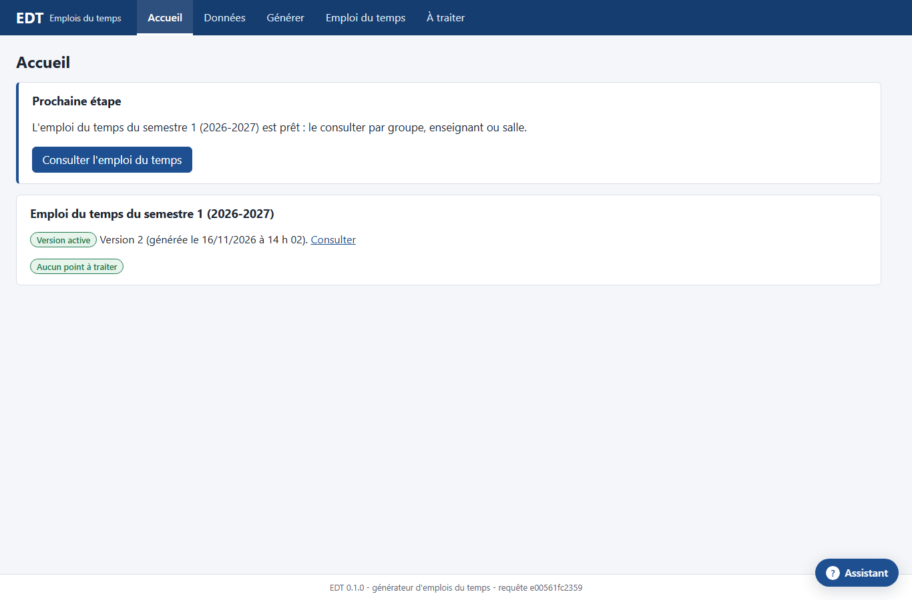
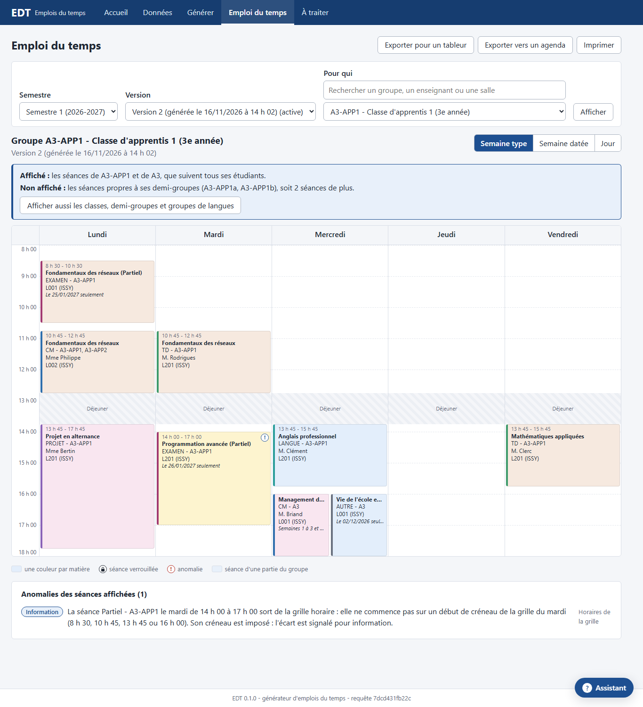

# EDT, générateur d'emplois du temps

EDT construit automatiquement l'emploi du temps d'une école d'ingénieurs à
partir de ses salles, groupes, enseignants, matières et besoins en séances.
Il s'adresse au responsable de scolarité. Il place chaque séance sur un
jour, un horaire et une salle. Il ne supprime jamais une règle pour réussir :
quand aucun emploi du temps n'est possible, il le dit et explique pourquoi.
L'emploi du temps produit se consulte par groupe, enseignant ou salle, se
retouche à la main et s'exporte vers un agenda.

Toutes les données sont fictives. L'application n'a pas d'écran de connexion.





## Équipe

Projet du module PTS Informatique, ISEP, année 2026-2027 : Axel, Nassim
Khiri, Kerime, Hugo.

## Démonstration

Démonstration en ligne : adresse communiquée par l'équipe.

Elle tourne sur un établissement fictif complet. Pour essayer
l'application sur votre poste, suivez le démarrage en cinq minutes
ci-dessous.

## Livrables du cours

1. [Spécifications fonctionnelles](docs/livrets/1-specifications-fonctionnelles.md) :
   ce que fait l'application, ses fonctionnalités classées, le diagramme de
   classes.
2. [Spécifications techniques et organisation](docs/livrets/2-specifications-techniques-et-organisation.md) :
   technologies, architecture, organisation de l'équipe.
3. [Guide de l'utilisateur](docs/livrets/3-guide-utilisateur.md) : le mode
   d'emploi, écran par écran.

## Ce que fait l'application

- Saisir ou importer l'établissement : campus, salles, groupes, enseignants,
  matières, besoins en séances, indisponibilités, calendrier.
- Régler les règles d'un emploi du temps, chacune nécessaire, importante ou
  facultative, et ajouter des règles personnalisées (« la classe A3-APP1 a
  aussi cours le samedi »).
- Générer l'emploi du temps d'un semestre, avec des vérifications préalables
  et un suivi en direct.
- Consulter le résultat en semaine type, en semaine datée ou au jour, et le
  retoucher : chaque modification est vérifiée avant d'être enregistrée.
- Traiter les points signalés (anomalies, séances à reprogrammer) et
  exporter en CSV ou vers un agenda (iCal).
- Poser des questions en langage courant à l'assistant
  ([docs/assistant.md](docs/assistant.md)).
- Lancer les tests du projet depuis les onglets « Tests unitaires » et « Tests
  d'intégration », et lire le résultat et la date de dernière exécution de chacun.

## Démarrage en cinq minutes

Il faut Python 3.11 ou plus récent. Depuis la racine du dépôt :

```sh
python -m venv .venv
.venv/Scripts/python -m pip install -e ".[dev]"   # Linux et macOS : .venv/bin/python
```

Activez ensuite l'environnement (`.venv\Scripts\activate` sous Windows,
`source .venv/bin/activate` ailleurs), puis :

```sh
python -m edt init-db              # crée la base data/edt.db et ses données par défaut
python -m edt jeu --taille moyen   # charge un établissement fictif (une promotion complète)
python -m edt serve                # lance le serveur web
```

Ouvrez <http://127.0.0.1:8000> dans un navigateur. L'accueil indique la
prochaine étape : dans l'onglet « Générer », lancez le calcul (une vingtaine
de secondes sur ce jeu), puis consultez le résultat dans l'onglet « Emploi du
temps ». Le même calcul se lance en ligne de commande avec
`python -m edt generer`.

`python -m edt doctor` vérifie l'installation (Python, OR-Tools, base,
schéma, journaux, port). Les réglages (base, journaux, adresse et port
d'écoute) se font par des variables d'environnement `EDT_*`, décrites dans
[docs/architecture.md](docs/architecture.md#configuration).

## Ligne de commande

Toute fonctionnalité est aussi une commande ; `python -m edt <commande>
--help` donne ses options.

| Commande | Rôle |
|---|---|
| `init-db`, `verifier-schema` | créer la base ; vérifier que ses tables correspondent au modèle |
| `jeu`, `jeu-minimal` | charger un établissement fictif (petit, moyen, grand) ; un très petit jeu |
| `serve` | lancer le serveur web |
| `pre-verifier`, `generer`, `instancier` | dire ce qui empêcherait un calcul ; générer l'emploi du temps d'un semestre ; produire ses séances datées |
| `verifier` | lister les anomalies d'un emploi du temps enregistré |
| `gabarit`, `importer`, `exporter-donnees`, `exporter-edt` | échanger des fichiers (XLSX, CSV, iCal) |
| `sauvegarder`, `verifier-sauvegarde` | sauvegarder la base ; contrôler une sauvegarde |
| `doctor`, `version` | vérifier l'installation ; afficher la version |
| `tests` | lancer les tests du projet comme depuis l'application (`--famille`, `--composant`) ; code 1 en cas d'échec |
| `assistant` | état de l'assistant (configuration, limites, consommation du jour) ; `--essai` : un appel d'essai au service ; `--question` : une question en langage courant ; code 1 si l'assistant n'est pas utilisable |

## Tests

Les tests sont rangés en deux familles : `tests/unitaires/` (un module exercé
seul, par ses fonctions) et `tests/integration/` (plusieurs couches
assemblées : requêtes web, ligne de commande, calcul complet). La règle de
rangement est contrôlée automatiquement ; elle est décrite dans
[tests/README.md](tests/README.md).

```sh
python -m pytest -m "not perf"              # toute la suite, sans les tests de charge
python -m pytest tests/unitaires            # les tests unitaires
python -m pytest tests/integration          # les tests d'intégration
python -m pytest tests/integration/parcours # les parcours de bout en bout
python -m pytest -m cas_limite              # la banque des cas limites
python -m pytest -m perf                    # les tests de charge (longs)
python -m tests.outils.classement           # nombre de tests par famille et par composant
python -m tests.outils.classement --ecrire  # met à jour les nombres de tests des documents
python -m ruff check .                      # lint
python -m ruff format --check .             # format
```

L'intégration continue (GitHub Actions, Python 3.11, 3.13 et 3.14) lance à
chaque pull request le lint, le format, le contrôle du rangement, puis les
tests unitaires et les tests d'intégration. Les tests créent leur base et
leurs journaux dans des dossiers temporaires : ils ne touchent jamais `data/`
ni `logs/`.

## Documentation

La carte complète, avec le public de chaque document, est dans
[docs/README.md](docs/README.md).

| Pour… | Lire |
|---|---|
| utiliser l'application | [Guide de l'utilisateur](docs/livrets/3-guide-utilisateur.md) |
| comprendre ce qu'elle fait | [Spécifications fonctionnelles](docs/livrets/1-specifications-fonctionnelles.md), [Choix de conception](docs/decisions.md) |
| lire ou modifier le code | [Architecture](docs/architecture.md), [Modèle de données](docs/modele-donnees.md), [Solveur](docs/solveur.md), [Vérificateur](docs/verification.md) |
| installer le serveur | [Déploiement](docs/deploiement.md) |

## Contribuer

Une branche par tâche, une pull request relue par un autre membre, la CI
verte avant la fusion. Le détail (conventions de code et d'écriture, tests,
ajout d'une commande ou d'un écran) est dans [CONTRIBUTING.md](CONTRIBUTING.md).
