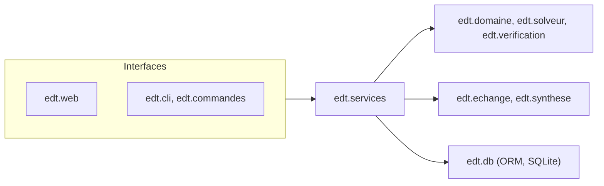
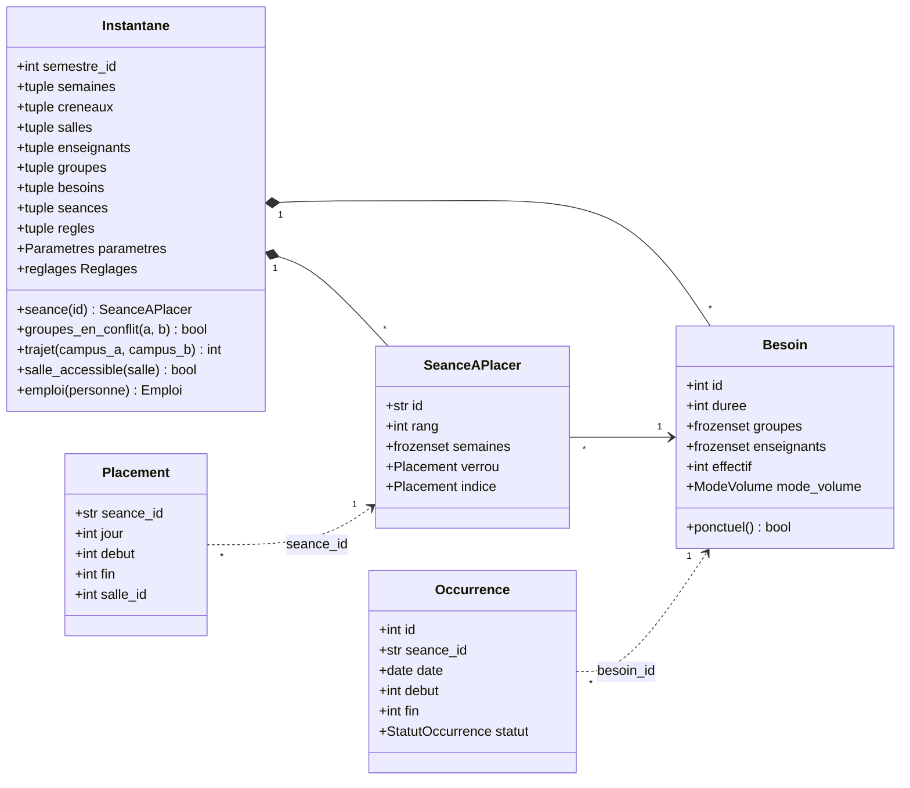

# Architecture

Ce document décrit l'organisation du code : les couches, l'arborescence, la
configuration, la base, les deux mécanismes d'extension, les contrats
partagés, la journalisation et les erreurs. Il s'adresse au développeur qui
arrive sur le projet. Les choix qui le fondent sont dans
[`decisions.md`](decisions.md) ; le modèle de données est dans
[`modele-donnees.md`](modele-donnees.md).

## Couches



| Couche | Paquet | Rôle | Peut importer |
|---|---|---|---|
| Interfaces | `edt.web`, `edt.cli`, `edt.commandes` | routes, gabarits, commandes : aucune logique métier | `services`, `domaine`, et `edt.db.moteur` pour ouvrir une session |
| Services | `edt.services` | fonctions typées, une par fonctionnalité | `domaine`, `solveur`, `verification`, `echange`, `synthese`, `db` |
| Logique pure | `edt.domaine`, `edt.solveur`, `edt.verification` | calculs sans base ni réseau | `domaine` seulement |
| Échange et données fictives | `edt.echange`, `edt.synthese` | lecture et écriture de fichiers, génération de jeux | `domaine`, `db`, `verification` et les services de lecture (instantané, conflits, paramètres, règles) |
| Données | `edt.db` | moteur, sessions, modèles ORM, données par défaut | `domaine` |
| Transverse | `edt.config`, `edt.journal`, `edt.erreurs` | configuration, journaux, erreurs | rien d'autre |

Règles qui en découlent :

- une fonctionnalité existe **d'abord comme fonction de service** (paramètres
  et retours explicites, sérialisables), puis comme route web **et** comme
  commande ; l'assistant conversationnel appelle les mêmes services
  ([`assistant.md`](assistant.md)) ;
- le solveur et le vérificateur **ne voient jamais l'ORM** : ils travaillent
  sur l'instantané (voir « Contrats partagés ») ;
- aucun état global en mémoire, sauf le suivi des calculs en cours
  (`edt.services.generation`) et la mémoire des écrans, invalidée à chaque
  écriture (`edt.services.emploi_du_temps.memoire`) : tout le reste est en
  base ; deux autres exceptions : l'assistant garde en mémoire ses
  conversations, ses compteurs par adresse et sa pause après un refus de clé
  (`edt.services.assistant`, voir [`assistant.md`](assistant.md)), et le
  lanceur de tests garde l'exécution en cours (`edt.services.banc_tests`) ;
  tout cela est perdu au redémarrage ;
- seule exception à l'ordre des couches : les commandes `init-db` et
  `jeu-minimal` appellent directement `edt.db.initialisation` et
  `edt.db.jeux`, outils d'administration de la base.

## Arborescence

```
pyproject.toml                 paquet, dépendances, pytest, ruff
.github/                       intégration continue, gabarits de pull request et de tâche
deploy/                        installation et déploiement sur le serveur (deploiement.md)
docs/                          documentation (carte : docs/README.md)
src/edt/
  __main__.py, cli.py          python -m edt : application Typer, découverte des commandes
  config.py                    variables d'environnement EDT_*
  journal.py                   configuration unique des journaux
  erreurs.py                   hiérarchie ErreurEDT
  commandes/                   un module par domaine, chacun expose `commandes`
    assistant.py               assistant (état, appel d'essai, question)
    banc_tests.py              tests
    base.py                    init-db, verifier-schema, jeu-minimal, serve, version,
                               doctor, sauvegarder, verifier-sauvegarde
    echange.py                 gabarit, importer, exporter-donnees, exporter-edt
    generation.py              pre-verifier, generer, instancier
    synthese.py                jeu
    verification.py            verifier
  db/
    base.py, moteur.py         base déclarative ; moteur SQLite, sessions, transactions
    modeles.py                 toutes les tables
    initialisation.py          schéma, détection d'un schéma périmé, données par défaut
    jeux.py                    jeu de données minimal
  domaine/                     logique pure
    enumerations.py            valeurs fermées et leurs libellés
    heures.py, calendrier.py   heures en minutes, semaines d'un semestre, jours fériés
    normalisation.py           codes et identifiants saisis ou importés
    contraintes.py             catalogue des contraintes et niveaux
    parametres.py              paramètres globaux typés
    regles.py                  règles personnalisées : types, validation, phrase, résolution
    instantane.py              CONTRAT : semestre à planifier, placements, séances datées
    depliage.py                besoins -> séances hebdomadaires et semaines actives
  services/
    instantane.py              base -> instantané
    conflits_groupes.py        relation de conflit entre groupes
    generation.py              orchestration d'un calcul
    diagnostic.py              diagnostic d'un calcul impossible : garde-fous, enregistrement
    instanciation.py           séances datées d'une version, replacement
    verification.py            vérification d'une version ou d'une modification
    parametres.py, niveaux.py  paramètres ; niveaux des règles d'un calcul
    calendrier.py, etat.py     années scolaires ; état de la base
    regles.py                  règles personnalisées
    echange.py, jeux.py        import et export ; établissements fictifs, remise à zéro
    assistant/                 assistant conversationnel (docs/assistant.md)
    banc_tests/                lancement des tests depuis l'application, résultats
    referentiels/              édition générique des données de l'établissement
    emploi_du_temps/           écrans Générer, Emploi du temps, Points à traiter, accueil
  verification/                vérificateur : une règle par code du catalogue, indicateurs
  solveur/                     CP-SAT : préparation, pré-vérifications, horaires (modele.py),
                               salles (salles.py), moteur, séances datées, replacement,
                               règles personnalisées, diagnostic d'un calcul impossible
                               (diagnostic.py)
  echange/                     format d'échange, lecture, écriture, iCal, rapport d'import
  synthese/                    générateur d'établissements fictifs et emploi du temps témoin
  web/
    app.py, asgi.py            creer_app() et découverte des routes ; point d'entrée ASGI
    dependances.py             SessionRequete, transaction des requêtes d'écriture
    gabarits.py, menu.py       rendre(), rediriger(), filtres ; entrées de menu
    intergiciels.py, erreurs.py  identifiant et journal des requêtes ; erreurs -> pages
    acces.py                   accès par mot de passe (gestion, consultation), facultatif
    donnees/                   écrans génériques des données, formulaire des règles
    routes/                    un module par écran (accueil, données, Générer,
                               Emploi du temps, Points à traiter, import et
                               export, assistant, tests, connexion)
    templates/, static/        gabarits Jinja2 ; CSS, JavaScript, HTMX embarqué
tests/                         unitaires/, integration/, outils/ : voir tests/README.md
```

## Configuration

Tout se règle par variables d'environnement, avec des valeurs par défaut
utilisables telles quelles (`edt.config.charger_configuration()`).

| Variable | Défaut | Rôle |
|---|---|---|
| `EDT_DB_URL` | `sqlite:///data/edt.db` | adresse SQLAlchemy de la base |
| `EDT_LOG_DIR` | `logs` | dossier des journaux |
| `EDT_HOST` | `127.0.0.1` | adresse d'écoute |
| `EDT_PORT` | `8000` | port d'écoute |
| `EDT_ENV` | `dev` | `dev` ou `prod` (en `prod`, `/docs` est désactivé) |
| `EDT_LOG_LEVEL` | `INFO` | niveau de journalisation |
| `EDT_MDP_GESTION` | (vide) | mot de passe de gestion ; vide = site ouvert, sans connexion |
| `EDT_MDP_CONSULTATION` | (vide) | mot de passe de consultation, en lecture seule (facultatif) |

Les deux mots de passe sont des secrets : au moins 8 caractères, différents,
jamais dans le dépôt ni dans `edt.env` (sur le serveur : `/etc/edt/comptes.env`,
voir [deploiement.md](deploiement.md), section 14). Le rôle reconnu est gardé
dans un cookie signé ; `edt.web.acces.IntergicielAcces` applique les droits
avant toute route, et un écran nouveau reste réservé à la gestion tant qu'il
n'est pas ajouté à `autorise_en_consultation`.

Une valeur invalide lève `ErreurConfiguration` : jamais de repli silencieux.
`EDT_PORT` est un entier de 1 à 65535 en chiffres ASCII, `EDT_HOST` une
adresse ou un nom sans espace ni « / » (sa résolution est contrôlée par
`doctor`), `EDT_DB_URL` une base **SQLite sur fichier** : une base en
mémoire, un autre pilote ou un schéma inconnu sont refusés avec le remède.
Une valeur vide prend le défaut. Les chemins relatifs partent du répertoire
de lancement.

Quatre variables règlent le lancement des tests depuis l'application
(onglets « Tests unitaires » et « Tests d'intégration », commande
`python -m edt tests`) ; le service `edt.services.banc_tests` les lit avec
les mêmes règles (valeur invalide refusée, valeur vide au défaut) :

| Variable | Défaut | Rôle |
|---|---|---|
| `EDT_TESTS_RACINE` | le dossier courant s'il contient `tests/unitaires` et `pyproject.toml`, sinon la racine déduite du code source | racine du dépôt dont les tests sont lancés |
| `EDT_TESTS_DUREE_MAX_S` | `900` | durée maximale d'une exécution, en secondes ; au-delà, pytest et ses processus enfants sont arrêtés |
| `EDT_TESTS_LANCEMENT` | `oui` | `non` désactive les boutons de lancement ; les résultats restent consultables |
| `EDT_TESTS_DELAI_S` | `60` | délai minimal, en secondes, entre la fin d'une exécution et un lancement depuis le site (`0` : aucun) ; la commande n'y est pas soumise |

Les tests tournent dans un sous-processus `python -m pytest` sans aucune
variable `EDT_*` héritée : sa base et ses journaux sont dans un dossier
temporaire effacé à la fin. Les résultats sont gardés dans
`<EDT_LOG_DIR>/tests/` (`resultats.json`, `derniere-execution.log`).

## Base de données : moteur, transactions, pannes

`edt.db.moteur` crée un moteur par adresse, partagé par tous les fils
(serveur, calcul). Chaque connexion SQLite active les clés étrangères, le
mode WAL (une écriture ne bloque jamais les lectures) et un délai d'attente
sur verrou de 10 s (`DELAI_VERROU_MS`).

- **Transactions.** SQLAlchemy émet le `BEGIN` (le pilote `sqlite3` ne gère
  pas les transactions : `isolation_level=None`). Le `BEGIN` est **différé**
  par défaut : une transaction qui ne fait que lire ne prend aucun verrou.
  Une transaction qui lit puis écrit appelle
  `transaction_immediate(session)` **avant sa première requête** (`BEGIN
  IMMEDIATE`, verrou d'écriture pris d'emblée) ; appelée trop tard, elle
  lève `ErreurConfiguration`. Sans cela, SQLite répond « database is
  locked » sans attendre. Côté web, toute requête POST, PUT, PATCH ou DELETE
  ouvre sa transaction ainsi (`edt.web.dependances`) ; seules les routes
  dont le service écrit dans ses propres transactions (lancer, relancer,
  arrêter un calcul : `ROUTES_ECRITURE_DELEGUEE`) gardent une session
  différée. Au-delà du délai de verrou, la page répond « base occupée »
  (503).
- **Identifiants.** `identifiant_valide(valeur)` : entier strictement
  positif dans les bornes de SQLite (`IDENTIFIANT_MAX`). Tout identifiant
  venu de l'extérieur (adresse, formulaire, option) passe par cette garde
  unique avant `session.get` : hors bornes, la réponse est « n'existe pas ».
- **Pannes.** `expliquer_erreur_base(erreur)` donne une phrase et un remède
  pour une panne du pilote (base verrouillée, fichier en lecture seule,
  fichier qui n'est pas une base SQLite, disque plein, base non initialisée
  avec le remède « python -m edt init-db ») : code 1 en ligne de
  commande, page 503 sur le web.
- **Opérations longues.** Pendant une remise à zéro ou un chargement de jeu
  fictif (`edt.services.jeux`), un fichier marqueur `<base>.operation` est
  posé à côté de la base : un autre processus répond « base occupée,
  réessayer ». Un marqueur de plus de dix minutes (processus mort) est
  ignoré.
- **Démarrage.** Le serveur ne refuse jamais de démarrer : une base
  corrompue ou verrouillée est journalisée et `/sante` répond « dégradé ».
  `python -m edt doctor` contrôle en plus qu'une écriture réelle est
  possible, que `edt.log` s'ouvre et que `EDT_HOST` se résout.

## Schéma de la base : pas de migrations

`python -m edt init-db` crée les tables manquantes et pose les données par
défaut, sans toucher au reste ; il se relance à chaque déploiement. Les
listes par défaut (grille horaire, types de salle, équipements, types de
séance) ne sont posées que dans une base **neuve** ; un paramètre absent est
toujours ajouté. `init-db` **ne modifie jamais une table existante** : quand
le modèle change, une base déjà créée devient **périmée**.

`edt.db.initialisation.ecarts_schema(moteur)` compare chaque table au modèle
(présence et type de chaque colonne, caractère obligatoire, valeurs d'une
énumération, unicités, index) et renvoie des phrases lisibles. Tant qu'il
reste un écart :

| Où | Ce qui se passe |
|---|---|
| `python -m edt init-db` | échoue (code 1) sans rien modifier, liste les écarts et indique la marche à suivre |
| `python -m edt init-db --reset` | recrée la base et **efface les données** ; demande confirmation dans un terminal (`--oui` l'évite), refuse d'agir pendant un calcul ou un chargement d'établissement fictif, sauvegarde d'abord la base dans `sauvegardes/` en production (sauf `--sans-sauvegarde`, quand l'appelant vient de la sauvegarder) |
| `python -m edt verifier-schema` | code 0 si le schéma est à jour, 1 avec la liste des écarts, 2 si la base est inaccessible |
| `python -m edt doctor` | une ligne « Schéma » en échec, avec le nombre d'écarts |
| `/sante` | répond 503 avec les écarts |
| `python -m edt jeu-minimal`, `jeu` | refusent de charger des données |

Limites : les clés étrangères et les contrôles entre colonnes ne sont pas
comparés ; la longueur d'un texte non plus (SQLite ne l'applique pas). Une
seule ancienne valeur est reprise à la lecture : le paramètre booléen
`dejeuner_horaires_determines` devient `dejeuner_mode` (vrai : `fixe`, faux :
`aucun`).

## Mécanismes d'extension

Une commande ou un écran s'ajoute **dans son propre fichier**. Ni
`edt/cli.py` ni `edt/web/app.py` ne se modifient : ils découvrent les
modules au démarrage. Un module dont le nom commence par `_` est ignoré (code
partagé). Un module qui n'expose pas l'objet attendu fait échouer le
démarrage avec un message explicite.

### Ajouter une commande

Créer un module dans `src/edt/commandes/` qui expose `commandes`, un
`typer.Typer`. Ses commandes s'ajoutent à `python -m edt`.

```python
# src/edt/commandes/salles.py
"""Commandes des salles."""

from typing import Annotated

import typer

from edt.db.moteur import session_base
from edt.services import salles as service_salles

commandes = typer.Typer()


@commandes.command("lister-salles")
def lister_salles(
    campus: Annotated[str | None, typer.Option(help="Code du campus.")] = None,
) -> None:
    """Affiche les salles (cette phrase devient l'aide de la commande)."""
    with session_base() as session:        # validée à la sortie, annulée sur erreur
        for salle in service_salles.lister(session, campus=campus):
            typer.echo(f"{salle.code}  {salle.capacite} places")
```

- La commande appelle un service et affiche le résultat ; elle ne contient
  pas de logique métier.
- Elle laisse remonter les `ErreurEDT` : le message est affiché en clair et
  le code de sortie vaut 1. Toute autre exception est journalisée avec sa
  trace et donne le code 2.
- La journalisation est déjà configurée quand la commande démarre.

### Ajouter un écran

Créer un module dans `src/edt/web/routes/` qui expose `routeur` (un
`fastapi.APIRouter`, obligatoire) et `MENU` (une liste d'`EntreeMenu`,
facultative), et ses gabarits dans `src/edt/web/templates/<écran>/`.

```python
# src/edt/web/routes/salles.py
"""Écran des salles."""

from typing import Annotated

from fastapi import APIRouter, Form, Request

from edt.services import salles as service_salles
from edt.web.dependances import SessionRequete
from edt.web.gabarits import rediriger, rendre
from edt.web.menu import SECTION_REFERENTIELS, EntreeMenu

routeur = APIRouter(prefix="/salles")
MENU = [EntreeMenu("Salles", "/salles", section=SECTION_REFERENTIELS, ordre=110)]


@routeur.get("")
def liste(request: Request, session: SessionRequete):
    return rendre(request, "salles/liste.html", {"salles": service_salles.lister(session)})


@routeur.post("")
def creer(
    request: Request,
    session: SessionRequete,
    code: Annotated[str, Form()],
    capacite: Annotated[int, Form()],
):
    service_salles.creer(session, code=code, capacite=capacite)   # lève ErreurEDT si refus
    return rediriger(request, "/salles", f"Salle {code} enregistrée.")
```

À savoir :

- **Session** : `SessionRequete` fournit une session validée à la fin de la
  route, avant l'envoi de la réponse, et annulée si la route lève une
  erreur. Ni une route ni un service n'appelle `session.commit()` ; un
  service fait `session.flush()` s'il a besoin d'un identifiant.
- **Rendu** : `rendre(request, gabarit, contexte)` ajoute le menu, les
  messages et l'identifiant de requête. `rediriger(request, url, message)`
  redirige après un POST et dépose le message pour la page suivante ; il
  gère aussi les requêtes HTMX (`HX-Redirect`).
- **Gabarits** : étendre `base.html` et importer `macros.html` ; les blocs,
  macros, classes CSS et comportements communs sont décrits dans
  [`interface.md`](interface.md).
- **Menu** : la `section` de l'entrée choisit l'onglet, l'`ordre` la place
  dans l'onglet ([`interface.md`](interface.md), « Navigation »).
- **Erreurs** : les laisser remonter (voir « Erreurs »).
- **Écran de données** : une entité de l'établissement se décrit une fois
  dans `edt.services.referentiels` et reçoit ses écrans génériques
  ([`interface.md`](interface.md), « Écrans de l'espace Données »).

## Contrats partagés

Le vérificateur et le solveur sont deux écritures indépendantes des mêmes
règles : ils raisonnent sur **la même représentation**, l'instantané. Ces
contrats ne changent pas sans mise à jour de leurs deux utilisateurs.

### L'instantané (`edt.domaine.instantane`)

Dataclasses figées, sans ORM, construites par
`edt.services.instantane.charger_instantane(session, semestre_id,
version_base_id=None)`. `charger_placements` et `charger_occurrences` lisent
la semaine type et les séances datées d'une version.



Ce qu'il faut savoir pour l'utiliser :

- **Unités** : heures en minutes depuis minuit, plages semi-ouvertes ; jours
  de 0 (lundi) à 6 ; semaines numérotées dans le semestre à partir de 1.
- **Séance** : identifiée par `"<besoin_id>-<rang>"` (`id_seance`,
  `decomposer_id_seance`). Ses **semaines actives** viennent du dépliage ;
  deux séances aux semaines disjointes ne se gênent jamais.
- **Exigences résolues au chargement** : effectif total, accessibilité
  requise (portée par un groupe du besoin ou un groupe lié), types de salle
  acceptés (ceux du besoin, sinon le type par défaut du type de séance,
  sinon tous).
- **Verrou et indice** : repris de la version de base (la version active par
  défaut). Le verrou est une contrainte, l'indice un point de départ.
- **Enseignant fictif** (`Enseignant.fictif`) : exclu de toutes les
  contraintes d'enseignant.
- **Jours travaillés** : `Instantane.jours_travailles` est le standard des
  jours ; aucun code ne suppose « lundi à vendredi ».
- **Emploi du temps d'une personne** (`Instantane.emplois`) : définition
  unique. Une personne est un groupe feuille ou un enseignant non fictif ;
  ses séances réunissent les siennes et celles de sa lignée (feuille, classe,
  promotion).
- **Règles personnalisées** : `Instantane.regles` (règles actives de l'année
  qui recoupent le semestre, résolues) et `Instantane.reglages` (jours permis
  de chaque séance, déjeuner et pause de chaque personne, chacun avec sa
  source). Une règle invalide fait échouer le chargement avec une
  `ErreurDonneesInvalides` qui la nomme.
- **Identifiants** : un identifiant hors des entiers de SQLite répond
  `ErreurIntrouvable`, jamais une erreur du pilote.

### Le dépliage (`edt.domaine.depliage`)

`deplier(besoins, semaines, jours_fermes, jours_travailles, periode)` passe
des besoins aux séances à placer.

- Une semaine est **ouverte** pour un besoin si elle recoupe sa fenêtre et
  qu'un jour travaillé au moins n'y est fermé ni globalement ni pour un de
  ses groupes.
- `par_semaine` : `nombre` séances, actives toutes les semaines ouvertes.
- `total` : `nombre` séances réparties régulièrement sur les S semaines
  ouvertes ; la semaine d'indice i en reçoit
  `ceil((i+1)·nombre/S) − ceil(i·nombre/S)`, et la séance de rang r est
  active les semaines qui en reçoivent au moins r. 10 séances sur
  15 semaines : 1, 1, 0, 1, 1, 0…
- `ponctuel` : une séance, active la seule semaine de sa date ; permise
  pendant des examens ou une semaine spéciale, pas un jour férié ni pendant
  des vacances.
- Un besoin impossible à déplier (volume trop grand pour la fenêtre, date
  hors semestre ou un jour fermé, besoin sans groupe) n'est pas corrigé : il
  produit un `ProblemeDepliage`, et le calcul est refusé tant que la règle
  concernée (`VOLUME` ou `JOUR_FERME`) est active.

### Les conflits entre groupes (`edt.services.conflits_groupes`)

Deux groupes sont en conflit si l'un est un ascendant de l'autre, s'ils sont
déclarés chevauchants (la déclaration vaut pour toute leur lignée) ou s'ils
partagent un étudiant (un inscrit appartient aussi aux ascendants de son
groupe). Deux groupes frères ne sont pas en conflit. L'instantané embarque le
résultat : `Instantane.groupes_en_conflit(a, b)`, `groupes_lies(groupe_id)`.

### Le vérificateur (`edt.verification`)

`verifier(instantane, placements, contraintes_actives=None)` vérifie une
semaine type, `verifier_occurrences(instantane, occurrences,
contraintes_actives=None)` des séances datées. Les deux renvoient une liste
d'`Anomalie` (code, gravité, message, séances, ressources concernées) : aucune
anomalie de gravité « erreur » signifie un emploi du temps valide. Le service
en base est `edt.services.verification` (`verifier_version`,
`verifier_occurrences_version`, `verifier_modification`), la commande
`python -m edt verifier`. Règles, gravités et indicateurs :
[`verification.md`](verification.md).

### Le solveur (`edt.solveur`)

`resoudre(instantane, options, arret=None) -> ResultatSolveur`.

- `OptionsSolveur` : temps limite, niveaux des règles, niveaux des règles
  personnalisées, optimisation, graine, nombre de fils, usage des indices,
  tolérance aux verrous contradictoires.
  `OptionsSolveur.depuis_parametres(parametres, ...)` donne les options d'un
  calcul.
- `ResultatSolveur` : statut, placements, message, avertissements,
  statistiques. `StatutSolveur` : `SOLUTION`, `INFAISABLE` (prouvé),
  `TEMPS_DEPASSE` (rien trouvé, sans preuve), `ARRETE`.
- **Tout ou rien** : un placement par séance de l'instantané, ou aucun.
- Le moteur (`edt.solveur.moteur`) lance lui-même les pré-vérifications,
  calcule les horaires (`modele.py`) puis les salles (`salles.py`) et ne
  déclare `INFAISABLE` que sur preuve. Avec l'optimisation, il rend la
  meilleure solution trouvée dans le temps imparti.
- Autres fonctions pures : `pre_verifier` (impossibilités certaines et
  situations tendues, en moins d'une seconde), `instancier` (une séance datée
  par séance et par semaine active, en mettant à part celles qui tombent un
  jour fermé ou pendant une indisponibilité), `replacer` (la place valide la
  plus proche de la date d'origine, sinon « à programmer » avec la raison).
- Du vérificateur, le paquet n'importe que le type `Anomalie`.

Formulation, objectif, mesures et limites : [`solveur.md`](solveur.md).

### L'orchestration d'un calcul (`edt.services.generation`)

| Fonction | Rôle |
|---|---|
| `lancer_calcul(semestre_id, options, ...)` | lance un calcul en arrière-plan, rend son identifiant ; `ErreurCalculEnCours` si un calcul tourne déjà |
| `etat_calcul`, `calcul_en_cours`, `dernier_calcul` | suivi (`SuiviCalcul`), interrogé chaque seconde par l'interface |
| `demander_arret`, `attendre_calcul`, `exiger_reussite` | arrêt ; attente et contrôle du résultat (ligne de commande) |
| `pre_verifier_semestre(session, semestre_id, ...)` | pré-vérifications seules, pour l'écran de lancement |
| `cloturer_calculs_interrompus()` | clôt en erreur un calcul resté « en cours » sans processus vivant |

Étapes d'un calcul, dans le fil d'arrière-plan :

1. **pré-vérifications** : une impossibilité certaine refuse le calcul sans
   appeler le moteur (état `infaisable`, `statistiques["refuse"]` vrai) ;
2. **moteur** ;
3. **contrôle** de la solution par le vérificateur : une erreur relevée est un
   défaut du moteur, l'état devient `erreur` et rien n'est enregistré ;
4. **enregistrement** de la version (activée par défaut) et de sa semaine
   type ;
5. **séances datées** (`instancier_version`) : un échec à cette étape
   n'annule pas la version ; il est journalisé, dit dans le message, et
   l'instanciation se relance.

États (`EtatCalcul`) : `en_cours`, `reussi`, `infaisable`, `temps_depasse`,
`arrete`, `erreur`. Ces fonctions ouvrent leurs propres sessions (un calcul
dure plus qu'une requête). Le suivi des fils vit dans le processus : le
serveur tourne en **un seul processus**.

### Les séances datées (`edt.services.instanciation`)

- `instancier_version(session, version_id)` pose la semaine type sur le
  calendrier, replace les séances qui tombent un jour fermé ou pendant une
  indisponibilité et écrit le tout dans `occurrence`. Elle est
  **idempotente** : relancée, elle remplace les séances issues de la semaine
  type ou d'un replacement et conserve les retouches manuelles et les
  séances importées.
- `replacer_occurrences(session, version_id, occurrence_ids, ...)` replace
  des séances datées désignées dans une fenêtre de dates ; c'est le point
  d'entrée du réaménagement sur imprévu
  ([`decisions.md`](decisions.md), section 13).
- Aucune des deux ne valide la transaction.

### Les paramètres (`edt.services.parametres`)

Les paramètres, leurs bornes et leurs défauts sont les champs de
`edt.domaine.parametres.Parametres` ; `definitions()` les décrit pour
l'écran de configuration. `lire_parametres(session)` lève en nommant le
paramètre si une valeur enregistrée est illisible ; l'écriture et la
réinitialisation lisent en mode tolérant pour que la base reste réparable
depuis son écran. Un paramètre peut être un nombre, un oui ou non, un choix
dans une liste fermée (`dejeuner_mode`) ou un ensemble de jours
(`jours_travailles`).

**Pause déjeuner.** `dejeuner_mode` choisit le mode ; `dejeuner_debut_min`
(X) et `dejeuner_fin_min` (Y) bornent la pause ; `dejeuner_duree_min` (N)
sert au mode libre. Le vérificateur, le solveur et les indicateurs ne lisent
que les propriétés `plage_dejeuner`, `fenetre_dejeuner` et `dejeuner_actif`,
ou leur équivalent par personne dans `Instantane.reglages`.

| Mode | Règle |
|---|---|
| `fixe` | la plage `[X, Y[` est réservée pour tous : aucune séance ne la recoupe |
| `libre` | chaque jour où une personne a une séance qui recoupe `[X, Y]`, elle garde un intervalle libre d'au moins N minutes consécutives dans `[X, Y]`, placé par le calcul |
| `aucun` | rien n'est réservé ; X, Y et N sont conservés mais ignorés |

### Les règles personnalisées (`edt.domaine.regles`, `edt.services.regles`)

1. **Domaine** (pur) : 14 types (`TypeRegle`), le catalogue
   `CATALOGUE_TYPES` (libellé, portées admises, paramètres, niveau par
   défaut, exemples), la validation, la phrase en français, la résolution en
   identifiants et la précédence (`resoudre_reglages`).
2. **Base** : table `regle`, une règle par ligne, paramètres en JSON.
3. **Service** : lecture, validation (erreurs par champ), écriture,
   activation, propositions pour une nouvelle année
   (`proposer_pour_annee`), explication ; chaque écriture est journalisée
   avec la phrase de la règle.
4. **Instantané** : seules les règles actives qui recoupent le semestre sont
   chargées.
5. **Solveur et vérificateur** : un poseur et un vérificateur par type,
   déclarés par `enregistrer("solveur", type)` et
   `enregistrer("verificateur", type)` ; un test vérifie que le catalogue est
   entièrement couvert.

Conception, catalogue des types et précédence :
[`regles-personnalisees.md`](regles-personnalisees.md).

### Sémantique des contraintes

Le catalogue (`edt.domaine.contraintes.CATALOGUE`) donne le code, le libellé
et la description de chaque contrainte ; les niveaux sont décrits dans
[`decisions.md`](decisions.md), section 6. Les précisions suivantes valent
pour le vérificateur **et** le solveur.

| Code | Précision |
|---|---|
| `SALLE_UNIQUE`, `ENSEIGNANT_UNIQUE`, `GROUPE_UNIQUE` | Deux séances se gênent si elles ont lieu le même jour, que leurs plages se recoupent et que leurs semaines actives se croisent. Groupes : relation de conflit de l'instantané. Enseignants fictifs exclus. |
| `PAUSE`, `CAMPUS_TRAJET` | Concernent les **personnes** (groupes en conflit, enseignants non fictifs), pas les salles. La durée de la pause d'une personne vient de `Instantane.reglages.pause` (règle `PAUSE_MINIMALE`, sinon `pause_min`). |
| `DEJEUNER` | Selon le mode (voir « Pause déjeuner ») ; le réglage d'une personne vient de `Instantane.reglages.dejeuner` (règle `PAUSE_DEJEUNER`, sinon l'établissement). Pour une séance imposée (début imposé, ponctuelle ou verrouillée), l'écart est une information. |
| `HORAIRES` | Début sur un début de créneau de la grille, séance dans la plage d'ouverture, sans déborder de sa demi-journée ; durée placée égale à la durée du besoin. Un jour ou un début imposé non respecté relève aussi de ce code. Pour une séance imposée, un écart à la grille est une information. |
| `JOURS` | Le standard des jours : `jours_travailles`, plus le samedi si le type de séance l'autorise et qu'aucune règle ne vise ce type. Une règle `JOURS_TRAVAILLES` retenue l'emporte ; une entorse à une règle porte le code `REGLE`. |
| `CAPACITE` | Capacité de la salle ≥ effectif du besoin. |
| `TYPE_SALLE` | Type de la salle parmi les types acceptés (vide = tous). Une salle ou un campus imposé non respecté relève aussi de ce code. |
| `EQUIPEMENT` | Équipements requis inclus dans ceux de la salle. |
| `ACCESSIBILITE` | Si le besoin requiert l'accessibilité, la salle est accessible. |
| `DISPO_ENSEIGNANT`, `DISPO_SALLE` | Semaine type : indisponibilités **récurrentes** seulement. Séances datées : toutes. |
| `DISPO_GROUPE` | Même règle ; l'indisponibilité d'un groupe vaut pour toute séance d'un groupe **lié** (ascendants, descendants, chevauchants, partageant un étudiant). |
| `MAX_ENSEIGNANT` | Maxima par jour et par semaine quand ils sont renseignés, semaine active par semaine active. |
| `VOLUME` | Chaque séance de l'instantané a un placement. |
| `VERROU` | Une séance verrouillée garde son jour, son heure et sa salle. |
| `JOUR_FERME` | Séances datées seulement. Une fermeture de portée « groupe » vaut pour ce groupe et ses descendants. |
| `REGLE` | Toute entorse à une règle personnalisée, au niveau de la règle, imputée à la règle (`regle_id`). |

Les jours fermés et les indisponibilités datées ne restreignent pas la
semaine type : la séance datée qui tombe dessus est replacée, ou passe « à
programmer ». Seule exception : une semaine entièrement fermée pour un
besoin est retirée de ses semaines actives par le dépliage.

Les niveaux d'un calcul forment un dictionnaire code → niveau
(`normaliser_niveaux`). Convention : **une clé absente est une contrainte
ignorée**, ni posée ni vérifiée ; c'est ainsi que la ligne de commande
traduit `-d CODE`. Les poids des préférences (10, 5, 2, 1) restent sous les
poids des niveaux souples (1 000 et 20).

## Journalisation

- Configurée **une seule fois**, par `edt.journal.configurer_journalisation()`
  (appelée par `creer_app()` et par la ligne de commande) : console et
  fichier tournant `<EDT_LOG_DIR>/edt.log` (5 Mo, 5 archives).
- Format : `date niveau [contexte] module : message`. Le contexte vaut
  `req=<identifiant>` pendant une requête web, `calcul=<identifiant>` pendant
  un calcul, `-` sinon ; il vient de variables de contexte, le code métier
  n'a rien à passer.
- Dans chaque module : `journal = logging.getLogger(__name__)`. Jamais de
  `print` dans un service.
- Chaque calcul a son fichier
  `<EDT_LOG_DIR>/generations/calcul-<id>-<date>-<heure>.log`, qui reçoit tout
  ce qui est journalisé dans le fil du calcul. Les 50 plus récents sont
  gardés (`NB_JOURNAUX_CALCUL`).
- Niveaux : `INFO` pour ce qu'un exploitant veut suivre (requête, calcul,
  import), `WARNING` pour un refus métier ou une situation anormale gérée,
  `ERROR` avec trace (`journal.exception`) pour l'inattendu.
- Un fichier journal impossible à ouvrir est une `ErreurConfiguration` qui
  nomme le chemin et le remède ; `doctor` tourne quand même, sur la console,
  et le dit.

## Erreurs

- **Rien n'échoue en silence** : pas de `except: pass`, pas de
  `except Exception` sans `journal.exception(...)` ni relance, pas de valeur
  de repli muette.
- Les services lèvent des `ErreurEDT` (`edt.erreurs`), dont le message
  français s'affiche tel quel ; `details` porte les lignes complémentaires.

| Classe | Usage | HTTP | Code de sortie |
|---|---|---|---|
| `ErreurDonneesInvalides` | saisie ou donnée importée hors format ou hors règle | 422 | 1 |
| `ErreurIntrouvable` | l'élément demandé n'existe pas | 404 | 1 |
| `ErreurRegleMetier` | opération refusée par une règle (doublon, élément utilisé) | 409 | 1 |
| `ErreurCalculEnCours` | un calcul tourne déjà (sous-classe de la précédente) | 409 | 1 |
| `ErreurInfaisable` | impossibilité prouvée | 422 | 1 |
| `ErreurTempsDepasse` | pas de solution dans le temps imparti | 422 | 1 |
| `ErreurNonLivre` | fonction absente de l'installation (garde-fou des raccords, ci-dessous) | 501 | 1 |
| `ErreurConfiguration` | variable d'environnement ou dossier invalide | 500 | 1 |
| `sqlalchemy.exc.DatabaseError` | panne du pilote de base (`expliquer_erreur_base`) | 503 | 1 |
| autre exception | erreur de programmation : trace dans le journal, référence de l'incident à l'écran | 500 | 2 |

Une violation d'unicité ou une suppression refusée par la base devient un
409 expliqué. Pour une requête HTMX, l'erreur revient en fragment affiché
dans la zone de messages.

**Raccords.** Les écrans de l'emploi du temps appellent les pré-vérifications,
le vérificateur et l'instanciation par un seul module,
`edt.services.emploi_du_temps.raccords`, qui importe chaque fonction au
moment de l'appel. Si une fonction manquait, l'écran afficherait un encart
explicite au lieu d'une liste vide ; dans l'application livrée, toutes sont
présentes.

## Où ajouter…

| Quoi | Où |
|---|---|
| une **contrainte** | un membre de `CodeContrainte` et son entrée dans `CATALOGUE` (`edt/domaine/contraintes.py`), puis son implémentation dans le vérificateur **et** dans le solveur, avec un test de chaque côté |
| un **type de règle personnalisée** | `edt/domaine/regles.py` (`TypeRegle`, `CATALOGUE_TYPES`), puis un poseur et un vérificateur enregistrés ; le formulaire se construit seul |
| un **paramètre** | un champ de `Parametres` (`edt/domaine/parametres.py`) : il apparaît à la prochaine `init-db` |
| une **table** ou une colonne | `edt/db/modeles.py` (et `MODELES`), puis `docs/modele-donnees.md` (un test vérifie que chaque table y est décrite) ; une base existante devient périmée : `init-db --reset` |
| une **valeur d'énumération** | `edt/domaine/enumerations.py`, avec son libellé ; si une colonne la stocke, une base existante est périmée |
| une **donnée par défaut** | `edt/db/initialisation.py` |
| un **service** | un module de `edt/services/` : fonctions typées qui reçoivent la session |
| un **écran** | un module de `edt/web/routes/` et ses gabarits (voir plus haut) |
| une **commande** | un module de `edt/commandes/` (voir plus haut) |
| un **test** | `tests/unitaires/<composant>/` s'il exerce un module seul par ses fonctions Python, `tests/integration/<composant>/` s'il passe par une requête HTTP, la ligne de commande, un autre processus ou un calcul complet ; aides partagées dans `tests/outils/<composant>/` ; règle dans [`tests/README.md`](../tests/README.md), contrôlée par `tests/test_rangement.py` |
| un **test de cas limite** | marqueur `@pytest.mark.cas_limite` et docstring « Cas : <scénario>. Risque : <ce qui casserait sans le test>. » ([`banque-de-tests.md`](banque-de-tests.md)) ; déterministe (ni horloge, ni ordre des tests, ni solution exacte du solveur) ; plus de 2 s : marqueur `perf` |

## Vérifier son travail

```sh
python -m ruff check .
python -m ruff format --check .
python -m pytest -m "not perf"
python -m edt doctor
python -m edt verifier-schema     # après un changement de edt/db/modeles.py
```
