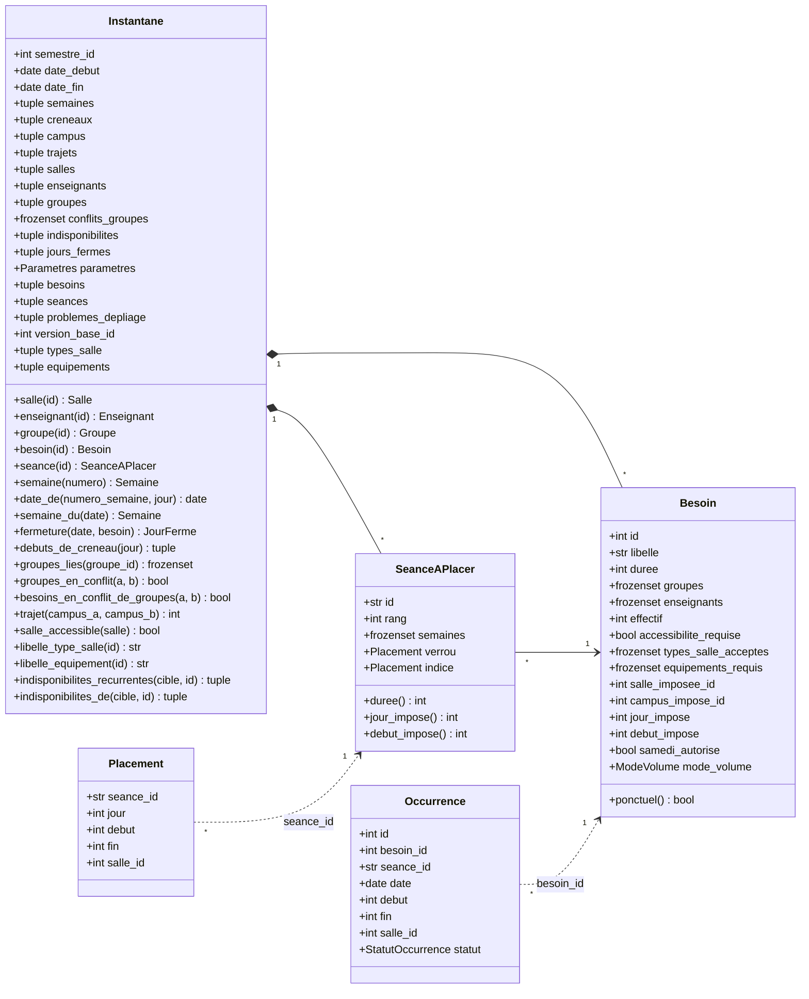

# Architecture

Ce document décrit le socle de l'application : les couches, l'arborescence,
les deux mécanismes d'extension, les contrats partagés entre les lots, les
conventions de journalisation et d'erreurs. Les décisions qui le fondent sont
dans [`decisions.md`](decisions.md) ; le modèle de données est dans
[`modele-donnees.md`](modele-donnees.md).

## Couches

```
web (routes, gabarits)  ─┐
cli (commandes)         ─┼─▶ services ─▶ domaine / solveur / verification
futur LLM / API         ─┘      │
                                └────▶ db (ORM, SQLite)
```

| Couche | Paquet | Rôle | Peut importer |
|---|---|---|---|
| Interfaces | `edt.web`, `edt.cli`, `edt.commandes` | routes, gabarits, commandes : aucune logique métier | `services`, `domaine`, et `edt.db.moteur` pour ouvrir une session |
| Services | `edt.services` | fonctions typées, une par fonctionnalité | `domaine`, `solveur`, `verification`, `db` |
| Logique pure | `edt.domaine`, `edt.solveur`, `edt.verification` | calculs sans base ni réseau | `domaine` seulement |
| Données | `edt.db` | moteur, sessions, modèles ORM, données par défaut | `domaine` |
| Transverse | `edt.config`, `edt.journal`, `edt.erreurs` | configuration, journaux, erreurs | rien d'autre |

Règles qui en découlent :

- une fonctionnalité existe **d'abord comme fonction de service** (paramètres
  et retours explicites), puis comme route web **et** comme commande ;
- le solveur et le vérificateur **ne voient jamais l'ORM** : ils travaillent
  sur l'instantané (voir « Contrats partagés ») ;
- aucun état global en mémoire, sauf le suivi des calculs en cours
  (`edt.services.generation`) : tout le reste est en base ;
- seule exception à l'ordre des couches : les commandes du socle `init-db` et
  `jeu-minimal` appellent directement `edt.db.initialisation` et
  `edt.db.jeux`, qui sont des outils d'administration de la base.

## Arborescence

```
pyproject.toml                 paquet, dépendances, pytest, ruff
.github/workflows/ci.yml       ruff + pytest sur chaque PR
docs/                          décisions, architecture, modèle de données
src/edt/
  __init__.py                  version
  __main__.py                  python -m edt
  cli.py                       application Typer, découverte des commandes
  config.py                    variables d'environnement EDT_*
  journal.py                   configuration unique des journaux
  erreurs.py                   hiérarchie ErreurEDT
  commandes/                   un module par lot (objet `commandes`)
    base.py                    init-db, verifier-schema, jeu-minimal, serve,
                               version, doctor
    generation.py              generer, pre-verifier, instancier
  db/
    base.py                    base déclarative, nommage des contraintes
    moteur.py                  moteur SQLite (clés étrangères, WAL), sessions
    modeles.py                 toutes les tables
    initialisation.py          schéma (création, détection d'un schéma périmé),
                               données par défaut, année scolaire
    jeux.py                    jeu de données minimal
  domaine/
    enumerations.py            valeurs fermées et leurs libellés
    heures.py                  minutes depuis minuit <-> « 8 h 30 »
    calendrier.py              semaines d'un semestre, jours fériés
    contraintes.py             catalogue des contraintes (codes stables)
    parametres.py              paramètres globaux typés
    instantane.py              CONTRAT : semestre à planifier, placements
    depliage.py                besoins -> séances hebdomadaires
  services/
    instantane.py              base -> instantané
    conflits_groupes.py        relation de conflit entre groupes
    generation.py              orchestration d'un calcul : pré-vérifications,
                               moteur, contrôle, version, séances datées
    instanciation.py           séances datées d'une version : instanciation,
                               replacement, enregistrement
    parametres.py              lecture et écriture des paramètres
    calendrier.py              années scolaires, semestre par défaut
    etat.py                    diagnostic de la base, compteurs
  verification/
    contrat.py                 CONTRAT : type Anomalie
    semaine_type.py, datee.py  verifier, verifier_occurrences
    regles_*.py, indicateurs.py  une règle par code du catalogue, indicateurs
  solveur/
    contrat.py                 CONTRAT : OptionsSolveur, ResultatSolveur
    regles.py                  règles communes : personnes, salles, horaires, paires
    preparation.py             domaines de débuts et de salles de chaque séance
    preverification.py         pre_verifier : impossibilités certaines, charges
    modele.py                  modèle CP-SAT des horaires (début et campus)
    salles.py                  modèle CP-SAT des salles, horaires fixés
    moteur.py                  resoudre : enchaînement, temps limite, arrêt
    instanciation.py           instancier : séances datées de la semaine type
    replacement.py             replacer : replacement de séances datées
    provisoire.py              ancien moteur glouton du socle, gardé pour ses tests
  web/
    app.py                     creer_app(), découverte des routes
    asgi.py                    app = creer_app()  (uvicorn edt.web.asgi:app)
    dependances.py             SessionRequete
    gabarits.py                rendre(), rediriger(), filtres Jinja
    intergiciels.py            identifiant de requête, journal des requêtes
    erreurs.py                 erreurs -> pages lisibles
    menu.py                    EntreeMenu, sections du menu
    routes/                    un module par écran (objets `routeur`, `MENU`)
      accueil.py               / et /sante
    templates/                 base.html, macros.html, un dossier par écran
    static/                    css/app.css, js/htmx.min.js, js/app.js
tests/
  conftest.py                  fixtures communes (base temporaire, jeu minimal)
  socle/                       tests du socle ; un dossier par lot ensuite
  solveur/                     tests du solveur : fabrique d'instantanés, une
                               contrainte par test, couche datée, services, charge
```

## Configuration

Tout se règle par variables d'environnement, avec des valeurs par défaut
utilisables telles quelles (`edt.config.charger_configuration()`).

| Variable | Défaut | Rôle |
|---|---|---|
| `EDT_DB_URL` | `sqlite:///data/edt.db` | URL SQLAlchemy de la base |
| `EDT_LOG_DIR` | `logs` | dossier des journaux |
| `EDT_HOST` | `127.0.0.1` | adresse d'écoute |
| `EDT_PORT` | `8000` | port d'écoute |
| `EDT_ENV` | `dev` | `dev` ou `prod` (en `prod`, `/docs` est désactivé) |
| `EDT_LOG_LEVEL` | `INFO` | niveau de journalisation |

Une valeur invalide lève `ErreurConfiguration` : jamais de repli silencieux.
Les chemins relatifs se résolvent depuis le répertoire de lancement.

## Schéma de la base : pas de migrations

Il n'y a pas de migrations en V1. `python -m edt init-db` crée les tables
manquantes et pose les données par défaut absentes, sans toucher au reste ;
on peut le relancer à chaque déploiement. Il **ne modifie jamais une table
existante** : quand le modèle change (colonne ajoutée, retirée, renommée,
changée de type), une base déjà créée devient **périmée** et l'application
planterait à la première requête qui touche la colonne.

Ce cas ne passe pas inaperçu. `edt.db.initialisation.ecarts_schema(moteur)`
compare chaque table existante au modèle, colonne par colonne, et renvoie
des phrases lisibles (« table salle : colonne etage absente de la base »,
« table besoin : colonne en trop : ancien_champ »). Tant qu'il reste un
écart :

| Où | Ce qui se passe |
|---|---|
| `python -m edt init-db` | échoue (code 1) **sans rien modifier**, liste les écarts et indique la marche à suivre |
| `python -m edt init-db --reset` | recrée la base au schéma du modèle et **efface les données** : c'est le seul remède |
| `python -m edt verifier-schema` | code 0 et « schéma à jour » ; code 1 et la liste des écarts ; code 2 si la base est inaccessible. À appeler par le script de déploiement |
| `python -m edt doctor` | une ligne « Schéma » : à jour, ou périmé avec le nombre d'écarts (contrôle en échec) |
| `/sante` | répond 503 : `EtatBase.initialisee` est faux, `EtatBase.ecarts_schema` porte les écarts |
| `python -m edt jeu-minimal` | refuse de charger des données |

Ce qui est comparé : la présence de chaque colonne, le nom de son type SQL,
son caractère obligatoire et, pour une énumération, la liste des valeurs
que la base accepte (une valeur ajoutée au modèle serait refusée à
l'enregistrement). La longueur d'un texte ne l'est pas (SQLite ne l'applique
pas : `VARCHAR(32)` et `VARCHAR(64)` s'y comportent à l'identique). Une
table du modèle pas encore créée n'est pas un écart : `init-db` la crée. Une
table de la base inconnue du modèle est ignorée.

Limite : les autres contraintes (unicités, clés étrangères, contrôles entre
colonnes) et les index ne sont pas comparés. Après un tel changement du
modèle, il faut penser soi-même à `init-db --reset`.

## Mécanismes d'extension

Chaque lot ajoute ses commandes et ses écrans **dans ses propres fichiers**.
Ni `edt/cli.py` ni `edt/web/app.py` ne se modifient : ils découvrent les
modules au démarrage. Un module dont le nom commence par `_` est ignoré
(code partagé). Un module qui n'expose pas l'objet attendu fait échouer le
démarrage avec un message explicite.

### Ajouter une commande

Créer un module dans `src/edt/commandes/` qui expose `commandes`, un
`typer.Typer`. Ses commandes s'ajoutent à `python -m edt`.

```python
# src/edt/commandes/salles.py
"""Commandes du lot « référentiels » : salles."""

from typing import Annotated

import typer

from edt.db.moteur import session_base
from edt.services import salles as service_salles   # le service du lot

commandes = typer.Typer()


@commandes.command("lister-salles")
def lister_salles(
    campus: Annotated[str | None, typer.Option(help="Code du campus.")] = None,
) -> None:
    """Affiche les salles (cette phrase devient l'aide de la commande)."""
    with session_base() as session:        # validée à la sortie, annulée sur erreur
        for salle in service_salles.lister(session, campus=campus):
            typer.echo(f"{salle.code}  {salle.capacite} places")
```

- La commande appelle un service et affiche le résultat ; elle ne contient
  pas de logique métier.
- Elle laisse remonter les `ErreurEDT` : le message est affiché en clair et
  le code de sortie vaut 1. Toute autre exception est journalisée avec sa
  trace et donne le code 2.
- La journalisation est déjà configurée quand la commande démarre.
- Pour regrouper des sous-commandes (`python -m edt donnees generer`),
  rattacher un `typer.Typer` nommé : `commandes.add_typer(groupe, name="donnees")`.

### Ajouter un écran

Créer un module dans `src/edt/web/routes/` qui expose `routeur` (un
`fastapi.APIRouter`, obligatoire) et `MENU` (une liste d'`EntreeMenu`,
facultative), et ses gabarits dans `src/edt/web/templates/<écran>/`.

```python
# src/edt/web/routes/salles.py
"""Écrans du lot « référentiels » : salles."""

from typing import Annotated

from fastapi import APIRouter, Form, Request

from edt.services import salles as service_salles
from edt.web.dependances import SessionRequete
from edt.web.gabarits import rediriger, rendre
from edt.web.menu import SECTION_REFERENTIELS, EntreeMenu

routeur = APIRouter(prefix="/salles")
MENU = [EntreeMenu("Salles", "/salles", section=SECTION_REFERENTIELS, ordre=120)]


@routeur.get("")
def liste(request: Request, session: SessionRequete):
    return rendre(request, "salles/liste.html", {"salles": service_salles.lister(session)})


@routeur.post("")
def creer(
    request: Request,
    session: SessionRequete,
    code: Annotated[str, Form()],
    capacite: Annotated[int, Form()],
):
    service_salles.creer(session, code=code, capacite=capacite)   # lève ErreurEDT si refus
    return rediriger(request, "/salles", f"Salle {code} enregistrée.")
```

```html
{# src/edt/web/templates/salles/liste.html #}



Salles



  {{ ui.bouton_suppression("/salles/" ~ salle.id ~ "/supprimer") }}



  {{ ui.champ("code", "Code", requis=true) }}
  {{ ui.champ("capacite", "Places", type="number", requis=true, attributs={"min": 0}) }}


```

À savoir :

- **Session** : le type `SessionRequete` fournit une session validée
  automatiquement à la fin de la route, *avant* l'envoi de la réponse, et
  annulée si la route lève une erreur. Une route n'appelle jamais
  `session.commit()` ; un service non plus (il fait `session.flush()` s'il a
  besoin d'un identifiant).
- **Rendu** : `rendre(request, gabarit, contexte)` ajoute le menu, les
  messages et l'identifiant de requête. `rediriger(request, url, message)`
  fait la redirection après un POST et dépose le message pour la page
  suivante ; il gère aussi les requêtes HTMX (`HX-Redirect`).
- **Gabarits** : étendre `base.html` (blocs `titre`, `actions`, `contenu`) et
  importer `macros.html` : `ui.message`, `ui.messages`, `ui.tableau`,
  `ui.formulaire`, `ui.champ`, `ui.bouton_suppression`, `ui.etiquette`.
  Filtres : `heure` (510 → « 8 h 30 »), `hhmm` (« 08:30 »), `duree`, `jour`,
  `date_fr`, `dateheure_fr`. Classes CSS : voir `static/css/app.css`.
- **Fragments HTMX** : un gabarit sans ``, rendu par la même
  fonction `rendre`. `edt.web.gabarits.est_htmx(request)` dit si la requête
  vient de HTMX. HTMX 2 est embarqué dans `static/js/htmx.min.js`.
- **Menu** : sections et plages d'ordre dans `edt/web/menu.py`
  (Référentiels 100-199, Planification 200-299, Emploi du temps 300-399,
  Données 400-499, Configuration 500-599).
- **Erreurs** : laisser remonter. Une `ErreurEDT` devient une page avec son
  message (404 introuvable, 409 règle métier, 422 données invalides) ; une
  violation d'unicité ou une suppression refusée par la base devient un 409
  expliqué ; tout le reste devient une page « erreur inattendue » avec la
  référence de l'incident, la trace allant dans le journal. Pour une requête
  HTMX, l'erreur revient en fragment de message affiché dans `#messages`.

## Contrats partagés

Le vérificateur et le solveur sont écrits séparément et doivent raisonner
sur **la même représentation**. Cette représentation et les signatures
ci-dessous sont le contrat : on n'en change rien sans le dire à tous.

### L'instantané (`edt.domaine.instantane`)

Dataclasses figées, sans ORM. Construit par :

```python
# edt.services.instantane
def charger_instantane(
    session: Session, semestre_id: int, version_base_id: int | None = None
) -> Instantane:
def charger_placements(session: Session, version_id: int) -> tuple[Placement, ...]:
def charger_occurrences(session: Session, version_id: int) -> tuple[Occurrence, ...]:
```



Ce qu'il faut savoir pour l'utiliser :

- **Heures** en minutes depuis minuit, plages semi-ouvertes ; **jours** de 0
  (lundi) à 6 ; **semaines** par numéro relatif au semestre (dès 1).
- **Séance** : identifiée par `"<besoin_id>-<rang>"` (`id_seance`). Ses
  **semaines actives** sont calculées par le dépliage. Deux séances dont les
  semaines actives sont disjointes ne se gênent jamais.
- **Exigences résolues au chargement** : `Besoin.effectif` (somme des
  effectifs), `Besoin.accessibilite_requise` (un groupe du besoin porte le
  drapeau ou est lié à un groupe qui le porte), `Besoin.types_salle_acceptes`
  (ceux du besoin, sinon le type par défaut du type de séance, sinon vide =
  tous les types).
- **Créneau imposé** : lire `SeanceAPlacer.jour_impose` et
  `SeanceAPlacer.debut_impose` (pour une séance ponctuelle, le jour vient de
  la date).
- **Verrou et indice** : repris de la version de base (la version active du
  semestre par défaut). `verrou` est une contrainte ; `indice` un point de
  départ. Un `Placement.salle_id` vide n'existe que pour une séance importée
  ou verrouillée dont la salle reste à choisir.
- **Enseignant fictif** (`Enseignant.fictif`) : exclu de toutes les
  contraintes d'enseignant.
- **Trajets** : `Instantane.trajet(a, b)` vaut 0 pour le même campus, la
  valeur de la matrice sinon, et le paramètre `trajet_defaut_min` à défaut.
- **Libellés pour les messages** : `Groupe.libelle`, `Enseignant.nom`,
  `Salle.code`, `Besoin.libelle`, `Instantane.libelle_type_salle(id)` et
  `Instantane.libelle_equipement(id)`.

### Le dépliage (`edt.domaine.depliage`)

```python
def deplier(
    besoins: Iterable[Besoin], semaines: Sequence[Semaine], jours_fermes: Iterable[JourFerme]
) -> Depliage:                       # Depliage(seances, problemes)
def semaines_ouvertes(
    besoin: Besoin, semaines: Sequence[Semaine], jours_fermes: Iterable[JourFerme]
) -> tuple[Semaine, ...]:
def repartition_reguliere(nombre: int, nb_semaines: int) -> list[int]:
```

- Une semaine est **ouverte** pour un besoin si elle recoupe sa fenêtre et
  si au moins un jour du lundi au vendredi n'est fermé ni globalement ni pour
  l'un de ses groupes.
- `par_semaine` : `nombre` séances, actives toutes les semaines ouvertes.
- `total` : `nombre` séances réparties régulièrement sur les S semaines
  ouvertes ; la semaine d'indice i en reçoit
  `ceil((i+1)·nombre/S) − ceil(i·nombre/S)` ; la séance de rang r est active
  les semaines qui en reçoivent au moins r. 10 séances sur 15 semaines :
  1, 1, 0, 1, 1, 0...
- `ponctuel` : une séance, active la seule semaine de sa date. Elle reste
  permise pendant des examens ou une semaine spéciale
  (`NatureJourFerme.admet_ponctuels`), pas un jour férié ni en vacances.
- Un besoin impossible à déplier entièrement (volume trop grand pour la
  fenêtre, date hors semestre, date un jour fermé) n'est pas corrigé : il
  produit un `ProblemeDepliage` (`Instantane.problemes_depliage`) et le
  calcul est refusé tant que la contrainte concernée (`VOLUME` ou
  `JOUR_FERME`) est active.

### Les conflits entre groupes (`edt.services.conflits_groupes`)

```python
def calculer_conflits_groupes(
    parents: Mapping[int, int | None],
    chevauchements: Iterable[Paire] = (),
    inscriptions: Iterable[Paire] = (),
) -> frozenset[Paire]:               # Paire = tuple[int, int], a < b
def conflits_groupes(session: Session, annee_scolaire_id: int) -> frozenset[Paire]:
```

Deux groupes sont en conflit si l'un est un ascendant de l'autre, s'ils sont
déclarés chevauchants (la déclaration vaut pour toute la lignée des deux
groupes : ascendants et descendants), ou s'ils partagent un étudiant (un
inscrit appartient aussi aux ascendants de son groupe). Deux frères ne sont
pas en conflit. L'instantané embarque le résultat : utiliser
`Instantane.groupes_en_conflit(a, b)`, `groupes_lies(groupe_id)` ou
`besoins_en_conflit_de_groupes(besoin_a, besoin_b)`.

### Le vérificateur (`edt.verification`)

```python
def verifier(
    instantane: Instantane,
    placements: Sequence[Placement],
    contraintes_actives: Iterable[str] | None = None,
) -> list[Anomalie]:
def verifier_occurrences(
    instantane: Instantane,
    occurrences: Sequence[Occurrence],
    contraintes_actives: Iterable[str] | None = None,
) -> list[Anomalie]:
```

`Anomalie(code, gravite, message, seances=(), occurrences=(), salles=(),
enseignants=(), groupes=(), jour=None, date=None, besoins=())`. Liste sans anomalie de
gravité « erreur » = emploi du temps valide. `contraintes_actives=None`
vérifie toutes les contraintes du catalogue. Point d'entrée à importer : `from edt.verification import verifier`. Les
règles, les gravités et les indicateurs sont détaillés dans
`docs/verification.md` ; le service base de données est
`edt.services.verification` (`verifier_version`,
`verifier_occurrences_version`, `verifier_modification`) et la commande
`python -m edt verifier`.

### Le solveur (`edt.solveur`)

```python
def resoudre(
    instantane: Instantane,
    options: OptionsSolveur,
    arret: threading.Event | None = None,
) -> ResultatSolveur:
```

- `OptionsSolveur(temps_limite_s=60.0, contraintes_desactivees=frozenset(),
  optimiser=False, graine=0, nb_workers=0, utiliser_indices=True,
  tolerer_violations_heritees=False)` ;
  `OptionsSolveur.depuis_parametres(parametres, ...)` donne les options par
  défaut d'un calcul.
- `ResultatSolveur(statut, placements=(), contraintes_desactivees=frozenset(),
  message="", avertissements=(), statistiques={})`.
- `StatutSolveur` : `SOLUTION`, `INFAISABLE` (prouvé), `TEMPS_DEPASSE` (pas
  trouvé, sans preuve), `ARRETE`.
- Tout ou rien : `placements` contient un placement par séance de
  l'instantané, ou rien. L'orchestration refuse une solution incomplète.
- Le moteur exporté est le moteur CP-SAT (`edt.solveur.moteur`). Il calcule
  en deux phases, horaires puis salles, respecte toutes les contraintes
  actives du catalogue et ne déclare `INFAISABLE` que sur preuve. Il lance
  lui-même les pré-vérifications : une impossibilité certaine donne
  `INFAISABLE` avec `statistiques["refuse"]` vrai et la liste des raisons
  dans `avertissements`. L'ancien moteur glouton reste dans
  `edt.solveur.provisoire` pour ses tests.
- Avec `optimiser`, il minimise l'objectif de qualité et rend la meilleure
  solution trouvée dans le temps imparti (`statistiques["objectif"]`,
  `["borne_objectif"]`, `["optimal"]`).

Autres fonctions pures du paquet :

```python
# edt.solveur.preverification
def pre_verifier(
    instantane: Instantane,
    contraintes_desactivees: Iterable[str] = (),
    *,
    tolerer_violations_heritees: bool = False,
) -> list[Anomalie]:

# edt.solveur.instanciation
def instancier(
    instantane: Instantane,
    placements: Sequence[Placement],
    contraintes_desactivees: Iterable[str] = (),
) -> ResultatInstanciation:           # occurrences, a_replacer

# edt.solveur.replacement
def replacer(
    instantane: Instantane,
    occurrences_fixes: Sequence[Occurrence],
    occurrences_a_replacer: Sequence[Occurrence],
    options: OptionsReplacement | None = None,
    arret: threading.Event | None = None,
) -> ResultatReplacement:             # replacements, replacees, a_programmer
```

- `pre_verifier` liste, en moins d'une seconde, les impossibilités certaines
  (gravité « erreur ») et les situations tendues (« avertissement ») : besoins
  impossibles à déplier, séances sans horaire ou sans salle possible, verrous
  contradictoires, charge des groupes, des enseignants et des salles.
- `instancier` donne une occurrence par séance et par semaine active, et met à
  part celles qui tombent un jour fermé ou pendant une indisponibilité.
- `replacer` cherche pour chaque occurrence à replacer la place valide la plus
  proche de sa date d'origine ; ce qui n'en trouve pas sort « à programmer »,
  avec la raison.

Du vérificateur, le paquet n'importe que le type `Anomalie` : le moteur et
son oracle restent deux écritures indépendantes des mêmes règles.
Formulation, traitement des semaines actives, objectif, mesures et limites :
`docs/solveur.md`.

### L'orchestration d'un calcul (`edt.services.generation`)

```python
def lancer_calcul(
    semestre_id: int,
    options: OptionsSolveur | None = None,
    *,
    moteur: Moteur | None = None,
    version_base_id: int | None = None,
    activer: bool = True,
) -> int:                                         # identifiant du calcul
def etat_calcul(calcul_id: int) -> SuiviCalcul:
def calcul_en_cours() -> SuiviCalcul | None:
def dernier_calcul(semestre_id: int | None = None) -> SuiviCalcul | None:
def demander_arret(calcul_id: int) -> SuiviCalcul:
def attendre_calcul(calcul_id: int, delai_s: float | None = None) -> SuiviCalcul:
def exiger_reussite(suivi: SuiviCalcul) -> SuiviCalcul:
def cloturer_calculs_interrompus() -> int:
def pre_verifier_semestre(
    session: Session,
    semestre_id: int,
    contraintes_desactivees: Iterable[str] = (),
    *,
    version_base_id: int | None = None,
    tolerer_violations_heritees: bool = False,
) -> list[Anomalie]:
```

`SuiviCalcul(id, semestre_id, etat, demarre_le, termine_le, temps_ecoule_s,
message, version_id, contraintes_desactivees, statistiques, fichier_journal,
arret_demande, avertissements=())`, avec `en_cours` et `reussi`.

- Le calcul tourne dans un fil d'arrière-plan ; **un seul à la fois**
  (`ErreurCalculEnCours` sinon). L'interface interroge `etat_calcul` chaque
  seconde.
- États (`EtatCalcul`) : `en_cours`, `reussi`, `infaisable`, `temps_depasse`,
  `arrete`, `erreur`.
- Étapes d'un calcul, dans le fil d'arrière-plan :
  1. **pré-vérifications** (`edt.solveur.preverification`). Une
     impossibilité certaine **refuse** le calcul sans appeler le moteur :
     état `infaisable`, `statistiques["refuse"]` vrai, message qui cite les
     premières raisons, liste complète dans `statistiques["impossibilites"]`.
     Un besoin impossible à déplier est refusé de cette façon, comme une
     charge trop forte ou des verrous contradictoires ;
  2. **moteur** ;
  3. **contrôle** de la solution par `edt.verification.verifier`. Une erreur
     relevée sur une solution du moteur est un défaut du moteur : état
     `erreur`, détail dans le journal du calcul, rien n'est enregistré. Avec
     `tolerer_violations_heritees`, les erreurs entre séances toutes
     verrouillées sont attendues et ne comptent pas ;
  4. **enregistrement** de la version (activée par défaut, l'ancienne est
     désactivée) et de ses `seance_hebdo` ;
  5. **séances datées** : `instancier_version` (voir plus bas). Un échec à
     cette étape n'annule pas la version : il est journalisé et dit dans le
     message, et l'instanciation peut être relancée.
- Succès : une nouvelle `version_edt`, ses `seance_hebdo` et ses
  `occurrence`. Tout autre cas : **aucune version**.
- `SuiviCalcul.avertissements` : situations tendues relevées par les
  pré-vérifications et remarques du moteur, à montrer à l'utilisateur.
  `statistiques` porte en plus `indicateurs` (ceux du vérificateur sur la
  solution) et `instanciation` (bilan des séances datées).
- `pre_verifier_semestre` donne les pré-vérifications seules, sans lancer de
  calcul, pour l'écran de lancement. Elle rapporte aussi les besoins
  impossibles à déplier (`Anomalie.besoins` porte le besoin concerné).
- Ces fonctions ouvrent leurs propres sessions (un calcul dépasse la durée
  d'une requête). Le suivi des fils vit dans le processus : le serveur se
  lance avec **un seul processus** (pas d'option `--workers`). `demander_arret` n'atteint que les calculs du processus
  courant. Un calcul resté « en cours » alors que plus rien ne l'exécute
  (processus tué, commande interrompue) est clos en erreur au démarrage du
  serveur, au prochain lancement et à chaque lecture de `calcul_en_cours` ; le
  calcul vivant d'un autre processus n'est jamais clos. L'import et le
  chargement d'un jeu fictif passent par `calcul_en_cours` pour savoir si un
  calcul tourne.

### Les séances datées (`edt.services.instanciation`)

```python
def instancier_version(
    session: Session, version_id: int, contraintes_desactivees: Iterable[str] | None = None
) -> RapportInstanciation:
def replacer_occurrences(
    session: Session,
    version_id: int,
    occurrence_ids: Sequence[int],
    date_debut: dt.date | None = None,
    date_fin: dt.date | None = None,
    contraintes_desactivees: Iterable[str] | None = None,
) -> RapportInstanciation:
```

`RapportInstanciation(version_id, nb_occurrences, nb_planifiees, nb_replacees,
nb_a_programmer, a_programmer, nb_conservees, nb_seances_ignorees, duree_s)`,
avec `resume()` et `vers_dict()`. Chaque entrée de `a_programmer` est une
`OccurrenceAProgrammer(occurrence_id, besoin_id, besoin, seance_id,
date_origine, horaire, raison)`.

- `instancier_version` produit les séances datées de la semaine type d'une
  version, replace celles qui tombent un jour fermé ou pendant une
  indisponibilité (récurrente ou datée), et écrit le tout dans `occurrence` :
  planifiée (origine « semaine type »), déplacée ou à programmer (origine
  « replacement », avec `date_initiale` et `commentaire`).
- Elle est **idempotente** : relancée, elle remplace les occurrences issues
  de la semaine type ou d'un replacement et ne touche pas aux occurrences
  saisies à la main ou importées, que les séances replacées évitent.
- `replacer_occurrences` replace des séances datées désignées, dans une
  fenêtre de dates ; les autres restent en place. C'est le point d'entrée
  du futur réaménagement sur imprévu.
- Les contraintes désactivées lors du calcul de la version le restent ici.
  Aucune des deux fonctions ne valide la transaction.

### Les commandes du calcul (`edt.commandes.generation`)

```sh
python -m edt pre-verifier --semestre 1
python -m edt generer --semestre 1 --temps-limite 120 --optimiser --graine 3 -d PAUSE
python -m edt instancier --version 4
```

| Commande | Service appelé | Code de sortie |
|---|---|---|
| `pre-verifier` | `pre_verifier_semestre` | 1 si le calcul serait refusé |
| `generer` | `lancer_calcul`, `attendre_calcul`, `exiger_reussite` | 1 si le calcul n'aboutit pas |
| `instancier` | `instancier_version` | 1 si la version est introuvable |

Sans `--semestre`, c'est le semestre en cours ; `instancier` prend la version
donnée, ou la version active du semestre.

### Les paramètres (`edt.services.parametres`)

```python
def lire_parametres(session: Session) -> Parametres:
def lire_parametre(session: Session, cle: str) -> ValeurParametre:
def ecrire_parametre(session: Session, cle: str, valeur: ValeurParametre) -> None:
def ecrire_parametres(session: Session, valeurs: dict[str, ValeurParametre]) -> Parametres:
def reinitialiser_parametres(session: Session) -> Parametres:
```

Les paramètres, leurs bornes et leurs valeurs par défaut sont les champs de
`edt.domaine.parametres.Parametres` ; `definitions()` les décrit pour l'écran
de configuration et `convertir_texte(cle, texte)` convertit une saisie.

### Sémantique des contraintes

Le catalogue (`edt.domaine.contraintes.CATALOGUE`) donne le code, le libellé
et la description de chaque contrainte. Les précisions suivantes valent pour
le vérificateur **et** le solveur.

| Code | Précision |
|---|---|
| `SALLE_UNIQUE`, `ENSEIGNANT_UNIQUE`, `GROUPE_UNIQUE` | Deux séances se gênent si elles ont lieu le même jour, que leurs plages se recoupent et que leurs semaines actives se croisent. Groupes : relation de conflit de l'instantané. Enseignants fictifs exclus. |
| `PAUSE`, `CAMPUS_TRAJET` | Concernent les **personnes** (groupes en conflit, enseignants non fictifs), pas les salles. |
| `DEJEUNER` | Aucune séance ne recoupe la plage `dejeuner_debut_min`..`dejeuner_fin_min`. Pour une séance imposée (début imposé, ponctuelle ou verrouillée), l'écart est une information. |
| `HORAIRES` | Début sur un début de créneau de la grille, séance dans la plage `ouverture_min`..`fermeture_min`, et séance qui ne déborde pas de sa demi-journée (sa fin ne dépasse pas la fin du dernier créneau de la même demi-journée). La durée placée égale la durée du besoin. Un **jour imposé ou un début imposé non respecté** relève aussi de ce code. Pour une séance imposée (début imposé, ponctuelle ou verrouillée), un écart à la grille est une anomalie de gravité « information », pas une erreur. |
| `JOURS` | Jours qui ont des créneaux dans la grille (lundi à vendredi) ; samedi seulement si `Besoin.samedi_autorise`. Un samedi hors des créneaux de la grille relève de `HORAIRES`. Information au lieu d'erreur pour une séance imposée. |
| `CAPACITE` | Capacité de la salle ≥ `Besoin.effectif`. |
| `TYPE_SALLE` | Type de la salle dans `types_salle_acceptes` (vide = tous). Une **salle imposée ou un campus imposé non respecté** relève aussi de ce code (famille « exigences de salle du besoin »). |
| `EQUIPEMENT` | `equipements_requis` inclus dans les équipements de la salle. |
| `ACCESSIBILITE` | Si `Besoin.accessibilite_requise`, alors `Instantane.salle_accessible(salle)`. |
| `DISPO_ENSEIGNANT`, `DISPO_SALLE` | Semaine type : indisponibilités **récurrentes** seulement (`indisponibilites_recurrentes`). Couche datée : toutes (`indisponibilites_de`, `Indisponibilite.concerne(date)`). |
| `DISPO_GROUPE` | Même règle ; de plus l'indisponibilité d'un groupe vaut pour toute séance d'un groupe qui lui est **lié** (`Instantane.groupes_lies`) : ascendants, descendants, groupes déclarés chevauchants ou partageant un étudiant. |
| `MAX_ENSEIGNANT` | `max_minutes_jour` et `max_minutes_semaine` quand ils sont renseignés ; la semaine s'entend semaine active par semaine active. |
| `VOLUME` | Chaque séance de l'instantané a un placement. |
| `VERROU` | Une séance dont `verrou` est renseigné garde ce jour, cette heure et cette salle. |
| `JOUR_FERME` | Couche datée seulement : `Instantane.fermeture(date, besoin)`. Une fermeture de portée « groupe » vaut pour ce groupe et ses descendants (pas pour les groupes seulement liés). |

Les jours fermés et les indisponibilités datées ne restreignent pas la
semaine type : l'occurrence qui tombe dessus est replacée par la couche
datée, ou passe « à programmer ». Seule exception, une semaine entièrement
fermée pour un besoin est retirée de ses semaines actives par le dépliage.

## Journalisation

- Configurée **une seule fois**, par `edt.journal.configurer_journalisation()`
  (appelée par `creer_app()` et par la ligne de commande) : console et
  fichier tournant `<EDT_LOG_DIR>/edt.log` (5 Mo, 5 archives).
- Format : `date niveau [contexte] module : message`. Le contexte vaut
  `req=<identifiant>` pendant une requête web, `calcul=<identifiant>`
  pendant un calcul, `-` sinon. Il vient de variables de contexte : le code
  métier n'a rien à passer.
- Dans chaque module : `journal = logging.getLogger(__name__)`. Jamais de
  `print` dans un service.
- Chaque calcul a en plus son fichier
  `<EDT_LOG_DIR>/generations/calcul-<id>-<date>-<heure>.log`, qui reçoit tout
  ce qui est journalisé dans le fil du calcul. Pour un rappel exécuté dans un
  autre fil (journal de CP-SAT), prendre `edt.journal.journal_calcul_courant()`
  au début de `resoudre` et écrire dessus.
- Niveaux : `INFO` pour ce qu'un exploitant veut suivre (requête, calcul,
  import), `WARNING` pour un refus métier ou une situation anormale gérée,
  `ERROR` avec trace (`journal.exception`) pour l'inattendu.

## Erreurs

- **Rien n'échoue en silence** : pas de `except: pass`, pas de
  `except Exception` sans `journal.exception(...)` ni relance, pas de valeur
  de repli silencieuse.
- Les services lèvent des `ErreurEDT` (`edt.erreurs`), dont le message
  français est affichable tel quel ; `details` porte les lignes
  complémentaires.

| Classe | Usage | HTTP | Code de sortie |
|---|---|---|---|
| `ErreurDonneesInvalides` | saisie ou donnée importée hors format ou hors règle | 422 | 1 |
| `ErreurIntrouvable` | l'élément demandé n'existe pas | 404 | 1 |
| `ErreurRegleMetier` | opération refusée par une règle (doublon, élément utilisé) | 409 | 1 |
| `ErreurCalculEnCours` | un calcul tourne déjà (sous-classe de la précédente) | 409 | 1 |
| `ErreurInfaisable` | impossibilité prouvée | 422 | 1 |
| `ErreurTempsDepasse` | pas de solution dans le temps imparti | 422 | 1 |
| `ErreurNonLivre` | fonction d'un lot pas encore livré | 501 | 1 |
| `ErreurConfiguration` | variable d'environnement ou dossier invalide | 500 | 1 |
| autre exception | erreur de programmation : trace dans le journal | 500 | 2 |

## Où ajouter...

| Quoi | Où |
|---|---|
| une **contrainte** | un membre de `CodeContrainte` et son entrée dans `CATALOGUE` (`edt/domaine/contraintes.py`), puis son implémentation dans le vérificateur **et** dans le solveur, avec un test de chaque côté |
| un **paramètre** | un champ de `Parametres` (`edt/domaine/parametres.py`) : il apparaît à la prochaine `init-db` |
| une **table** ou une colonne | `edt/db/modeles.py` (et `MODELES`), puis `docs/modele-donnees.md` (diagramme et tableau) ; une base existante devient périmée dès qu'une table existante change : `init-db` le refuse, il faut `init-db --reset`, qui efface les données (voir « Schéma de la base ») ; si le solveur ou le vérificateur en a besoin, l'exposer dans l'instantané |
| une **valeur d'énumération** | `edt/domaine/enumerations.py`, avec son libellé ; si une colonne la stocke, une base existante la refuserait : le schéma est signalé périmé, il faut `init-db --reset` |
| une **donnée par défaut** | `edt/db/initialisation.py` |
| un **service** | un module de `edt/services/` : fonctions typées qui reçoivent la session |
| un **écran** | un module de `edt/web/routes/` et ses gabarits (voir plus haut) |
| une **commande** | un module de `edt/commandes/` (voir plus haut) |
| un **test** | `tests/<lot>/test_*.py` (dossier avec un `__init__.py` vide, comme `tests/socle/`), avec les fixtures de `tests/conftest.py` ; un test long porte `@pytest.mark.perf` |

## Vérifier son travail

```sh
python -m ruff check .
python -m ruff format --check .
python -m pytest -m "not perf"
python -m edt doctor
python -m edt verifier-schema     # après un changement de edt/db/modeles.py
```
