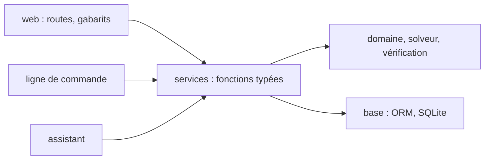

# Choix de conception

Ce document réunit les choix qui expliquent l'application telle qu'elle est :
son périmètre, sa pile technique, son modèle, ses règles de calcul et ses
limites. Il s'adresse à l'équipe et à tout développeur qui reprend le code. Un
choix se modifie ici, par une pull request, avant de modifier le code.

Principes généraux : simplicité et efficacité, tout réglage est configurable,
tous les cas réalistes d'une école d'ingénieurs sont pris en charge. L'école
ne fournit aucune donnée réelle : l'application fonctionne entièrement sur des
jeux fictifs générés ([`donnees-fictives.md`](donnees-fictives.md)).

## 1. Périmètre et usage

- Application web pour un responsable de scolarité **non informaticien** :
  vocabulaire de la scolarité, aucune notion de solveur visible, messages
  d'erreur qui disent ce qui s'est passé et quoi faire.
- La démonstration est l'application complète : un établissement entier
  (toutes les promotions, plusieurs campus), sans mode de démonstration ni
  placement de secours.
- Déployée sur un serveur (2 cœurs, 3,7 Go de mémoire, Python 3.14 sur le VPS),
  accessible par le web, **sans écran de connexion**. L'usage est celui d'une
  seule personne à la fois, mais rien dans le code ne suppose un seul
  utilisateur : tout passe par la base, sauf quelques états en mémoire perdus
  au redémarrage (suivi des calculs, mémoire des écrans, conversations de
  l'assistant, exécution des tests en cours), décrits dans
  [`architecture.md`](architecture.md).
- Un visiteur manipule librement l'application : aucun écran ne plante ni
  n'affiche d'erreur brute.
- Toutes les données sont **créables, modifiables et supprimables** dans
  l'interface. L'import de fichiers vient en complément.
- Classement des fonctionnalités. Obligatoire : saisie des référentiels,
  import CSV, règles d'un emploi du temps (section 6), génération, vues par
  groupe, enseignant et salle, message d'impossibilité, modification par
  formulaire, export CSV, jeu de données. Utile : historique des versions,
  impression, export iCal, tableau de bord, explication d'un échec,
  glisser-déposer. Optionnelle : réaménagement sur imprévu, pilotage en
  langage courant, authentification. L'état de chaque fonctionnalité est
  dans le [livret 1](livrets/1-specifications-fonctionnelles.md).

## 2. Pile technique

| Sujet | Choix |
|---|---|
| Langage | Python, `requires-python >= 3.11` |
| Solveur | OR-Tools CP-SAT (9.15 ou plus) |
| Base | SQLite via SQLAlchemy 2 (clés étrangères actives, mode WAL). Pas de migrations de schéma : la base se recrée et se repeuple par commande |
| Web | FastAPI, gabarits Jinja2, HTMX embarqué dans le dépôt, aucun outil Node |
| Ligne de commande | `python -m edt <commande>` (Typer) : toute fonctionnalité est aussi une commande |
| Tests | pytest ; ruff pour le format et le lint ; GitHub Actions sur chaque pull request |
| Déploiement | service systemd (uvicorn) derrière nginx, scripts de `deploy/` |

Architecture en couches (seule exception : les commandes d'administration
`init-db` et `jeu-minimal` appellent directement la couche base, voir
[`architecture.md`](architecture.md)) :

Une fonctionnalité existe d'abord comme **fonction de service typée**
(paramètres et retours explicites, sérialisables en JSON), puis comme route
web et comme commande. Les mêmes fonctions servent à l'assistant
conversationnel ([`assistant.md`](assistant.md)) et serviraient à une API
hébergée sans réécriture. Le détail est dans
[`architecture.md`](architecture.md).

## 3. Qualité, journalisation, erreurs

- **Rien n'échoue en silence.** Interdits : `except: pass`,
  `except Exception` sans journalisation ni relance, valeur de repli muette.
- Journalisation par le module `logging`, configurée en un seul endroit :
  console et fichier tournant `logs/edt.log`, plus un fichier par calcul dans
  `logs/generations/`. Chaque requête web porte un identifiant repris dans les
  journaux et dans la page d'erreur montrée à l'utilisateur.
- Une seule hiérarchie d'erreurs métier (`ErreurEDT` et ses sous-classes) :
  les services lèvent des erreurs métier, la couche web les traduit en
  message lisible, la ligne de commande en code de sortie non nul.
- Les données importées ne sont **jamais corrigées automatiquement** : ce qui
  ne respecte pas les règles est signalé.
- Tests ciblés : un test par règle, un test d'intégration par parcours, une
  banque de cas limites ([`banque-de-tests.md`](banque-de-tests.md)).
- Documentation : docstring sur chaque module et chaque fonction publique, un
  document de `docs/` par sous-système, diagramme de classes UML (Mermaid)
  tenu à jour ([`modele-donnees.md`](modele-donnees.md)).
- Code, commentaires, commits et documentation en **français**.

## 4. Modèle de données

Noms de tables en français, au singulier. Le détail des colonnes est dans
[`modele-donnees.md`](modele-donnees.md).

- **Année scolaire** et **semestre**, dates de début et de fin paramétrables.
- **Campus** et **matrice des trajets** entre campus (60 minutes par défaut,
  paramètre `trajet_defaut_min`). Nomenclature des salles : préfixe `N` pour
  Notre-Dame-des-Champs, `L` pour Issy, et des salles d'établissements
  voisins (par exemple `Stan301`) rattachées à leur propre site.
- **Salle** : code, campus, bâtiment, étage, capacité, type de salle,
  équipements, accessibilité (oui, non, inconnue). Unicité (code, campus).
- **Type de salle** et **équipement** : listes configurables.
- **Enseignant** : identifiant stable, nom, prénom, statut (permanent,
  vacataire, extérieur), maxima horaires facultatifs. Un enseignant inconnu à
  l'import est remplacé par un enseignant fictif propre à la matière, exclu
  des contraintes d'enseignant.
- **Groupe** : un arbre (promotion, classe, demi-groupe) plus des groupes
  transverses (langues par niveau, options, parcours) et des groupes
  **tiers-temps** pour les épreuves. Chaque groupe porte son effectif et
  l'indication « salle accessible requise ». Unicité (code, année).
- **Étudiant** (facultatif, fictif) et inscriptions aux groupes. Aucune
  donnée de santé, aucune donnée nominative réelle.
- **Conflit entre groupes** : deux groupes n'ont pas cours en même temps si
  l'un contient l'autre, s'ils sont déclarés chevauchants ou s'ils partagent
  un étudiant. Une seule fonction de service calcule cette relation ; le
  solveur et le vérificateur la consomment.
- **Matière** : code module (clé), libellé, promotion de rattachement.
- **Type de séance** : CM, TD, TP, projet, langue, DST, examen, autre. Liste
  configurable, avec « samedi autorisé » et un type de salle par défaut.
- **Grille horaire** : créneaux configurables (jour, début, fin,
  demi-journée). Par défaut : 8 h 30-10 h 30, 10 h 45-12 h 45,
  13 h 45-15 h 45 et 16 h 00-18 h 00 du lundi au vendredi ; deux créneaux le
  samedi matin.
- **Pause déjeuner** : paramètre `dejeuner_mode`, réglable dans l'écran
  « Générer » comme dans les paramètres, à trois valeurs : `fixe` (la plage
  12 h 45-13 h 45 reste libre pour tous), `libre` (chaque groupe et chaque
  enseignant garde une pause d'au moins N minutes dans une fenêtre, placée
  par le calcul), `aucun` (rien n'est réservé). Une règle personnalisée
  `PAUSE_DEJEUNER` donne un autre réglage à un groupe ou à un enseignant.
- **Indisponibilité** : d'un enseignant, d'une salle ou d'un groupe ;
  récurrente (jour et plage horaire) ou datée (plage de dates) ; toujours
  respectée. Une préférence horaire s'exprime par une règle personnalisée
  `CRENEAUX_INTERDITS` de niveau facultatif (le champ `poids` de la table
  n'est pas lu).
- **Jour fermé** : férié, vacances, examens, semaine spéciale ; portée
  globale ou limitée à un groupe et ses descendants. Calendrier français
  prérempli, fériés mobiles compris.
- **Besoin** (la demande) : matière, type de séance, groupes (1 à n),
  enseignants (0 à n), durée en minutes, exigences de salle (types acceptés,
  équipements, salle ou campus imposé), créneau imposé facultatif, et un mode
  de volume :
  - `par_semaine` : n séances chaque semaine active du semestre ;
  - `total` : n séances réparties régulièrement entre deux dates, avec un
    maximum par semaine ;
  - `ponctuel` : séance datée saisie à la main (examen, événement, semaine
    spéciale).
- **Version d'emploi du temps** : chaque génération crée une version
  (générée), un import d'emploi du temps existant crée une version
  (référence). Une seule version est active par semestre ; l'historique est
  conservé.
- **Séance hebdomadaire** : élément de la semaine type d'une version (besoin,
  jour, début et fin, salle, verrou, semaines actives).
- **Occurrence** (séance datée) : issue de la semaine type posée sur le
  calendrier, d'un replacement, d'une saisie manuelle ou d'un import ; statut
  planifiée, annulée, déplacée ou à programmer.
- **Calcul** : suivi d'une génération (état, durée, paramètres, niveaux des
  règles, message, fichier journal).
- **Paramètre** : réglages globaux typés (temps limite, poids de l'objectif,
  pause déjeuner, jours travaillés, etc.). `jours_travailles` est un ensemble
  de jours (lundi à vendredi par défaut) : le standard des jours de cours.
- **Règle personnalisée** ([`regles-personnalisees.md`](regles-personnalisees.md)) :
  elle appartient à une **année scolaire** (code unique dans l'année, par
  exemple « R007 ») ; type du catalogue (14 types), portée (établissement,
  groupe, enseignant, campus, type de séance, matière, besoin), paramètres,
  niveau, état (**proposée**, sans effet ; active ; inactive), période
  (année, semestre ou dates), origine (saisie, import, assistant, base,
  reprise). La création d'une année propose les règles de base et la reprise
  des règles actives de l'année précédente ; rien n'est imposé.
- **Provenance** des données importées : fichier, ligne, colonnes non
  reconnues.

## 5. Calendrier

- Le calcul produit **une semaine type par semestre**, puis la pose sur le
  calendrier réel du semestre. La démonstration couvre une année complète.
- Une séance hebdomadaire porte ses **semaines actives**. Deux séances aux
  semaines actives disjointes peuvent occuper le même créneau et la même
  ressource : le modèle est exact sur ce point, indispensable aux matières
  courtes du mode `total`.
- Mode `total` : la répartition sur les semaines est calculée avant la
  résolution, par une règle déterministe (régulière sur la fenêtre, dans la
  limite du maximum par semaine).
- Une séance datée qui tombe un **jour fermé** est **replacée
  automatiquement** pour préserver le volume. Si aucune place ne respecte les
  règles, elle passe « à programmer » et apparaît dans la page « Points à
  traiter » de l'onglet Générer.
- Les semaines spéciales reçoivent un planning saisi à la main (besoins
  ponctuels) ; une semaine entièrement fermée n'a pas de séances datées.
- Apprentis : seule leur semaine type « école » est gérée.
- Partiels : de la 3ᵉ à la 5ᵉ année ; représentés par des fermetures propres
  aux promotions concernées, des indisponibilités de salles et des besoins
  ponctuels (groupe tiers-temps dans une salle séparée).
- DST : 1ʳᵉ année le jeudi de 13 h 45 à 18 h, 2ᵉ année le lundi de 8 h à 12 h
  (créneau imposé). Un créneau imposé peut sortir de la grille ; il est alors
  signalé comme information, pas comme erreur.
- Heures en heure locale Europe/Paris, stockées sans fuseau.

## 6. Catalogue des contraintes

Les codes sont stables et **communs au vérificateur et au solveur**. Avant
chaque calcul, chaque règle reçoit un **niveau**
(`edt.domaine.contraintes.Niveau`) :

| Niveau | Pour le calcul | Une entorse constatée est |
|---|---|---|
| nécessaire | jamais enfreinte | une erreur |
| important | enfreinte seulement faute de choix ; chaque entorse pèse 1 000 dans l'objectif | un avertissement |
| facultatif | un souhait ; chaque entorse pèse 20 | une information |

Sept règles définissent le problème et restent toujours nécessaires :
`SALLE_UNIQUE`, `ENSEIGNANT_UNIQUE`, `GROUPE_UNIQUE`, `VERROU`, `JOUR_FERME`,
`VOLUME` et `REGLE` (chaque règle personnalisée porte son propre niveau). Par
défaut, `PAUSE`, `DEJEUNER`, `EQUIPEMENT` et `MAX_ENSEIGNANT` sont
importantes, les autres nécessaires. Les niveaux sont enregistrés avec le
calcul et appliqués ensuite à la vérification de la version produite.
L'interface ne permet pas d'ignorer une règle. La ligne de commande le permet
(`generer -d CODE`) ; la règle ignorée est alors tracée dans le résultat du
calcul. Aucune règle n'est jamais abandonnée automatiquement.

| Code | Règle |
|---|---|
| `SALLE_UNIQUE` | Une salle accueille une seule séance à la fois |
| `ENSEIGNANT_UNIQUE` | Un enseignant donne une seule séance à la fois |
| `GROUPE_UNIQUE` | Deux groupes en conflit n'ont pas cours en même temps |
| `CAMPUS_TRAJET` | Pour un groupe ou un enseignant, deux séances du même jour sur deux campus différents sont séparées d'au moins le temps de trajet (le déjeuner d'une heure suffit) |
| `ACCESSIBILITE` | Une séance dont un groupe requiert l'accessibilité a lieu dans une salle accessible (« inconnue » vaut « non », réglable) |
| `HORAIRES` | Séance dans la plage d'ouverture et sur un début de créneau de la grille, sauf créneau imposé |
| `JOURS` | Jours travaillés de l'établissement (paramètre `jours_travailles`) : un **standard** dont une règle personnalisée `JOURS_TRAVAILLES` peut s'écarter dans les deux sens, pour sa portée. La case « samedi autorisé » d'un type de séance est une exception implicite, qu'une règle explicite sur ce type remplace |
| `PAUSE` | 15 minutes entre deux séances consécutives d'une même personne |
| `DEJEUNER` | Selon le mode de la pause déjeuner : la plage fixe reste libre, ou chaque personne garde sa pause libre dans la fenêtre. En mode « pas de pause », la règle est sans objet (le vérificateur ne relève rien, le solveur ne la pose pas) : c'est un réglage choisi par l'utilisateur, pas un abandon automatique |
| `CAPACITE` | Capacité de la salle supérieure ou égale à la somme des effectifs |
| `TYPE_SALLE` | La salle est d'un type accepté par le besoin |
| `EQUIPEMENT` | La salle possède les équipements requis |
| `DISPO_ENSEIGNANT`, `DISPO_SALLE`, `DISPO_GROUPE` | Respect des indisponibilités |
| `MAX_ENSEIGNANT` | Maxima horaires de l'enseignant, s'ils sont renseignés |
| `VOLUME` | Toutes les séances demandées sont placées |
| `VERROU` | Une séance verrouillée reste à sa place |
| `JOUR_FERME` | Aucune séance datée un jour fermé pour les groupes concernés |
| `REGLE` | Règle personnalisée : chaque entorse porte ce code et le niveau de la règle. `JOURS`, `DEJEUNER` et `PAUSE` cèdent la place à la règle qui les remplace, pour sa portée |

Préférences (objectif à minimiser, actif par défaut) :
10 × trous des groupes + 5 × changements de campus + 2 × séances le samedi +
1 × créneaux extrêmes. Les poids sont des paramètres.

## 7. Vérificateur

- Fonctions Python pures, **indépendantes du solveur**, qui listent les
  anomalies d'un emploi du temps (semaine type ou séances datées) : aucune
  anomalie de gravité « erreur » signifie un emploi du temps valide.
- Il sert d'**oracle aux tests du solveur**, contrôle chaque solution du
  solveur avant son enregistrement, valide les modifications manuelles,
  audite un emploi du temps importé et alimente la page « Points à
  traiter ».
- Indicateurs calculés au même endroit : pourcentage de séances placées,
  nombre de conflits, taux d'utilisation des salles, changements de campus,
  trous.
- Détail : [`verification.md`](verification.md).

## 8. Solveur

- Résolution en deux phases : d'abord les horaires (jour, début et campus de
  chaque séance), puis les salles, horaires fixés. Les domaines de salles
  sont filtrés à l'avance (capacité, type, équipement, accessibilité,
  disponibilité) et les séances identiques sont ordonnées pour éviter les
  symétries. Détail : [`solveur.md`](solveur.md).
- L'objectif de qualité est **actif par défaut** : le calcul trouve d'abord
  un emploi du temps valide, puis l'améliore dans le temps restant ; un arrêt
  ou un temps dépassé conserve la meilleure solution trouvée. Le mode
  « première solution valide » se règle dans les paramètres
  (`objectif_actif`).
- Temps limite de 5 minutes, réglable jusqu'à 15 ; relance longue de
  15 minutes, réglable jusqu'à 30 ; au plus 8 fils de calcul, jamais plus que
  la machine n'a de cœurs (deux par défaut). Deux messages distincts :
  « impossible » (prouvé) et « pas trouvé dans le temps imparti ».
- **Tout ou rien** : sans solution, aucun emploi du temps partiel n'est
  enregistré.
- **Pré-vérifications** avant chaque calcul, par famille (charge des
  groupes, des enseignants, des types de salle, salles accessibles,
  contradictions entre verrous) : une impossibilité certaine refuse le
  calcul, une situation tendue est un avertissement.
- Les verrous sont des contraintes nécessaires. Des séances verrouillées qui
  se contredisent déjà font refuser le calcul avec leur liste, sauf si
  l'option qui les tolère est choisie.
- Un nouveau calcul part de la version active comme indice. « Proposer une
  autre solution » relance avec une nouvelle graine, sans indice.
- Mode déterministe (graine fixe, un seul fil) pour les tests ; plusieurs
  fils sinon.
- Calcul en arrière-plan (un fil), **un seul à la fois**, état interrogé
  chaque seconde, temps écoulé, bouton d'arrêt.
- Performance visée et vérifiée par les tests de charge (`perf`) : 200 séances
  en moins de 30 s, jeu « grand » en moins de 120 s par semestre.
- Le même moteur de **replacement daté** sert au replacement des jours
  fermés et sert de base au réaménagement sur imprévu (section 13).

## 9. Données fictives

- Générateur paramétrable à graine fixe, réaliste pour une école
  d'ingénieurs : cycle intégré et cycle ingénieur, apprentis, classes,
  demi-groupes, groupes transverses, groupe à salle accessible, groupes
  tiers-temps, enseignants permanents et vacataires avec indisponibilités,
  deux campus et un site voisin, salles typées et équipées, matières avec
  codes modules, besoins dans les trois modes de volume, DST, partiels,
  calendrier de l'année, règles personnalisées.
- Trois tailles : **petit** (une promotion réduite, pour les tests), **moyen**
  (une promotion complète), **grand** (établissement complet).
- Noms fictifs lisibles (« Mme Martin »).
- Détail : [`donnees-fictives.md`](donnees-fictives.md).

## 10. Import et export

- Format d'échange fixe, avec gabarit téléchargeable : un classeur XLSX à
  onglets ou un CSV par entité. Détection de l'encodage, du séparateur et de
  la marque d'ordre des octets. Le type de séance est une colonne
  obligatoire.
- Import **partiel avec rapport** ligne par ligne (les lignes valides entrent,
  les autres sont listées), simulation possible avant d'écrire ; un réimport
  met à jour par identifiant métier ; plusieurs fichiers acceptés, avec
  dédoublonnage. Taille d'un envoi : 20 Mo au plus.
- Trois modes pour un emploi du temps existant : référence, verrous, séances
  à replacer. Lecteur iCal : les séances datées sont importées telles
  quelles, les règles de récurrence sont développées en séances datées, hors
  vacances et jours fériés.
- Un enseignant inconnu devient l'enseignant fictif de la matière, une salle
  « à définir » est laissée au calcul, une séance d'un groupe inconnu est
  écartée et signalée dans le rapport. Les séances annulées ne comptent pas
  dans les besoins ; les événements spéciaux sont importés avec le type
  « autre », figés, hors des besoins. Une séance longue est une seule ligne.
- Aucun logiciel source n'est supposé : un format correspond à un adaptateur
  isolé.
- Exports : CSV, iCal, données de l'établissement (réimportables),
  impression par le navigateur.
- Disponible dans l'interface et en ligne de commande, par les mêmes
  fonctions. Détail : [`import-export.md`](import-export.md).

## 11. Interface

- Six onglets : Accueil, Données, Générer, Emploi du temps, Tests unitaires,
  Tests d'intégration. La page « Points à traiter » est rangée dans l'onglet
  Générer, qui affiche le nombre de points à traiter.
- Écrans d'édition pour toutes les entités : liste triable, recherche,
  formulaire, suppression avec confirmation.
- Écrans de configuration : calendrier, grille horaire, paramètres, règles
  personnalisées, import et export, chargement d'un jeu fictif, remise à
  zéro.
- Écran « Besoins » : c'est l'entrée du générateur.
- Lancement d'un calcul : pré-vérifications, niveau de chaque règle, mode de
  la pause déjeuner, suivi en direct, résultat ou explication de l'échec.
- Emploi du temps : vue **semaine** et vue **jour**, par groupe (de tout
  type), par enseignant et par salle ; semaine type et semaines datées avec
  navigation ; modification par formulaire dans un panneau latéral (créneau,
  salle parmi les salles compatibles), contrôlée par le vérificateur.
- Page « Points à traiter » (onglet Générer) : anomalies et séances « à
  programmer ».
- Supprimer un élément visé par des règles personnalisées : la confirmation
  liste ces règles et propose de les supprimer avec lui.
- Panneau de l'assistant conversationnel sur toutes les pages
  ([`assistant.md`](assistant.md)).
- Détail : [`interface.md`](interface.md).

## 12. Confidentialité

- Aucune donnée personnelle réelle dans le dépôt ni dans l'application : tous
  les jeux sont fictifs. Un fichier réel éventuel reste hors du dépôt.
- Aucune donnée de santé : l'accessibilité est une indication portée par un
  groupe.
- Aucun secret dans le dépôt : l'adresse du serveur et les clés de connexion
  sont lues dans des fichiers locaux non suivis
  ([`deploiement.md`](deploiement.md)).

## 13. Évolutions prévues

Ces fonctionnalités ne font pas partie de l'application ; l'architecture les
prépare.

- **Réaménagement sur imprévu** (absence d'un enseignant, salle indisponible
  sur des dates données) : des séances datées déplacées ou annulées,
  rattachées à l'imprévu, au-dessus de la semaine type qui reste la
  référence, en dérangeant le moins possible. Le moteur de replacement et
  `edt.services.instanciation.replacer_occurrences` en sont le point
  d'entrée.
- Authentification et rôles ; hébergement de plusieurs établissements.
- Glisser-déposer dans la grille.
- Alternance semaine A / semaine B et calendrier d'alternance des
  apprentis.
- Diagnostic fin d'une impossibilité (règles en cause).
- Calcul limité à une partie de l'établissement.
- Migrations de schéma.
