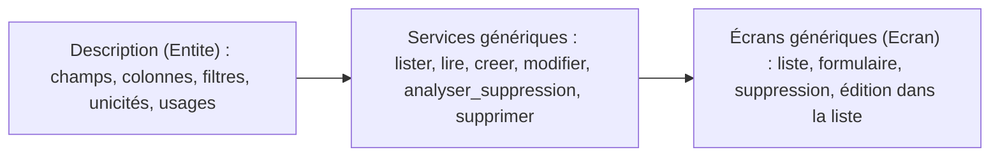

# Interface web

Ce document décrit l'interface web : ses principes, la navigation, la mise en
page commune, l'espace « Données » et son mécanisme générique, les onglets
Générer et Emploi du temps, la page des points à traiter, l'accueil, les cas
limites, la façon d'ajouter une vue et les onglets de tests. Il s'adresse aux
développeurs ; le mode d'emploi de
l'utilisateur est le [livret 3](livrets/3-guide-utilisateur.md). Le socle
(routes découvertes, `rendre`, `rediriger`, `SessionRequete`, erreurs) est
décrit dans [`architecture.md`](architecture.md).

## 1. Principes

L'utilisateur est un responsable de scolarité **non informaticien**.

- Vocabulaire de la scolarité : aucun terme de solveur ni de base de données
  à l'écran, un mot par notion (règle, séance, séance datée, groupe,
  campus).
- Une phrase d'explication en tête de chaque page.
- Aucune trace technique à l'écran : une erreur inattendue affiche la
  référence de l'incident, la trace va dans le journal.
- Erreurs de saisie sous le champ concerné, saisie conservée, statut 422.
- Une vérification qui n'a pas pu tourner est **dite**, jamais remplacée par
  une liste vide.
- Les écrans restent utilisables sans JavaScript (liens, formulaires, pages
  complètes) ; HTMX évite des rechargements.
- Les routes ne touchent pas l'ORM et n'appellent jamais `commit()` : elles
  lisent les paramètres, appellent un service et choisissent la page.

## 2. Navigation

La barre du haut porte **six onglets**, dans un ordre fixe : Accueil,
Données, Générer, Emploi du temps, Tests unitaires, Tests d'intégration.
Chaque écran se range dans un onglet par la `section` de son entrée de menu
(`edt/web/menu.py`, `ONGLETS`) :

| Onglet | Sections | Écrans |
|---|---|---|
| Accueil | (aucune) | `/` |
| Données | `SECTION_REFERENTIELS`, `SECTION_PLANIFICATION`, `SECTION_CONFIGURATION`, `SECTION_DONNEES` | établissement, besoins, règles et calendrier, import et export (dont l'établissement fictif), listes de référence |
| Générer | `SECTION_GENERER`, `SECTION_A_TRAITER` | `/calculs`, `/versions`, `/a-traiter` (« Points à traiter ») |
| Emploi du temps | `SECTION_EMPLOI_DU_TEMPS` | `/emploi-du-temps` |
| Tests unitaires | `SECTION_TESTS_UNITAIRES` | `/tests/unitaires` |
| Tests d'intégration | `SECTION_TESTS_INTEGRATION` | `/tests/integration` |

- L'`ordre` d'une entrée la place dans son onglet ; un onglet sans entrée
  n'est pas affiché ; son adresse est celle de sa première entrée.
- Un onglet de plusieurs entrées a une **sous-navigation** à gauche (une
  bande défilante sur un petit écran) et un **menu déroulant** au survol ou
  au clavier.
- Dans l'onglet Données, les entrées sont regroupées sous des titres
  (`GROUPE_ETABLISSEMENT`, `GROUPE_BESOINS`, `GROUPE_REGLES`,
  `GROUPE_IMPORT_EXPORT`, `GROUPE_JEUX`, `GROUPE_LISTES`, dans cet ordre).
  Une entrée choisit un autre groupe par son champ `groupe` : « Types de
  salle », « Équipements » et « Types de séance » vont dans « Listes de
  référence » ; « Établissement fictif » reste dans « Import et export », et
  le groupe « Jeux de données » n'a plus d'entrée. Dans l'onglet Générer, la
  section À traiter (page « Points à traiter ») rejoint le groupe « Générer ».
- Une entrée dont la section n'est rangée dans aucun onglet va dans l'onglet
  Données, sous un groupe portant le nom de sa section, et un avertissement
  est journalisé.
- Un onglet peut afficher un **compteur** chargé par HTMX :
  `COMPTEURS_ONGLETS` associe à l'onglet l'adresse d'un fragment
  (« Générer » → `/a-traiter/compteur`, le nombre de points à traiter). Sans
  JavaScript, l'onglet reste un lien simple ; si le fragment échoue, l'échec
  est noté dans la console, sans bandeau d'erreur.
- Un onglet peut avoir sa **couleur** : `CLASSES_ONGLETS` lui associe une
  classe de `app.css` (turquoise foncé pour « Tests unitaires », violet pour
  « Tests d'intégration »), visible sur toutes les pages.
- L'onglet actif est celui dont une entrée correspond à l'adresse affichée
  (l'entrée `/salles` couvre aussi `/salles/12`).
- Sur un écran étroit, les six onglets passent sur deux rangées : aucun
  n'est caché.

```python
# src/edt/web/routes/calculs.py
MENU = [
    EntreeMenu("Générer un emploi du temps", "/calculs", section=SECTION_GENERER, ordre=250),
    EntreeMenu("Historique et versions", "/versions", section=SECTION_GENERER, ordre=260),
]
```

`EntreeMenu(libelle, url, section="", ordre=100, groupe="")`.

## 3. Mise en page commune

### Gabarit de base (`templates/base.html`)

| Bloc | Rôle |
|---|---|
| `titre` | titre de la page (onglet du navigateur et titre principal) |
| `actions` | boutons à droite du titre |
| `contenu` | corps de la page |
| `styles` | feuilles de style propres à l'écran |
| `scripts` | scripts propres à l'écran, en fin de page |

Le gabarit pose la barre et ses onglets, la sous-navigation, la zone de
messages `#messages`, le pied de page (nom et version de l'application ;
l'identifiant de la requête n'apparaît que sur les pages d'erreur) et
le panneau de l'assistant (section 10). La classe `js` est ajoutée à
`<html>` quand JavaScript fonctionne.

### Macros et styles

- `templates/macros.html` (``) : `message`,
  `messages`, `etiquette`, `couleur`, `cellule`, `tableau`, `formulaire`,
  `champ` (libellé, aide, erreur liée par `aria-describedby`, listes de cases
  filtrables), `bouton_suppression`, `bouton_action`, `pagination`.
- `templates/donnees/_ui.html` : macros des écrans de données (`champ`,
  `rubriques`, `barre_liste`, `cellule`, `retour`, `raisons`,
  `regles_touchees`).
- `templates/edt/_ui.html` : macros des écrans de l'emploi du temps
  (`ressources` et `script` chargent `edt.css` et `edt.js`, `anomalies`,
  `indicateurs`, `choix_semestre`, `perimetre`).
- `static/css/app.css` : aucune couleur en dur dans un écran, les variables
  (`--marque`, `--succes`, `--attention`, `--erreur`, `--bordure`…) sont dans
  `:root` ; classes réutilisables pour les cartes, tableaux (défilement
  horizontal sur petit écran, colonne d'actions toujours visible),
  formulaires, boutons, étiquettes, arbre et matrice.
- `static/css/edt.css` : grille de l'emploi du temps, panneau latéral,
  feuille d'impression.

### Comportements communs (`static/js/app.js`)

| Attribut | Effet |
|---|---|
| `data-confirmation="..."` sur un formulaire | confirmation avant l'envoi |
| `data-visible-si="champ:v1,v2"` sur un bloc | bloc affiché, et envoyé, seulement si `champ` vaut v1 ou v2 ; plusieurs conditions séparées par `;` doivent toutes tenir |
| `data-attente="..."` sur un formulaire | boutons désactivés et texte d'attente pendant l'envoi |
| `.choix-multiple` | filtre au clavier d'une liste de cases |
| `data-arbre` et `<details data-noeud>` | arbre repliable, état conservé d'une page à l'autre |
| `data-erreur-silencieuse` sur un élément HTMX accessoire | son échec est noté dans la console, sans bandeau |
| erreurs HTMX | le fragment d'erreur renvoyé s'affiche dans `#messages` |

Ces comportements s'appliquent aussi aux fragments chargés par HTMX.
`static/js/edt.js` ajoute la recherche rapide des sélecteurs (sans tenir
compte des accents) et l'envoi automatique des choix de l'emploi du temps.

## 4. L'espace « Données »

### Mécanisme générique

Chaque entité est décrite **une fois**, de façon déclarative, dans
`edt.services.referentiels` ; services et écrans génériques s'en déduisent.



Ajouter une entité :

1. dans le module de sa famille (`lieux`, `personnes`, `enseignements`,
   `calendrier`), déclarer un `Entite` : champs (`Champ`, avec leur
   `TypeChamp`), colonnes de liste (`Colonne`), tri par défaut, recherche,
   unicités (`Unicite`, contrôlées avant l'écriture), usages qui empêchent
   une suppression (`Decompte`), conséquences d'une suppression, crochets
   (`valider`, `preparer`, `apres_ecriture`, `apres_creation`, `analyser`) ;
2. l'ajouter à `ENTITES` dans `catalogue.py` ;
3. déclarer son écran dans un module `edt/web/routes/donnees_*.py` :

   ```python
   ECRAN = Ecran(EQUIPEMENT, "/equipements", introduction="...", edition_en_ligne=True)
   routeur.include_router(routeur_ecran(ECRAN))
   MENU = [EntreeMenu("Équipements", "/equipements", section=SECTION_REFERENTIELS, ordre=130)]
   ```

`routeur_ecran(ecran)` donne la liste (recherche `q`, `tri`, `sens`, `page`,
un paramètre par filtre), le formulaire d'ajout (prérempli par les paramètres
d'adresse qui portent le nom d'un champ), la création, la modification, la
confirmation et la suppression, la ligne seule et son édition sur place.

Comportements garantis par le mécanisme :

- **Suppression** : avec JavaScript, la ligne se remplace par une ligne de
  confirmation qui dit ce que la suppression emportera, ou pourquoi elle est
  refusée, avec un lien vers les éléments qui bloquent ; sans JavaScript, une
  page de confirmation fait la même chose.
- **Pendant un calcul, aucune suppression** : un calcul enregistre à sa fin
  des séances qui pointent vers les données lues à son lancement.
  `analyser_suppression` refuse donc toute suppression pendant un calcul,
  avec un lien vers son suivi ; seules les règles personnalisées, que le
  calcul copie à son lancement, restent supprimables.
- **Ce qui vient du navigateur** : une adresse de retour n'est suivie que si
  elle reste dans l'écran ; un nombre est lu en chiffres ASCII et borné ; un
  identifiant hors bornes donne « introuvable » (404) ; un fragment demandé
  sans HTMX renvoie (303) vers sa page entière.
- **Listes** : un filtre à valeur par défaut (l'année ou le semestre en
  cours) est rappelé dans le résumé ; une liste vide invite à ajouter un
  élément ou à effacer la recherche ; avec HTMX, recherche, filtres, tri et
  pagination ne remplacent que la zone de liste et l'adresse suit.
- **Retour** : après un enregistrement ou une suppression, l'utilisateur
  revient sur la liste d'où il venait (recherche, filtres, tri et page
  compris).
- **Bornes** : entiers bornés par le champ puis par ce que la base sait
  enregistrer ; texte libre borné à 5 000 caractères, dans le navigateur
  comme sur le serveur.

Les services de `edt.services.referentiels` (`lister`, `lire`, `creer`,
`modifier`, `analyser_suppression`, `supprimer`, `options`, `decrire`) ne
valident pas la transaction et rendent des valeurs sérialisables ; une
saisie refusée lève `ErreurSaisie`, dont `champs` donne le message de chaque
champ fautif.

### Écrans

| Groupe | Adresses | Contenu |
|---|---|---|
| Établissement | `/campus`, `/salles`, `/enseignants`, `/groupes` (et `/groupes/arbre`), `/etudiants`, `/matieres` | campus et matrice des trajets, salles (filtres campus, type, accessibilité), enseignants, arbre des groupes repliable, étudiants fictifs et inscriptions, matières |
| Besoins et disponibilités | `/besoins`, `/indisponibilites` | besoins : filtres, ajout rapide, duplication, formulaire selon le mode de volume, charge hebdomadaire des groupes ; indisponibilités récurrentes ou datées |
| Règles et calendrier | `/calendrier`, `/regles`, `/grille`, `/parametres` | années, semestres, jours fermés et fériés ; règles personnalisées ; créneaux de la grille ; paramètres construits depuis `Parametres` |
| Import et export | `/import`, `/export`, `/jeux` | import simulé puis appliqué, rapport ; exports ([`import-export.md`](import-export.md)) ; « Établissement fictif » : chargement d'un établissement fictif (petit, moyen, grand, numéro de variante), remise à zéro |
| Listes de référence | `/types-salle`, `/equipements`, `/types-seance` | listes configurables : types de salle, équipements, types de séance |

- **Paramètres** : chaque paramètre devient un champ selon son type (nombre,
  heure, case, liste de choix, cases des jours) ; les champs utiles à un seul
  mode de la pause déjeuner sont masqués selon le mode. Pendant un calcul,
  tout enregistrement est refusé (409, saisie conservée) : le calcul relit
  les paramètres pour contrôler sa solution.
- **Établissement fictif** : un chargement dans une base non vide et toute remise
  à zéro exigent une confirmation qui liste ce qui sera effacé ; refusés
  pendant un calcul ; une seule de ces opérations à la fois, une page
  demandée pendant ce temps reçoit « base occupée, réessayer ».
- **Calendrier** : la création d'une année propose ses règles de base et la
  reprise des règles de l'année précédente, en état « proposée ».

### Règles personnalisées (`/regles`)

L'écran ne parle qu'au service `edt.services.regles` ; le formulaire est
construit par `edt.web.donnees.regles` depuis `CATALOGUE_TYPES`. Rien n'est
propre à un type dans la couche web : un type ajouté au catalogue a son
formulaire sans autre code.

- **Liste** : une année scolaire à la fois ; filtres par état, type, niveau,
  origine, portée et groupe (un groupe montre aussi les règles héritées de
  ses ancêtres) ; recherche sans tenir compte des accents. Une règle
  proposée est mise en évidence, avec ses actions « activer » et « écarter » ;
  un bandeau compte les règles proposées de l'année et permet de toutes les
  confirmer.
- **Ajout guidé** : d'abord le choix du type (une carte par type, avec ses
  exemples de phrases), puis le formulaire en trois rubriques : portée
  (natures admises par le type), paramètres (un champ par `ChampRegle`),
  application (niveau, période, commentaire).
- **Aperçu** : à chaque changement, le brouillon passe par `valider` et la
  phrase de la règle s'affiche telle qu'elle sera enregistrée, ou la liste de
  ce qui reste à corriger. L'aperçu est porté par une section du formulaire,
  pas par le formulaire lui-même : HTMX n'enverrait rien tant qu'un champ
  requis est vide.
- **Erreurs** : les erreurs du service (`ErreurSaisie.erreurs`, par chemin
  JSON) reviennent sous le champ concerné ; aucune n'est perdue.

**Supprimer une cible visée par des règles.** Supprimer un groupe, un
enseignant, un campus, une salle, un type de séance, une matière, un besoin
ou un semestre liste d'abord les règles touchées et ce qu'il leur arrivera
(supprimée, ou l'élément retiré de ses paramètres). La confirmation supprime
l'élément et ses règles dans une seule transaction, une ligne de journal par
règle. Si la liste des règles a changé entre l'affichage et la confirmation,
rien n'est supprimé et la page le dit. Ce calcul est fait par
`edt.services.referentiels.regles_cibles`.

## 5. Onglet « Générer »

| Adresse | Rôle |
|---|---|
| `GET /calculs?semestre_id=` | récapitulatif, vérifications préalables, règles et niveaux, règles personnalisées, pause déjeuner, options, lancement |
| `GET /calculs/verifications` | fragment des vérifications, recalculé quand un niveau change |
| `POST /calculs` | lit les niveaux, enregistre la pause déjeuner si elle a changé, lance le calcul et redirige vers son suivi |
| `GET /calculs/{id}`, `GET /calculs/{id}/etat` | suivi puis résultat ; le fragment d'état est interrogé chaque seconde tant que le calcul tourne |
| `POST /calculs/{id}/arreter`, `POST /calculs/{id}/relancer` | arrêt ; relance plus longue ou autre solution |
| `GET /versions?semestre_id=` | historique des calculs et des versions |
| `POST /versions/{id}/activer`, `POST /versions/{id}/supprimer` | activation ; suppression (refusée pour la version active) |

- **Récapitulatif** : besoins, séances de la semaine type, groupes,
  enseignants et salles concernés, lus dans l'instantané du semestre comme
  le calcul.
- **Vérifications préalables** (`pre_verifier_semestre`) : groupées par
  gravité. Une erreur empêche de lancer (la page est réaffichée en 409 avec
  les choix de l'utilisateur) ; les avertissements sont comptés et
  dépliables. Elles reçoivent les niveaux choisis.
- **Règles et niveaux** : une ligne par règle du catalogue ; pour une règle
  modifiable, un choix entre nécessaire, important et facultatif, le niveau
  par défaut signalé ; les règles qui définissent le problème sont affichées
  « toujours nécessaires », sans choix. Préremplissage : les niveaux du
  dernier calcul du semestre, sinon ceux du catalogue. Un choix invalide
  réaffiche la page en 422, sans rien lancer.
- **Règles personnalisées** : les règles actives de l'année qui recoupent le
  semestre, chacune avec un choix de niveau et une case pour l'ignorer le
  temps d'un calcul (jamais préremplie). Au-delà de vingt règles, elles sont
  regroupées par type et repliées. Une règle créée ou activée après un calcul
  s'applique à son propre niveau lors d'une relance, et le message le dit.
- **Pause déjeuner** : trois choix (horaires déterminés, pause libre bornée,
  pas de pause, champ `dejeuner`), préremplis depuis les paramètres ; les
  heures et la durée ne sont visibles que pour les modes qui les utilisent.
  Au lancement, un choix différent des paramètres est enregistré dans sa
  propre transaction, pour que les vérifications, le calcul et les calculs
  suivants le voient. Une saisie refusée réaffiche la page en 422 sans rien
  enregistrer ni lancer.
- **Options** : durée de recherche (les deux durées affichées sont lues dans
  les paramètres `temps_limite_s` et `temps_limite_long_s`), recherche d'un
  emploi du temps plus confortable (optimisation, cochée par défaut),
  proposition d'une autre solution (nouvelle graine, sans partir de la
  version active).
- **Un seul calcul à la fois** : si un calcul tourne, `/calculs` montre son
  suivi ; un second lancement mène au suivi du calcul en cours.
- **Résultat** : succès (séances placées, bilan des séances datées, liens
  vers l'emploi du temps et « Points à traiter », indicateurs, qualité) ; arrêté
  avec une solution (meilleure solution conservée, version enregistrée) ;
  refusé par les vérifications préalables (liste des points bloquants) ;
  impossible (prouvé) ; pas trouvé dans le temps imparti (proposition de
  relance plus longue) ; erreur (numéro du calcul et fichier journal, jamais
  de trace). Dans tous les cas, les avertissements du calcul sont comptés et
  dépliables, et seuls les niveaux qui s'écartent du défaut sont rappelés.

## 6. Onglet « Emploi du temps »

Paramètres de `GET /emploi-du-temps` : `semestre_id`, `version_id` (la
version active par défaut), au plus une cible (`groupe_id`, `enseignant_id`,
`salle_id`, ou `cible=groupe:12`), `couche` (`hebdo` ou `date`), `affichage`
(`semaine` ou `jour`), `date`, `jour`, `seance` (`h<id>` pour une séance de
la semaine type, `o<id>` pour une séance datée) pour mettre une séance en
évidence et ouvrir son panneau, `etendu` pour la vue d'un groupe.

- **Ouverture** : sans cible dans l'adresse, la page s'ouvre sur la dernière
  cible consultée (témoin `edt_derniere_cible`), sinon sur la première classe
  de l'année. Une cible inconnue est remplacée par la première classe, avec
  un message.
- **Sélecteurs** : semestre, version, « pour qui » (groupes par nature,
  enseignants, salles par campus) avec recherche rapide.
- **Trois affichages** : semaine type ; semaine datée (navigation, saut à
  une date, jours fermés grisés avec leur libellé, séances annulées barrées,
  déplacées en pointillés, séances « à programmer » listées sous la grille) ;
  jour.
- **Colonnes** : les jours travaillés de l'établissement, plus tout jour où
  tombe une séance affichée (samedi ouvert par une règle ou un type de
  séance).
- **Vue d'un groupe** : restreinte (le groupe et ses ascendants, ce que
  suivent tous ses étudiants ; défaut d'une promotion, d'une classe, d'un
  groupe transverse) ou étendue (en plus ses descendants et les groupes qui
  partagent une partie de ses étudiants, hachurés ; défaut d'un demi-groupe).
  Un bandeau dit ce qui est affiché et ce qui ne l'est pas, et propose la
  bascule.
- **Bande du déjeuner** : celle de la personne affichée, d'après
  `Instantane.reglages` : la plage réservée en horaires déterminés, la
  fenêtre en pause libre, rien sans pause ; une valeur venue d'une règle la
  nomme.
- **Bloc** : horaire, matière, type, groupes, enseignants, salle ; couleur
  stable par matière et liseré de la couleur du type de séance ; cadenas si
  la séance est verrouillée ; marque colorée selon la gravité de ses
  anomalies ; mention d'une séance qui n'a pas lieu chaque semaine.
- **Panneau latéral** (clic sur un bloc ; sans JavaScript, la même page avec
  `seance=`) : détail, exigences de salle, anomalies de la séance, puis
  formulaire. Jour et heure parmi les débuts de la grille et les jours permis
  de la séance ; salle parmi les **salles compatibles**, libres d'abord, les
  occupées signalées avec la séance qui les occupe.
- **Enregistrement** : `verifier_modification` est appelé avant toute
  écriture. Une entorse à une règle nécessaire refuse le déplacement et
  s'affiche en phrases ; une entorse à une règle importante ou facultative
  accompagne le message de succès. Une retouche applique les mêmes règles,
  aux mêmes niveaux, que le calcul de la version. Après un déplacement, les
  séances datées de la version sont recalculées.
- **Verrou** : verrouiller ou déverrouiller une séance.
- **Séance datée** : déplacer cette séance seulement (date initiale
  conservée), l'annuler avec un motif, programmer une séance « à
  programmer ». Une retouche prend l'origine « saisie manuelle ».
- **Recalculer les séances datées** : réapplique la semaine type, conserve
  les retouches manuelles et le dit avant d'agir. Les séances datées
  importées ne se recalculent jamais depuis la semaine type (elles seraient
  doublées) : l'écran l'explique au lieu de proposer le bouton.
- **Impression** : la feuille d'impression masque menus, sélecteurs et
  panneau et imprime la grille en A4 paysage, avec ses couleurs et un titre.
- **Exports** : `/export/emploi-du-temps.csv` et `/export/emploi-du-temps.ics`
  pour la version, la couche et la cible affichées.

## 7. Page « Points à traiter » (onglet Générer)

`GET /a-traiter` (filtre `semestre_id` facultatif) : pour la version active
de chaque semestre, les anomalies de la semaine type puis des séances
datées, regroupées par gravité puis par règle (100 lignes au plus par
règle, le total restant affiché), puis les séances « à programmer » avec
leur raison. Chaque ligne mène à l'emploi du temps de la ressource
concernée, la séance mise en évidence. Une anomalie d'une règle
personnalisée porte le code de la règle en lien vers elle ; une anomalie
d'une règle importante ou facultative porte son niveau.

**Nombre de points à traiter** : une seule définition, `ATraiter.total`,
reprise par la page, la pastille de l'onglet Générer et l'accueil. Il compte les
erreurs et les avertissements, sur la semaine type et les séances datées,
et chaque séance « à programmer » une fois.

Une version calculée en ligne de commande avec des règles ignorées
(`generer -d CODE`) est vérifiée sur toutes les règles ; les écarts aux
règles ignorées sont listés à part et ne comptent pas comme points à
traiter.

## 8. Accueil

`GET /` montre ce dont l'utilisateur a besoin pour avancer, **sans
statistiques**, pour le semestre du jour :

1. **Prochaine étape** : une phrase et le lien vers l'écran qui y mène.
2. **Emploi du temps du semestre** : le calcul en cours, ou la version
   active et ses points à traiter, ou l'absence d'emploi du temps.
3. **Dernier calcul**, seulement s'il s'est terminé sans emploi du temps
   (impossible, refusé, temps dépassé, arrêté, erreur).
4. **État de la base**, seulement en cas de problème (base inaccessible,
   schéma périmé, base non initialisée, écritures refusées) ou de base vide,
   avec la cause et le remède.

| Situation | Prochaine étape |
|---|---|
| base vide | `/jeux` (charger un établissement fictif), ou `/import` |
| salles ou groupes manquants | `/salles` ou `/groupes` |
| calcul en cours | `/calculs/{id}` |
| aucun besoin pour le semestre | `/besoins` |
| pas de version | `/calculs?semestre_id=` (ou le dernier calcul en échec) |
| anomalies ou séances à programmer | `/a-traiter?semestre_id=` |
| sinon | `/emploi-du-temps?version_id=` |

`/sante` rend l'état de l'application en JSON (base accessible,
initialisée, inscriptible, écarts de schéma) pour la supervision ; toute
page GET répond aussi à HEAD, sans corps (`IntergicielHead`).

## 9. Fichiers des écrans de l'emploi du temps

| Fichier (`src/edt/services/emploi_du_temps/`) | Rôle |
|---|---|
| `calculs.py` | préparation, lancement et résultat d'un calcul |
| `vues.py` | séances d'une vue (version, cible, couche, période) |
| `disposition.py` | position des blocs dans la grille (fonction pure) |
| `modifications.py` | salles compatibles, déplacement vérifié, verrou, séances datées |
| `versions.py` | semestres, versions, historique, activation, suppression |
| `anomalies.py`, `compteur.py` | la page « Points à traiter » et son compteur |
| `tableau_de_bord.py` | ce que l'accueil affiche |
| `regles_personnalisees.py` | règles personnalisées sur ces écrans |
| `presentation.py` | mises en forme françaises (durées, semaines, couleur d'une matière) |
| `identifiants.py` | identifiants reçus (adresse, formulaire, témoin) vérifiés avant la base |
| `memoire.py`, `prechauffage.py` | mémoire des résultats coûteux et recalcul en arrière-plan |
| `raccords.py` | seul point d'appel des pré-vérifications, du vérificateur et de l'instanciation |

Routes : `web/routes/calculs.py`, `emploi_du_temps.py`, `a_traiter.py`,
`accueil.py` ; gabarits : `web/templates/edt/`.

## 10. Panneau de l'assistant

Un bouton fixe, présent sur toutes les pages, ouvre le panneau de
l'assistant conversationnel, qui recouvre la page sans la décaler. Son
fonctionnement, ses garde-fous et ses limites sont décrits dans
[`assistant.md`](assistant.md).

## 11. Performance et mémoire

Les écrans de consultation passent par `memoire.memoriser` : la
vérification d'une version, les pré-vérifications et le récapitulatif d'un
semestre sont gardés avec une **empreinte** de la base (fichier SQLite et son
journal, versions actives, agrégats sur leurs séances). Toute écriture
validée l'invalide ; le résultat est recalculé une fois, puis servi depuis la
mémoire. Les modifications vérifient toujours sans mémoire, dans leur
transaction. Après un calcul réussi ou l'activation d'une version,
`prechauffage.lancer` refait ces calculs dans un fil d'arrière-plan unique.

Sur le jeu moyen, une fois la mémoire remplie, l'accueil, Générer, l'emploi
du temps d'une classe, Points à traiter et la liste des besoins répondent chacun en
moins de 0,3 s sur un poste de développement. Le premier affichage après une
écriture faite hors de ces écrans (calcul en ligne de commande, import) paie
le chargement de l'instantané et la vérification.

## 12. Disposition des blocs

`disposition.disposer(plages, ouverture, fermeture)` reçoit des
`Plage(cle, colonne, debut, fin)` (minutes depuis minuit, colonne = jour) et
renvoie l'axe et une `Position` par clé, en pourcentages :

1. **Axe** : de `min(ouverture, débuts)` à `max(fermeture, fins)`, arrondi à
   l'heure pleine. Un DST de 8 h à 12 h avec une grille qui ouvre à 8 h 30
   élargit l'axe à 8 h.
2. **Grappes** : dans une colonne, les plages triées par début sont
   regroupées tant qu'elles recoupent la grappe en cours (plages
   semi-ouvertes).
3. **Voies** : chaque plage prend la première voie libre de sa grappe, sinon
   une nouvelle ; la grappe est découpée en colonnes de même largeur.
4. **Élargissement** : un bloc s'étend vers la droite sur les voies voisines
   libres pendant toute sa durée.

Deux demi-groupes en TP au même moment occupent chacun la moitié de la
colonne. Une colonne est au moins aussi large que son plus grand nombre de
séances côte à côte (la grille défile), et un bloc étroit ne garde que
matière, groupes et salle. Le calcul est testé seul
(`tests/unitaires/web_edt/test_disposition.py`).

## 13. Cas limites

Aucune adresse de l'interface ne répond par une erreur 500 sur un chemin
normal. Les tests de cas limites des écrans (marqueur `cas_limite`, docstring
« Cas : … Risque : … ») sont rangés avec leur écran ; `test_cas_limites.py`
réunit ceux qui traversent plusieurs écrans :

```sh
python -m pytest -m cas_limite tests/unitaires/web_donnees tests/integration/web_donnees
python -m pytest -m cas_limite tests/unitaires/web_edt tests/integration/web_edt
```

- **Identifiants hors bornes ou inconnus** (lien mal copié, `-1`, vingt
  chiffres) : « introuvable » (404). Dans l'adresse de la grille, une cible
  hors bornes affiche la première classe en le disant ; une séance
  introuvable ouvre la page sans panneau, en le disant.
- **Nombres écrits dans un texte** (`seance=h12`, `cible=groupe:12`,
  champs de formulaire) : chiffres ASCII seulement, 30 chiffres significatifs
  au plus (`entier_ecrit`) ; au-delà, « illisible » ou « hors bornes », jamais
  une exception. Une saisie recopiée dans un message est coupée à
  40 caractères.
- **En-tête `HX-Current-URL` illisible** : ignoré et journalisé ; l'adresse de
  retour par défaut est utilisée.
- **Paramètre vide** (`?semestre_id=`) : vaut « non précisé ».
- **Témoin de dernière cible** illisible : ignoré, journalisé, remplacé.
- **Fragment ouvert sans HTMX** (suivi d'un calcul, vérifications, panneau
  d'une séance, compteur, ligne d'une liste) : redirection vers la page
  complète (303).
- **Textes longs** : motif d'annulation et commentaire d'une règle bornés à
  2 000 caractères, texte libre des données à 5 000, dans le navigateur
  comme sur le serveur.
- **Autre écrivain** (import ou chargement de jeu dans un autre onglet,
  commande sur le serveur) : une écriture attend son tour jusqu'au délai de
  verrou, puis « base occupée » (503) sans rien changer ; les pages restent
  servies pendant ce temps.
- **Arrêter un calcul déjà terminé** (deux onglets) : le message dit qu'il
  n'y a rien à arrêter.
- **Données vides** : une version sans séance s'affiche, se liste et
  s'exporte ; un semestre sans grille laisse les écrans ouverts.
- **Filtres inconnus** (`couche`, `affichage`, deux cibles à la fois,
  `cible=bureau:3`) : page « saisie invalide » (422) qui nomme le paramètre.

## 14. Ajouter une vue

Exemple : une vue « par campus ».

1. **Service** : ajouter `CAMPUS = "campus"` à `vues.NatureCible`, sa clause
   dans `vues._filtre_cible` (les séances dont la salle est sur ce campus),
   son titre dans `_titre_cible` et ses options dans `options_cibles`.
   `construire_vue` fait le reste : lecture limitée à la période,
   disposition, anomalies.
2. **Route** : accepter `campus_id` dans `emploi_du_temps.page` et
   `Cible.depuis`, et l'ajouter aux paramètres d'export.
3. **Test** : un cas de plus dans
   `test_trois_affichages_pour_un_groupe_un_enseignant_une_salle`.

Pour un nouvel *affichage* (un mois, par exemple), ajouter un membre à
`Affichage`, calculer la période et les colonnes dans `construire_vue`, et
réutiliser `disposer` : il ne connaît que des colonnes et des minutes.

## 15. Onglets « Tests unitaires » et « Tests d'intégration »

Les deux familles de tests du projet (voir [`tests/README.md`](../tests/README.md))
se lancent depuis l'application, sans la quitter. Chaque page s'ouvre sur le
bloc « Comment sont organisés ces tests » : deux ou trois phrases et un
schéma SVG dessiné dans la page (`templates/tests/_schema_*.html`, avec titre
et description pour les lecteurs d'écran). Viennent ensuite le résumé de la
famille (réussis, échecs, ignorés, jamais lancés, date de la dernière
exécution complète, bouton « Lancer tous les … »), le suivi de l'exécution,
puis chaque composant (replié, déplié d'office s'il contient un échec ou un
test en cours), ses fichiers et ses tests.

| Adresse | Rôle |
|---|---|
| `GET /tests/unitaires`, `GET /tests/integration` | page d'une famille (`GET /tests` mène à la première) |
| `POST /tests/{famille}/lancer` | champ `cible` : `famille`, `composant:<nom>`, `fichier:<chemin>` ou `test:<clé>` |
| `GET /tests/{famille}/suivi?execution=…&depuis=N` | fragment interrogé chaque seconde pendant l'exécution |
| `POST /tests/arreter` | arrêt de l'exécution en cours |
| `GET /tests/journal` | sortie complète de pytest pour la dernière exécution (texte) |

- **Un test** est une fonction de test : ses cas paramétrés sont lancés
  ensemble et regroupés (échec si l'un échoue). Chaque ligne montre son état
  (réussi, échec, ignoré avec la raison, jamais lancé, en cours, en
  attente), sa durée, la date de sa dernière exécution et, pour un échec, le
  message de l'assertion dans un bloc replié.
- **Suivi en direct** : même mécanique que le suivi d'un calcul. Le fragment
  de suivi se redemande chaque seconde ; il renvoie l'avancement (tests
  terminés sur le total, réussis, échecs) et, par `hx-swap-oob`, les lignes
  des tests terminés depuis le compte précédent (`depuis`) et les résumés de
  leur fichier, de leur composant et de la famille. Une exécution que le
  serveur ne connaît plus (redémarrage) fait recharger la page
  (`HX-Refresh`).
- **Garde-fous** : une exécution à la fois (un second envoi mène au suivi en
  cours, sans erreur), refus pendant un calcul d'emploi du temps, durée
  maximale, tests de charge exclus des lancements par groupe (ils se lancent
  un par un), lancement désactivable (`EDT_TESTS_LANCEMENT=non`) ; dossier
  `tests` absent, pytest absent ou fichier de résultats illisible donnent un
  message, jamais une erreur.
- **Où vit la logique** : `edt.services.banc_tests` (catalogue lu par `ast`,
  exécution dans un sous-processus pytest, greffon, résultats, tableau d'une
  famille) ; la commande `python -m edt tests` passe par le même service.
  Résultats : `<EDT_LOG_DIR>/tests/resultats.json`, hors de la base, que le
  chargement d'un établissement fictif remet à zéro.
- **Couleurs** : variables `--tests-unitaires` et `--tests-integration` de
  `app.css` (onglets), reprises par `static/css/tests.css` (filet du titre,
  bandeau, boutons, schéma).

Fichiers : `web/routes/tests.py`, `web/templates/tests/`,
`web/static/css/tests.css`.
