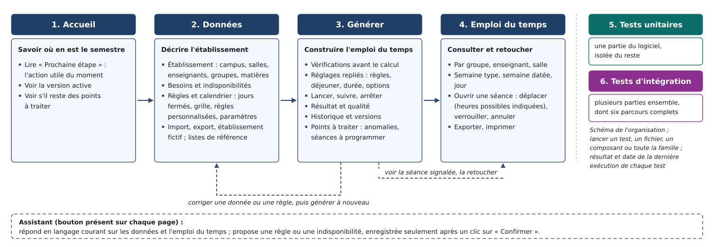
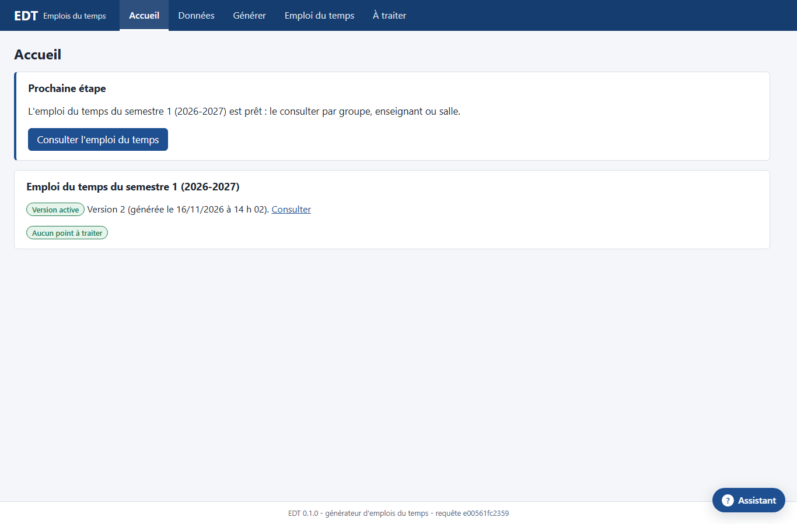
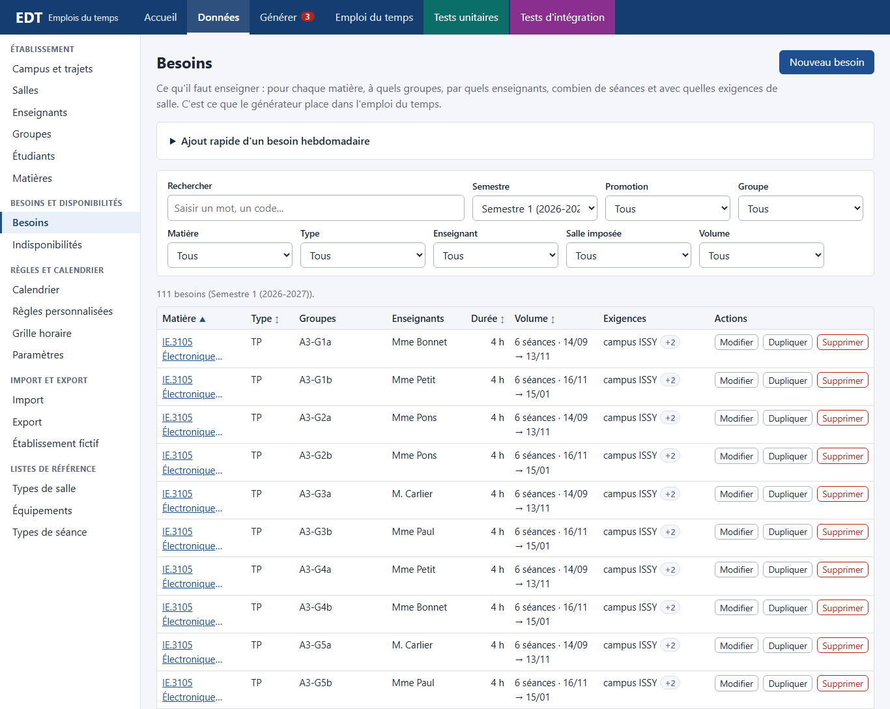
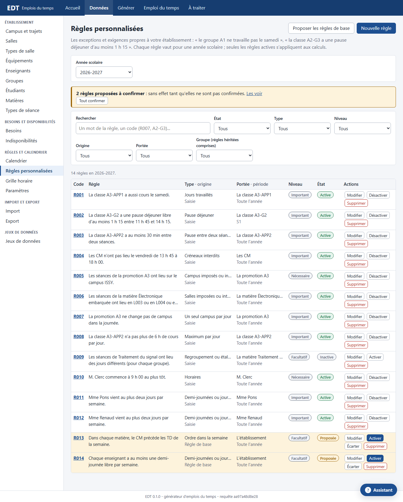
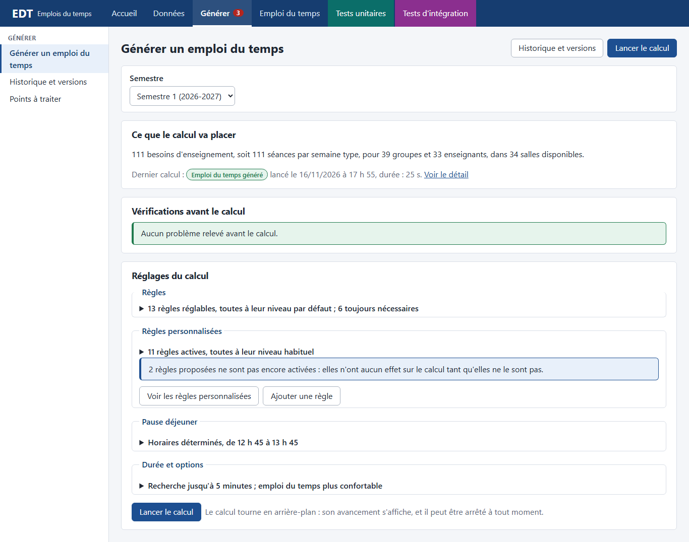
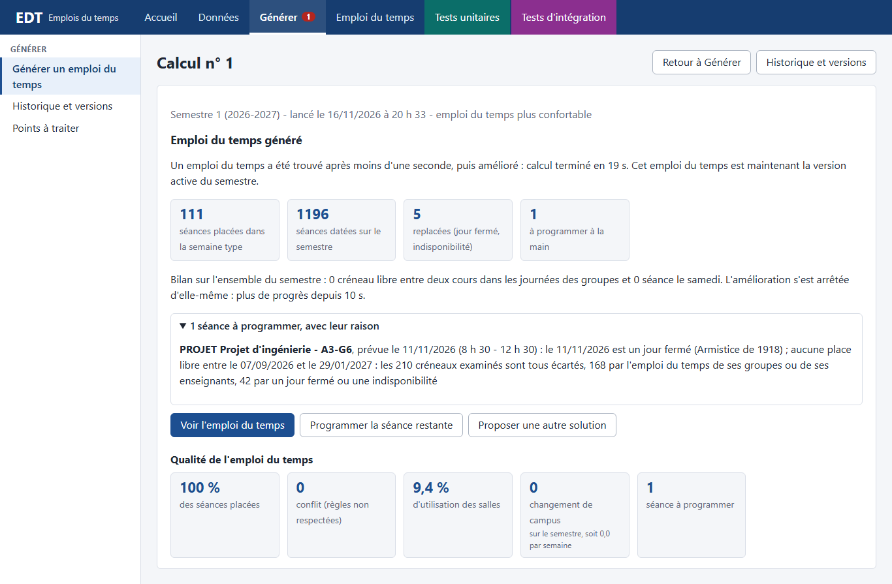
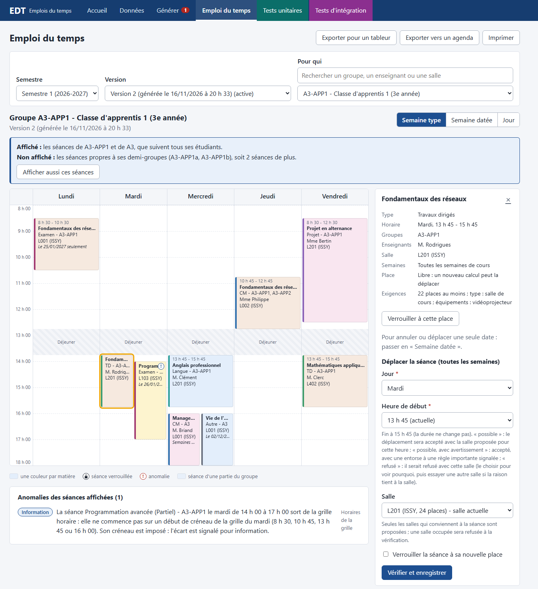
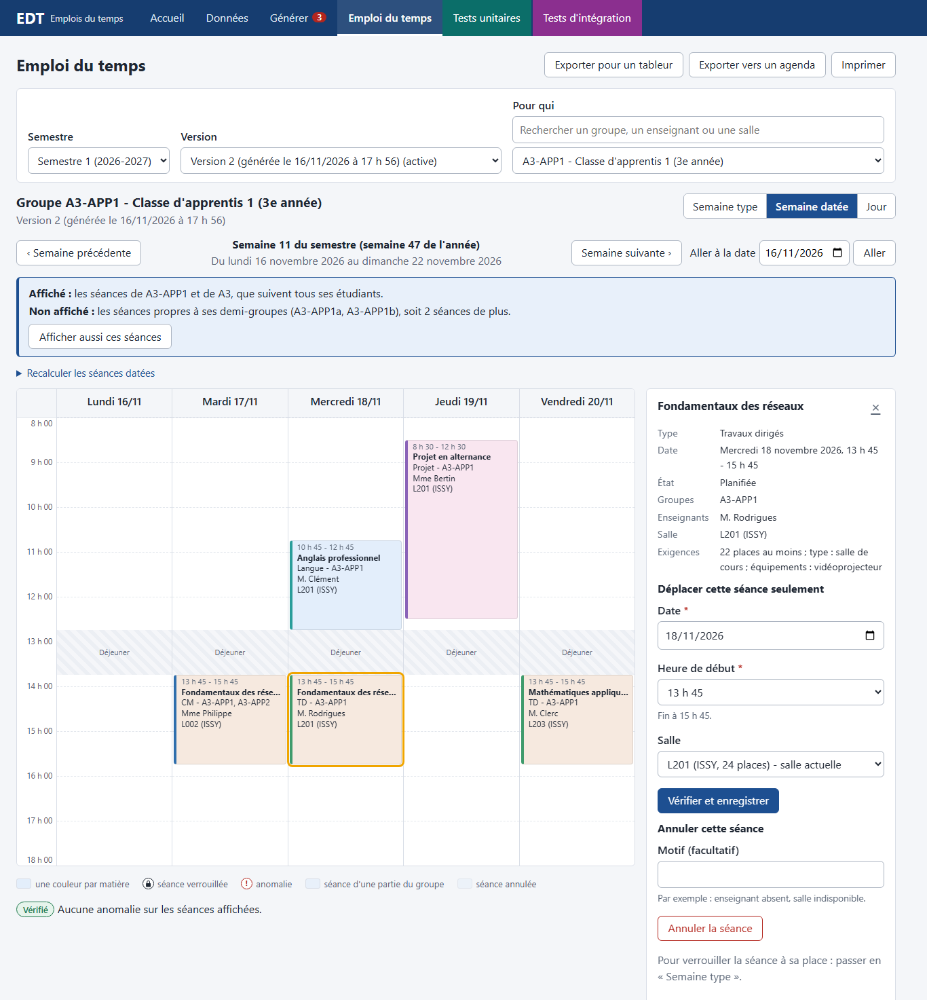
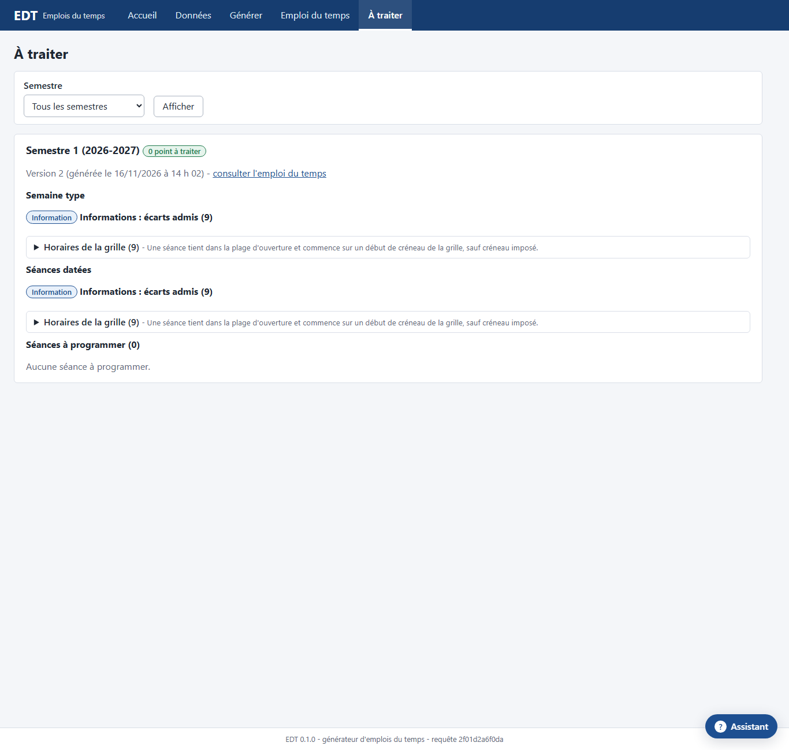
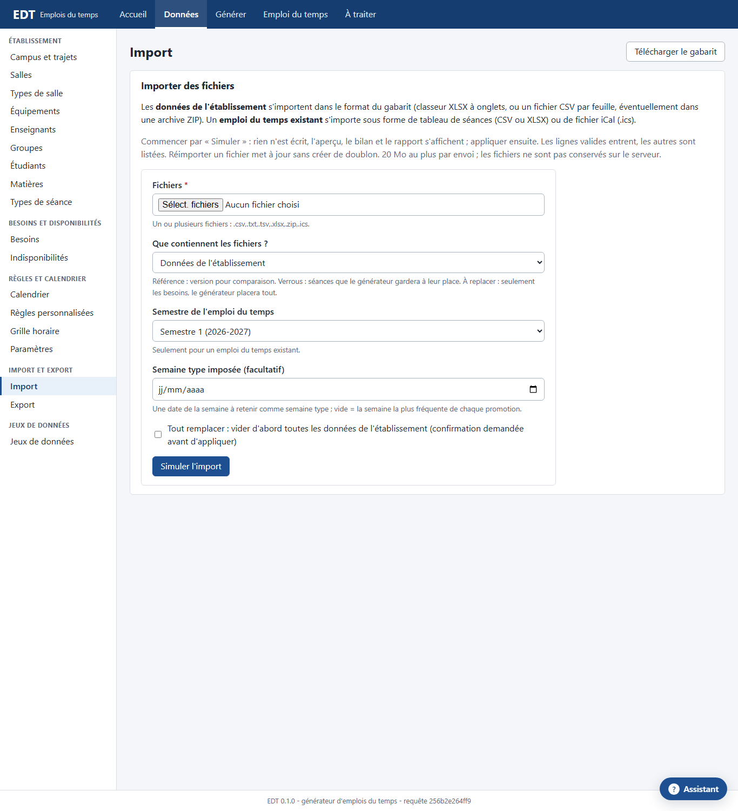

# Spécifications fonctionnelles

**EDT : générateur automatique d'emplois du temps**

Projet PTS Informatique, ISEP, année 2026-2027

| | |
|---|---|
| Livret | 1 sur 4 : spécifications fonctionnelles |
| Enseignant | Hervé Allanic |
| Équipe | Axel, Nassim Khiri, Kerime, Hugo |
| Date | 23 novembre 2026 |
| Version | 1.2 |
| Application décrite | EDT 1.0.0 |

Ce livret décrit l'application du point de vue de la personne qui l'utilise : à quoi elle
sert, ce qu'elle permet de faire et comment elle s'organise. Il ne contient aucun détail de
réalisation ; ceux-ci figurent dans le livret 2, [Spécifications techniques et
organisation](2-specifications-techniques-et-organisation.md). Le mode d'emploi pas à pas
fait l'objet du livret 3, le [guide de l'utilisateur](3-guide-utilisateur.md) ; la recette de
ces fonctionnalités fait l'objet du livret 4, le [cahier de recette](4-cahier-de-recette.md).

---

## Table des matières

- [1. Description de l'application](#1-description-de-lapplication)
  - [1.1 Contexte](#11-contexte)
  - [1.2 À qui s'adresse l'application](#12-à-qui-sadresse-lapplication)
  - [1.3 Ce que fait l'application](#13-ce-que-fait-lapplication)
  - [1.4 Objectifs et intérêt](#14-objectifs-et-intérêt)
  - [1.5 Principes de fonctionnement](#15-principes-de-fonctionnement)
  - [1.6 Périmètre](#16-périmètre)
- [2. Fonctionnement de l'application](#2-fonctionnement-de-lapplication)
  - [2.1 Les six onglets et le parcours](#21-les-six-onglets-et-le-parcours)
  - [2.2 Les fonctionnalités classées par niveau d'utilité](#22-les-fonctionnalités-classées-par-niveau-dutilité)
  - [2.3 Les règles d'un emploi du temps](#23-les-règles-dun-emploi-du-temps)
  - [2.4 Cas d'usage](#24-cas-dusage)
  - [2.5 Les écrans](#25-les-écrans)
- [3. Modélisation : diagramme des classes](#3-modélisation--diagramme-des-classes)
- [Annexe : glossaire](#annexe--glossaire)

---

## 1. Description de l'application

### 1.1 Contexte

Construire l'emploi du temps d'une école d'ingénieurs est un travail long et délicat. Chaque
semaine, des centaines de séances (cours magistraux, travaux dirigés, travaux pratiques,
langues, projets, examens) doivent trouver un jour, une heure et une salle. Chaque choix doit
respecter en même temps les disponibilités des enseignants, la taille et l'équipement des
salles, l'organisation des classes en demi-groupes et en groupes de langues, les trajets entre
les campus, l'accessibilité des salles pour les étudiants qui en ont besoin, les jours fériés
et les périodes d'examens.

À la main, une seule modification peut en entraîner beaucoup d'autres, et une erreur
(une salle occupée deux fois, un enseignant attendu à deux endroits) n'apparaît souvent
qu'au moment où elle gêne. L'application EDT confie ce travail à l'ordinateur.

### 1.2 À qui s'adresse l'application

L'application s'adresse au responsable de la scolarité qui prépare les emplois du temps d'un
établissement. Elle ne suppose aucune connaissance en informatique : les écrans emploient le
vocabulaire de la scolarité (groupe, enseignant, salle, séance, semestre), et chaque message
dit ce qui s'est passé et quoi faire.

Les emplois du temps produits concernent les étudiants, les enseignants et les gestionnaires
de salles, qui peuvent les consulter, les imprimer ou les ajouter à leur agenda.

L'application s'utilise dans un navigateur web, sur un ordinateur ; la consultation de
l'emploi du temps fonctionne aussi sur un téléphone.

### 1.3 Ce que fait l'application

L'utilisateur décrit son établissement : les campus, les salles, les enseignants, les groupes
d'étudiants, les matières et, surtout, les **besoins** (« la classe A3-G2 a deux heures de TD de
réseaux par semaine avec M. Rodrigues, dans une salle informatique »). Il précise le calendrier
(jours fériés, vacances, examens), les indisponibilités de chacun et, s'il le souhaite, des
règles propres à son établissement (« le groupe A1 ne travaille pas le samedi »).

L'application calcule alors l'emploi du temps du semestre en deux temps :

1. une **semaine type**, où chaque séance reçoit un jour, une heure et une salle ;
2. les **séances datées** de tout le semestre, obtenues en reportant la semaine type sur le
   calendrier réel ; une séance qui tombe un jour fermé est replacée automatiquement, et celle
   qui ne trouve aucune place est signalée « à programmer ».

L'utilisateur consulte le résultat par groupe, par enseignant ou par salle, le retouche s'il le
faut (chaque retouche est vérifiée avant d'être enregistrée), traite les points signalés,
puis l'exporte ou l'imprime.

### 1.4 Objectifs et intérêt

- **Gagner du temps** : un premier emploi du temps valide pour un semestre complet est trouvé
  en quelques secondes pour une promotion et en une vingtaine de secondes pour l'établissement
  fictif complet de démonstration (cinq années, 46 classes, 99 salles).
- **Supprimer les conflits** : une salle n'accueille qu'une séance à la fois, un enseignant ne
  donne qu'une séance à la fois, un groupe n'a jamais deux cours en même temps.
- **Respecter les personnes** : indisponibilités, heures maximales des enseignants, pause
  déjeuner, temps de trajet entre campus, salles accessibles.
- **Améliorer le confort** : par défaut, l'application cherche un emploi du temps avec moins
  de trous dans les journées, moins de changements de campus et moins de séances le samedi ;
  l'option peut être décochée.
- **Rester maître des décisions** : l'utilisateur choisit l'importance de chaque règle, peut
  retoucher le résultat et garde l'historique de toutes les versions.

### 1.5 Principes de fonctionnement

1. **Aucune règle n'est abandonnée en silence.** Si l'emploi du temps demandé est impossible,
   l'application le dit et explique pourquoi ; elle ne supprime jamais une règle pour réussir.
   Seul l'utilisateur peut décider qu'une règle devient moins importante, et le résultat
   rappelle ce choix.
2. **Tout ou rien.** Un calcul place toutes les séances demandées ou n'en place aucune : il ne
   produit jamais un emploi du temps incomplet.
3. **Tout est vérifié.** Chaque emploi du temps, qu'il soit calculé, importé ou retouché à la
   main, est contrôlé par une vérification indépendante du calcul, qui liste les anomalies
   avec leur gravité.
4. **Tout se modifie dans l'application.** Chaque donnée se crée, se modifie et se supprime
   dans les écrans ; l'import de fichiers ne fait que compléter la saisie. Une donnée importée
   n'est jamais corrigée automatiquement : ce qui ne respecte pas les règles est signalé.
5. **Données fictives.** L'application est livrée avec des établissements fictifs complets et
   réalistes ; toutes les personnes y sont inventées. Aucune donnée personnelle réelle n'est
   utilisée, et aucune donnée de santé n'est enregistrée : le besoin d'une salle accessible
   est une simple case cochée sur un groupe.

### 1.6 Périmètre

L'application traite un établissement complet : plusieurs campus et des salles
d'établissements voisins, toutes les promotions, les classes, les demi-groupes, les groupes
de langues et d'options, les apprentis (leur semaine de présence à l'école), les épreuves avec
tiers-temps et les deux semestres de l'année. Un emploi du temps se calcule semestre par
semestre.

Elle n'a pas d'écran de connexion : la version de démonstration est ouverte, et l'ajout de
comptes et de rôles fait partie des évolutions prévues (section 2.2).

---

## 2. Fonctionnement de l'application

### 2.1 Les six onglets et le parcours

L'application s'organise en six onglets, toujours visibles en haut de l'écran. Les quatre
premiers suivent l'ordre du travail du responsable des emplois du temps ; les deux derniers,
de couleur différente, présentent les tests automatiques du logiciel.

*Figure 1. Le parcours type. Les flèches en pointillés sont les retours habituels : corriger une
donnée puis relancer le calcul, ou retoucher directement une séance.*

| Onglet | Rôle |
|---|---|
| **Accueil** | Indique la « prochaine étape » utile (charger un établissement fictif ou importer des fichiers, générer l'emploi du temps, le consulter, voir ce qui reste à traiter), puis la version active et le nombre de points à traiter du semestre en cours. |
| **Données** | Regroupe tout ce qui décrit l'établissement, en cinq familles : *Établissement* (campus et trajets, salles, enseignants, groupes, étudiants, matières), *Besoins et disponibilités*, *Règles et calendrier* (calendrier, règles personnalisées, grille horaire, paramètres), *Import et export* (import, export, établissement fictif) et *Listes de référence* (types de salle, équipements, types de séance). |
| **Générer** | Trois écrans. « Générer un emploi du temps » montre ce que le calcul va placer et les points bloquants éventuels ; ses réglages (niveau de chaque règle, règles personnalisées, pause déjeuner, durée et options) sont repliés derrière des résumés ; il lance et suit le calcul, puis présente le résultat. « Historique et versions » liste les calculs et les versions. « Points à traiter » liste les anomalies relevées par la vérification, classées par gravité, et les séances datées restées « à programmer » ; un compteur sur l'onglet en donne le nombre. |
| **Emploi du temps** | Affiche l'emploi du temps d'un groupe, d'un enseignant ou d'une salle, en semaine type, en semaine datée ou jour par jour ; une séance s'ouvre d'un clic pour être déplacée, verrouillée ou annulée. Exporte et imprime. |
| **Tests unitaires**, **Tests d'intégration** | Présentent les tests automatiques du logiciel, avec un schéma de leur organisation. Chaque test, fichier, composant ou famille se lance d'un clic, sauf les tests de charge, longs, réservés à une commande de l'administrateur ; chaque test affiche son résultat et la date de sa dernière exécution (fonctionnalité optionnelle P4). |

Un bouton **Assistant**, présent sur chaque page, ouvre un panneau de dialogue en langage
courant (fonctionnalité optionnelle P3).

### 2.2 Les fonctionnalités classées par niveau d'utilité

Les fonctionnalités sont classées selon les trois niveaux demandés : **Obligatoire** (sans elle,
l'application ne remplit pas sa mission), **Utile** (elle facilite nettement le travail),
**Optionnelle** (un plus, réalisé ou prévu). La colonne « État » distingue ce qui est réalisé
de ce qui est prévu.

#### 2.2.1 Obligatoire

| N° | Fonctionnalité | Ce que l'utilisateur peut faire | État |
|---|---|---|---|
| O1 | Décrire l'établissement | Créer, modifier, rechercher, trier et supprimer les campus (avec les temps de trajet entre eux), les salles (campus, capacité, type, équipements, accessibilité), les enseignants (statut, heures maximales par jour et par semaine), les groupes (arbre promotion, classe, demi-groupe, et groupes à part : langues, options, tiers-temps), les étudiants, les matières et les types de séance. Une suppression demande une confirmation et liste ce qu'elle entraîne. | Réalisée |
| O2 | Décrire les besoins d'enseignement | Pour chaque besoin : matière, type de séance, groupes, enseignants, durée, volume (un nombre de séances chaque semaine, un total à répartir entre deux dates, ou une séance à une date précise), exigences de salle (types acceptés, équipements, salle ou campus imposé), créneau imposé. | Réalisée |
| O3 | Indiquer les disponibilités et le calendrier | Indisponibilités d'un enseignant, d'une salle ou d'un groupe, chaque semaine ou sur une période ; jours fermés (fériés préremplis, vacances, examens, semaines spéciales), pour tout l'établissement ou pour un groupe ; grille horaire des créneaux. | Réalisée |
| O4 | Respecter les règles du cahier des charges | Les règles de la section 2.3 sont toujours prises en compte : une séance par salle, par enseignant et par groupe à la fois, horaires et jours d'ouverture, pauses, déjeuner, trajets entre campus, capacité, type et équipement des salles, accessibilité, indisponibilités. | Réalisée |
| O5 | Générer l'emploi du temps d'un semestre | Lancer le calcul de la semaine type puis des séances datées de tout le semestre ; les séances qui tombent un jour fermé sont replacées automatiquement. | Réalisée |
| O6 | Être prévenu quand c'est impossible | Le résultat distingue « impossible (prouvé) » et « pas trouvé dans le temps imparti », avec les raisons connues. Aucun emploi du temps partiel n'est produit. | Réalisée |
| O7 | Consulter l'emploi du temps | Par groupe, par enseignant ou par salle, avec une couleur par matière et le détail de chaque séance. | Réalisée |
| O8 | Modifier une séance | Déplacer une séance (jour, heure, salle choisie parmi les salles qui conviennent). Pour une séance de la semaine type, chaque heure de début proposée est marquée « possible », « possible, avec avertissement » ou « refusé » avant tout choix ; la modification est vérifiée avant d'être enregistrée et une salle occupée est refusée. | Réalisée |
| O9 | Importer des données | Charger les données de l'établissement depuis des fichiers CSV. | Réalisée |
| O10 | Exporter l'emploi du temps | Exporter l'emploi du temps en fichier CSV, pour tout l'établissement ou pour une seule ressource. | Réalisée |
| O11 | Charger un établissement fictif | Charger en une fois un établissement fictif réaliste, de trois tailles (petit, moyen, grand) ; un autre numéro de variante donne un autre établissement de même taille. | Réalisée |

#### 2.2.2 Utile

| N° | Fonctionnalité | Ce que l'utilisateur peut faire | État |
|---|---|---|---|
| U1 | Vérifications avant le calcul | Voir, avant de lancer, les points bloquants qui rendent l'emploi du temps impossible et les avertissements qui le rendent difficile (charge d'un groupe, d'un enseignant ou d'un type de salle, manque de salles accessibles, séances verrouillées incompatibles). | Réalisée |
| U2 | Niveau de chaque règle | Choisir, à chaque calcul, si une règle est *nécessaire*, *importante* ou *facultative* (section 2.3). Les niveaux choisis sont rappelés dans le résultat. | Réalisée |
| U3 | Règles personnalisées | Ajouter des exceptions et exigences propres à l'établissement, parmi quatorze types (section 2.3), en précisant qui elle concerne (établissement, groupe, enseignant, campus, type de séance, matière, besoin) et sur quelle période ; les activer, les désactiver ; activer d'un clic les règles de base proposées et celles reprises de l'année précédente. | Réalisée |
| U4 | Pause déjeuner réglable | Choisir entre une plage fixe laissée libre (12 h 45 à 13 h 45 par défaut), une pause d'une durée minimale placée librement dans une plage, ou aucune pause réservée. | Réalisée |
| U5 | Emploi du temps plus confortable | Obtenir moins de trous, moins de changements de campus et moins de samedis (option cochée par défaut, décochable) ; le calcul s'arrête de lui-même quand il ne trouve plus mieux, en gardant toujours la meilleure solution trouvée. | Réalisée |
| U6 | Suivre et piloter un calcul | Choisir la durée maximale du calcul (5 ou 15 minutes), suivre l'avancement, arrêter, demander une autre solution que la précédente. Pendant le calcul, l'écran annonce dès qu'un emploi du temps est trouvé : le calcul cherche ensuite à l'améliorer, et un arrêt garde le meilleur. | Réalisée |
| U7 | Historique et versions | Chaque calcul crée une version ; une seule est active par semestre ; une version peut être consultée, rendue active ou supprimée. Un emploi du temps de référence, fourni avec l'établissement fictif ou importé, sert de comparaison. | Réalisée |
| U8 | Vues semaine type, semaine datée et jour | Passer de la semaine type aux semaines réelles du semestre, naviguer de semaine en semaine, afficher une seule journée. | Réalisée |
| U9 | Retouches et verrous | Verrouiller une séance à sa place pour les calculs suivants ; déplacer ou annuler une seule séance datée (avec un motif) sans toucher aux autres semaines ; recalculer les séances datées en conservant ces retouches. | Réalisée |
| U10 | Points à traiter | Dans la page « Points à traiter » de l'onglet Générer, voir les anomalies classées en erreurs, avertissements et informations, et les séances à programmer, avec un lien vers la séance concernée. | Réalisée |
| U11 | Tableau de bord | L'accueil indique la prochaine étape et l'état du semestre en cours ; le résultat d'un calcul donne des indicateurs de qualité (séances placées, conflits, utilisation des salles, changements de campus). | Réalisée |
| U12 | Agenda et impression | Exporter l'emploi du temps vers un agenda (format iCal) et l'imprimer, ou l'enregistrer en PDF, depuis le navigateur. | Réalisée |
| U13 | Échanges de fichiers complets | Télécharger un gabarit vide (classeur Excel ou fichiers CSV) ; simuler un import avant de l'appliquer, avec un rapport ligne par ligne (les lignes valides entrent, les autres sont listées) ; réimporter un fichier sans créer de doublon ; exporter toutes les données dans le même format ; importer un emploi du temps existant comme référence, comme séances verrouillées ou comme séances à replacer, y compris depuis un agenda. | Réalisée |

#### 2.2.3 Optionnelle

| N° | Fonctionnalité | Ce que l'utilisateur peut faire | État |
|---|---|---|---|
| P1 | Consultation sur téléphone | Afficher l'application sur un petit écran : menus et emploi du temps s'adaptent à la largeur. | Réalisée |
| P2 | Commandes pour un administrateur | Réaliser chaque opération (installation, chargement d'un établissement fictif, calcul, vérification, import, export, sauvegarde) par une commande tapée au clavier, sans ouvrir l'application. | Réalisée |
| P3 | Assistant conversationnel | Poser une question en langage courant sur les données ou l'emploi du temps (« Quelles salles de plus de 40 places sont libres le jeudi après-midi ? ») et recevoir une réponse fondée sur les données de l'application, que l'assistant consulte sans rien modifier ; demander une modification (« Mme Bertin n'est pas disponible le mercredi matin ») et recevoir une proposition : une règle personnalisée, sa modification, son activation ou sa désactivation, ou une indisponibilité. Rien n'est enregistré avant le clic sur « Confirmer ». L'assistant ne lance pas de calcul et ne supprime rien. Le nombre de messages et la dépense de la journée sont limités ; sans service configuré, le panneau le dit et le reste de l'application fonctionne. | Réalisée |
| P4 | Tests du logiciel lancés depuis l'application | Dans les onglets « Tests unitaires » et « Tests d'intégration », lire un schéma de l'organisation des tests, lancer un test, un fichier, un composant ou toute une famille (les tests de charge, longs, se lancent seulement par une commande de l'administrateur), suivre l'exécution et l'arrêter ; chaque test affiche son résultat (réussi, échec avec son message, ignoré avec sa raison, jamais lancé) et la date de sa dernière exécution. Les tests tournent à part : les données de l'application ne sont jamais touchées. Cette fonctionnalité sert à montrer la qualité du logiciel ; le travail du responsable des emplois du temps ne l'exige pas. | Réalisée |
| P5 | Réaménagement sur imprévu | Replacer automatiquement les séances touchées par un imprévu (absence, salle fermée) en modifiant le moins possible le reste de l'emploi du temps. | Prévue |
| P6 | Comptes et rôles | Se connecter, avec des droits différents selon le rôle (gestionnaire, consultation). | Prévue |
| P7 | Glisser-déposer | Déplacer une séance en la faisant glisser dans la grille. | Prévue |
| P8 | Alternance semaine A / semaine B | Gérer des semaines qui alternent, et le calendrier d'alternance des apprentis. | Prévue |
| P9 | Diagnostic détaillé d'un calcul impossible | Désigner précisément le plus petit ensemble de règles et de données qui rend le calcul impossible. | Prévue |
| P10 | Calcul d'une partie de l'établissement | Ne recalculer qu'une promotion ou qu'un campus. | Prévue |

### 2.3 Les règles d'un emploi du temps

#### Les règles toujours prises en compte

| Règle | Ce qu'elle garantit | Niveau par défaut |
|---|---|---|
| Une séance par salle | Une salle accueille une seule séance à la fois. | toujours nécessaire |
| Une séance par enseignant | Un enseignant donne une seule séance à la fois. | toujours nécessaire |
| Une séance par groupe | Deux groupes qui ont des étudiants en commun (l'un contient l'autre, ou ils partagent des étudiants) n'ont pas cours en même temps. | toujours nécessaire |
| Toutes les séances placées | Chaque séance demandée par les besoins a un jour, une heure et une salle. | toujours nécessaire |
| Séances verrouillées | Une séance verrouillée reste à sa place (jour, heure et salle). | toujours nécessaire |
| Jours fermés | Aucune séance un jour fermé pour les groupes concernés. | toujours nécessaire |
| Trajet entre campus | Pour un groupe ou un enseignant, deux séances du même jour sur deux campus différents sont séparées d'au moins le temps de trajet (une heure par défaut). | nécessaire |
| Salle accessible | Une séance dont un groupe a besoin d'une salle accessible a lieu dans une salle accessible. | nécessaire |
| Horaires de la grille | Une séance tient dans les heures d'ouverture (8 h 30 à 18 h par défaut) et commence au début d'un créneau, sauf créneau imposé. | nécessaire |
| Jours de cours | Les séances ont lieu du lundi au vendredi ; le samedi matin est réservé aux types de séance qui l'autorisent. | nécessaire |
| Capacité de la salle | La salle a assez de places pour tous les groupes de la séance. | nécessaire |
| Type de salle | La salle est d'un type accepté par le besoin (amphithéâtre, salle informatique...). | nécessaire |
| Disponibilités | Aucune séance pendant une indisponibilité d'un de ses enseignants, de sa salle ou d'un de ses groupes. | nécessaire |
| Pause entre deux séances | Un groupe ou un enseignant a une pause entre deux séances qui se suivent (15 minutes par défaut, durée réglée dans les paramètres). | important |
| Pause déjeuner | La pause déjeuner reste libre pour chaque groupe et chaque enseignant, selon le mode choisi. | important |
| Équipements de la salle | La salle possède les équipements demandés (vidéoprojecteur, ordinateurs...). | important |
| Heures maximales des enseignants | Les heures maximales par jour et par semaine d'un enseignant sont respectées lorsqu'elles sont renseignées. | important |

#### Les trois niveaux

- **Nécessaire** : la règle est toujours respectée ; un emploi du temps qui l'enfreint est refusé.
- **Important** : la règle n'est enfreinte que si rien d'autre n'est possible ; chaque entorse
  est signalée comme avertissement.
- **Facultatif** : c'est un souhait ; il est respecté quand c'est possible et chaque entorse est
  signalée pour information.

Les six règles qui définissent le problème restent toujours nécessaires. Pour les autres,
l'utilisateur choisit le niveau à chaque calcul, dans l'écran « Générer ».

#### Les règles personnalisées

Une règle personnalisée exprime une exception ou une exigence propre à l'établissement. Elle
appartient à une année scolaire, porte un code (« R007 »), concerne une partie de l'établissement (tout
l'établissement, un groupe et ses sous-groupes, un enseignant, un campus, un type de séance, une
matière ou un besoin), sur toute l'année, un semestre ou une période, et a son propre niveau.
Elle est *proposée* (sans effet tant qu'elle n'est pas activée), *active* ou *inactive*.
L'application l'affiche toujours sous forme d'une phrase lisible.

| Type de règle | Exemple de phrase |
|---|---|
| Jours travaillés | Le groupe A1 ne travaille pas le samedi. |
| Horaires | Le lundi, les A3 commencent à 10 h au plus tôt. |
| Créneaux interdits | Pas de CM le vendredi après-midi. |
| Campus imposés ou interdits | Les séances de la promotion A3 ont lieu à Issy. |
| Salles imposées ou interdites | Les TP d'électronique des A2 ont lieu en N016 ou en N018. |
| Pause déjeuner | La classe A2-G3 a une pause déjeuner libre d'au moins 1 h 15 entre 11 h 45 et 14 h 15. |
| Pause entre deux séances | Le demi-groupe A1-G2a a au moins 30 min entre deux séances. |
| Maximum par jour | Les A1 n'ont pas plus de 6 h de cours par jour. |
| Demi-journées ou journées libres | Chaque enseignant a au moins une demi-journée libre par semaine. |
| Trous limités | La classe A3-APP1 n'a aucun trou dans la semaine. |
| Un seul campus par jour | Les A3 ne changent pas de campus dans la journée. |
| Matières par jour | Les A1 n'ont pas plus de 3 matières différentes par jour. |
| Ordre dans la semaine | Dans chaque matière, le CM précède les TD de la semaine. |
| Regroupement ou étalement d'une matière | Les séances de mathématiques des A1 ont lieu des jours différents. |

### 2.4 Cas d'usage

L'acteur des cas 1 à 6 est le **responsable des emplois du temps** ; celui du cas 7 est un
membre de l'équipe du projet ou un examinateur.

#### Cas 1. Préparer et générer l'emploi du temps d'un semestre

- **Point de départ** : les données de l'établissement sont saisies ou importées.
- **Déroulement** :
  1. L'accueil propose, comme prochaine étape, de générer l'emploi du temps.
  2. Dans **Générer**, l'utilisateur choisit le semestre. L'écran résume ce que le calcul va
     placer (nombre de besoins, de séances, de groupes, d'enseignants, de salles) et affiche
     les vérifications préalables (« Aucun problème relevé avant le calcul » quand rien ne
     l'empêche).
  3. Les réglages sont repliés derrière des résumés (« 13 règles réglables, toutes à leur
     niveau par défaut ; 6 toujours nécessaires ») ; il les ouvre s'il veut changer le niveau
     d'une règle, la pause déjeuner, la durée ou l'option « emploi du temps plus
     confortable », puis clique sur « Lancer le calcul ».
  4. Le calcul se déroule en arrière-plan ; son avancement s'affiche. Dès qu'un emploi du
     temps est trouvé, l'écran l'annonce : le calcul cherche ensuite à l'améliorer et peut être
     arrêté sans perdre le meilleur trouvé.
  5. Le résultat donne le nombre de séances placées dans la semaine type, de séances datées,
     de séances replacées et de séances à programmer, ainsi que des indicateurs de qualité.
- **Résultat** : une nouvelle version devient l'emploi du temps actif du semestre.
- **Variante** : si une vérification préalable relève un point bloquant, ou si le calcul est
  impossible, l'écran le dit et donne les raisons connues. L'utilisateur corrige une donnée
  (un besoin, une indisponibilité) ou rend une règle moins exigeante, puis relance.

#### Cas 2. Ajouter une exigence propre à l'établissement

- **Point de départ** : une enseignante ne peut venir que deux jours par semaine.
- **Déroulement** :
  1. Dans **Données › Règles personnalisées**, l'utilisateur clique sur « Nouvelle règle » et
     choisit le type « Demi-journées ou journées libres ».
  2. Il indique qui la règle concerne (l'enseignante), le nombre de jours, le niveau et la période ; la
     phrase de la règle se met à jour à chaque changement (« Mme Pons vient au plus deux jours
     par semaine »).
  3. Il enregistre : la règle est active.
- **Résultat** : le prochain calcul respecte la règle. Dans « Générer », son niveau peut être
  changé ou la règle ignorée pour un seul calcul, sans modifier la règle elle-même.

#### Cas 3. Déplacer une séance pour tout le semestre

- **Point de départ** : un cours magistral doit changer de jour toutes les semaines.
- **Déroulement** :
  1. Dans **Emploi du temps**, en « Semaine type », l'utilisateur clique sur la séance : un
     panneau en donne le détail.
  2. Sous « Déplacer la séance (toutes les semaines) », il choisit le jour ; chaque heure de
     début est marquée « (possible) », « (possible, avec avertissement) » ou « (refusé) », et
     chaque salle occupée est signalée avec
     la séance qui l'occupe.
  3. Il choisit une heure possible et une salle libre, puis « Vérifier et enregistrer » ; il
     peut aussi cocher « Verrouiller la séance à sa nouvelle place ».
- **Résultat** : la séance change de place dans la semaine type ; une heure refusée affiche la
  raison du refus et rien n'est enregistré.

#### Cas 4. Réagir à une absence ponctuelle

- **Point de départ** : un enseignant est absent le lundi 16 novembre.
- **Déroulement** :
  1. Dans **Emploi du temps**, l'utilisateur affiche l'enseignant en « Semaine datée » et
     navigue jusqu'à la semaine concernée.
  2. Il clique sur la séance : un panneau en donne le détail.
  3. Il choisit « Déplacer cette séance seulement » (nouvelle date, heure, salle parmi celles
     qui conviennent) puis « Vérifier et enregistrer », ou bien « Annuler la séance » avec un
     motif.
- **Résultat** : seule la séance de ce jour change ; les autres semaines gardent la semaine
  type. Cette retouche à la main est vérifiée ; toute conséquence (par exemple une règle non
  respectée) apparaît dans la page **Points à traiter** de l'onglet Générer.

#### Cas 5. Importer les données d'un établissement

- **Point de départ** : les données existent dans un tableur.
- **Déroulement** :
  1. Dans **Données › Import**, l'utilisateur télécharge le gabarit (un onglet d'explications
     puis une feuille par sorte de données, colonnes obligatoires en gras) et le remplit.
  2. Il envoie le fichier et clique sur « Simuler l'import » : rien n'est encore enregistré ;
     l'aperçu, le bilan et le rapport ligne par ligne s'affichent.
  3. Il corrige les lignes refusées ou applique l'import tel quel.
- **Résultat** : les lignes valides entrent ; réimporter le même fichier, une fois modifié, met à jour
  les données sans créer de doublon.

#### Cas 6. Diffuser l'emploi du temps

- **Point de départ** : l'emploi du temps du semestre est prêt.
- **Déroulement** : dans **Emploi du temps**, l'utilisateur choisit un groupe, un enseignant ou
  une salle, puis « Exporter vers un agenda », « Exporter pour un tableur » ou « Imprimer ».
- **Résultat** : un fichier agenda à ajouter à un calendrier personnel, un fichier pour un
  tableur, ou une page imprimable.

#### Cas 7. Montrer que le logiciel est testé

- **Point de départ** : une démonstration du projet, devant un examinateur.
- **Déroulement** :
  1. Dans l'onglet **Tests unitaires**, le schéma en tête de page explique comment un test
     unitaire est construit et comment les tests sont rangés par composant.
  2. L'utilisateur lance un composant (par exemple « verification ») ou un seul test ; la page
     se met à jour toute seule : nombre de tests terminés, réussis et en échec.
  3. L'onglet **Tests d'intégration** montre de même les tests qui traversent l'application
     entière, dont six parcours de bout en bout.
- **Résultat** : chaque test lancé affiche son résultat et la date de cette exécution ; pour un
  échec, le message d'erreur se déplie. Le [cahier de recette](4-cahier-de-recette.md)
  (livret 4) relie ces tests aux fonctionnalités et aux cas d'usage de ce livret.

### 2.5 Les écrans

Les captures suivantes proviennent de la démonstration, sur l'établissement fictif « moyen »
(une promotion de troisième année, 39 groupes, 34 enseignants, 34 salles).

*Figure 2. Accueil : la prochaine étape utile et l'état du semestre en cours.*

*Figure 3. Données › Besoins : ce qu'il faut enseigner. Le menu de gauche donne accès à toutes
les données de l'établissement.*

*Figure 4. Données › Règles personnalisées : chaque règle est écrite en phrase ; les règles
proposées attendent d'être activées.*

*Figure 5. Générer un emploi du temps : les réglages sont repliés derrière des résumés et
s'ouvrent d'un clic.*

*Figure 6. Résultat d'un calcul réussi, avec les indicateurs de qualité.*

*Figure 7. Emploi du temps en semaine type : une séance ouverte peut être déplacée ou
verrouillée.*

*Figure 8. Semaine datée : une séance précise peut être déplacée ou annulée sans toucher aux
autres semaines.*

*Figure 9. Générer › Points à traiter : anomalies classées par gravité et séances à
programmer.*

*Figure 10. Données › Import : un import se simule avant d'être appliqué.*

---

## 3. Modélisation : diagramme des classes

Le diagramme présente les notions manipulées par l'application et leurs liens. Il suit la
notation UML : chaque classe porte son nom, ses attributs (les informations qu'elle contient)
et ses opérations (ce que l'application lui demande de faire).

*Figure 11. Diagramme des classes (notions principales).*

**Lecture du diagramme**

- **Composition** (losange plein) : la partie n'existe pas sans son tout. Une année scolaire
  contient ses semestres, ses jours fermés et ses règles personnalisées ; un semestre contient
  ses besoins et ses versions d'emploi du temps ; une version contient ses séances de la
  semaine type et ses séances datées ; un groupe contient ses sous-groupes (une promotion ses
  classes, une classe ses demi-groupes). Supprimer le tout supprime ses parties.
- **Agrégation** (losange vide) : un besoin regroupe un ou plusieurs groupes et des
  enseignants, qui existent indépendamment de lui et participent à d'autres besoins.
- **Association** (flèche simple) : une classe en utilise une autre. Un besoin porte sur une
  matière et un type de séance ; une séance de la semaine type satisfait un besoin et occupe
  une salle ; une séance datée provient, le plus souvent, d'une séance de la semaine type ;
  une salle appartient à un campus ; une indisponibilité vise un enseignant, une salle ou un
  groupe ; un jour fermé peut ne concerner qu'un groupe ; une règle personnalisée a un niveau.
- **Dépendance** (flèche en pointillés) : une règle personnalisée consulte la définition de son
  type (ses paramètres, sa description, ses exemples) pour se valider et s'écrire en phrase.
- **Héritage** (flèche à triangle vide) : les dix classes du diagramme reliées à « Donnée
  importable » en héritent, ainsi que les étudiants, non représentés ; elle retient le fichier et la ligne d'où provient une donnée importée ainsi que les colonnes non
  reconnues du fichier. Une donnée saisie à la main laisse ces attributs vides.
- **Multiplicités** : « `1` » exactement un, « `0..1` » au plus un, « `*` » zéro ou plusieurs,
  « `1..*` » au moins un. Par exemple, un besoin concerne au moins un groupe (`1..*`) et un nombre
  quelconque d'enseignants (`*`), y compris aucun.

**Opérations.** Les opérations indiquées sont celles que l'application applique réellement à
ces objets : par exemple, « est accessible(inconnue acceptée) » dit si une salle convient à un
groupe qui a besoin d'une salle accessible, en traitant une accessibilité « inconnue » comme
« non » sauf réglage contraire ; « concerne(date) » dit si une indisponibilité s'applique un jour
donné ; « période en clair() » écrit « toute l'année », « S1 » ou « du 01/10/2026 au 15/12/2026 ».
Les classes sans opération ne portent que des informations : le calcul et la vérification,
qui les exploitent, sont décrits dans le livret 2.

**Ce que le diagramme ne montre pas.** Pour tenir sur une page, il omet quelques notions
secondaires : les étudiants et leur inscription aux groupes, les types de salle et les
équipements (qui apparaissent comme attributs des salles et des besoins), les créneaux de la
grille horaire, les temps de trajet entre campus, les paramètres généraux, le suivi des
calculs et le compte quotidien de l'assistant. Il omet aussi les liens d'un besoin vers une salle ou un campus imposés, et le lien de
chaque règle personnalisée vers sa cible, représenté par l'attribut « concerne » et l'opération
« cible() ».

---

## Annexe : glossaire

| Terme | Définition |
|---|---|
| À programmer | État d'une séance datée pour laquelle aucune place valide n'a été trouvée ; elle apparaît dans la page « Points à traiter » de l'onglet Générer. |
| Anomalie | Constat de la vérification d'un emploi du temps. Sa gravité est *erreur* (règle nécessaire enfreinte), *avertissement* (règle importante enfreinte) ou *information* (entorse à une règle facultative, ou entorse admise comme un créneau imposé hors de la grille). |
| Besoin | Ce qu'il faut enseigner : une matière, un type de séance, des groupes, des enseignants, une durée, un volume et des exigences de salle. C'est la demande que le calcul satisfait. |
| Calcul | Une exécution du générateur, qui cherche l'emploi du temps d'un semestre (« calcul n° 3 »). Chaque calcul réussi produit une version. |
| Concerne | Ce que vise une règle personnalisée : l'établissement, un groupe, un enseignant, un campus, un type de séance, une matière ou un besoin. |
| Créneau | Plage horaire de la grille (par exemple 8 h 30 à 10 h 30). Une séance commence au début d'un créneau, sauf créneau imposé. |
| Créneau imposé | Jour et heure fixés à l'avance pour un besoin (par exemple un devoir surveillé). |
| Demi-groupe | Moitié d'une classe, pour les travaux pratiques par exemple. |
| Emploi du temps de référence | Version fournie avec l'établissement fictif, ou importée, qui sert de comparaison ; elle n'est pas active. |
| Entorse | Règle importante ou facultative qui n'est pas tenue, ou règle ignorée pour un calcul. Chaque entorse est signalée dans le résultat. |
| Établissement fictif | Établissement inventé, complet et réaliste, chargé en une fois pour découvrir l'application ou la démontrer. |
| Gabarit | Classeur ou fichiers vides, au bon format, à remplir pour importer des données. |
| Groupe | Ensemble d'étudiants qui suivent les mêmes séances : promotion, classe, demi-groupe, groupe transverse (langue, option) ou groupe tiers-temps pour les épreuves. |
| Groupes en conflit | Groupes qui ne peuvent pas avoir cours en même temps : l'un contient l'autre, ils sont déclarés chevauchants ou ils ont un étudiant en commun. |
| Indisponibilité | Période où un enseignant, une salle ou un groupe ne peut pas avoir de séance, chaque semaine ou sur des dates précises. |
| Jour fermé | Jour ou période sans cours (férié, vacances, examens, semaine spéciale), pour tout l'établissement ou pour un groupe. |
| Niveau | Importance d'une règle pour un calcul : nécessaire, important ou facultatif. |
| Numéro de variante | Nombre qui détermine un établissement fictif : le même numéro redonne exactement les mêmes données, un autre numéro un autre établissement. |
| Point à traiter | Ce que compte la page « Points à traiter » (onglet Générer) : une anomalie de gravité erreur ou avertissement, ou une séance à programmer. |
| Point bloquant | Résultat d'une vérification préalable qui rend le calcul impossible et empêche de le lancer (par exemple un groupe dont les séances dépassent les heures disponibles). |
| Règle | Condition que l'emploi du temps doit respecter. Les règles du catalogue s'appliquent toujours ; les règles personnalisées sont ajoutées par l'utilisateur. |
| Séance | Un moment d'enseignement : des groupes, des enseignants, une salle, un jour et une heure. |
| Séance datée | Séance à une date précise du semestre, issue de la semaine type, d'un replacement, d'une saisie ou d'un import. Elle peut être planifiée, déplacée, annulée ou à programmer. |
| Semaine type | Semaine modèle calculée pour un semestre, reportée ensuite sur chaque semaine du calendrier. |
| Simulation d'import | Lecture d'un fichier sans rien enregistrer, pour voir le bilan et le rapport avant d'appliquer l'import. |
| Test d'intégration | Test automatique qui fait fonctionner plusieurs parties du logiciel ensemble, comme le ferait un utilisateur (une page, une commande, un calcul complet). |
| Test unitaire | Test automatique qui vérifie une seule partie du logiciel, isolée du reste. |
| Trou | Créneau libre entre deux séances dans la journée d'un groupe. |
| Verrou | Marque posée sur une séance de la semaine type pour qu'un nouveau calcul la laisse à sa place. |
| Version | Un emploi du temps complet d'un semestre, produit par un calcul (version *générée*) ou fourni pour comparaison (*emploi du temps de référence*). Une seule version est *active* par semestre. |
