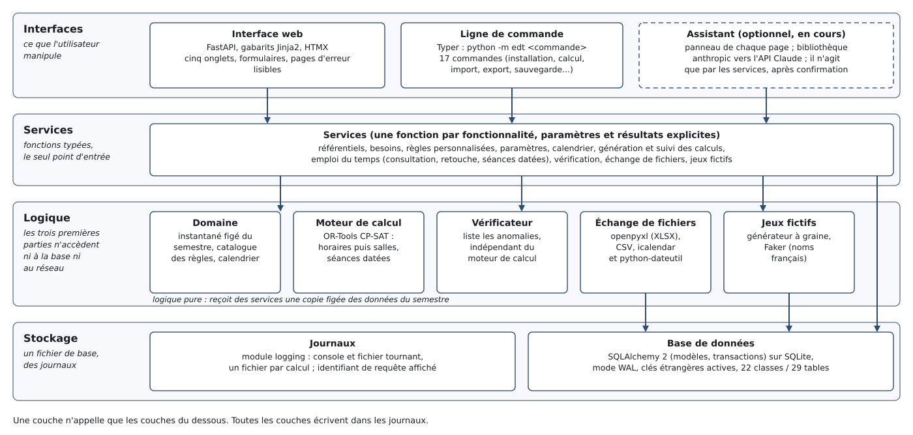

# Spécifications techniques et organisation

**EDT : générateur automatique d'emplois du temps**

Projet PTS Informatique, ISEP, année 2026-2027

| | |
|---|---|
| Livret | 2 sur 3 : spécifications techniques et organisation du projet |
| Enseignant | Hervé Allanic |
| Équipe | Axel, Nassim Khiri, Kerime, Hugo |
| Date | 16 novembre 2026 |
| Version | 1.0 |

Ce livret décrit comment l'application est construite (matériels, systèmes, technologies,
langages, bibliothèques) et comment le projet a été organisé (lots, planning, outils, méthodes,
référentiel). Il complète le livret 1, [Spécifications fonctionnelles](1-specifications-fonctionnelles.md),
qui décrit l'application du point de vue de l'utilisateur. Les chiffres cités sont mesurés sur
le dépôt au 16 novembre 2026.

---

## Table des matières

- [1. Spécifications techniques](#1-spécifications-techniques)
  - [1.1 Vue d'ensemble](#11-vue-densemble)
  - [1.2 Matériels ciblés](#12-matériels-ciblés)
  - [1.3 Systèmes d'exploitation](#13-systèmes-dexploitation)
  - [1.4 Interfaces externes](#14-interfaces-externes)
  - [1.5 Stockage des données](#15-stockage-des-données)
  - [1.6 Autres technologies](#16-autres-technologies)
  - [1.7 Langages de programmation](#17-langages-de-programmation)
  - [1.8 Bibliothèques](#18-bibliothèques)
  - [1.9 Le calcul de l'emploi du temps](#19-le-calcul-de-lemploi-du-temps)
  - [1.10 Du diagramme des classes au code](#110-du-diagramme-des-classes-au-code)
  - [1.11 Tests](#111-tests)
  - [1.12 Déploiement](#112-déploiement)
- [2. Organisation du projet](#2-organisation-du-projet)
  - [2.1 Équipe et contributions](#21-équipe-et-contributions)
  - [2.2 Découpage en lots](#22-découpage-en-lots)
  - [2.3 Planning prévu et réalisé](#23-planning-prévu-et-réalisé)
  - [2.4 Environnement de développement](#24-environnement-de-développement)
  - [2.5 Méthodes de suivi](#25-méthodes-de-suivi)
  - [2.6 Référentiel du projet](#26-référentiel-du-projet)

---

## 1. Spécifications techniques

### 1.1 Vue d'ensemble

L'application est une **application web** écrite en Python. Un navigateur affiche des pages
produites par le serveur ; le générateur, qui calcule l'emploi du temps, repose sur une
bibliothèque de programmation par contraintes ; toutes les données sont enregistrées dans une
base SQLite.
L'architecture est en couches, sans exception : les interfaces (web et ligne de commande)
appellent des services, qui s'appuient sur une logique pure (domaine, générateur,
vérificateur) et sur la base.

*Figure 1. Architecture en couches.*

Trois règles structurent le code :

- une fonctionnalité existe d'abord comme **fonction de service typée** (paramètres et résultats
  explicites), puis comme page web et comme commande : l'interface web et la ligne de commande
  appellent exactement les mêmes fonctions, comme l'assistant en cours de réalisation ;
- le générateur et le vérificateur ne lisent jamais la base : ils travaillent sur un
  **instantané**, copie figée et complète des données d'un semestre, construite par les services ;
- **rien n'échoue en silence** : les services lèvent des erreurs métier (une hiérarchie unique
  `ErreurEDT`), traduites en message lisible par l'interface web et en code de sortie non nul
  par la ligne de commande ; chaque module journalise ce qu'il fait.

La description détaillée se trouve dans [architecture.md](../architecture.md).

### 1.2 Matériels ciblés

| Matériel | Usage |
|---|---|
| Ordinateur de bureau ou portable | Usage principal : saisie des données, lancement des calculs, consultation et retouche. Aucune installation : un navigateur web suffit. |
| Téléphone | Consultation de l'emploi du temps et des pages de données : la mise en page s'adapte aux écrans de moins de 56 rem (environ 900 pixels) de large. |
| Serveur | Héberge l'application de démonstration : machine virtuelle de 2 cœurs et 3,7 Go de mémoire. Un calcul utilise au plus 8 fils d'exécution, jamais plus que de cœurs disponibles. |
| Poste de développement | Ordinateur sous Windows 11 avec Python 3.11, où l'application se lance aussi en local. |

### 1.3 Systèmes d'exploitation

| Système | Rôle |
|---|---|
| Windows 11 | Développement et essais en local (Python 3.11). |
| Ubuntu 26.04 | Serveur de démonstration (Python 3.14). |
| Ubuntu (machines de GitHub Actions) | Intégration continue : chaque changement est vérifié sous Python 3.11, 3.13 et 3.14. |
| Tout système disposant de Python 3.11 ou plus | L'application fonctionne sous Windows et sous Linux (développement, serveur, intégration continue) ; elle ne demande que Python et ses bibliothèques. Les fichiers sont lus et écrits en UTF-8. |

### 1.4 Interfaces externes

| Interface | Description |
|---|---|
| Interface web (HTTP, HTTPS) | Interface principale : cinq onglets, formulaires, tableaux, grille d'emploi du temps. Les pages sont produites par le serveur ; HTMX remplace seulement des morceaux de page (filtres, panneaux, suivi d'un calcul), sans application JavaScript à construire. En ligne, le site n'est joignable qu'en HTTPS. |
| Ligne de commande | `python -m edt <commande>` : 17 commandes (créer et vérifier la base, charger un établissement fictif, pré-vérifier, générer, instancier les séances datées, vérifier, importer, exporter, gabarit, sauvegarder, diagnostiquer l'installation, lancer le serveur web). Chaque commande appelle les mêmes services que l'interface web. |
| Fichiers échangés | Import et export des données de l'établissement en classeur Excel (XLSX, un onglet par feuille) ou en fichiers CSV (dans une archive ZIP) ; import d'un emploi du temps existant en CSV, XLSX ou agenda iCal (`.ics`) ; export de l'emploi du temps en CSV ou iCal ; impression ou PDF par le navigateur. L'encodage, le séparateur et la marque d'ordre des octets d'un CSV sont détectés ; un envoi est limité à 20 Mo. |
| Communication réseau | Le serveur web de l'application n'écoute que sur la machine elle-même (127.0.0.1:8000) ; nginx est seul exposé sur Internet (ports 80 et 443). |
| API Claude d'Anthropic (optionnelle) | Utilisée seulement par l'assistant conversationnel, en cours de réalisation : appel sortant en HTTPS. Sans clé d'accès configurée, l'assistant est indisponible et le reste de l'application fonctionne normalement. Aucune donnée réelle n'est envoyée : toutes les données sont fictives. |

### 1.5 Stockage des données

| Stockage | Description |
|---|---|
| Base SQLite | Un seul fichier, sans serveur de base à administrer : suffisant pour un établissement complet et un utilisateur à la fois. Le mode WAL permet de lire pendant une écriture ; les clés étrangères sont actives ; une transaction qui lit puis écrit réserve l'écriture dès son début, ce qui évite les blocages. 22 classes enregistrées, 29 tables avec les tables d'association ([modele-donnees.md](../modele-donnees.md)). |
| Schéma sans migrations | Le schéma est créé par la commande `init-db` ; une base au schéma périmé est détectée (`verifier-schema`) et se recrée puis se repeuple par commande. |
| Journaux | Module `logging` de Python, configuré en un seul endroit : console, fichier tournant `logs/edt.log`, un fichier par calcul dans `logs/generations/`. Chaque requête web reçoit un identifiant, repris dans les journaux et affiché sur les pages d'erreur. Sur le serveur, les journaux vont aussi dans journald. |
| Sauvegardes | Copie cohérente de la base, vérifiée avant d'être gardée (commande `sauvegarder`) ; sur le serveur, une sauvegarde chaque nuit à 3 h 30 (14 gardées) et une avant chaque déploiement. |
| Configuration | Variables d'environnement `EDT_*` (adresse de la base, dossier des journaux, niveau de journalisation, adresse et port) ; sur le serveur, un fichier d'environnement hors du dépôt. Aucun secret n'est écrit dans le dépôt. |

### 1.6 Autres technologies

| Technologie | Utilité |
|---|---|
| HTML et CSS | Les pages sont produites par des gabarits Jinja2 (49 gabarits) et mises en forme par deux feuilles de style, avec des règles propres à l'impression et aux petits écrans. |
| HTMX 2.0.11 | Petite bibliothèque JavaScript, copiée dans le dépôt (aucun outil Node) : un attribut sur un lien ou un formulaire suffit pour remplacer un morceau de page par la réponse du serveur. |
| nginx | Serveur web frontal : termine le HTTPS, sert les fichiers statiques, relaie le reste vers l'application, affiche des pages d'erreur en français (application indisponible, envoi trop volumineux). |
| certbot (Let's Encrypt) | Obtient et renouvelle automatiquement le certificat HTTPS. |
| systemd | Lance l'application comme service (un seul processus, utilisateur système dédié, redémarrage après une panne) et déclenche la sauvegarde quotidienne par un minuteur. |
| Bash | Huit scripts d'installation, de déploiement, de surveillance et de lecture des journaux (`deploy/`). |
| Git et GitHub | Gestion de version, pull requests, intégration continue (section 2.6). |
| GitHub Actions | À chaque pull request et à chaque envoi sur la branche principale : contrôle du style (ruff), du rangement des tests, puis tests unitaires et tests d'intégration, sous trois versions de Python. |

### 1.7 Langages de programmation

| Langage | Volume (fichiers suivis) | Utilité |
|---|---|---|
| Python 3.11 ou plus | 135 fichiers, 55 841 lignes dans `src/` ; 198 fichiers, 34 322 lignes de tests | Tout le code de l'application : services, générateur, vérificateur, interface web, ligne de commande, import et export, création des établissements fictifs. Choisi pour sa lisibilité et pour ses bibliothèques (programmation par contraintes, tableurs, agendas). |
| HTML (gabarits Jinja2) | 49 gabarits | Structure des pages ; les variables et les boucles des gabarits sont remplies par le serveur. |
| CSS | 2 fichiers, 2 414 lignes | Mise en page, couleurs par matière, grille d'emploi du temps, impression, petits écrans. |
| JavaScript | 2 fichiers, 513 lignes (hors HTMX) | Petits comportements d'interface : demande de confirmation avant une suppression, champs qui n'apparaissent qu'au besoin, recherche rapide dans les listes, blocs repliables, impression, panneau de l'assistant. |
| Bash | 8 scripts, 1 793 lignes | Installation du serveur, déploiement, état et journaux. |
| SQL | aucun fichier | Les requêtes sont produites par SQLAlchemy à partir des classes Python. |

### 1.8 Bibliothèques

Les dépendances sont déclarées dans [`pyproject.toml`](../../pyproject.toml) et s'installent par
`pip install -e ".[dev]"`. La colonne « Version utilisée » est celle de l'environnement de
développement. Les versions exactes installées par le contrôle automatique et par le
déploiement sont figées dans un fichier dédié, pour que chaque installation soit
identique.

| Bibliothèque | Version demandée | Version utilisée | Utilité |
|---|---|---|---|
| OR-Tools (CP-SAT) | 9.15 ou plus | 9.15 | Moteur de programmation par contraintes de Google. Il place chaque séance (jour, heure, campus, puis salle) en respectant les règles nécessaires et en minimisant les entorses aux règles importantes et facultatives, ainsi que les trous et les samedis. |
| SQLAlchemy | 2.0 ou plus | 2.1.3 | Fait correspondre les classes Python aux tables SQLite ; gère les sessions, les transactions et les contraintes d'intégrité. |
| FastAPI | 0.121 ou plus | 0.142.2 | Cadre du serveur web : associe chaque adresse à une fonction, lit les formulaires, renvoie les pages HTML et traduit les erreurs métier en pages lisibles. |
| Uvicorn | toute version | 0.54.0 | Serveur qui exécute l'application FastAPI, en local (`python -m edt serve`) comme sur le serveur. |
| Jinja2 | toute version | 3.1.6 | Moteur de gabarits : produit le HTML de chaque écran à partir des données. |
| python-multipart | toute version | 0.0.32 | Lecture des formulaires et des fichiers envoyés (import), utilisée par FastAPI. |
| Typer | 0.27 ou plus | 0.27.2 | Construit la ligne de commande `python -m edt` : options, aide, codes de sortie. |
| openpyxl | toute version | 3.1.5 | Lecture et écriture des classeurs Excel : import, export et gabarit vide. |
| icalendar | toute version | 7.3.0 | Lecture et écriture des agendas iCal : export de l'emploi du temps vers un agenda, import d'un emploi du temps existant. |
| python-dateutil | toute version | 2.9.0 | Interprète les règles de récurrence des agendas importés (« chaque lundi jusqu'au... »). |
| Faker | toute version | 40.40.0 | Fournit des noms et prénoms français pour les établissements fictifs ; avec le même numéro de variante, le même établissement est reproduit à l'identique. |
| anthropic (facultative) | non déclarée à cette date | 2.8.0 | Client de l'API Claude, utilisé par l'assistant conversationnel en cours de réalisation ; l'application fonctionne sans elle. |
| pytest (développement) | toute version | 9.1.1 | Lance les tests automatiques ; les marqueurs `unitaire`, `integration`, `cas_limite` et `perf` les classent. |
| httpx2 (développement) | toute version | 2.16.2 | Client HTTP utilisé par le client de test de FastAPI pour envoyer de vraies requêtes à l'application pendant les tests d'intégration. |
| ruff (développement) | toute version | 0.16.10 | Vérifie le style et les erreurs courantes du code Python et le met en forme ; la CI refuse un changement qui ne le respecte pas. |

### 1.9 Le calcul de l'emploi du temps

Le calcul d'un semestre enchaîne les étapes suivantes :

1. **Instantané** : les services lisent la base et construisent la copie figée du semestre ;
   chaque besoin y est « déplié » en séances hebdomadaires, avec leurs semaines actives.
2. **Pré-vérifications** : contrôles rapides (charge de chaque groupe, de chaque enseignant, de
   chaque type de salle ; salles accessibles ; verrous incompatibles). Un point bloquant
   empêche de lancer le calcul et l'écran en donne la raison.
3. **Horaires** : un premier modèle CP-SAT choisit le jour, l'heure et le campus de chaque
   séance.
4. **Salles** : un second modèle affecte une salle à chaque séance ; si c'est impossible, les
   horaires en cause sont écartés et l'étape 3 reprend.
5. **Amélioration** (mode « plus confortable ») : l'objectif est ajouté au même modèle, en
   partant de la solution valide. Chaque entorse à une règle importante pèse 1 000, à une règle
   facultative 20 ; chaque trou d'un groupe pèse 10, un changement de campus 5, une séance le
   samedi 2, un créneau en début ou fin de journée 1. Un arrêt ou la fin du temps garde toujours
   la meilleure solution trouvée.
6. **Séances datées** : la semaine type est reportée sur chaque semaine du semestre ; une séance
   qui tombe un jour fermé ou pendant une indisponibilité est replacée, ou passe « à
   programmer ».
7. **Vérification** : le vérificateur, écrit indépendamment du générateur, contrôle le résultat
   avant qu'il soit enregistré comme nouvelle version.

Mesures consignées dans [solveur.md](../solveur.md), première solution valide : 111 séances
hebdomadaires (établissement fictif moyen, semestre 1) en 1,9 s ; 595 séances (établissement
fictif grand, semestre 1, 99 salles) en 19,5 s. Sur l'établissement grand, 180 secondes d'amélioration ramènent les trous de 2 874 à 3 sur le
semestre.

### 1.10 Du diagramme des classes au code

Chaque notion du diagramme du livret 1 existe sous deux formes : une classe enregistrée en
base (`src/edt/db/modeles.py`, classes SQLAlchemy) et une copie figée dans l'instantané
(`src/edt/domaine/instantane.py`, classes immuables) sur laquelle travaillent le générateur et le
vérificateur. Le diagramme les réunit ; le tableau ci-dessous donne la correspondance.

| Notion du livret 1 | Classe enregistrée | Opérations, et où elles se trouvent |
|---|---|---|
| Année scolaire | `AnneeScolaire` | |
| Semestre | `Semestre` | |
| Type de séance | `TypeSeance` | |
| Version d'emploi du temps | `VersionEdt` | |
| Campus | `Campus` | |
| Jour fermé | `JourFerme` | `concerne()` : `instantane.JourFerme` |
| Groupe | `Groupe` | |
| Besoin | `Besoin` | `ponctuel` : `instantane.Besoin` |
| Séance de la semaine type | `SeanceHebdo` | |
| Salle | `Salle` | `est_accessible()` : `instantane.Salle` |
| Indisponibilité | `Indisponibilite` | `ressource_id` : `modeles.Indisponibilite` ; `recurrente`, `concerne()` : `instantane.Indisponibilite` |
| Enseignant | `Enseignant` | `nom_affiche()` : `modeles.Enseignant` |
| Matière | `Matiere` | |
| Séance datée | `Occurrence` | |
| Règle personnalisée | `Regle` | `cible_id()` : `modeles.Regle` ; `active`, `couvre()`, `periode_texte()` : `domaine.regles.Regle` |
| Type de règle | `DefinitionType` (catalogue `CATALOGUE_TYPES`, `domaine/regles.py`) | `libelle`, `champ()` |
| Niveau | `Niveau` (`domaine/contraintes.py`) | `libelle`, `description` |
| Donnée importable | `Provenance` (classe de base sans table) | |

Le code contient d'autres héritages que le diagramme fonctionnel ne montre pas : les classes
enregistrées héritent aussi de `CodeNormalise` ou `IdentifiantNormalise` (normalisation des
codes à chaque affectation) et de la base déclarative SQLAlchemy ; les erreurs métier forment la
hiérarchie `ErreurEDT` (huit sous-classes, dont `ErreurInfaisable` et `ErreurDonneesInvalides`) ;
les énumérations affichables dérivent de `EnumLibelle`. Un test vérifie que
[modele-donnees.md](../modele-donnees.md) décrit toutes les tables du modèle.

### 1.11 Tests

| Famille | Nombre | Contenu |
|---|---|---|
| Tests unitaires (`tests/unitaires/`) | 1 180 | Un module exercé seul : règles du vérificateur, modèles du générateur, lecture des fichiers, services, gabarits... |
| Tests d'intégration (`tests/integration/`) | 518 | Plusieurs couches assemblées : requêtes HTTP au vrai serveur de test, commandes, calculs complets ; dont 6 parcours de bout en bout. |
| Contrôle du rangement (`tests/test_rangement.py`) | 12 | Vérifie que chaque test est rangé dans la bonne famille. |
| dont cas limites (marqueur `cas_limite`) | 549 | Cas limites et pannes plausibles, chacun documenté par « Cas : … Risque : … ». |
| dont tests de charge (marqueur `perf`) | 27 | Calculs longs sur l'établissement fictif grand, exclus de l'intégration continue. |

Total : 1 710 tests. Le vérificateur sert d'oracle aux tests du générateur : un emploi du temps
produit est valide si le vérificateur ne relève aucune erreur. Par règle, un test ne dépend
ni de l'heure réelle, ni du hasard, ni de la solution exacte du générateur. La stratégie est détaillée
dans [banque-de-tests.md](../banque-de-tests.md) et [tests/integration/README.md](../../tests/integration/README.md).

### 1.12 Déploiement

*Figure 2. Déploiement de la démonstration.*

Une mise à jour se fait depuis le poste de développement par `deploy/deployer.sh` : le code
d'un commit est envoyé au serveur, installé dans un nouveau dossier de version avec son propre
environnement Python, vérifié, puis mis en service ; la base est sauvegardée avant chaque
déploiement, et la version précédente reste disponible pour un retour arrière. Le détail est dans
[deploiement.md](../deploiement.md).

---

## 2. Organisation du projet

### 2.1 Équipe et contributions

L'équipe compte quatre membres : Axel, Nassim Khiri, Kerime et Hugo. Le tableau suivant
présente les contributions telles que l'historique Git les établit ; le travail fait hors du
dépôt (discussions, décisions en séance, relectures orales) n'y figure pas.

| Membre | Compte GitHub | Contributions visibles dans l'historique |
|---|---|---|
| Axel | Maki882 | Création du dépôt ; questionnaire de cadrage et document des décisions ; ouverture et fusion de 29 des 30 pull requests ; 455 des 463 commits de la branche principale (code, tests, documentation, déploiement). 359 de ces commits sont co-signés par un assistant de programmation (section 2.4). |
| Hugo | HugoLec94 | Premier vérificateur de conflits du planning et ses tests, versé par la première pull request ; il a ensuite été généralisé dans le vérificateur actuel. |
| Kerime | kerime-2 | Réponses au questionnaire de cadrage (deux commits). |
| — | dzzmimou48-cmd | Première structure de la base de données, ses données de test et ses tests (quatre commits), reprise ensuite dans le socle. |
| Nassim Khiri | — | Aucun commit n'est rattaché à son nom dans l'historique. |

Les réponses au questionnaire données de vive voix ou par message sont consignées dans le
dépôt sans que leur auteur soit précisé.

### 2.2 Découpage en lots

| Lot | Sous-étapes | Réalisé |
|---|---|---|
| **1. Cadrage** | Analyse du besoin (ébauche de spécification) ; questionnaire de 400 questions numérotées ; réponses de l'équipe ; document des décisions de cadrage, qui fait autorité. | 28/09 au 05/10 |
| **2. Socle** | Modèle de données (22 classes) ; contrats partagés (instantané, catalogue des règles) ; configuration, journaux, erreurs ; ligne de commande ; détection d'un schéma périmé. | 05/10 |
| **3. Vérificateur** | Une fonction par règle ; gravités ; indicateurs de qualité ; vérification de la semaine type et des séances datées. | 28/09 (première version), 05/10 |
| **4. Établissements fictifs** | Création d'établissements fictifs en trois tailles, chacun désigné par un numéro de variante ; emploi du temps de référence ; écran « Établissement fictif ». | 05/10, puis 02/11 |
| **5. Interface Données** | Cinq onglets ; écrans de toutes les données (listes, recherche, formulaires, suppression avec ses conséquences) ; lisibilité sur un établissement complet. | 05/10 et 06/10 |
| **6. Import et export** | Gabarit ; lecture XLSX, CSV et iCal ; simulation et rapport ; exports ; import d'un emploi du temps existant. | 05/10 |
| **7. Interface emploi du temps** | Onglets Générer, Emploi du temps, À traiter ; vues semaine type, datée, jour ; retouches et verrous. | 05/10, puis 02/11 |
| **8. Générateur** | Modèle des horaires puis des salles ; amélioration ; séances datées et replacement ; arrêt automatique quand l'amélioration ne progresse plus ; tests déterministes. | 05/10 et 06/10 |
| **9. Règles** | Niveaux nécessaire, important, facultatif ; pause déjeuner à trois modes ; conception puis réalisation des règles personnalisées (14 types). | 06/10 au 13/10 |
| **10. Déploiement** | Scripts d'installation et de déploiement ; HTTPS ; sauvegardes ; intégration continue sous trois versions de Python. | 05/10, puis 02/11 |
| **11. Tests** | Tests écrits avec chaque lot ; banque de cas limites ; six parcours de bout en bout ; séparation des tests unitaires et d'intégration. | 05/10 au 16/11 |
| **12. Finalisation** | Simplification de l'interface ; textes et documentation ; livrets du cours. | 16/11 (en cours) |
| **13. Assistant (optionnel)** | Panneau de dialogue, réponses fondées sur les données, propositions acceptées par l'utilisateur. | 16/11 (en cours) |
| **14. Guide utilisateur et soutenance** | Livret 3 ; scénario de démonstration. | prévu à partir du 23/11 |

### 2.3 Planning prévu et réalisé

Le planning prévu est celui des séances du cours. Le planning réalisé se lit dans
l'historique Git : chaque carré du diagramme marque un jour où au moins un commit a touché la
partie concernée.

*Figure 3. Diagramme de Gantt : prévu (calendrier du cours) et réalisé (historique du dépôt).*

| Jalon du cours | Prévu | Réalisé |
|---|---|---|
| Présentation, équipes, choix du projet | 14/09 | Dépôt GitHub créé le 28/09 ; l'activité antérieure n'y figure pas. |
| Spécifications fonctionnelles et UML | 21/09 | Ébauche (document Word) versée le 28/09 ; livret 1 au plan du cours le 16/11. |
| Spécifications techniques et organisation | 28/09 | Choix techniques fixés dans les décisions de cadrage le 05/10 ; livret 2 le 16/11. |
| Démarrage des développements avec GitHub | 05/10 | 28/09 : base initiale et premier vérificateur ; 05/10 et 06/10 : socle, vérificateur, établissements fictifs, interface, import et export, générateur, déploiement. |
| Tests unitaires | 12/10 | Écrits avec chaque lot dès le 05/10 ; 13/10 : règles personnalisées et leurs tests. |
| Tests d'intégration | 02/11 | Premiers tests d'intégration des commandes le 05/10 ; banque de cas limites le 02/11 ; parcours de bout en bout le 09/11 ; séparation unitaires et intégration le 16/11. |
| Finalisation des développements | 16/11 | En cours le 16/11. |
| Documentation utilisateur, préparation de la soutenance | 23/11 | À venir. |
| Soutenance | 14/12 | À venir. |

Le développement a été concentré sur les jours de séance : 16 commits le 28/09, 202 le 05/10,
41 le 06/10, 93 le 13/10, 105 le 02/11, 6 le 09/11 sur la branche principale.

### 2.4 Environnement de développement

| Outil | Usage |
|---|---|
| Python 3.11 et environnement virtuel (`venv`) | Une installation isolée par poste : `python -m venv .venv`, puis `pip install -e ".[dev]"` installe l'application et ses outils de développement. |
| pip et `pyproject.toml` | Gestion des bibliothèques : toutes les dépendances et leurs versions minimales sont déclarées dans un seul fichier. |
| pytest | Tests unitaires et d'intégration, lancés localement avant chaque pull request et par la CI. |
| ruff | Style et erreurs courantes ; mise en forme automatique du code. |
| Git, GitHub, GitHub CLI (`gh`) | Gestion de version, branches, pull requests, consultation de la CI. |
| GitHub Actions | Intégration continue (section 1.6). |
| Navigateur web | Essai des écrans en local (`python -m edt serve`). |
| Assistants de programmation | Claude Code (Anthropic) ; le fichier de consignes `AGENTS.md` sert aussi à Codex. Leur usage est décrit ci-dessous. |

Les éditeurs de code employés par les membres ne sont pas consignés dans le dépôt : leurs
réglages sont exclus du suivi (`.gitignore`).

> **Encadré : usage des assistants de programmation**
>
> Le projet a été réalisé avec des assistants de programmation fondés sur l'intelligence
> artificielle ; 359 des 463 commits de la branche principale portent leur co-signature. Ils
> ont été employés selon les principes suivants.
>
> - **L'équipe décide et vérifie ; l'assistant propose et exécute** dans un cadre écrit,
>   le fichier [`AGENTS.md`](../../AGENTS.md) : architecture, conventions, ce qu'un assistant ne
>   fait pas seul (changer la spécification, ajouter une dépendance majeure, fusionner).
> - **Aucun secret n'est confié à un assistant** (ni clé, ni mot de passe) et **toutes les
>   données sont fictives**.
> - **Chaque tâche est décrite par un brief autonome** : fichiers concernés, interdits,
>   décisions déjà prises, preuve de réussite attendue.
> - **Un fichier n'est modifié que par un seul assistant à la fois** : chaque tâche a sa branche
>   et son périmètre.
> - **Le travail est vérifié sur pièces** : relecture des changements réels, tests relancés ;
>   pour l'important, une seconde relecture indépendante cherche les défauts.
> - **Un test appelle le vrai code et doit pouvoir échouer** : un correctif s'accompagne d'un
>   test qui échoue sans lui.
> - **Rien n'échoue en silence**, et **tout chiffre écrit est mesuré**.
> - **Chaque changement passe par une branche, une pull request et le contrôle automatique.**
> - **La contribution des assistants reste visible dans l'historique** (ligne
>   `Co-Authored-By` des commits).

### 2.5 Méthodes de suivi

| Méthode | Description |
|---|---|
| Questionnaire de cadrage | Le cadrage s'est appuyé sur un questionnaire de 400 questions numérotées ; les réponses de l'équipe sont consolidées dans [decisions.md](../decisions.md), qui fait autorité : une décision s'y change avant de changer le code. |
| Pull requests | 30 pull requests, toutes fusionnées, chacune décrite selon un modèle (« Quoi », « Pourquoi », « Comment vérifier », liste de contrôle). |
| Modèle de tâche | Un modèle d'issue pour décrire une tâche ; des étiquettes reprennent le classement Obligatoire, Utile, Optionnelle. |
| Intégration continue | Chaque pull request et chaque envoi sur la branche principale sont vérifiés automatiquement ; le résultat s'affiche sur la pull request avant la fusion. |
| Historique des commits | La convention est un message en français, à l'impératif, un sujet par commit ; l'historique sert de journal de bord et de base au planning réalisé (section 2.3). |
| Documentation de conception | Un document par partie de l'application (architecture, modèle de données, générateur, vérification, import et export, établissements fictifs, déploiement, tests), versé avec le code de cette partie. |

Les échanges de l'équipe en dehors de GitHub (réunions, messagerie) ne sont pas consignés dans
le dépôt ; les décisions qui en résultent le sont, dans le document des décisions. Aucune
issue ni aucun jalon n'est ouvert sur GitHub, et aucune relecture formelle (approbation d'une
pull request) n'y est enregistrée.

### 2.6 Référentiel du projet

| Élément | Description |
|---|---|
| Dépôt | GitHub `Maki882/projet-edt`, privé, ouvert aux quatre membres de l'équipe. Il contient le code, les tests, les scripts de déploiement et toute la documentation, dont les livrets du cours (`docs/livrets/`). |
| Branches | Une branche par tâche, nommée `type/description` (par exemple `feat/import-csv`, `fix/pause-dejeuner`) ; fusion dans `main` par pull request. Les 17 premiers commits (28/09 et 05/10 : mise en place du dépôt, base initiale, questionnaire, décisions) ont été déposés directement sur `main` ; depuis, chaque changement passe par une pull request. |
| Protection de `main` | La protection automatique des branches n'est pas disponible pour ce dépôt privé avec l'offre gratuite de GitHub : la règle « pas d'envoi direct sur `main` » est une convention de l'équipe, appliquée depuis le 05/10. |
| Organisation des dossiers | `src/edt/` : l'application, un paquet par couche ou par partie ; `tests/` : `unitaires/`, `integration/`, `outils/` ; `deploy/` : serveur ; `docs/` : documentation de conception et livrets. |
| Langue | Code, commentaires, messages, commits et documentation en français. |
| Fichiers exclus | Environnements virtuels, bases, journaux, réglages d'éditeurs et secrets ne sont jamais suivis (`.gitignore`). |
