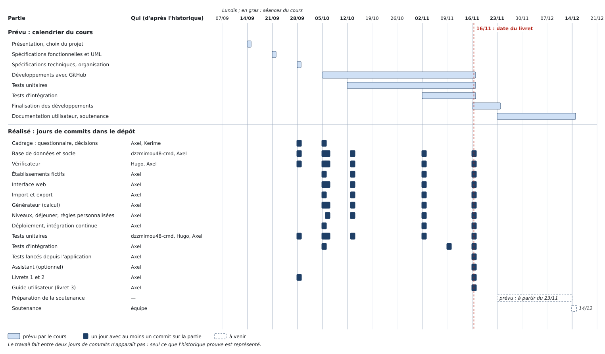

# Spécifications techniques et organisation

**EDT : générateur automatique d'emplois du temps**

Projet PTS Informatique, ISEP, année 2026-2027

| | |
|---|---|
| Livret | 2 sur 4 : spécifications techniques et organisation du projet |
| Enseignant | Hervé Allanic |
| Équipe | Axel, Nassim Khiri, Kerime, Hugo |
| Date | 23 novembre 2026 |
| Version | 1.2 |
| Application décrite | EDT 1.0.0 |
| Dépôt GitHub | https://github.com/Maki882/projet-edt |

Ce livret décrit comment l'application est construite (matériels, systèmes, technologies,
langages, bibliothèques) et comment le projet a été organisé (lots, planning, outils, méthodes,
référentiel). Il complète le livret 1, [Spécifications fonctionnelles](1-specifications-fonctionnelles.md),
qui décrit l'application du point de vue de l'utilisateur, le livret 3,
[guide de l'utilisateur](3-guide-utilisateur.md), et le livret 4,
[cahier de recette](4-cahier-de-recette.md), qui présente la recette par les tests
d'intégration. Les chiffres cités sont mesurés sur la
branche principale à la version 1.0.0 de l'application (16 novembre 2026).

---

## Table des matières

- [1. Spécifications techniques](#1-spécifications-techniques)
  - [1.1 Vue d'ensemble](#11-vue-densemble)
  - [1.2 Matériels ciblés](#12-matériels-ciblés)
  - [1.3 Systèmes d'exploitation](#13-systèmes-dexploitation)
  - [1.4 Interfaces externes](#14-interfaces-externes)
  - [1.5 Stockage des données](#15-stockage-des-données)
  - [1.6 Autres technologies](#16-autres-technologies)
  - [1.7 Langages de programmation](#17-langages-de-programmation)
  - [1.8 Bibliothèques](#18-bibliothèques)
  - [1.9 Le calcul de l'emploi du temps](#19-le-calcul-de-lemploi-du-temps)
  - [1.10 Du diagramme des classes au code](#110-du-diagramme-des-classes-au-code)
  - [1.11 Tests](#111-tests)
  - [1.12 Assistant conversationnel](#112-assistant-conversationnel)
  - [1.13 Déploiement](#113-déploiement)
- [2. Organisation du projet](#2-organisation-du-projet)
  - [2.1 Équipe et contributions](#21-équipe-et-contributions)
  - [2.2 Découpage en lots](#22-découpage-en-lots)
  - [2.3 Planning prévu et réalisé](#23-planning-prévu-et-réalisé)
  - [2.4 Environnement de développement](#24-environnement-de-développement)
  - [2.5 Méthodes de suivi](#25-méthodes-de-suivi)
  - [2.6 Référentiel du projet](#26-référentiel-du-projet)

---

## 1. Spécifications techniques

### 1.1 Vue d'ensemble

L'application est une **application web** écrite en Python. Un navigateur affiche des pages
produites par le serveur ; le générateur, qui calcule l'emploi du temps, repose sur une
bibliothèque de programmation par contraintes ; toutes les données sont enregistrées dans une
base SQLite.
L'architecture est en couches, sans exception : les interfaces (web, ligne de commande et
assistant) appellent des services, qui s'appuient sur une logique pure (domaine, générateur,
vérificateur) et sur la base.

*Figure 1. Architecture en couches.*

Trois règles structurent le code :

- une fonctionnalité existe d'abord comme **fonction de service typée** (paramètres et résultats
  explicites), puis comme page web et comme commande : l'interface web, la ligne de commande
  et l'assistant appellent exactement les mêmes fonctions ;
- le générateur et le vérificateur ne lisent jamais la base : ils travaillent sur un
  **instantané**, copie figée et complète des données d'un semestre, construite par les services ;
- **rien n'échoue en silence** : les services lèvent des erreurs métier (une hiérarchie unique
  `ErreurEDT`), traduites en message lisible par l'interface web et en code de sortie non nul
  par la ligne de commande ; chaque module journalise ce qu'il fait.

La description détaillée se trouve dans [architecture.md](../architecture.md).

### 1.2 Matériels ciblés

| Matériel | Usage |
|---|---|
| Ordinateur de bureau ou portable | Usage principal : saisie des données, lancement des calculs, consultation et retouche. Aucune installation : un navigateur web suffit. |
| Téléphone | Consultation de l'emploi du temps et des pages de données : la mise en page s'adapte aux écrans de moins de 56 rem (environ 900 pixels) de large. |
| Serveur | Héberge l'application de démonstration : machine virtuelle de 2 cœurs et 3,7 Go de mémoire. Un calcul utilise au plus 8 fils d'exécution, jamais plus que de cœurs disponibles. |
| Poste de développement | Ordinateur sous Windows 11 avec Python 3.11, où l'application se lance aussi en local. |

### 1.3 Systèmes d'exploitation

| Système | Rôle |
|---|---|
| Windows 11 | Développement et essais en local (Python 3.11). |
| Ubuntu 26.04 | Serveur de démonstration (Python 3.14). |
| Ubuntu (machines de GitHub Actions) | Intégration continue : chaque changement est vérifié sous Python 3.11, 3.13 et 3.14. |
| Tout système disposant de Python 3.11 ou plus | L'application fonctionne sous Windows et sous Linux (développement, serveur, intégration continue) ; elle ne demande que Python et ses bibliothèques. Les fichiers sont lus et écrits en UTF-8. |

### 1.4 Interfaces externes

| Interface | Description |
|---|---|
| Interface web (HTTP, HTTPS) | Interface principale : six onglets (dont deux pour lancer les tests du projet), formulaires, tableaux, grille d'emploi du temps. Les pages sont produites par le serveur ; HTMX remplace seulement des morceaux de page (filtres, panneaux, suivi d'un calcul), sans application JavaScript à construire. En ligne, le site n'est joignable qu'en HTTPS. |
| Ligne de commande | `python -m edt <commande>` : 19 commandes (créer et vérifier la base, charger un établissement fictif, pré-vérifier, générer, instancier les séances datées, vérifier, importer, exporter, gabarit, sauvegarder, diagnostiquer l'installation, lancer le serveur web, lancer les tests, interroger l'assistant). Chaque commande appelle les mêmes services que l'interface web. |
| Fichiers échangés | Import et export des données de l'établissement en classeur Excel (XLSX, un onglet par feuille) ou en fichiers CSV (dans une archive ZIP) ; import d'un emploi du temps existant en CSV, XLSX ou agenda iCal (`.ics`) ; export de l'emploi du temps en CSV ou iCal ; impression ou PDF par le navigateur. L'encodage, le séparateur et la marque d'ordre des octets d'un CSV sont détectés ; un envoi est limité à 20 Mo. |
| Communication réseau | Le serveur web de l'application n'écoute que sur la machine elle-même (127.0.0.1:8000) ; nginx est seul exposé sur Internet (ports 80 et 443). |
| API Claude d'Anthropic (optionnelle) | Utilisée seulement par l'assistant conversationnel (section 1.12) : appel sortant en HTTPS. Sans clé d'accès sur le serveur, le panneau dit que l'assistant n'est pas configuré et le reste de l'application fonctionne normalement. Aucune donnée réelle n'est envoyée : toutes les données sont fictives. |

### 1.5 Stockage des données

| Stockage | Description |
|---|---|
| Base SQLite | Un seul fichier, sans serveur de base à administrer : suffisant pour un établissement complet et un utilisateur à la fois. Le mode WAL permet de lire pendant une écriture ; les clés étrangères sont actives ; une transaction qui lit puis écrit réserve l'écriture dès son début, ce qui évite les blocages. 23 classes enregistrées, 30 tables avec les tables d'association ([modele-donnees.md](../modele-donnees.md)) ; la dernière, `assistant_consommation`, reste dans le modèle mais n'est ni lue ni écrite : la consommation du jour de l'assistant est gardée dans un fichier hors de la base ([assistant.md](../assistant.md), § 3). |
| Schéma sans migrations | Le schéma est créé par la commande `init-db` ; une base au schéma périmé est détectée (`verifier-schema`) et se recrée puis se repeuple par commande. |
| Journaux | Module `logging` de Python, configuré en un seul endroit : console, fichier tournant `logs/edt.log`, un fichier par calcul dans `logs/generations/` ; les résultats des tests lancés depuis l'application sont dans `logs/tests/`. Chaque requête web reçoit un identifiant, repris dans les journaux et affiché sur les pages d'erreur. Sur le serveur, les journaux vont aussi dans journald. |
| Sauvegardes | Copie cohérente de la base, vérifiée avant d'être gardée (commande `sauvegarder`) ; sur le serveur, une sauvegarde chaque nuit à 3 h 30 (14 gardées) et une avant chaque déploiement. |
| Configuration | Variables d'environnement `EDT_*` (adresse de la base, dossier des journaux, niveau de journalisation, adresse et port, réglages de l'assistant et du lancement des tests) ; sur le serveur, des fichiers d'environnement hors du dépôt. Les paramètres d'une installation (adresse du serveur, domaine, chemin de la clé SSH) sont dans `deploy/serveur.env`, que Git ne suit pas : le dépôt ne contient qu'un modèle aux valeurs neutres. Aucun secret n'est écrit dans le dépôt. |

### 1.6 Autres technologies

| Technologie | Utilité |
|---|---|
| HTML et CSS | Les pages sont produites par des gabarits Jinja2 (65 gabarits) et mises en forme par quatre feuilles de style, avec des règles propres à l'impression et aux petits écrans. |
| HTMX 2.0.11 | Petite bibliothèque JavaScript, copiée dans le dépôt (aucun outil Node) : un attribut sur un lien ou un formulaire suffit pour remplacer un morceau de page par la réponse du serveur. |
| nginx | Serveur web frontal : termine le HTTPS, sert les fichiers statiques, relaie le reste vers l'application, affiche des pages d'erreur en français (application indisponible, envoi trop volumineux). |
| certbot (Let's Encrypt) | Obtient et renouvelle automatiquement le certificat HTTPS. |
| systemd | Lance l'application comme service (un seul processus, utilisateur système dédié, redémarrage après une panne) et déclenche la sauvegarde quotidienne par un minuteur. |
| Bash | Dix scripts d'installation, de déploiement, d'installation de la clé de l'assistant, de surveillance et de lecture des journaux (`deploy/`). |
| Git et GitHub | Gestion de version, pull requests, intégration continue (section 2.6). |
| GitHub Actions | À chaque pull request et à chaque envoi sur la branche principale : contrôle du style (ruff), du rangement des tests, puis tests unitaires et tests d'intégration, sous trois versions de Python. |

### 1.7 Langages de programmation

| Langage | Volume (fichiers suivis) | Utilité |
|---|---|---|
| Python 3.11 ou plus | 155 fichiers, 66 045 lignes dans `src/` ; 237 fichiers, 45 476 lignes de tests | Tout le code de l'application : services, générateur, vérificateur, interface web, ligne de commande, import et export, création des établissements fictifs, assistant, banc de tests. Choisi pour sa lisibilité et pour ses bibliothèques (programmation par contraintes, tableurs, agendas). |
| HTML (gabarits Jinja2) | 65 gabarits | Structure des pages ; les variables et les boucles des gabarits sont remplies par le serveur. |
| CSS | 4 fichiers, 3 195 lignes | Mise en page, couleurs par matière, grille d'emploi du temps, impression, petits écrans. |
| JavaScript | 3 fichiers, 810 lignes (hors HTMX) | Petits comportements d'interface : demande de confirmation avant une suppression, champs qui n'apparaissent qu'au besoin, recherche rapide dans les listes, blocs repliables, impression, panneau de l'assistant (envoi, suivi d'un échange, clavier). |
| Bash | 10 scripts, 2 175 lignes | Installation du serveur, déploiement, clé de l'assistant, état et journaux. |
| SQL | aucun fichier | Les requêtes sont produites par SQLAlchemy à partir des classes Python. |

### 1.8 Bibliothèques

Les dépendances sont déclarées dans [`pyproject.toml`](../../pyproject.toml), avec des bornes
larges. La version exacte de chaque paquet, dépendances indirectes comprises, est figée dans
[`contraintes.txt`](../../contraintes.txt), utilisé par l'installation locale, le contrôle
automatique et le déploiement : le serveur reçoit exactement les versions que le contrôle
automatique a testées. La colonne « Version figée » en est tirée.

| Bibliothèque | Version demandée | Version figée | Utilité |
|---|---|---|---|
| OR-Tools (CP-SAT) | 9.15 ou plus | 9.15.6755 | Moteur de programmation par contraintes de Google. Il place chaque séance (jour, heure, campus, puis salle) en respectant les règles nécessaires et en minimisant les entorses aux règles importantes et facultatives, ainsi que les trous et les samedis. |
| SQLAlchemy | 2.0 ou plus | 2.1.8 | Fait correspondre les classes Python aux tables SQLite ; gère les sessions, les transactions et les contraintes d'intégrité. |
| FastAPI | 0.121 ou plus | 0.163.1 | Cadre du serveur web : associe chaque adresse à une fonction, lit les formulaires, renvoie les pages HTML et traduit les erreurs métier en pages lisibles. |
| Uvicorn | toute version | 0.54.0 | Serveur qui exécute l'application FastAPI, en local (`python -m edt serve`) comme sur le serveur. |
| Jinja2 | toute version | 3.1.6 | Moteur de gabarits : produit le HTML de chaque écran à partir des données. |
| python-multipart | toute version | 0.0.34 | Lecture des formulaires et des fichiers envoyés (import), utilisée par FastAPI. |
| Typer | 0.27 ou plus | 0.29.1 | Construit la ligne de commande `python -m edt` : options, aide, codes de sortie. |
| openpyxl | toute version | 3.1.5 | Lecture et écriture des classeurs Excel : import, export et gabarit vide. |
| icalendar | toute version | 7.3.0 | Lecture et écriture des agendas iCal : export de l'emploi du temps vers un agenda, import d'un emploi du temps existant. |
| python-dateutil | toute version | 4.0.0 | Interprète les règles de récurrence des agendas importés (« chaque lundi jusqu'au... »). |
| Faker | toute version | 40.54.0 | Fournit des noms et prénoms français pour les établissements fictifs ; avec le même numéro de variante, le même établissement est reproduit à l'identique. |
| anthropic | 2.0 ou plus, avant 3 | 2.8.0 | Client officiel de l'API Claude, utilisé par l'assistant conversationnel ; il n'est appelé que si une clé d'accès est installée sur le serveur. |
| pytest (développement) | toute version | 9.2.0 | Lance les tests automatiques ; les marqueurs `unitaire`, `integration`, `cas_limite` et `perf` les classent. Le banc de tests de l'application le lance dans un processus à part ; c'est pourquoi le serveur installe aussi les outils de développement, aux versions figées. |
| httpx2 (développement) | toute version | 2.16.2 | Client HTTP utilisé par le client de test de FastAPI pour envoyer de vraies requêtes à l'application pendant les tests d'intégration. |
| ruff (développement) | toute version | 0.17.5 | Vérifie le style et les erreurs courantes du code Python et le met en forme ; la CI refuse un changement qui ne le respecte pas. |

### 1.9 Le calcul de l'emploi du temps

Le calcul d'un semestre enchaîne les étapes suivantes :

1. **Instantané** : les services lisent la base et construisent la copie figée du semestre ;
   chaque besoin y est « déplié » en séances hebdomadaires, avec leurs semaines actives.
2. **Pré-vérifications** : contrôles rapides (charge de chaque groupe, de chaque enseignant, de
   chaque type de salle ; salles accessibles ; verrous incompatibles). Un point bloquant
   empêche de lancer le calcul et l'écran en donne la raison.
3. **Horaires** : un premier modèle CP-SAT choisit le jour, l'heure et le campus de chaque
   séance.
4. **Salles** : un second modèle affecte une salle à chaque séance ; si c'est impossible, les
   horaires en cause sont écartés et l'étape 3 reprend.
5. **Amélioration** (mode « plus confortable ») : l'objectif est ajouté au même modèle, en
   partant de la solution valide. Chaque entorse à une règle importante pèse 1 000, à une règle
   facultative 20 ; chaque trou d'un groupe pèse 10, un changement de campus 5, une séance le
   samedi 2, un créneau en début ou fin de journée 1. Un arrêt ou la fin du temps garde toujours
   la meilleure solution trouvée.
6. **Séances datées** : la semaine type est reportée sur chaque semaine du semestre ; une séance
   qui tombe un jour fermé ou pendant une indisponibilité est replacée, ou passe « à
   programmer ».
7. **Vérification** : le vérificateur, écrit indépendamment du générateur, contrôle le résultat
   avant qu'il soit enregistré comme nouvelle version.

Pendant le calcul, le suivi interrogé chaque seconde annonce dès qu'un premier emploi du temps
valide est trouvé ; un arrêt demandé ensuite garde le meilleur trouvé.

Mesures consignées dans [solveur.md](../solveur.md), première solution valide : 111 séances
hebdomadaires (établissement fictif moyen, semestre 1) en 1,9 s ; 595 séances (établissement
fictif grand, semestre 1, 99 salles) en 19,5 s. Sur l'établissement grand, 180 secondes
d'amélioration ramènent les trous de 2 874 à 3 sur le semestre. Une mesure faite pour ce
livret sur le poste de développement : le calcul complet du semestre 1 de l'établissement
moyen, amélioration comprise, a pris 19,4 s (la durée varie avec la charge de la machine).

### 1.10 Du diagramme des classes au code

Chaque notion du diagramme du livret 1 existe sous deux formes : une classe enregistrée en
base (`src/edt/db/modeles.py`, classes SQLAlchemy) et une copie figée dans l'instantané
(`src/edt/domaine/instantane.py`, classes immuables) sur laquelle travaillent le générateur et le
vérificateur. Le diagramme les réunit ; le tableau ci-dessous donne la correspondance.

| Notion du livret 1 | Classe enregistrée | Opérations, et où elles se trouvent |
|---|---|---|
| Année scolaire | `AnneeScolaire` | |
| Semestre | `Semestre` | |
| Type de séance | `TypeSeance` | |
| Version d'emploi du temps | `VersionEdt` | |
| Campus | `Campus` | |
| Jour fermé | `JourFerme` | `concerne()` : `instantane.JourFerme` |
| Groupe | `Groupe` | |
| Besoin | `Besoin` | `ponctuel` : `instantane.Besoin` |
| Séance de la semaine type | `SeanceHebdo` | |
| Salle | `Salle` | `est_accessible()` : `instantane.Salle` |
| Indisponibilité | `Indisponibilite` | `ressource_id` : `modeles.Indisponibilite` ; `recurrente`, `concerne()` : `instantane.Indisponibilite` |
| Enseignant | `Enseignant` | `nom_affiche()` : `modeles.Enseignant` |
| Matière | `Matiere` | |
| Séance datée | `Occurrence` | |
| Règle personnalisée | `Regle` | `cible_id()` : `modeles.Regle` ; `active`, `couvre()`, `periode_texte()` : `domaine.regles.Regle` |
| Type de règle | `DefinitionType` (catalogue `CATALOGUE_TYPES`, `domaine/regles.py`) | `libelle`, `champ()` |
| Niveau | `Niveau` (`domaine/contraintes.py`) | `libelle`, `description` |
| Donnée importable | `Provenance` (classe de base sans table) | |

Le code contient d'autres héritages que le diagramme fonctionnel ne montre pas : les classes
enregistrées héritent aussi de `CodeNormalise` ou `IdentifiantNormalise` (normalisation des
codes à chaque affectation) et de la base déclarative SQLAlchemy ; les erreurs métier forment la
hiérarchie `ErreurEDT` (huit sous-classes, dont `ErreurInfaisable` et `ErreurDonneesInvalides`) ;
les énumérations affichables dérivent de `EnumLibelle`. Un test vérifie que
[modele-donnees.md](../modele-donnees.md) décrit toutes les tables du modèle.

### 1.11 Tests

Les nombres ci-dessous sont ceux du tableau généré dans [tests/README.md](../../tests/README.md)
(`python -m tests.outils.classement`) à la version 1.0.0 ; la recette a ajouté depuis 13 tests
d'intégration et les contrôles de son outil (livret 4, [cahier de recette](4-cahier-de-recette.md),
section 3). Ce tableau compte les fonctions de test ; pytest, qui compte
chaque cas d'une fonction paramétrée à part, collecte 2 262 cas.

| Famille | Fonctions | Contenu |
|---|---|---|
| Tests unitaires (`tests/unitaires/`) | 1 121 | Un module exercé seul : règles du vérificateur, modèles du générateur, lecture des fichiers, services, outils de l'assistant, catalogue du banc de tests... |
| Tests d'intégration (`tests/integration/`) | 533 | Plusieurs couches assemblées : requêtes HTTP au vrai serveur de test, commandes, calculs complets ; dont 6 parcours de bout en bout. |
| Contrôle du rangement (`tests/test_rangement.py`) | 11 | Vérifie que chaque test est rangé dans la bonne famille et que les tableaux de nombres des documents sont à jour. |
| dont cas limites (marqueur `cas_limite`) | 538 | Cas limites et pannes plausibles, chacun documenté par « Cas : … Risque : … ». |
| dont tests de charge (marqueur `perf`) | 24 | Calculs longs sur l'établissement fictif grand, exclus de l'intégration continue. |

Le vérificateur sert d'oracle aux tests du générateur : un emploi du temps produit est valide si
le vérificateur ne relève aucune erreur. Par règle, un test ne dépend ni de l'heure réelle, ni
du hasard, ni de la solution exacte du générateur. Les tests de l'assistant n'appellent jamais
le service réel : ils utilisent un faux client. La stratégie est détaillée dans
[banque-de-tests.md](../banque-de-tests.md) et [tests/integration/README.md](../../tests/integration/README.md).

**Tests lancés depuis l'application.** Les onglets « Tests unitaires » et « Tests
d'intégration » s'appuient sur le service `edt.services.banc_tests`, que la commande
`python -m edt tests` (options `--famille` et `--composant`) utilise aussi :

- le catalogue des tests est lu dans les fichiers de tests eux-mêmes, sans les exécuter ;
- une exécution lance pytest dans un processus à part, avec un greffon qui signale chaque test
  terminé ; la page suit l'exécution chaque seconde et peut l'arrêter ;
- les tests tournent sur une base et des journaux temporaires, effacés à la fin, dans un
  environnement sans les réglages de l'application : la base de l'application n'est jamais
  touchée ;
- une seule exécution à la fois, refusée pendant un calcul d'emploi du temps ; durée maximale
  réglable (`EDT_TESTS_DUREE_MAX_S`, 900 s par défaut) ; lancement désactivable
  (`EDT_TESTS_LANCEMENT=non`) ; les tests de charge ne se lancent que par la commande
  `python -m edt tests --test …`, jamais depuis la page ;
- le résultat et la date de la dernière exécution de chaque test sont gardés dans
  `logs/tests/resultats.json`, avec le journal complet de la dernière exécution.

Mesure faite sur le serveur de démonstration (Linux, deux cœurs) le 16 novembre, avec le
code de la version 1.0.0 : la famille des tests unitaires, lancée par
`python -m edt tests --famille unitaires`, a duré 2 min 33 s : 1 101 tests (les
20 tests de charge ne partent pas avec la famille), 1 101 réussis, 0 échec, 0 ignoré ;
la famille des tests d'intégration, 5 min 00 s : 529 tests (hors les
4 tests de charge), 529 réussis.

La recette de l'application (fiches de recette reliées aux fonctionnalités et aux cas d'usage
du livret 1, campagnes et résultats) fait l'objet du livret 4,
[cahier de recette](4-cahier-de-recette.md).

### 1.12 Assistant conversationnel

Le panneau « Assistant », présent sur chaque page, transmet la demande de l'utilisateur au
modèle Claude d'Anthropic, avec des consignes et douze outils. Les outils n'écrivent rien : ils
lisent les données par les services (contexte, recherche, salles libres, emploi du temps,
points à traiter, règles) ou préparent une proposition validée par le service concerné, ou le lien d'un formulaire de besoin
prérempli que l'utilisateur vérifie et enregistre lui-même. Une
proposition (règle personnalisée, modification, activation ou désactivation d'une règle,
indisponibilité) n'est enregistrée qu'au clic sur « Confirmer », après une nouvelle validation
complète.

| Sujet | Réalisation |
|---|---|
| Code | paquet `edt.services.assistant` (consignes, outils, boucle d'échange, limites, conversations, propositions, client) ; routes `edt.web.routes.assistant` ; commande `python -m edt assistant` (état, `--essai`, `--question`) |
| Limites par défaut | 10 messages par conversation, 20 messages par adresse et par jour, 100 messages par jour pour le site, 2 échanges simultanés, budget estimé de 2 dollars par jour ; chaque limite est réglable par une variable `EDT_ASSISTANT_*` |
| Mémoire | conversations gardées en mémoire, oubliées après 30 minutes sans activité ou au redémarrage ; le texte des conversations n'est enregistré nulle part ; seule la consommation du jour (échanges, appels, jetons, coût estimé) est gardée, dans un fichier du dossier des journaux |
| Clé d'accès | installée sur le serveur par `deploy/installer-cle-assistant.sh`, en saisie masquée, dans un fichier d'environnement réservé au service ; jamais dans le dépôt ni dans les journaux |
| Sans clé | le panneau dit que l'assistant n'est pas configuré ; le reste de l'application fonctionne |

La documentation complète est dans [assistant.md](../assistant.md).

### 1.13 Déploiement

*Figure 2. Déploiement de la démonstration.*

Une mise à jour se fait depuis le poste de développement par `deploy/deployer.sh` : le code
d'un commit est envoyé au serveur, installé dans un nouveau dossier de version avec son propre
environnement Python aux versions figées (outils de développement compris, pour les tests
lancés depuis l'application), vérifié, puis mis en service ; la base est sauvegardée avant chaque
déploiement, et la version précédente reste disponible pour un retour arrière. Le détail est dans
[deploiement.md](../deploiement.md).

---

## 2. Organisation du projet

### 2.1 Équipe et contributions

L'équipe compte quatre membres : Axel, Nassim Khiri, Kerime et Hugo. Le tableau suivant
présente les contributions telles que l'historique Git les établit ; le travail fait hors du
dépôt (discussions, décisions en séance, relectures orales) n'y figure pas.

| Membre | Compte GitHub | Contributions visibles dans l'historique |
|---|---|---|
| Axel | Maki882 | Création du dépôt ; questionnaire de cadrage et document des décisions ; ouverture et fusion de 52 des 53 pull requests ; 812 des 820 commits de la branche principale (code, tests, documentation, déploiement). 680 des 820 commits de la branche principale sont co-signés par un assistant de programmation (section 2.4). |
| Hugo | HugoLec94 | Premier vérificateur de conflits du planning et ses tests, versé par la première pull request ; il a ensuite été généralisé dans le vérificateur actuel. |
| Kerime | kerime-2 | Réponses au questionnaire de cadrage (deux commits). |
| — | `dzzmimou48-cmd` | Première structure de la base de données, ses données de test et ses tests (quatre commits), reprise ensuite dans le socle. |
| Nassim Khiri | — | Aucun commit n'est rattaché à son nom dans l'historique. |

Les réponses au questionnaire, données de vive voix ou par message, sont consolidées sans
nom d'auteur dans le document des décisions ([decisions.md](../decisions.md)) ; les réponses
brutes restent dans l'historique du dépôt.

### 2.2 Découpage en lots

| Lot | Sous-étapes | Réalisé (dates principales ; tous les jours de commits en figure 3) |
|---|---|---|
| **1. Cadrage** | Analyse du besoin (ébauche de spécification) ; questionnaire de 400 questions numérotées ; réponses de l'équipe ; document des décisions de cadrage, qui fait autorité. | 28/09 au 05/10 |
| **2. Socle** | Modèle de données (22 classes) ; contrats partagés (instantané, catalogue des règles) ; configuration, journaux, erreurs ; ligne de commande ; détection d'un schéma périmé. | 05/10 |
| **3. Vérificateur** | Une fonction par règle ; gravités ; indicateurs de qualité ; vérification de la semaine type et des séances datées. | 28/09 (première version), 05/10 |
| **4. Établissements fictifs** | Création d'établissements fictifs en trois tailles, chacun désigné par un numéro de variante ; emploi du temps de référence ; écran « Établissement fictif ». | 05/10, puis 02/11 |
| **5. Interface Données** | Onglets ; écrans de toutes les données (listes, recherche, formulaires, suppression avec ses conséquences) ; lisibilité sur un établissement complet. | 05/10 et 06/10 |
| **6. Import et export** | Gabarit ; lecture XLSX, CSV et iCal ; simulation et rapport ; exports ; import d'un emploi du temps existant. | 05/10 |
| **7. Interface emploi du temps** | Onglets Générer et Emploi du temps, page des points à traiter ; vues semaine type, datée, jour ; retouches et verrous ; heures possibles au déplacement. | 05/10, puis 02/11 et 16/11 |
| **8. Générateur** | Modèle des horaires puis des salles ; amélioration ; séances datées et replacement ; arrêt automatique quand l'amélioration ne progresse plus ; tests déterministes. | 05/10 et 06/10 |
| **9. Règles** | Niveaux nécessaire, important, facultatif ; pause déjeuner à trois modes ; conception puis réalisation des règles personnalisées (14 types). | 06/10 au 13/10 |
| **10. Déploiement** | Scripts d'installation et de déploiement ; HTTPS ; sauvegardes ; intégration continue sous trois versions de Python ; versions figées ; paramètres d'installation hors du dépôt. | 05/10, puis 02/11 et 16/11 |
| **11. Tests** | Tests écrits avec chaque lot ; banque de cas limites ; six parcours de bout en bout ; séparation des tests unitaires et d'intégration. | 05/10 au 16/11 |
| **12. Finalisation** | Simplification de l'interface (réglages repliés, vocabulaire unique) ; textes et documentation ; livrets 1, 2 et 3. | 16/11 |
| **13. Assistant (optionnel)** | Consignes et douze outils de lecture ; propositions confirmées d'un clic ; limites et budget quotidien ; commande d'état et d'essai ; script d'installation de la clé. | 16/11 |
| **14. Tests lancés depuis l'application** | Catalogue des tests, exécution dans un processus à part, suivi et arrêt ; deux onglets avec un schéma de l'organisation des tests ; commande `tests`. | 16/11 |
| **15. Soutenance** | Scénario de démonstration ; préparation de la soutenance. | prévu à partir du 23/11 |
| **16. Cahier de recette** | Livret 4 : fiches de recette reliées aux fonctionnalités et aux cas d'usage du livret 1, adossées aux tests d'intégration ; campagnes ; journal des anomalies corrigées ; bilan. | 23/11 |

### 2.3 Planning prévu et réalisé

Le planning prévu est celui des séances du cours. Le planning réalisé se lit dans
l'historique Git : chaque carré du diagramme marque un jour où au moins un commit a touché la
partie concernée.

*Figure 3. Diagramme de Gantt : prévu (calendrier du cours) et réalisé (historique du dépôt).*

| Jalon du cours | Prévu | Réalisé |
|---|---|---|
| Présentation, équipes, choix du projet | 14/09 | Dépôt GitHub créé le 28/09 ; l'activité antérieure n'y figure pas. |
| Spécifications fonctionnelles et UML | 21/09 | Ébauche (document Word) versée le 28/09 ; livret 1 au plan du cours le 16/11. |
| Spécifications techniques et organisation | 28/09 | Choix techniques fixés dans les décisions de cadrage le 05/10 ; livret 2 le 16/11. |
| Démarrage des développements avec GitHub | 05/10 | 28/09 : base initiale et premier vérificateur ; 05/10 et 06/10 : socle, vérificateur, établissements fictifs, interface, import et export, générateur, déploiement. |
| Tests unitaires | 12/10 | Écrits avec chaque lot dès le 05/10 ; 13/10 : règles personnalisées et leurs tests. |
| Tests d'intégration | 02/11 | Premiers tests d'intégration des commandes le 05/10 ; banque de cas limites le 02/11 ; parcours de bout en bout le 09/11 ; séparation unitaires et intégration, tests lancés depuis l'application le 16/11. |
| Finalisation des développements | 16/11 | 16/11 : ergonomie, textes, versions figées, assistant, onglets de tests, livrets 1, 2 et 3. |
| Documentation utilisateur, préparation de la soutenance | 23/11 | Livret 3 (guide de l'utilisateur) rédigé le 16/11 ; livret 4 (cahier de recette) rédigé le 23/11 ; préparation de la soutenance à venir. |
| Soutenance | 14/12 | À venir. |

Le développement a été concentré sur les jours de séance : 16 commits le 28/09, 202 le 05/10,
41 le 06/10, 93 le 13/10, 105 le 02/11, 6 le 09/11 et 357 le 16/11 sur la branche principale.

### 2.4 Environnement de développement

| Outil | Usage |
|---|---|
| Python 3.11 et environnement virtuel (`venv`) | Une installation isolée par poste : `python -m venv .venv`, puis `python -m pip install -e ".[dev]" -c contraintes.txt` installe l'application et ses outils de développement aux versions figées. |
| pip, `pyproject.toml` et `contraintes.txt` | Gestion des bibliothèques : les dépendances et leurs bornes sont déclarées dans `pyproject.toml` ; la version exacte de chaque paquet est figée dans `contraintes.txt` (section 1.8). |
| pytest | Tests unitaires et d'intégration, lancés localement avant chaque pull request et par la CI. |
| ruff | Style et erreurs courantes ; mise en forme automatique du code. |
| Git, GitHub, GitHub CLI (`gh`) | Gestion de version, branches, pull requests, consultation de la CI. |
| GitHub Actions | Intégration continue (section 1.6). |
| Navigateur web | Essai des écrans en local (`python -m edt serve`). |
| Assistants de programmation | Assistants fondés sur l'intelligence artificielle, encadrés par le fichier de consignes `AGENTS.md` ; outils et usage décrits dans l'encadré ci-dessous. |

Les éditeurs de code employés par les membres ne sont pas consignés dans le dépôt : leurs
réglages sont exclus du suivi (`.gitignore`).

> **Encadré : usage des assistants de programmation**
>
> Le projet a été réalisé avec des assistants de programmation fondés sur l'intelligence
> artificielle ; 680 des 820 commits de la branche principale portent leur co-signature.
> Outils employés : Claude Code (Anthropic) ; le fichier `AGENTS.md` sert aussi à Codex.
> Ils ont été employés selon les principes suivants. Les équipes d'agents mises en place
> ensuite sont décrites dans [docs/organisation-agents.md](../organisation-agents.md).
>
> - **L'équipe décide et vérifie ; l'assistant propose et exécute** dans un cadre écrit,
>   le fichier [`AGENTS.md`](../../AGENTS.md) : architecture, conventions, ce qu'un assistant ne
>   fait pas seul (changer la spécification, ajouter une dépendance majeure, fusionner).
> - **Aucun secret n'est confié à un assistant** (ni clé, ni mot de passe) et **toutes les
>   données sont fictives**.
> - **Chaque tâche est décrite par un brief autonome** : fichiers concernés, interdits,
>   décisions déjà prises, preuve de réussite attendue.
> - **Un fichier n'est modifié que par un seul assistant à la fois** : chaque tâche a sa branche
>   et son périmètre.
> - **Le travail est vérifié sur pièces** : relecture des changements réels, tests relancés ;
>   pour l'important, une seconde relecture indépendante cherche les défauts.
> - **Un test appelle le vrai code et doit pouvoir échouer** : un correctif s'accompagne d'un
>   test qui échoue sans lui.
> - **Rien n'échoue en silence**, et **tout chiffre écrit est mesuré**.
> - **Chaque changement passe par une branche, une pull request et le contrôle automatique.**
> - **La contribution des assistants reste visible dans l'historique** (ligne
>   `Co-Authored-By` des commits).

### 2.5 Méthodes de suivi

| Méthode | Description |
|---|---|
| Questionnaire de cadrage | Le cadrage s'est appuyé sur un questionnaire de 400 questions numérotées ; les réponses de l'équipe sont consolidées dans [decisions.md](../decisions.md), qui fait autorité : une décision s'y change avant de changer le code. |
| Pull requests | 53 pull requests, toutes fusionnées, chacune décrite selon un modèle (« Quoi », « Pourquoi », « Comment vérifier », liste de contrôle). Les 23 dernières (31 à 53) datent de la journée de finalisation du 16/11. |
| Modèle de tâche | Un modèle d'issue (« Tâche ») décrit l'objectif, le classement (obligatoire, utile ou optionnelle, comme au livret 1), les détails et le critère de réussite ; des étiquettes du même nom existent sur GitHub. Il a servi pour la première fois le 23/11/2026, pour l'issue n° 54 ([lien](https://github.com/Maki882/projet-edt/issues/54)), qui suit l'anomalie ouverte relevée par la recette (livret 4) ; jusque-là, le suivi passait par les pull requests et le document des décisions. Les issues ouvertes par l'équipe d'agents suivent aussi ce modèle ([organisation-agents.md](../organisation-agents.md)). |
| Intégration continue | Chaque pull request et chaque envoi sur la branche principale sont vérifiés automatiquement ; le résultat s'affiche sur la pull request avant la fusion. |
| Historique des commits | La convention est un message en français, à l'impératif, un sujet par commit ; l'historique sert de journal de bord et de base au planning réalisé (section 2.3). |
| Documentation de conception | Un document par partie de l'application (architecture, modèle de données, générateur, vérification, import et export, établissements fictifs, déploiement, tests), versé avec le code de cette partie. |

Les échanges de l'équipe en dehors de GitHub (réunions, messagerie) ne sont pas consignés dans
le dépôt ; les décisions qui en résultent le sont, dans le document des décisions. Sur GitHub, une
issue est ouverte (n° 54) ; aucun jalon n'est ouvert, et aucune relecture formelle (approbation
d'une pull request) n'y est enregistrée.

### 2.6 Référentiel du projet

| Élément | Description |
|---|---|
| Dépôt | GitHub `Maki882/projet-edt`, à l'adresse <https://github.com/Maki882/projet-edt> ; dépôt privé, accès donné aux membres de l'équipe et à l'enseignant sur invitation, modifiable par les quatre membres de l'équipe. Il contient le code, les tests, les scripts de déploiement et toute la documentation, dont les livrets du cours (`docs/livrets/`). |
| Branches | Une branche par tâche, nommée `type/description` (par exemple `feat/import-export`, `fix/schema-perime`), puis `partie/description` pendant la finalisation (par exemple `assistant/assistant-conversationnel`, `generer/suivi-et-page-repliee`) ; fusion dans `main` par pull request. Les 17 premiers commits (28/09 et 05/10 : mise en place du dépôt, base initiale, questionnaire, décisions) ont été déposés directement sur `main` ; depuis, chaque changement passe par une pull request. |
| Protection de `main` | La protection automatique des branches n'est pas disponible pour ce dépôt privé (offre gratuite de GitHub) : la règle « pas d'envoi direct sur `main` » reste une convention de l'équipe, appliquée depuis le 05/10. |
| Organisation des dossiers | `src/edt/` : l'application, un paquet par couche ou par partie ; `tests/` : `unitaires/`, `integration/`, `outils/` ; `deploy/` : serveur ; `docs/` : documentation de conception et livrets. |
| Langue | Code, commentaires, messages, commits et documentation en français. |
| Fichiers exclus | Environnements virtuels, bases, journaux, réglages d'éditeurs et secrets ne sont jamais suivis (`.gitignore`). |
