# Guide de l'utilisateur

**EDT : générateur automatique d'emplois du temps**

Projet PTS Informatique, ISEP, année 2026-2027

| | |
|---|---|
| Livret | 3 sur 3 : guide de l'utilisateur |
| Enseignant | Hervé Allanic |
| Équipe | Axel, Nassim Khiri, Kerime, Hugo |
| Date | 16 novembre 2026 |
| Version | 1.0 |
| Application décrite | EDT 1.0.0 |

Ce livret est le mode d'emploi de l'application, écran par écran. Il s'adresse au
responsable de la scolarité qui la découvre et ne suppose aucune connaissance en
informatique. Ce que fait l'application et pourquoi est décrit dans le livret 1,
[Spécifications fonctionnelles](1-specifications-fonctionnelles.md) ; sa construction, dans le
livret 2, [Spécifications techniques et organisation](2-specifications-techniques-et-organisation.md).

Toutes les captures proviennent de l'application sur l'établissement fictif « moyen » (une
promotion de troisième année, 39 groupes, 34 enseignants, 34 salles). Les noms de personnes
sont inventés. Les libellés écrits « entre guillemets » ou en gras sont ceux de l'écran.

---

## Table des matières

- [1. L'application en une page](#1-lapplication-en-une-page)
- [2. Prise en main en cinq minutes](#2-prise-en-main-en-cinq-minutes)
- [3. Saisir ou importer les données](#3-saisir-ou-importer-les-données)
- [4. Les règles](#4-les-règles)
- [5. Générer un emploi du temps](#5-générer-un-emploi-du-temps)
- [6. Consulter et retoucher l'emploi du temps](#6-consulter-et-retoucher-lemploi-du-temps)
- [7. Les points à traiter](#7-les-points-à-traiter)
- [8. Importer et exporter](#8-importer-et-exporter)
- [9. L'assistant](#9-lassistant)
- [10. Les onglets de tests](#10-les-onglets-de-tests)
- [11. Questions fréquentes et messages courants](#11-questions-fréquentes-et-messages-courants)
- [Annexe : installation et commandes pour l'administrateur](#annexe--installation-et-commandes-pour-ladministrateur)

---

## 1. L'application en une page

EDT construit l'emploi du temps d'un semestre : chaque séance reçoit un jour, une heure et
une salle, dans le respect des disponibilités, des salles, des groupes, du calendrier et des
règles de l'établissement. Quand aucun emploi du temps n'est possible, l'application le dit
et désigne la cause ; elle ne supprime jamais une règle pour réussir. Elle s'ouvre dans un
navigateur web, sans écran de connexion. Six onglets occupent le haut de chaque page :

| Onglet | À quoi il sert |
|---|---|
| **Accueil** | l'encadré « Prochaine étape » et l'état de l'emploi du temps du semestre en cours (version active, points à traiter) ; les autres semestres se consultent dans Générer › Points à traiter |
| **Données** | l'établissement : campus, salles, enseignants, groupes, matières, besoins, indisponibilités, calendrier, règles, import et export |
| **Générer** | lancer le calcul, suivre son avancement, l'historique des versions et les **points à traiter**, dont le nombre s'affiche sur l'onglet |
| **Emploi du temps** | consulter le résultat par groupe, enseignant ou salle ; déplacer, verrouiller ou annuler une séance ; imprimer et exporter |
| **Tests unitaires** et **Tests d'intégration** | les tests automatiques de l'application, lancés et lus depuis le navigateur |

Le bouton **Assistant**, en bas à droite de chaque page, ouvre un panneau où poser des
questions en langage courant (partie 9). Le principe à retenir : **l'accueil dit toujours
quoi faire ensuite.** Son encadré « Prochaine étape » propose l'action utile selon l'état de
la base : charger un établissement, générer l'emploi du temps, le consulter.

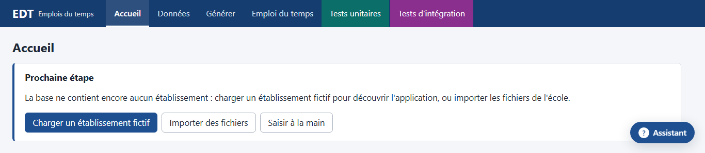

*Figure 1. Accueil d'une base vide : trois façons de commencer.*

## 2. Prise en main en cinq minutes

Ce parcours, celui de la démonstration, charge un établissement inventé, calcule son emploi
du temps et l'affiche.

**Étape 1. Charger un établissement fictif.** Sur l'accueil, cliquer sur « Charger un
établissement fictif ». L'écran **Établissement fictif** propose trois tailles : **Petit**
(calcul en quelques secondes), **Moyen** (calcul en moins d'une minute, choisi par défaut) et
**Grand** (cinq années, trois sites). Laisser « Moyen » et cliquer sur « Charger
l'établissement fictif ».

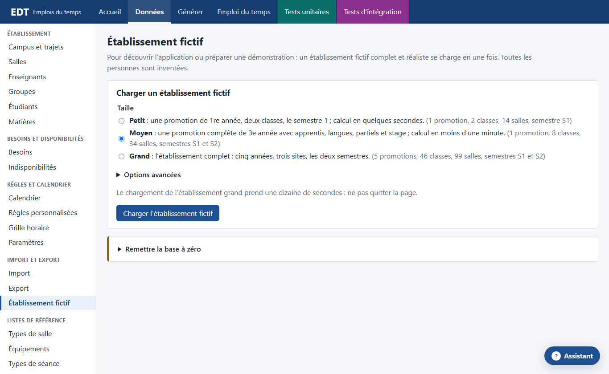

*Figure 2. Données › Établissement fictif : la taille « Moyen » est choisie par défaut.*

En quelques secondes, l'écran **Établissement fictif chargé** résume ce qui est entré dans
la base : 3 campus, 34 salles, 39 groupes, 246 étudiants, 34 enseignants, 30 matières,
221 besoins d'enseignement et 14 règles d'exemple. Si la base contenait déjà des données, le
chargement les remplace toutes, une fois cochée la case « Confirmer l'effacement de toutes
les données actuelles ».

**Étape 2. Générer.** Cliquer sur « Générer l'emploi du temps » (le même bouton figure sur
l'accueil). L'écran **Générer un emploi du temps** affiche ce que le calcul va placer, le
résultat des vérifications (« Aucun problème relevé avant le calcul. ») et les réglages,
repliés. Cliquer sur « Lancer le calcul ».

La page du calcul se met à jour toute seule. Dès la première seconde, elle indique « Un
emploi du temps est déjà trouvé » : le calcul cherche ensuite à l'améliorer et s'arrête de
lui-même quand il ne progresse plus (une vingtaine de secondes ici). « Arrêter le calcul »
garde le meilleur trouvé.

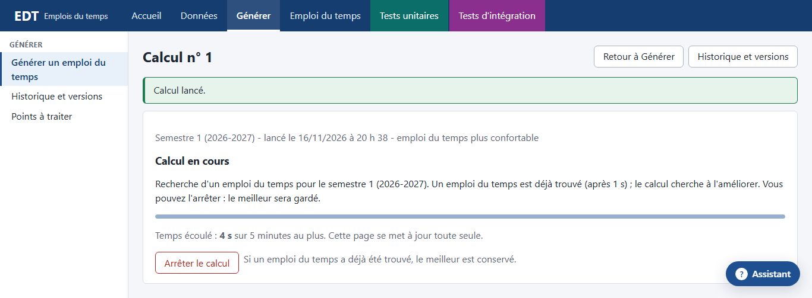

*Figure 3. Calcul en cours : un premier emploi du temps est trouvé après une seconde.*

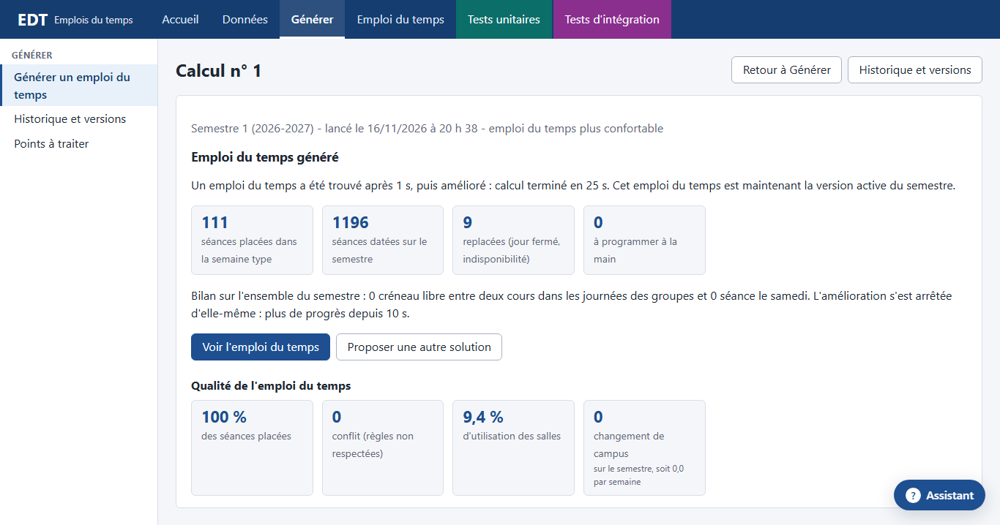

*Figure 4. Résultat : l'emploi du temps devient la version active du semestre.*

**Étape 3. Consulter.** Cliquer sur « Voir l'emploi du temps ». L'onglet **Emploi du temps**
s'ouvre sur une classe ; la liste « Pour qui » choisit un autre groupe, un enseignant ou une
salle (partie 6). L'accueil affiche alors « L'emploi du temps du semestre 1 (2026-2027)
est prêt » et le bouton « Consulter l'emploi du temps » ; s'il reste des points à traiter
(partie 7), il en donne le nombre et propose « Voir ce qui reste à traiter ».

## 3. Saisir ou importer les données

L'onglet **Données** rassemble tout ce que le calcul utilise. Le menu de gauche est rangé en
cinq groupes :

| Groupe du menu | Écrans |
|---|---|
| Établissement | Campus et trajets, Salles, Enseignants, Groupes, Étudiants, Matières |
| Besoins et disponibilités | Besoins, Indisponibilités |
| Règles et calendrier | Calendrier, Règles personnalisées, Grille horaire, Paramètres |
| Import et export | Import, Export, Établissement fictif |
| Listes de référence | Types de salle, Équipements, Types de séance |

Chaque écran suit le même modèle : une phrase dit à quoi il sert ; une recherche et des
filtres surmontent la liste ; un bouton de création (« Nouveau besoin », « Nouvelle
indisponibilité »…) est en haut à droite ; chaque ligne porte « Modifier », « Supprimer » et
parfois « Dupliquer ». Une suppression demande toujours une confirmation.

- **Besoins** : le cœur des données, ce qu'il faut enseigner, à quels groupes, par quels
  enseignants, combien de séances et dans quelles salles. Le bloc « Ajout rapide d'un besoin
  hebdomadaire » en crée un en une ligne (matière, type, durée « 2 h » ou « 1 h 30 »,
  groupes, enseignants, séances par semaine), puis « Ajouter le besoin ».
- **Indisponibilités** : un enseignant, une salle ou un groupe absent chaque semaine ou
  pendant une période datée.
- **Calendrier** : dates des semestres et jours fermés ; « Préremplir les jours fériés ».
- **Grille horaire** et **Paramètres** : les créneaux où une séance peut commencer ; les
  jours travaillés, l'ouverture, la fermeture et les pauses.

Pour reprendre les fichiers d'une école plutôt que tout saisir, voir la partie 8.

## 4. Les règles

### 4.1 Les trois niveaux

Chaque règle porte un niveau, affiché à l'écran avec la même définition (écran Générer et
formulaire d'une règle) :

- **Nécessaire** : toujours respectée ;
- **Important** : enfreinte seulement faute de mieux, avec un avertissement ;
- **Facultatif** : un souhait, signalé pour information s'il n'est pas tenu.

Les **règles de base** (une séance à la fois par salle, par enseignant et par groupe ;
capacité de la salle ; disponibilités ; pauses ; trajets…) se règlent dans **Générer**,
section « Règles » des réglages, sauf les six marquées « Toujours nécessaire ». Le niveau
choisi vaut pour le calcul lancé et est rappelé dans son résultat.

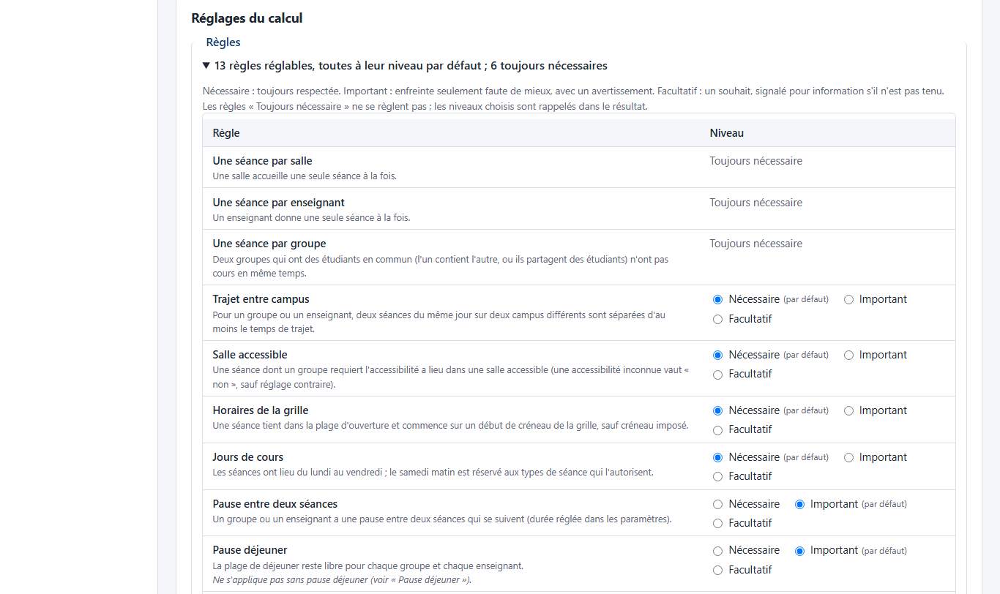

*Figure 5. Générer › Réglages du calcul › Règles : le niveau de chaque règle de base.*

### 4.2 Les règles personnalisées

Les règles propres à l'établissement (« la classe A3-APP1 a aussi cours le samedi »,
« M. Clerc commence à 9 h 00 au plus tôt ») se gèrent dans **Données › Règles
personnalisées**. Chacune s'écrit en phrase et porte un code (R001, R002…), un type, ce
qu'elle concerne, une période, un niveau et un état : **Active** (prise en compte par les
calculs), **Proposée** (suggérée par l'application, sans effet tant qu'elle n'est pas
activée : « Activer » ou « Écarter ») ou **Inactive** (gardée sans effet).

Pour en créer une : « Nouvelle règle » (ou « Ajouter une règle » dans Générer). L'étape 1
présente quatorze types avec des exemples ; cliquer sur « Choisir ». L'étape 2 demande à qui
s'applique la règle, ses paramètres, son niveau et sa période ; l'**aperçu** écrit la phrase
de la règle au fur et à mesure.

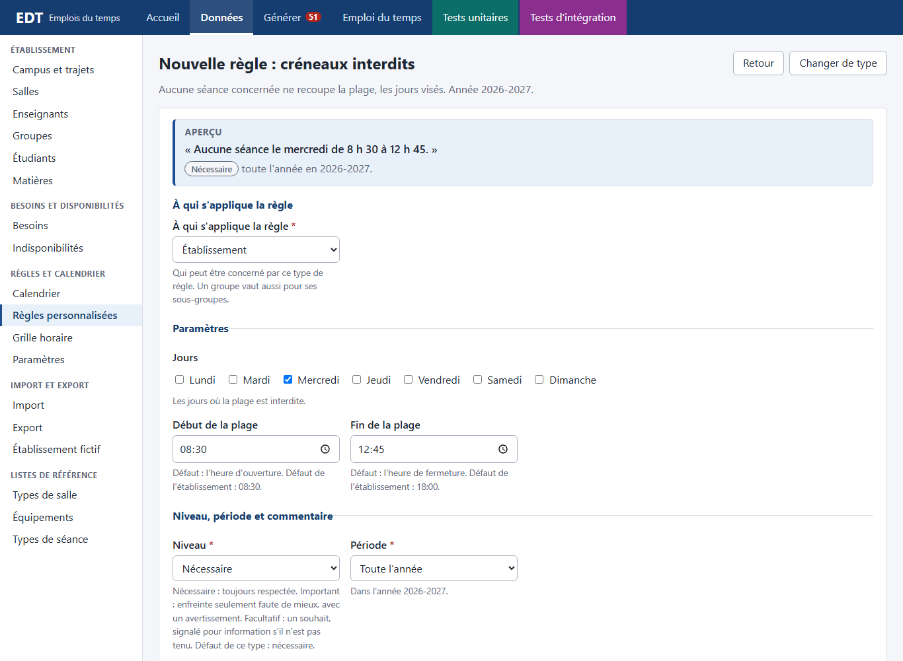

*Figure 6. Une nouvelle règle : l'aperçu donne la phrase avant l'enregistrement.*

« Créer la règle » affiche « Règle R015 créée : … Elle s'appliquera aux prochains
calculs. » L'emploi du temps déjà calculé ne change pas : les séances qui ne respectent pas
la règle apparaissent dans les points à traiter (partie 7). Dans Générer, la section
« Règles personnalisées » permet aussi de changer le niveau d'une règle pour un seul calcul,
ou de choisir « Ignorer pour ce calcul ».

## 5. Générer un emploi du temps

### 5.1 Avant le calcul

L'écran **Générer un emploi du temps** se lit de haut en bas : le **semestre** ; **ce que
le calcul va placer** (besoins, séances, groupes, enseignants, salles) et le dernier calcul ;
les **vérifications avant le calcul** ; les **réglages du calcul**, repliés derrière une
ligne de résumé : « Règles », « Règles personnalisées », « Pause déjeuner » et « Durée et
options » (recherche jusqu'à 5 ou 15 minutes ; « Emploi du temps plus confortable », avec
moins de trous, de changements de campus et de samedis).

Si des séances datées ont été déplacées ou annulées à la main (partie 6.3), un encadré
prévient : « Le nouveau calcul crée une autre version, sans ces retouches : seules les
séances verrouillées gardent leur place. » Une séance déplacée en semaine type (partie 6.2)
ne garde sa place au calcul suivant que si elle est verrouillée.

### 5.2 Pendant et après le calcul

« Lancer le calcul » ouvre la page du calcul (figure 3). Le résultat compte les séances
placées, les séances datées, les séances replacées (tombées un jour fermé ou pendant une
indisponibilité) et celles à programmer à la main, puis donne la **qualité** : séances
placées, conflits, utilisation des salles, changements de campus. « Proposer une autre
solution » relance, après confirmation, un calcul qui cherche un emploi du temps différent.

Chaque calcul réussi enregistre une **version**. L'écran **Historique et versions** (menu
de gauche de Générer) les liste ; la **version active** est celle que les écrans montrent.
« Consulter », « Rendre active » et « Supprimer » agissent sur une version. Si la case
« Enregistrer aussi un emploi du temps de référence » a été cochée au chargement (options
avancées de l'écran Établissement fictif), l'établissement fictif fournit aussi un **emploi
du temps de référence**, pour comparer.

### 5.3 Quand aucun emploi du temps n'est possible

Si les vérifications trouvent un **point bloquant**, l'encadré devient rouge : « Le calcul
ne peut pas être lancé : 86 points bloquants à corriger », puis chaque séance sans horaire
possible, la cause (« … par la règle R016 ») et le remède : « Lever ou assouplir l'une de
ces causes. » « Lancer le calcul » répond alors « Le calcul n'a pas été lancé ».

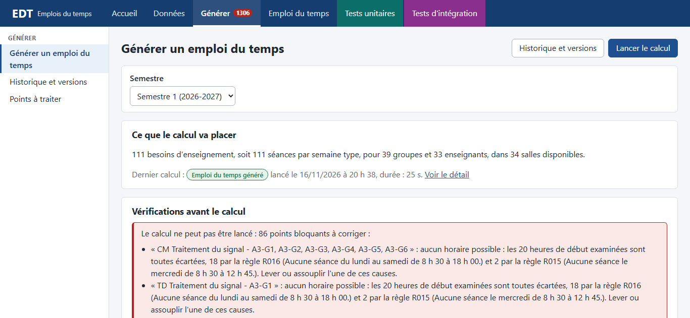

*Figure 7. Points bloquants : ici, une règle interdit toute séance du lundi au samedi.*

Que faire : dans **Données › Règles personnalisées**, désactiver, modifier ou baisser le
niveau de la règle citée ; ou corriger la donnée en cause (une indisponibilité trop large,
une salle manquante). Les vérifications se refont à chaque affichage de l'écran.

## 6. Consulter et retoucher l'emploi du temps

### 6.1 Choisir l'affichage

L'onglet **Emploi du temps** montre la version active. En haut : « Semestre », « Version »
et « Pour qui » (avec une recherche) pour choisir un groupe, un enseignant ou une salle. À
droite, trois vues : **Semaine type** (la semaine modèle, répétée tout le semestre),
**Semaine datée** (une semaine réelle, avec jours fériés, séances replacées et retouches ;
« Semaine précédente », « Semaine suivante », « Aller à la date ») et **Jour**.

Pour un groupe, l'encadré bleu dit ce qui est affiché et ce qui ne l'est pas (les séances de
ses demi-groupes) ; « Afficher aussi ces séances » les ajoute. Un cadenas marque une séance
verrouillée, un point d'exclamation une anomalie, détaillée sous la grille.

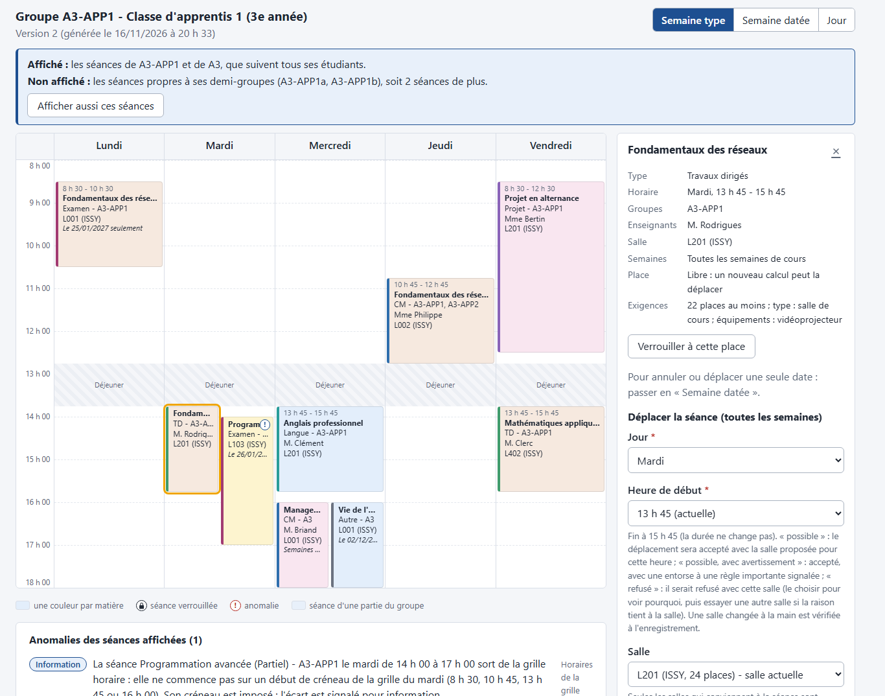

*Figure 8. Semaine type de la classe A3-APP1, panneau d'une séance ouvert.*

### 6.2 Déplacer ou verrouiller une séance de la semaine type

Un clic sur une séance ouvre son panneau à droite : type, horaire, groupes, enseignants,
salle, semaines, **place** et exigences. Deux actions :

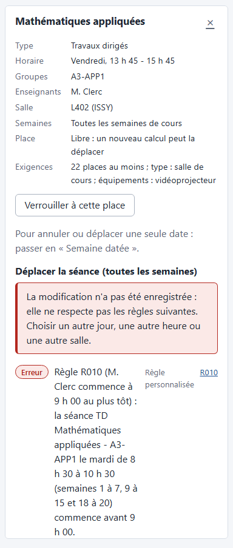

*Figure 9. Un déplacement refusé : rien n'est enregistré, la raison est donnée.*

- « Verrouiller à cette place » : « Séance verrouillée : les prochains calculs la laisseront
  à sa place. » « Déverrouiller » annule ce choix.
- « Déplacer la séance (toutes les semaines) » : choisir le jour, l'heure de début et la
  salle. Chaque heure est marquée **(possible)** (accepté avec la salle proposée pour cette
  heure), **(possible, avec avertissement)** (accepté, avec une entorse à une règle
  importante signalée), **(refusé)** ou **(actuelle)**. Quand aucune heure ne convient ce
  jour-là, le panneau le dit : « Aucune heure possible le jeudi avec les salles proposées :
  essayer un autre jour (règle la plus souvent en cause : Une séance par groupe). »
  « Vérifier et enregistrer » contrôle toutes les règles. Un déplacement accepté s'affiche en
  vert (« Séance déplacée au mardi à 13 h 45, salle L201… ») ; un déplacement refusé
  n'enregistre rien et liste les règles en cause (figure 9).

### 6.3 Retoucher une seule date

En **Semaine datée**, le panneau d'une séance porte deux actions qui ne touchent qu'à cette
date :

- « Déplacer cette séance seulement » : date, heure de début, salle, puis « Vérifier et
  enregistrer » ;
- « Annuler cette séance », avec un motif facultatif (« enseignant absent ») : le navigateur
  demande « Annuler la séance du 18/11/2026 ? Elle n'aura pas lieu et ne comptera plus dans
  le volume. Elle ne pourra pas être rétablie dans cette version. », puis affiche « Séance
  du 18/11/2026 annulée. »

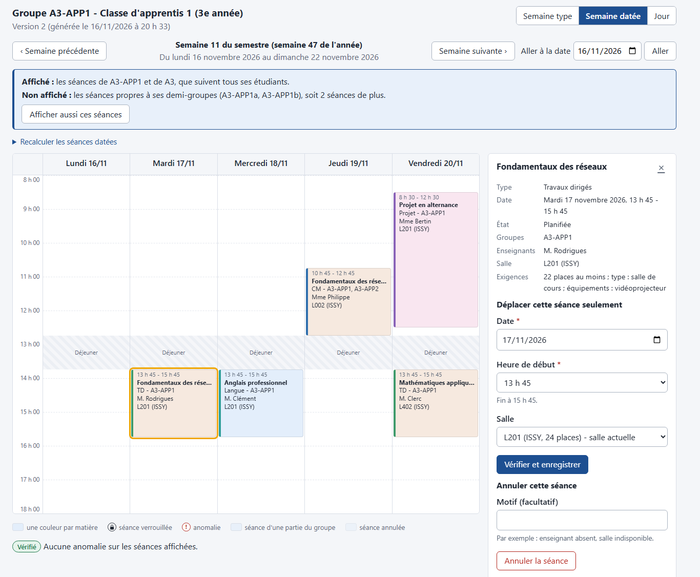

*Figure 10. Semaine datée : une retouche ne touche qu'une date.*

Un nouveau calcul ne reprend pas ces retouches (partie 5.1) : seules les séances
verrouillées gardent leur place.

### 6.4 Imprimer et exporter l'affichage

En haut de l'écran : « Imprimer » imprime la grille affichée ; « Exporter pour un tableur »
télécharge un fichier CSV ; « Exporter vers un agenda », un fichier iCal pour un agenda
personnel (pour un groupe, demi-groupes compris).

## 7. Les points à traiter

L'écran **Points à traiter** (onglet Générer, menu de gauche) rassemble ce que la
vérification de la version active a relevé ; leur nombre s'affiche sur l'onglet **Générer**.
Pour chaque semestre :

- **Semaine type** et **Séances datées** : les anomalies, par gravité (**Erreur** « Règles
  non respectées », **Avertissement** « Situations à vérifier », **Information** « Pour
  information ») puis par règle, chacune avec « Voir dans l'emploi du temps » ;
- **Séances à programmer** : les séances tombées un jour fermé ou pendant une
  indisponibilité sans autre créneau trouvé, avec la raison et le bouton « Programmer ».

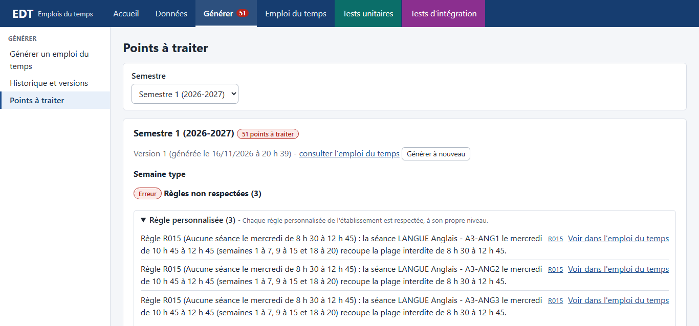

*Figure 11. Après l'ajout d'une règle, les séances qui ne la respectent pas sont listées.*

Pour régler une **erreur** : « Générer à nouveau » puis relancer le calcul, ou déplacer la
séance en cause (partie 6). Un **avertissement** ou une **information** se lit, sans
correction obligatoire. Pour une **séance à programmer** : « Programmer », puis choisir une
date, une heure et une salle. Corriger la semaine type corrige aussi les séances datées qui
en découlent.

## 8. Importer et exporter

L'écran **Données › Import** reprend les fichiers d'une école. « Télécharger le gabarit »
fournit le classeur modèle, avec ses explications. « Que contiennent les fichiers ? » choisit
entre les **données de l'établissement** (format du gabarit : classeur XLSX, ou un CSV par
feuille) et un **emploi du temps existant** (CSV, XLSX ou iCal), repris comme emploi du temps
de référence, en séances verrouillées ou en séances à replacer.

Un import se fait en deux temps : « Simuler l'import » lit les fichiers sans rien écrire et
donne le bilan et les lignes rejetées avec leur raison ; « Appliquer l'import » enregistre
ensuite les lignes valides. Réimporter un fichier met à jour sans créer de doublon.

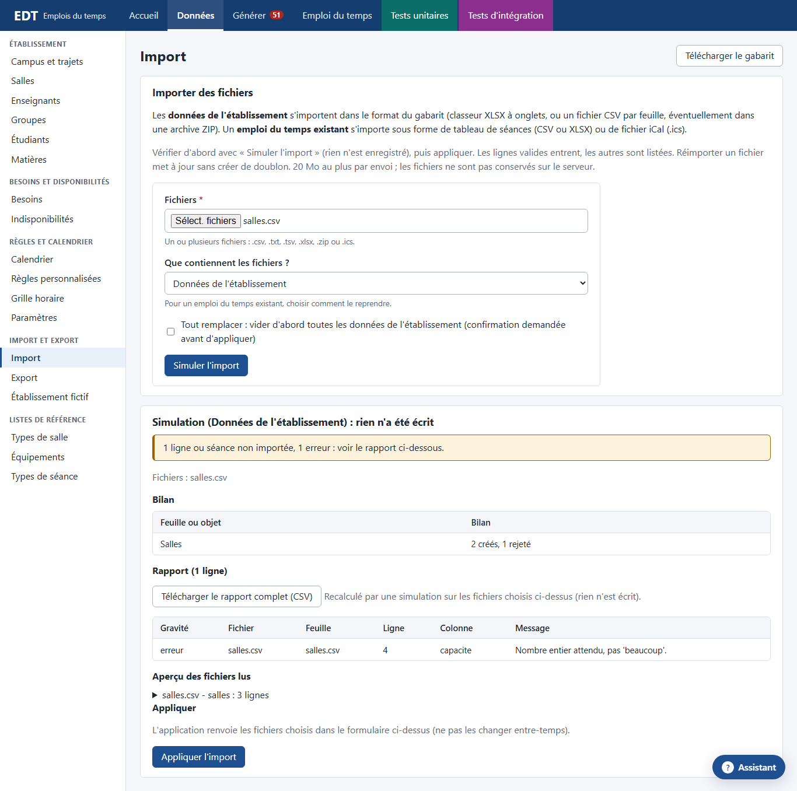

*Figure 12. Une simulation : rien n'est écrit tant que l'import n'est pas appliqué.*

L'écran **Données › Export** propose l'**emploi du temps** d'une version (semaine type ou
séances datées, en entier ou pour un seul groupe, enseignant ou salle) par « Télécharger en
CSV » ou « Télécharger en iCal (agenda) » ; les **données de l'établissement** en « Classeur
Excel (.xlsx) » ou « Fichiers CSV (archive .zip) », réimportables tels quels ; le **gabarit
vide**.

## 9. L'assistant

Le bouton **Assistant**, en bas à droite de chaque page, ouvre un panneau de conversation.
La demande s'écrit dans « Votre demande » et part avec « Envoyer » (ou Ctrl + Entrée). Trois
exemples de demandes s'affichent à l'ouverture ; un clic sur l'un d'eux le recopie dans la
zone de saisie.

L'assistant **répond** sur les données et l'emploi du temps (salles libres, séances d'un
groupe, d'un enseignant ou d'une salle, points à traiter, explication d'une règle),
**propose** une règle, sa modification, son activation ou une indisponibilité, et
**prépare** le formulaire d'un nouveau besoin, à vérifier et à enregistrer soi-même.

**Il propose, vous confirmez.** Une proposition s'affiche dans une carte « Nouvelle règle »
marquée « À confirmer », avec sa phrase, son type, son niveau et sa période. « Confirmer »
l'enregistre (« Enregistrée : règle R016, active. Elle comptera au prochain calcul. ») ;
« Refuser » n'enregistre rien. La carte rappelle : « Rien n'est enregistré avant Confirmer.
Vérifiez la phrase : l'assistant peut se tromper. »

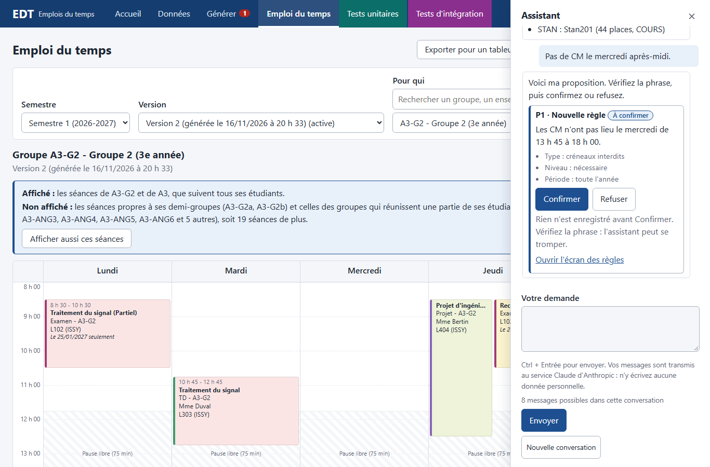

*Figure 13. Une demande en langage courant devient une règle proposée, à confirmer.*

Limites :

- il ne génère pas d'emploi du temps, ne supprime rien et ne déplace aucune séance ;
- une conversation compte au plus 10 messages ; « Nouvelle conversation » repart de zéro ;
- les messages sont transmis au service Claude d'Anthropic : n'y écrire aucune donnée
  personnelle ;
- sur un serveur où l'assistant n'est pas configuré, le panneau affiche « Indisponible » et
  « L'assistant n'est pas configuré sur ce serveur. Le reste de l'application fonctionne
  normalement. »

## 10. Les onglets de tests

Les onglets **Tests unitaires** et **Tests d'intégration** sont un outil de l'équipe, montré
à la soutenance : ils lancent depuis le navigateur les tests automatiques de l'application,
sur une base temporaire effacée à la fin. Un **test unitaire** exerce une seule partie du
code ; un **test d'intégration** en fait travailler plusieurs ensemble (une page web, une
commande, un calcul complet) ; le bloc « Comment sont organisés ces tests » l'explique.

Les tests sont rangés par composant, puis par fichier, et chaque niveau a son bouton
(« Lancer tous les tests … », « Lancer le composant … », « Lancer ce fichier », « Lancer »).
Un cadre suit l'exécution (« 6 tests terminés sur 6 : 6 réussis, 0 échec, 0 ignoré ») ;
chaque test affiche son état, sa durée et sa « Dernière exécution » (« jamais » pour un test
jamais lancé), et « Journal complet de l'exécution » donne le détail. Pendant une exécution
des tests, l'écran Générer prévient qu'un calcul lancé à ce moment serait refusé. Les tests
de charge, longs, ne se lancent pas depuis le navigateur : leur ligne porte « Par la
commande », et l'administrateur les lance un par un avec `python -m edt tests --test …`
(voir l'annexe).

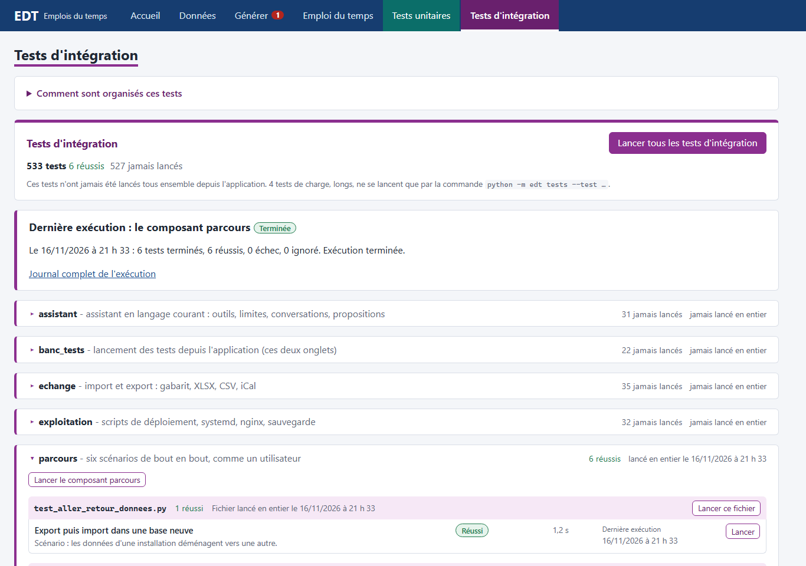

*Figure 14. Tests d'intégration : le composant « parcours » vient d'être lancé.*

## 11. Questions fréquentes et messages courants

| Message ou situation | Ce qui s'est passé | Que faire |
|---|---|---|
| « Le calcul ne peut pas être lancé : … points bloquants à corriger » | une donnée ou une règle rend le calcul impossible | lever ou assouplir la règle ou la donnée citée (partie 5.3) |
| « La modification n'a pas été enregistrée : elle ne respecte pas les règles suivantes » | un déplacement de séance enfreint une règle nécessaire | choisir une heure marquée « (possible) », avec la salle proposée |
| « Aucune heure possible le … avec les salles proposées : essayer un autre jour » | aucune heure de ce jour ne convient à la séance | choisir un autre jour ; la règle citée est la cause la plus fréquente |
| « Une exécution des tests est en cours : un calcul lancé maintenant serait refusé » | des tests tournent depuis les onglets de tests | relancer le calcul à la fin des tests, visible dans leur onglet |
| « Règle R… déjà créée avec ce contenu : rien n'a été ajouté. » | une règle identique existe déjà | rien à faire : la règle existante s'applique |
| « Saisie invalide » | une valeur envoyée manque ou n'est pas valide ; rien n'a été enregistré | « Revenir à la page précédente » et corriger le champ cité |
| « Base de données occupée » | une autre opération (chargement, remise à zéro, calcul) utilise la base ; rien n'a été modifié | réessayer dans quelques secondes |
| « Erreur interne de l'assistant », avec une référence | l'assistant n'a pas pu répondre | « Renvoyer ma demande » ; si l'erreur revient, transmettre la référence à l'administrateur |
| Une règle ajoutée n'a « aucun effet » | la règle est proposée ou inactive, ou aucun calcul n'a eu lieu depuis | l'activer, puis générer à nouveau |
| Une retouche a disparu après un calcul | un nouveau calcul ne reprend pas les retouches des séances datées | verrouiller les séances à garder avant de recalculer ; l'ancienne version reste dans « Historique et versions » |
| Repartir d'une base vide | | Données › Établissement fictif › « Remettre la base à zéro », après avoir coché la confirmation |

## Annexe : installation et commandes pour l'administrateur

Il faut Python 3.11 ou plus récent. Depuis la racine du dépôt, dans un environnement
virtuel (`python -m venv .venv`, puis l'activer) :

```sh
python -m pip install -e . -c contraintes.txt   # installe l'application aux versions figées
python -m edt init-db                    # crée la base data/edt.db et ses données par défaut
python -m edt serve                      # lance le serveur web sur http://127.0.0.1:8000
```

L'établissement fictif se charge ensuite depuis l'accueil, ou par
`python -m edt jeu --taille moyen`. `python -m edt doctor` vérifie l'installation. Les
réglages (base, journaux, adresse et port d'écoute) passent par les variables
d'environnement `EDT_DB_URL`, `EDT_LOG_DIR`, `EDT_HOST` et `EDT_PORT`. Chaque fonction est
aussi une commande ; `python -m edt <commande> --help` donne ses options.

| Commande | Rôle |
|---|---|
| `init-db`, `verifier-schema` | créer la base ; vérifier que ses tables correspondent au modèle |
| `jeu`, `jeu-minimal` | charger un établissement fictif (petit, moyen, grand) ; un très petit jeu de données |
| `serve` | lancer le serveur web |
| `pre-verifier`, `generer`, `instancier` | dire ce qui empêcherait un calcul ; générer l'emploi du temps d'un semestre ; produire ses séances datées |
| `verifier` | lister les anomalies d'un emploi du temps enregistré |
| `gabarit`, `importer`, `exporter-donnees`, `exporter-edt` | échanger des fichiers (XLSX, CSV, iCal) |
| `sauvegarder`, `verifier-sauvegarde` | sauvegarder la base ; contrôler une sauvegarde |
| `assistant` | état de l'assistant (configuration, limites, consommation du jour) |
| `tests` | lancer les tests comme depuis les onglets de tests ; un seul test, dont un test de charge, avec `--test` |
| `doctor`, `version` | vérifier l'installation ; afficher la version |
