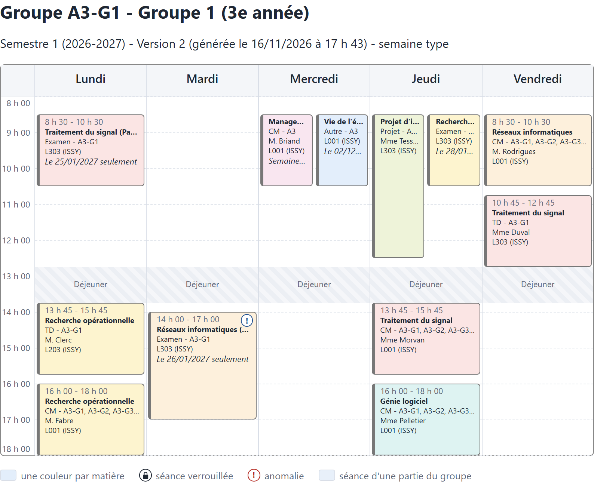
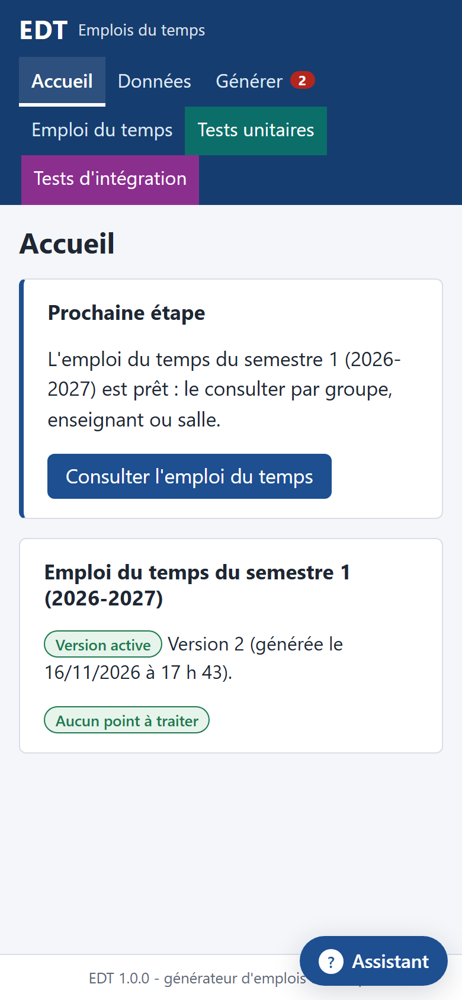

# Cahier de recette

**EDT : générateur automatique d'emplois du temps**

Projet PTS Informatique, ISEP, année 2026-2027

| | |
|---|---|
| Livret | 4 sur 4 : cahier de recette (tests d'intégration) |
| Enseignant | Hervé Allanic |
| Équipe | Axel, Nassim Khiri, Kerime, Hugo |
| Date | 23 novembre 2026 |
| Version | 1.0 |
| Application décrite | EDT 1.0.0 |

Ce livret établit que l'application fait ce que les trois autres livrets annoncent. Le livret 1,
[Spécifications fonctionnelles](1-specifications-fonctionnelles.md), dit ce que l'application
doit faire ; le livret 2, [Spécifications techniques et
organisation](2-specifications-techniques-et-organisation.md), comment elle est construite et
testée ; le livret 3, le [guide de l'utilisateur](3-guide-utilisateur.md), comment s'en servir.
Le présent livret reprend chaque fonctionnalité réalisée et chaque cas d'usage du livret 1, décrit
l'essai qui la vérifie (une fiche de recette), et donne le résultat obtenu lors de campagnes
réelles.

Les nombres de ce livret (tests, fiches, résultats, durées, dates) ne sont pas écrits à la main :
ils sont produits par un outil du dépôt à partir des fiches, des tests eux-mêmes et des fichiers
de résultats que l'application enregistre (annexe D).

Les sections 1 à 8 se lisent d'une traite : elles disent ce qui est recetté, comment, avec
quel résultat et quelles réserves. Les annexes se consultent au besoin : fiches détaillées
(annexe A), résultats par fichier de tests (annexe B), détail des anomalies corrigées
(annexe C), tenue à jour du cahier (annexe D).

---

## Table des matières

- [1. Objet et périmètre](#1-objet-et-périmètre)
- [2. Moyens et méthode](#2-moyens-et-méthode)
- [3. Synthèse des résultats](#3-synthèse-des-résultats)
- [4. Tableau de recette](#4-tableau-de-recette)
  - [4.1 Parcours de bout en bout](#41-parcours-de-bout-en-bout)
  - [4.2 Fonctionnalités obligatoires](#42-fonctionnalités-obligatoires)
  - [4.3 Fonctionnalités utiles](#43-fonctionnalités-utiles)
  - [4.4 Fonctionnalités optionnelles réalisées](#44-fonctionnalités-optionnelles-réalisées)
  - [4.5 Exploitation et robustesse](#45-exploitation-et-robustesse)
- [5. Matrice de traçabilité](#5-matrice-de-traçabilité)
- [6. Anomalies relevées et corrections](#6-anomalies-relevées-et-corrections)
- [7. Limites et réserves](#7-limites-et-réserves)
  - [7.1 Ce que les tests d'intégration ne vérifient pas](#71-ce-que-les-tests-dintégration-ne-vérifient-pas)
  - [7.2 Limites connues de la version 1.0.0](#72-limites-connues-de-la-version-100)
  - [7.3 Réserves de la recette](#73-réserves-de-la-recette)
  - [7.4 Fonctionnalités réalisées sans fiche](#74-fonctionnalités-réalisées-sans-fiche)
- [8. Bilan de la recette](#8-bilan-de-la-recette)
- [Annexe A. Fiches détaillées](#annexe-a-fiches-détaillées)
  - [A.1 Parcours de bout en bout](#a1-parcours-de-bout-en-bout)
  - [A.2 Fonctionnalités obligatoires](#a2-fonctionnalités-obligatoires)
  - [A.3 Fonctionnalités utiles](#a3-fonctionnalités-utiles)
  - [A.4 Fonctionnalités optionnelles réalisées](#a4-fonctionnalités-optionnelles-réalisées)
  - [A.5 Exploitation et robustesse](#a5-exploitation-et-robustesse)
- [Annexe B. Résultats par fichier de tests d'intégration](#annexe-b-résultats-par-fichier-de-tests-dintégration)
- [Annexe C. Détail des anomalies corrigées](#annexe-c-détail-des-anomalies-corrigées)
- [Annexe D. Tenue à jour du cahier](#annexe-d-tenue-à-jour-du-cahier)

---

## 1. Objet et périmètre

### 1.1 Ce qui est recetté

La recette porte sur la version 1.0.0 de l'application, celle que décrivent les trois autres
livrets et qui est en service sur le serveur de démonstration. Elle couvre :

- les fonctionnalités réalisées du livret 1 : les onze fonctionnalités obligatoires (O1 à O11),
  les treize fonctionnalités utiles (U1 à U13) et les quatre fonctionnalités optionnelles
  réalisées (P1 à P4) ;
- les sept cas d'usage du livret 1 ;
- l'exploitation : installation, diagnostic, sauvegarde et restauration, remise à zéro, conduite
  face à une base indisponible, démarrage et arrêt du service, scripts de déploiement.

### 1.2 Ce qui ne l'est pas

- Les fonctionnalités optionnelles prévues et non réalisées : réaménagement sur imprévu (P5),
  comptes et rôles (P6), glisser-déposer (P7), alternance semaine A / semaine B (P8), diagnostic
  détaillé d'un calcul impossible (P9), calcul d'une partie de l'établissement (P10).
- La qualité des réponses de l'assistant (P3) : les tests remplacent le service externe par un
  faux service qui rejoue des réponses écrites d'avance ; ils vérifient le circuit de
  l'application, pas la pertinence d'une réponse.
- Les tests de charge : longs, ils ne partent pas avec la famille des tests d'intégration et se
  lancent par une commande de l'administrateur ; ils sont comptés à part.
- Le déploiement réel sur le serveur : les scripts de déploiement sont contrôlés hors du serveur.

Le rendu visuel, sur un petit écran et à l'impression, ne peut pas être jugé par un test qui
lit les pages par HTTP : il fait l'objet de deux essais manuels (fiches REC-P1-2, en émulation
d'appareil mobile dans Chrome et non sur un téléphone réel, et REC-U12-2). Un troisième essai
manuel (REC-U13-3) rejoue en ligne de commande un défaut ouvert qu'aucun test d'intégration ne
garde encore (anomalie ANO-21). Ce que les tests d'intégration ne couvrent pas, fonctionnalité par fonctionnalité,
est dit à la section 7.

### 1.3 Documents de référence

- Livret 1, Spécifications fonctionnelles : fonctionnalités (section 2.2), règles (section 2.3),
  cas d'usage (section 2.4).
- Livret 2, Spécifications techniques et organisation : organisation des tests (section 1.11).
- Livret 3, Guide de l'utilisateur : libellés des écrans.
- Dans le dépôt (https://github.com/Maki882/projet-edt) : `tests/integration/README.md`
  (organisation des tests d'intégration), `docs/banque-de-tests.md` (cas limites),
  `docs/livrets/recette/fiches.toml` (fiches de ce livret) et
  `docs/livrets/recette/campagnes.json` (résultats enregistrés).

## 2. Moyens et méthode

### 2.1 Une recette par tests d'intégration

Un test d'intégration fait fonctionner plusieurs parties du logiciel ensemble, comme le ferait
un utilisateur : il envoie une vraie requête HTTP à l'application web, ou tape une commande, et
la requête traverse les services, la base de données SQLite et, quand il le faut, le vrai moteur
de calcul et le vrai vérificateur. Un test unitaire, au contraire, vérifie une seule partie,
isolée du reste ; les tests unitaires ne sont pas l'objet de ce livret, mais la section 7 dit
quand ils couvrent ce que les tests d'intégration laissent de côté.

Chaque fiche de recette décrit un essai tel qu'un utilisateur le jouerait à la main (conditions
de départ, étapes, résultat attendu), puis cite les tests automatisés qui le jouent. S'appuyer
sur des tests automatisés plutôt que sur des essais manuels a trois avantages : la recette se
rejoue entièrement en quelques minutes, à chaque modification ; le résultat attendu est écrit
dans le test sous forme d'assertions, sans place pour l'interprétation ; et la recette est
rejouée à l'identique sur plusieurs systèmes. Trois essais restent manuels : deux jugent un
rendu visuel, le troisième rejoue un défaut ouvert (section 1.2).

Les tests ne contrôlent jamais où le moteur de calcul a placé une séance : le moteur ne donne pas
la même solution d'un système à l'autre. Ils contrôlent des propriétés (une version active
existe, aucune anomalie bloquante, autant de lignes exportées que de séances). Quand un essai
demande une situation rare (panne du moteur, base en lecture seule, calcul en cours), le test la
provoque par un substitut, et la fiche le dit dans sa remarque.

### 2.2 Environnements

| Environnement | Rôle |
|---|---|
| Serveur de démonstration | Linux, deux processeurs, Python 3.14 : la machine où l'application est en service. |
| Poste de développement | Windows 11, Python 3.11 : la machine où l'application est écrite. |
| Contrôle automatique du dépôt | À chaque modification proposée, sous Python 3.11, 3.13 et 3.14 : contrôle du style, du rangement des tests, tests unitaires puis tests d'intégration. Il a réussi sur le commit de la version 1.0.0. |

Les campagnes enregistrées et leurs caractéristiques exactes figurent à la section 3.

### 2.3 Jeux de données

Toutes les données sont fictives ; aucune personne réelle n'y figure.

- Le **jeu minimal** : 2 campus, 6 salles, 5 enseignants, 9 groupes, 6 matières, 16 besoins
  (17 séances par semaine type), semestre 1 de l'année 2026-2027, avec ses jours fériés et ses
  vacances. La plupart des fiches partent de lui.
- Les **établissements fictifs** « petit », « moyen » et « grand » du livret 1 (fonctionnalité
  O11), produits par l'application elle-même.
- Des **fichiers fictifs** d'import, rangés avec les tests (salles avec erreurs, séances d'un
  emploi du temps existant), et des fichiers fabriqués par les tests pour les cas limites.

Chaque test part d'une base neuve, dans un dossier temporaire qui lui est propre : aucun test ne
dépend d'un autre, et aucune donnée de l'application en service n'est touchée.

### 2.4 Déroulement d'une campagne

Une campagne est une exécution de toute la famille des tests d'intégration sur une machine.
L'application enregistre, pour chaque test, son résultat (réussi, échec, ignoré avec sa raison),
sa durée et sa date, ainsi que le bilan de l'exécution. L'outil du cahier (annexe D) reprend ce
fichier, n'en garde que les tests d'intégration de l'exécution enregistrée, et le range dans
`campagnes.json` sous le rôle de la machine.

### 2.5 Verdicts et critère d'acceptation

Chaque fiche reçoit l'un de trois verdicts :

- **Conforme** : chacun de ses tests a réussi dans au moins une campagne et aucun n'a échoué ;
  un test ignoré sur un système pour une raison propre à ce système (par exemple un test qui
  n'a de sens que sous Linux) est dit avec sa raison. Une fiche d'essai manuel est conforme si
  le constat correspond au résultat attendu.
- **Non conforme** : au moins un de ses tests a échoué dans une campagne, ou l'essai manuel
  ne donne pas le résultat attendu.
- **Non exécutée** : au moins un de ses tests n'a réussi dans aucune campagne.

Règle de décision, appliquée au bilan (section 8), selon la gravité des anomalies de la
section 6 :

- la version est **refusée** tant qu'une anomalie bloquante est ouverte ;
- elle est **acceptée avec réserves** quand il reste des anomalies majeures ou mineures
  ouvertes, chacune suivie par une demande de correction du dépôt ; chaque fiche non conforme
  est alors rattachée à l'une d'elles ;
- elle est **acceptée sans réserve** sinon : toutes les fiches conformes et chaque
  fonctionnalité réalisée du livret 1 vérifiée par au moins une fiche.

### 2.6 Rejouer la recette

- Depuis l'application : onglet **Tests d'intégration**, bouton de lancement de toute la famille.
- En ligne de commande, comme pour les campagnes de ce livret :
  `python -m edt tests --famille integration`.
- Avec pytest, depuis la racine du dépôt, sans les tests de charge comme dans les campagnes :
  `python -m pytest tests/integration -m "not perf"`.

## 3. Synthèse des résultats

Deux campagnes de référence ont été enregistrées le 23 novembre 2026, l'une sur le serveur de
démonstration, l'autre sur le poste de développement. Elles ont tourné sur le même commit,
77558fd : le code de l'application y est celui de la version 1.0.0, inchangé ; seuls des tests
d'intégration et des documents s'y ajoutent. La version 1.0.0 comptait 533 fonctions de test
d'intégration (livret 2, section 1.11) ; la recette en a ajouté 13. Chaque campagne a lancé
toute la famille des tests d'intégration par la commande
`python -m edt tests --famille integration`.

<!-- recette-synthese : début de la partie générée par `python -m tests.outils.recette --ecrire`, ne pas modifier à la main -->

Le dépôt compte 546 fonctions de test d'intégration ; les campagnes en exécutent 542, les 4 tests de charge se lançant à part.

| Campagne | Date et heures | Système | Python | Tests | Réussis | Échecs | Ignorés | Durée |
|---|---|---|---|---:|---:|---:|---:|---:|
| Serveur de démonstration (EDT 1.0.0, 2 processeurs) | 23/11/2026, 14 h 43 à 14 h 48 | Linux (noyau 7.0) | 3.14.4 | 542 | 542 | 0 | 0 | 5 min 19 s |
| Poste de développement (EDT 1.0.0, 32 processeurs) | 23/11/2026, 14 h 47 à 14 h 51 | Windows 11 | 3.11.9 | 542 | 540 | 0 | 2 | 3 min 35 s |

La durée va de la première à la dernière heure enregistrées par l'application pour l'exécution.

Serveur de démonstration : 1 entrée du fichier de résultats écartée, non comptée dans les nombres ci-dessus :
- `socle/test_web.py::test_base_non_initialisee_une_trace_puis_une_ligne` (résultat du 16/11/2026 : résultat daté hors de l'exécution enregistrée)

Poste de développement : 2 tests ignorés, raison enregistrée « processus et /proc de Linux seulement » :
- `exploitation/test_scripts_deploiement.py::test_processus_hors_service_ignore_les_processus_du_service`
- `exploitation/test_scripts_deploiement.py::test_processus_hors_service_liste_une_commande_de_l_utilisateur`

**Par composant.** Nombre de fonctions de test d'intégration du dépôt, tests de charge compris, tests cités par au moins une fiche, et tests réussis dans chaque campagne.

| Composant | Tests | Dont charge | Cités | Réussis : serveur de démonstration | Réussis : poste de développement |
|---|---:|---:|---:|---:|---:|
| `assistant` | 31 | 0 | 26 | 31 | 31 |
| `banc_tests` | 22 | 0 | 21 | 22 | 22 |
| `echange` | 40 | 0 | 40 | 40 | 40 |
| `exploitation` | 32 | 0 | 30 | 32 | 30 |
| `parcours` | 6 | 0 | 6 | 6 | 6 |
| `socle` | 79 | 0 | 68 | 79 | 79 |
| `solveur` | 54 | 1 | 26 | 53 | 53 |
| `synthese` | 6 | 0 | 6 | 6 | 6 |
| `verification` | 6 | 0 | 6 | 6 | 6 |
| `web_donnees` | 127 | 3 | 65 | 124 | 124 |
| `web_edt` | 143 | 0 | 113 | 143 | 143 |
| **Total** | **546** | **4** | **407** | **542** | **540** |

**Fiches.** Le cahier compte 69 fiches, dont 3 fiches d'essai manuel : 68 « Conforme », 1 « Non conforme », 0 « Non exécutée ». Les fiches citent 407 des 546 tests d'intégration du dépôt (74,5 %) ; les autres figurent à l'annexe B, rangés par fichier.

**Fiche non conforme.** REC-U13-3, « Réimport, dans la même base, de l'emploi du temps exporté », suivie par l'anomalie ANO-21 (section 6). Le verdict d'ensemble est donné à la section 8.

<!-- recette-synthese : fin de la partie générée -->

## 4. Tableau de recette

Une ligne par fiche de recette, rangée par famille : les parcours de bout en bout d'abord,
qui enchaînent plusieurs fonctionnalités comme un utilisateur ; puis les fonctionnalités
obligatoires, utiles et optionnelles, dans l'ordre du livret 1 ; enfin l'exploitation et la
robustesse. Pour chaque fiche : les fonctionnalités du livret 1 qu'elle vérifie, ce qu'elle
vérifie, le nombre de tests automatisés qui la jouent, les tests réussis sur ce nombre dans
chaque campagne (colonnes « Serveur » : serveur de démonstration, « Poste » : poste de
développement) et le verdict (section 2.5). L'identifiant mène à la fiche détaillée
(annexe A) : conditions de départ, étapes, résultat attendu et tests cités.

<!-- recette-tableau : début de la partie générée par `python -m tests.outils.recette --ecrire`, ne pas modifier à la main -->

### 4.1 Parcours de bout en bout

| Fiche | Fonction. | Ce qui est vérifié | Tests | Serveur | Poste | Verdict |
|---|---|---|---|---|---|---|
| [REC‑BOUT‑1](#rec-bout-1-parcours-sur-le-site--générer-lemploi-du-temps-du-semestre-le-consulter-et-lexporter) | O5, O4, U7, O7, O10, U12 | Parcours sur le site : générer l'emploi du temps du semestre, le consulter et l'exporter | 1 | 1/1 | 1/1 | Conforme |
| [REC‑BOUT‑2](#rec-bout-2-parcours-en-ligne-de-commande--de-la-base-vide-au-fichier-csv-de-lemploi-du-temps) | P2, O5, O4, O10 | Parcours en ligne de commande : de la base vide au fichier CSV de l'emploi du temps | 1 | 1/1 | 1/1 | Conforme |
| [REC‑BOUT‑3](#rec-bout-3-aller-retour-des-données--exporter-le-classeur-dun-établissement-et-le-réimporter-dans-une-base-neuve) | U13, O9 | Aller-retour des données : exporter le classeur d'un établissement et le réimporter dans une base neuve | 1 | 1/1 | 1/1 | Conforme |
| [REC‑BOUT‑4](#rec-bout-4-règle-personnalisée-de-bout-en-bout--la-classe-a1-g1-ne-travaille-pas-le-lundi) | U3, O4, O5 | Règle personnalisée de bout en bout : la classe A1-G1 ne travaille pas le lundi | 1 | 1/1 | 1/1 | Conforme |
| [REC‑BOUT‑5](#rec-bout-5-retouche-à-la-main--annuler-une-séance-datée-par-le-site-avec-un-motif) | U9, O5 | Retouche à la main : annuler une séance datée par le site, avec un motif | 1 | 1/1 | 1/1 | Conforme |
| [REC‑BOUT‑6](#rec-bout-6-établissement-fictif-réaliste--charger-le-jeu--petit--le-calculer-et-le-vérifier) | O11, O5, O4 | Établissement fictif réaliste : charger le jeu « petit », le calculer et le vérifier | 1 | 1/1 | 1/1 | Conforme |

### 4.2 Fonctionnalités obligatoires

| Fiche | Fonction. | Ce qui est vérifié | Tests | Serveur | Poste | Verdict |
|---|---|---|---|---|---|---|
| [REC‑O1‑1](#rec-o1-1-créer-retrouver-et-modifier-les-éléments-de-létablissement) | O1 | Créer, retrouver et modifier les éléments de l'établissement | 7 | 7/7 | 7/7 | Conforme |
| [REC‑O1‑2](#rec-o1-2-saisie-invalide-dun-élément--refus-expliqué-sous-le-champ-rien-nest-enregistré) | O1 | Saisie invalide d'un élément : refus expliqué sous le champ, rien n'est enregistré | 6 | 6/6 | 6/6 | Conforme |
| [REC‑O1‑3](#rec-o1-3-supprimer-un-élément--confirmation-refus-avec-liens-conséquences-expliquées) | O1 | Supprimer un élément : confirmation, refus avec liens, conséquences expliquées | 8 | 8/8 | 8/8 | Conforme |
| [REC‑O2‑1](#rec-o2-1-saisir-retrouver-et-dupliquer-les-besoins-denseignement) | O2 | Saisir, retrouver et dupliquer les besoins d'enseignement | 9 | 9/9 | 9/9 | Conforme |
| [REC‑O3‑1](#rec-o3-1-tenir-le-calendrier-les-indisponibilités-et-la-grille-horaire--dates-aberrantes-refusées) | O3 | Tenir le calendrier, les indisponibilités et la grille horaire ; dates aberrantes refusées | 7 | 7/7 | 7/7 | Conforme |
| [REC‑O4‑1](#rec-o4-1-un-emploi-du-temps-calculé-ne-présente-aucune-erreur-au-vérificateur) | O4 | Un emploi du temps calculé ne présente aucune erreur au vérificateur | 4 | 4/4 | 4/4 | Conforme |
| [REC‑O4‑2](#rec-o4-2-le-vérificateur-signale-les-règles-non-respectées-et-refuse-une-vérification-impossible) | O4 | Le vérificateur signale les règles non respectées et refuse une vérification impossible | 6 | 6/6 | 6/6 | Conforme |
| [REC‑O5‑1](#rec-o5-1-générer-lemploi-du-temps-dun-semestre-depuis-lécran--générer-) | O5, U11 | Générer l'emploi du temps d'un semestre depuis l'écran « Générer » | 3 | 3/3 | 3/3 | Conforme |
| [REC‑O5‑2](#rec-o5-2-séances-datées-du-semestre-et-replacement-des-jours-fermés) | O5, O4 | Séances datées du semestre et replacement des jours fermés | 6 | 6/6 | 6/6 | Conforme |
| [REC‑O5‑3](#rec-o5-3-calcul-refusé-pendant-une-exécution-des-tests-un-import-ou-un-chargement) | O5 | Calcul refusé pendant une exécution des tests, un import ou un chargement | 4 | 4/4 | 4/4 | Conforme |
| [REC‑O6‑1](#rec-o6-1-distinguer--impossible--et--pas-trouvé-dans-le-temps-imparti-) | O6 | Distinguer « impossible » et « pas trouvé dans le temps imparti » | 5 | 5/5 | 5/5 | Conforme |
| [REC‑O6‑2](#rec-o6-2-aucun-emploi-du-temps-partiel-ou-incohérent-nest-enregistré) | O6 | Aucun emploi du temps partiel ou incohérent n'est enregistré | 7 | 7/7 | 7/7 | Conforme |
| [REC‑O7‑1](#rec-o7-1-consulter-lemploi-du-temps-dun-groupe-dun-enseignant-ou-dune-salle) | O7 | Consulter l'emploi du temps d'un groupe, d'un enseignant ou d'une salle | 7 | 7/7 | 7/7 | Conforme |
| [REC‑O7‑2](#rec-o7-2-lien-périmé-ou-adresse-abîmée-vers-lemploi-du-temps) | O7, U8 | Lien périmé ou adresse abîmée vers l'emploi du temps | 9 | 9/9 | 9/9 | Conforme |
| [REC‑O8‑1](#rec-o8-1-déplacer-une-séance-de-la-semaine-type--heures-annoncées--possible--salles-qui-conviennent) | O8 | Déplacer une séance de la semaine type : heures annoncées « (possible) », salles qui conviennent | 7 | 7/7 | 7/7 | Conforme |
| [REC‑O8‑2](#rec-o8-2-déplacement-refusé--conflit-salle-occupée-créneau-ou-jour-impossible) | O8 | Déplacement refusé : conflit, salle occupée, créneau ou jour impossible | 7 | 7/7 | 7/7 | Conforme |
| [REC‑O9‑1](#rec-o9-1-importer-un-fichier-csv-de-salles--simulation-puis-application) | O9, U13 | Importer un fichier CSV de salles : simulation, puis application | 5 | 5/5 | 5/5 | Conforme |
| [REC‑O9‑2](#rec-o9-2-import-refusé--fichier-vide-trop-gros-ou-illisible-remplacement-non-confirmé-calcul-en-cours) | O9, U13 | Import refusé : fichier vide, trop gros ou illisible, remplacement non confirmé, calcul en cours | 10 | 10/10 | 10/10 | Conforme |
| [REC‑O10‑1](#rec-o10-1-exporter-lemploi-du-temps-en-csv-pour-tout-létablissement-ou-une-seule-ressource) | O10 | Exporter l'emploi du temps en CSV, pour tout l'établissement ou une seule ressource | 5 | 5/5 | 5/5 | Conforme |
| [REC‑O10‑2](#rec-o10-2-export-refusé-ou-limite--paramètres-invalides-version-vide-formule-dans-un-libellé) | O10, U12 | Export refusé ou limite : paramètres invalides, version vide, formule dans un libellé | 8 | 8/8 | 8/8 | Conforme |
| [REC‑O11‑1](#rec-o11-1-charger-un-établissement-fictif-depuis-lécran-et-par-la-commande) | O11, P2 | Charger un établissement fictif, depuis l'écran et par la commande | 5 | 5/5 | 5/5 | Conforme |
| [REC‑O11‑2](#rec-o11-2-chargement-refusé--effacement-non-confirmé-variante-invalide-calcul-ou-chargement-en-cours) | O11 | Chargement refusé : effacement non confirmé, variante invalide, calcul ou chargement en cours | 11 | 11/11 | 11/11 | Conforme |

### 4.3 Fonctionnalités utiles

| Fiche | Fonction. | Ce qui est vérifié | Tests | Serveur | Poste | Verdict |
|---|---|---|---|---|---|---|
| [REC‑U1‑1](#rec-u1-1-vérifications-avant-le-calcul-sur-lécran--générer-) | U1 | Vérifications avant le calcul sur l'écran « Générer » | 6 | 6/6 | 6/6 | Conforme |
| [REC‑U1‑2](#rec-u1-2-calcul-refusé-avant-la-recherche--point-bloquant-semestre-sans-besoin-verrous-contradictoires) | U1, O6 | Calcul refusé avant la recherche : point bloquant, semestre sans besoin, verrous contradictoires | 7 | 7/7 | 7/7 | Conforme |
| [REC‑U2‑1](#rec-u2-1-choisir-le-niveau-des-règles-pour-un-calcul-et-le-retrouver-dans-le-résultat) | U2, U3 | Choisir le niveau des règles pour un calcul et le retrouver dans le résultat | 8 | 8/8 | 8/8 | Conforme |
| [REC‑U2‑2](#rec-u2-2-effet-du-niveau--une-règle-nécessaire-nest-jamais-enfreinte-une-règle-importante-lest-faute-de-mieux) | U2, O4 | Effet du niveau : une règle nécessaire n'est jamais enfreinte, une règle importante l'est faute de mieux | 6 | 6/6 | 6/6 | Conforme |
| [REC‑U3‑1](#rec-u3-1-créer-et-modifier-une-règle-personnalisée-par-lajout-guidé) | U3 | Créer et modifier une règle personnalisée par l'ajout guidé | 8 | 8/8 | 8/8 | Conforme |
| [REC‑U3‑2](#rec-u3-2-activer-écarter-et-désactiver-des-règles--règles-proposées-à-la-création-dune-année) | U3 | Activer, écarter et désactiver des règles ; règles proposées à la création d'une année | 7 | 7/7 | 7/7 | Conforme |
| [REC‑U3‑3](#rec-u3-3-saisie-dune-règle-refusée-double-envoi-et-règle-disparue) | U3 | Saisie d'une règle refusée, double envoi et règle disparue | 7 | 7/7 | 7/7 | Conforme |
| [REC‑U4‑1](#rec-u4-1-choisir-la-pause-déjeuner-au-lancement-dun-calcul-ou-dans-les-paramètres-et-la-voir-dans-la-grille) | U4, O7 | Choisir la pause déjeuner, au lancement d'un calcul ou dans les paramètres, et la voir dans la grille | 12 | 12/12 | 12/12 | Conforme |
| [REC‑U5‑1](#rec-u5-1-emploi-du-temps-plus-confortable-ou-premier-emploi-du-temps-valide) | U5, U11 | Emploi du temps plus confortable, ou premier emploi du temps valide | 6 | 6/6 | 6/6 | Conforme |
| [REC‑U6‑1](#rec-u6-1-choisir-la-durée-et-suivre-lavancement-dun-calcul) | U6 | Choisir la durée et suivre l'avancement d'un calcul | 7 | 7/7 | 7/7 | Conforme |
| [REC‑U6‑2](#rec-u6-2-arrêter-un-calcul-proposer-une-autre-solution-un-seul-calcul-à-la-fois) | U6 | Arrêter un calcul, proposer une autre solution, un seul calcul à la fois | 12 | 12/12 | 12/12 | Conforme |
| [REC‑U7‑1](#rec-u7-1-historique-des-versions--une-seule-active-rendre-active-supprimer) | U7 | Historique des versions : une seule active, rendre active, supprimer | 5 | 5/5 | 5/5 | Conforme |
| [REC‑U8‑1](#rec-u8-1-passer-de-la-semaine-type-à-la-semaine-datée-et-au-jour-naviguer-de-semaine-en-semaine) | U8 | Passer de la semaine type à la semaine datée et au jour, naviguer de semaine en semaine | 3 | 3/3 | 3/3 | Conforme |
| [REC‑U9‑1](#rec-u9-1-verrouiller-et-déverrouiller-une-séance--place-gardée-au-calcul-suivant) | U9, O8 | Verrouiller et déverrouiller une séance ; place gardée au calcul suivant | 5 | 5/5 | 5/5 | Conforme |
| [REC‑U9‑2](#rec-u9-2-déplacer-ou-annuler-une-seule-séance-datée-recalculer-en-gardant-les-retouches--retouches-refusées) | U9, U8 | Déplacer ou annuler une seule séance datée, recalculer en gardant les retouches ; retouches refusées | 8 | 8/8 | 8/8 | Conforme |
| [REC‑U10‑1](#rec-u10-1-page--points-à-traiter---anomalies-par-gravité-séances-à-programmer-même-nombre-partout) | U10 | Page « Points à traiter » : anomalies par gravité, séances à programmer, même nombre partout | 9 | 9/9 | 9/9 | Conforme |
| [REC‑U11‑1](#rec-u11-1-accueil--la-prochaine-étape-et-létat-du-semestre-selon-lavancement) | U11 | Accueil : la prochaine étape et l'état du semestre selon l'avancement | 7 | 7/7 | 7/7 | Conforme |
| [REC‑U11‑2](#rec-u11-2-résultat-dun-calcul--compteurs-des-séances-indicateurs-et-bilan-de-qualité) | U11 | Résultat d'un calcul : compteurs des séances, indicateurs et bilan de qualité | 3 | 3/3 | 3/3 | Conforme |
| [REC‑U12‑1](#rec-u12-1-exporter-lemploi-du-temps-vers-un-agenda-format-ical) | U12 | Exporter l'emploi du temps vers un agenda (format iCal) | 4 | 4/4 | 4/4 | Conforme |
| [REC‑U12‑2](#rec-u12-2-imprimer-lemploi-du-temps-ou-lenregistrer-en-pdf) | U12 | Imprimer l'emploi du temps ou l'enregistrer en PDF | 1 et essai manuel | 1/1 | 1/1 | Conforme |
| [REC‑U13‑1](#rec-u13-1-gabarit-vide-export-de-toutes-les-données-et-réimport-sans-doublon) | U13 | Gabarit vide, export de toutes les données et réimport sans doublon | 5 | 5/5 | 5/5 | Conforme |
| [REC‑U13‑2](#rec-u13-2-importer-un-emploi-du-temps-existant--référence-séances-verrouillées-séances-à-replacer) | U13, U7 | Importer un emploi du temps existant : référence, séances verrouillées, séances à replacer | 6 | 6/6 | 6/6 | Conforme |
| [REC‑U13‑3](#rec-u13-3-réimport-dans-la-même-base-de-lemploi-du-temps-exporté) | U13 | Réimport, dans la même base, de l'emploi du temps exporté | essai manuel | — | — | Non conforme |

### 4.4 Fonctionnalités optionnelles réalisées

| Fiche | Fonction. | Ce qui est vérifié | Tests | Serveur | Poste | Verdict |
|---|---|---|---|---|---|---|
| [REC‑P1‑1](#rec-p1-1-pages-prévues-pour-un-petit-écran) | P1 | Pages prévues pour un petit écran | 3 | 3/3 | 3/3 | Conforme |
| [REC‑P1‑2](#rec-p1-2-consulter-lapplication-sur-un-écran-de-téléphone-émulation-dans-chrome) | P1 | Consulter l'application sur un écran de téléphone (émulation dans Chrome) | essai manuel | — | — | Conforme |
| [REC‑P2‑1](#rec-p2-1-réaliser-les-opérations-courantes-en-ligne-de-commande-sans-ouvrir-le-site) | P2 | Réaliser les opérations courantes en ligne de commande, sans ouvrir le site | 4 | 4/4 | 4/4 | Conforme |
| [REC‑P2‑2](#rec-p2-2-commande-mal-employée--refus-avec-un-message-clair-et-un-code-de-sortie-non-nul) | P2 | Commande mal employée : refus avec un message clair et un code de sortie non nul | 5 | 5/5 | 5/5 | Conforme |
| [REC‑P3‑1](#rec-p3-1-poser-une-question-à-lassistant-et-lire-sa-réponse) | P3 | Poser une question à l'assistant et lire sa réponse | 6 | 6/6 | 6/6 | Conforme |
| [REC‑P3‑2](#rec-p3-2-confirmer-ou-refuser-une-proposition-de-lassistant) | P3 | Confirmer ou refuser une proposition de l'assistant | 6 | 6/6 | 6/6 | Conforme |
| [REC‑P3‑3](#rec-p3-3-assistant-non-configuré-désactivé-ou-limité-et-contrôlé-par-ladministrateur) | P3 | Assistant non configuré, désactivé ou limité, et contrôlé par l'administrateur | 14 | 14/14 | 14/14 | Conforme |
| [REC‑P4‑1](#rec-p4-1-lire-les-onglets-de-tests-et-lancer-une-famille-de-tests-depuis-le-site) | P4 | Lire les onglets de tests et lancer une famille de tests depuis le site | 7 | 7/7 | 7/7 | Conforme |
| [REC‑P4‑2](#rec-p4-2-suivre-et-arrêter-une-exécution-des-tests--double-clic-et-lancements-refusés) | P4 | Suivre et arrêter une exécution des tests ; double clic et lancements refusés | 8 | 8/8 | 8/8 | Conforme |
| [REC‑P4‑3](#rec-p4-3-tests-de-charge-et-commande--tests--réservés-à-ladministrateur) | P4, P2 | Tests de charge et commande « tests » réservés à l'administrateur | 6 | 6/6 | 6/6 | Conforme |

### 4.5 Exploitation et robustesse

| Fiche | Fonction. | Ce qui est vérifié | Tests | Serveur | Poste | Verdict |
|---|---|---|---|---|---|---|
| [REC‑EXP‑1](#rec-exp-1-installer-la-base-et-diagnostiquer-linstallation) | — | Installer la base et diagnostiquer l'installation | 14 | 14/14 | 14/14 | Conforme |
| [REC‑EXP‑2](#rec-exp-2-sauvegarder-la-base-contrôler-une-sauvegarde-et-la-restaurer) | — | Sauvegarder la base, contrôler une sauvegarde et la restaurer | 10 | 10/10 | 10/10 | Conforme |
| [REC‑EXP‑3](#rec-exp-3-remise-à-zéro-de-la-base-protégée-par-confirmation-refus-et-sauvegarde-préalable) | — | Remise à zéro de la base protégée par confirmation, refus et sauvegarde préalable | 8 | 8/8 | 8/8 | Conforme |
| [REC‑EXP‑4](#rec-exp-4-base-verrouillée-illisible-ou-au-schéma-périmé--signalée-jamais-réparée-en-silence) | — | Base verrouillée, illisible ou au schéma périmé : signalée, jamais réparée en silence | 11 | 11/11 | 11/11 | Conforme |
| [REC‑EXP‑5](#rec-exp-5-le-site-face-à-une-base-indisponible-et-des-pages-derreur-qui-disent-quoi-faire) | — | Le site face à une base indisponible, et des pages d'erreur qui disent quoi faire | 17 | 17/17 | 17/17 | Conforme |
| [REC‑EXP‑6](#rec-exp-6-double-envoi-dun-formulaire-et-requêtes-simultanées--ni-doublon-ni-page-derreur) | — | Double envoi d'un formulaire et requêtes simultanées : ni doublon, ni page d'erreur | 4 | 4/4 | 4/4 | Conforme |
| [REC‑EXP‑7](#rec-exp-7-démarrage-arrêt-brutal-et-redémarrage-du-service) | — | Démarrage, arrêt brutal et redémarrage du service | 8 | 8/8 | 8/8 | Conforme |
| [REC‑EXP‑8](#rec-exp-8-scripts-de-déploiement-et-installation-de-la-clé-de-lassistant-contrôlés-hors-du-serveur) | — | Scripts de déploiement et installation de la clé de l'assistant, contrôlés hors du serveur | 13 | 13/13 | 11/13, 2 ignorés | Conforme |

<!-- recette-tableau : fin de la partie générée -->

## 5. Matrice de traçabilité

Chaque fonctionnalité réalisée du livret 1, les fiches qui la vérifient, le nombre de tests
distincts de ces fiches et le verdict le moins favorable de ces fiches ; puis chaque cas d'usage
du livret 1 et les fiches qui l'illustrent.

<!-- recette-matrice : début de la partie générée par `python -m tests.outils.recette --ecrire`, ne pas modifier à la main -->

| N° | Fonctionnalité | Fiches | Tests | Verdict |
|---|---|---|---:|---|
| O1 | Décrire l'établissement | REC‑O1‑1, REC‑O1‑2, REC‑O1‑3 | 20 | Conforme |
| O2 | Décrire les besoins d'enseignement | REC‑O2‑1 | 9 | Conforme |
| O3 | Indiquer les disponibilités et le calendrier | REC‑O3‑1 | 7 | Conforme |
| O4 | Respecter les règles du cahier des charges | REC‑BOUT‑1, REC‑BOUT‑2, REC‑BOUT‑4, REC‑BOUT‑6, REC‑O4‑1, REC‑O4‑2, REC‑O5‑2, REC‑U2‑2 | 22 | Conforme |
| O5 | Générer l'emploi du temps d'un semestre | REC‑BOUT‑1, REC‑BOUT‑2, REC‑BOUT‑4, REC‑BOUT‑5, REC‑BOUT‑6, REC‑O5‑1, REC‑O5‑2, REC‑O5‑3 | 18 | Conforme |
| O6 | Être prévenu quand c'est impossible | REC‑O6‑1, REC‑O6‑2, REC‑U1‑2 | 19 | Conforme |
| O7 | Consulter l'emploi du temps | REC‑BOUT‑1, REC‑O7‑1, REC‑O7‑2, REC‑U4‑1 | 29 | Conforme |
| O8 | Modifier une séance | REC‑O8‑1, REC‑O8‑2, REC‑U9‑1 | 17 | Conforme |
| O9 | Importer des données | REC‑BOUT‑3, REC‑O9‑1, REC‑O9‑2 | 16 | Conforme |
| O10 | Exporter l'emploi du temps | REC‑BOUT‑1, REC‑BOUT‑2, REC‑O10‑1, REC‑O10‑2 | 15 | Conforme |
| O11 | Charger un établissement fictif | REC‑BOUT‑6, REC‑O11‑1, REC‑O11‑2 | 17 | Conforme |
| U1 | Vérifications avant le calcul | REC‑U1‑1, REC‑U1‑2 | 13 | Conforme |
| U2 | Niveau de chaque règle | REC‑U2‑1, REC‑U2‑2 | 14 | Conforme |
| U3 | Règles personnalisées | REC‑BOUT‑4, REC‑U2‑1, REC‑U3‑1, REC‑U3‑2, REC‑U3‑3 | 28 | Conforme |
| U4 | Pause déjeuner réglable | REC‑U4‑1 | 12 | Conforme |
| U5 | Emploi du temps plus confortable | REC‑U5‑1 | 6 | Conforme |
| U6 | Suivre et piloter un calcul | REC‑U6‑1, REC‑U6‑2 | 18 | Conforme |
| U7 | Historique et versions | REC‑BOUT‑1, REC‑U7‑1, REC‑U13‑2 | 12 | Conforme |
| U8 | Vues semaine type, semaine datée et jour | REC‑O7‑2, REC‑U8‑1, REC‑U9‑2 | 20 | Conforme |
| U9 | Retouches et verrous | REC‑BOUT‑5, REC‑U9‑1, REC‑U9‑2 | 13 | Conforme |
| U10 | Points à traiter | REC‑U10‑1 | 9 | Conforme |
| U11 | Tableau de bord | REC‑O5‑1, REC‑U5‑1, REC‑U11‑1, REC‑U11‑2 | 17 | Conforme |
| U12 | Agenda et impression | REC‑BOUT‑1, REC‑O10‑2, REC‑U12‑1, REC‑U12‑2 | 13 | Conforme |
| U13 | Échanges de fichiers complets | REC‑BOUT‑3, REC‑O9‑1, REC‑O9‑2, REC‑U13‑1, REC‑U13‑2, REC‑U13‑3 | 27 | Non conforme |
| P1 | Consultation sur téléphone | REC‑P1‑1, REC‑P1‑2 | 3 | Conforme |
| P2 | Commandes pour un administrateur | REC‑BOUT‑2, REC‑O11‑1, REC‑P2‑1, REC‑P2‑2, REC‑P4‑3 | 19 | Conforme |
| P3 | Assistant conversationnel | REC‑P3‑1, REC‑P3‑2, REC‑P3‑3 | 26 | Conforme |
| P4 | Tests du logiciel lancés depuis l'application | REC‑P4‑1, REC‑P4‑2, REC‑P4‑3 | 21 | Conforme |
| — | Exploitation et robustesse (hors livret 1) | REC‑EXP‑1, REC‑EXP‑2, REC‑EXP‑3, REC‑EXP‑4, REC‑EXP‑5, REC‑EXP‑6, REC‑EXP‑7, REC‑EXP‑8 | 85 | Conforme |

| Cas d'usage du livret 1 | Fiches |
|---|---|
| Cas 1. Préparer et générer l'emploi du temps d'un semestre | REC‑BOUT‑1, REC‑BOUT‑2, REC‑BOUT‑4, REC‑BOUT‑6, REC‑O4‑1, REC‑O5‑1, REC‑O5‑2, REC‑U1‑1, REC‑U2‑1, REC‑U6‑1, REC‑U7‑1, REC‑U11‑1, REC‑U11‑2 |
| Cas 2. Ajouter une exigence propre à l'établissement | REC‑BOUT‑4, REC‑U2‑1, REC‑U3‑1 |
| Cas 3. Déplacer une séance pour tout le semestre | REC‑O8‑1, REC‑O8‑2, REC‑U9‑1 |
| Cas 4. Réagir à une absence ponctuelle | REC‑BOUT‑5, REC‑U8‑1, REC‑U9‑2, REC‑U10‑1 |
| Cas 5. Importer les données d'un établissement | REC‑BOUT‑3, REC‑O9‑1, REC‑U13‑1 |
| Cas 6. Diffuser l'emploi du temps | REC‑BOUT‑1, REC‑BOUT‑2, REC‑O7‑1, REC‑O10‑1, REC‑U12‑1, REC‑U12‑2 |
| Cas 7. Montrer que le logiciel est testé | REC‑P4‑1, REC‑P4‑2, REC‑P4‑3 |

<!-- recette-matrice : fin de la partie générée -->

## 6. Anomalies relevées et corrections

Le tableau ci-dessous reprend les anomalies qui ont été relevées pendant la réalisation et qui touchaient
ce que l'utilisateur voit ou ce dont l'exploitation dépend, avec leur correction. Les références
renvoient aux demandes de fusion (« pull requests ») et aux commits du dépôt. Chaque correction
de l'application est gardée par au moins un test de non-régression, cité avec elle. La dernière
anomalie, relevée par les essais de cette recette, reste ouverte dans la version 1.0.0.

Gravité : *bloquante* (l'application ou une fonction principale devient inutilisable),
*majeure* (résultat faux ou perte d'une action de l'utilisateur), *mineure* (message ou page
d'erreur inadaptés, sans perte).

| N° | Date | Anomalie | Gravité | État |
|---|---|---|---|---|
| ANO‑01 | 05/10/2026 | Application déclarée prête avec un schéma de base périmé | bloquante | corrigée |
| ANO‑02 | 05/10/2026 | Déplacement d'une séance refusé pour une anomalie déjà présente | majeure | corrigée |
| ANO‑03 | 06/10/2026 | Chargement d'un établissement fictif impossible sur une base neuve | majeure | corrigée |
| ANO‑04 | 13/10/2026 | Calcul refusé à tort pour une règle souple entre deux horaires fixes | majeure | corrigée |
| ANO‑05 | 02/11/2026 | Erreur 500 sur un lien dont l'identifiant est démesuré | mineure | corrigée |
| ANO‑06 | 09/11/2026 | Demande d'arrêt d'un calcul perdue | majeure | corrigée |
| ANO‑07 | 16/11/2026 | Écrans « Paramètres » et « Générer » inaccessibles après un ancien réglage illisible | bloquante | corrigée |
| ANO‑08 | 16/11/2026 | Base vidée par le chargement d'un établissement fictif après « Proposer une autre solution » | bloquante | corrigée |
| ANO‑09 | 16/11/2026 | Échec de la sauvegarde préalable à une remise à zéro mal dit sous Linux | mineure | corrigée |
| ANO‑10 | 16/11/2026 | Seconde remise à zéro par le rechargement de la page de résultat d'un chargement | majeure | corrigée |
| ANO‑11 | 16/11/2026 | Assistant refusé en bloc par le service réel | majeure | corrigée |
| ANO‑12 | 16/11/2026 | Proposition de l'assistant confirmée sur une autre cible que celle affichée | majeure | corrigée |
| ANO‑13 | 16/11/2026 | Gel d'une dizaine de secondes et calcul perdu au lancement | majeure | corrigée |
| ANO‑14 | 16/11/2026 | Page d'erreur à l'import d'un fichier mal encodé | mineure | corrigée |
| ANO‑15 | 16/11/2026 | Sauvegardes du déploiement évincées par des remises à zéro refusées | majeure | corrigée |
| ANO‑16 | 16/11/2026 | Heure annoncée « possible » refusée à l'enregistrement d'un déplacement | majeure | corrigée |
| ANO‑17 | 16/11/2026 | Calcul lancé pendant une exécution des tests : résultat dégradé, puis page d'erreur | majeure | corrigée |
| ANO‑18 | 16/11/2026 | Quota quotidien de l'assistant consommé par des envois refusés | majeure | corrigée |
| ANO‑19 | 16/11/2026 | Deux règles identiques créées par deux envois du même formulaire | mineure | corrigée |
| ANO‑20 | 06/10/2026 et 16/11/2026 | Tests qui dépendaient de la solution du moteur, en échec sous Linux | mineure | corrigée |
| ANO‑21 | 23/11/2026 | Besoins recréés ou réécrits par le réimport d'un emploi du temps exporté | majeure | ouverte |

Le détail des anomalies corrigées (constat, détection, correction, référence et test de
non-régression) figure à l'annexe C. Seule l'anomalie ouverte est détaillée ici.

**ANO-21. Besoins recréés ou réécrits par le réimport d'un emploi du temps exporté (majeure,
ouverte).** Une base qui réimporte, comme emploi du temps existant, la semaine type qu'elle vient
d'exporter ne retrouve pas tous ses besoins. Constat du 23/11/2026, par l'écran d'import, sur la
version saisie à la main du jeu minimal (celle des tests de REC-U13-2), qui compte 16 besoins.

Avec l'agenda iCal, en mode « référence » ou « à replacer » :

- la simulation annonce « enseignants fictifs : 1 créé » et « besoins : 1 créé, 5 mis à jour,
  9 inchangés » ;
- le devoir surveillé de mathématiques (IM.1101, ponctuel le 19/11/2026, 180 min) est créé une
  seconde fois : la base passe à 17 besoins ;
- un besoin au volume total sans dates reçoit le 10/09/2026 au 07/01/2027 comme dates de début
  et de fin ;
- deux besoins au volume total du 05/10 au 18/12 passent du 09/10 au 11/12 ;
- un besoin au volume total du 07/09 au 23/10 passe du 08/09 au 20/10 ;
- le projet IG.1101, sans enseignant, reçoit l'enseignant fictif `FICTIF-IG.1101-A1` (5 puis
  6 enseignants) ;
- le calcul suivant place 18 séances au lieu de 17.

Avec le fichier CSV, en mode « référence » ou « séances verrouillées » :

- la simulation annonce « besoins : 2 créés, 5 mis à jour, 9 inchangés » ; la base passe à
  18 besoins ;
- l'examen (120 min) et le devoir surveillé (180 min) sont recréés en besoins d'une séance chaque
  semaine ;
- quatre besoins définis par un volume total deviennent des besoins hebdomadaires : trois
  besoins de 8, 6 et 6 séances au total passent à 1 séance par semaine ;
- le besoin de 10 séances au total, au plus 2 par semaine, passe à 2 séances par semaine, au
  plus 1 par semaine ;
- les trois de ces besoins qui avaient des dates de début et de fin les perdent.

Avec la version calculée par le moteur, celle de la fiche REC-U13-3, les bilans de la simulation
sont les mêmes ; les dates réécrites dépendent des séances placées. La simulation annonce ces
nombres avant d'appliquer et liste chaque besoin reconstitué avec son état (« créé », « mis à
jour (dates) », « mis à jour (volume, dates) », « mis à jour (enseignants) ») et ses nouvelles
valeurs, sans montrer les anciennes. Le fichier CSV de la semaine type ne porte pas les dates des
séances ponctuelles.

Le réimport est un usage documenté : `docs/import-export.md` annonce qu'un même fichier peut être
réimporté dans un autre mode, les besoins étant retrouvés par leur identifiant métier, sans
doublon. Gravité majeure, selon l'échelle ci-dessus : le résultat est faux. Détection : écriture
des tests de cette recette ; essai manuel REC-U13-3, au verdict « Non conforme ». Suivi : ticket
n° 54 du dépôt (« issue » GitHub), https://github.com/Maki882/projet-edt/issues/54. Contournement d'ici la correction : ne pas
appliquer, sur sa base d'origine, l'import d'un emploi du temps qui en vient, et lire le compte
rendu de simulation. Les tests ajoutés ne figent ni le défaut ni sa correction.

## 7. Limites et réserves

### 7.1 Ce que les tests d'intégration ne vérifient pas

Pour chaque fonctionnalité, ce qu'aucun test d'intégration ne prouve, et ce qui le couvre
ailleurs quand c'est le cas.

| Fonctionnalité | Ce qui n'est pas vérifié par un test d'intégration | Couvert ailleurs |
|---|---|---|
| O1 Décrire l'établissement | Tri, recherche, filtre et modification ne sont essayés que sur les salles ; pour les autres éléments, seuls la liste, le formulaire et une création. Les valeurs enregistrées pour le statut et les heures maximales d'un enseignant, l'accessibilité d'une salle et les groupes transverses ne sont pas relues. | Tests unitaires des écrans de données (mécanisme commun). |
| O2 Besoins | Les exigences de salle (types acceptés, équipements, salle ou campus imposé) et le jour imposé ne sont pas saisis par l'écran. | Respect de ces exigences par le calcul et le vérificateur : tests unitaires. |
| O3 Disponibilités et calendrier | Seule une indisponibilité datée d'une salle est saisie par l'écran ; ni indisponibilité hebdomadaire, ni indisponibilité d'un enseignant ou d'un groupe ; ni vacances ni fermeture de tout l'établissement. | Effet des indisponibilités sur la vérification : tests unitaires. |
| O4 Règles | La validité est prouvée globalement (aucune anomalie bloquante), pas règle par règle ; les avertissements des règles importantes ne sont pas comptés ; aucune entorse à une règle personnalisée n'est relevée sur une version réelle. | Chaque règle, dans le moteur et dans le vérificateur : tests unitaires. |
| O6 Calcul impossible | Aucun test d'intégration n'obtient l'impossibilité d'une vraie recherche : elle est produite par un moteur d'essai, et les impossibilités réelles sont refusées avant la recherche. | Impossibilité rendue par le vrai moteur sur de petits cas : tests unitaires. |
| O11 Établissement fictif | Les tailles « moyen » et « grand » ne sont chargées que par le service ou par les tests de charge ; qu'un même numéro de variante redonne le même établissement n'est pas vérifié ici. | Tests unitaires du générateur d'établissements. |
| U1 Vérifications avant le calcul | Les contrôles de charge (groupe, enseignant, type de salle) et de salles accessibles sont essayés avec des messages simulés. | Tests unitaires des vérifications préalables. |
| U2 Niveaux | L'effet réel du niveau facultatif n'est pas essayé ; les nombres d'entorses affichés sont fournis par le test. | Tests unitaires des contraintes souples. |
| U3 Règles personnalisées | Seul le type « Jours travaillés » est prouvé respecté de bout en bout ; aucune règle sur une période datée, ni sur un campus, une matière ou un besoin ; la reprise d'une règle de l'année précédente n'est vérifiée que lorsque sa cible a disparu. | Tests unitaires du moteur, du vérificateur et du service des règles. |
| U4 Pause déjeuner | Le choix est enregistré et le calcul réussit, mais aucun test d'intégration ne vérifie que l'emploi du temps produit laisse la pause libre. | Tests unitaires du vérificateur et du moteur. |
| U5 Confort | La case cochée par défaut sur l'écran et une baisse mesurée des trous, des changements de campus et des samedis ne sont pas vérifiées. | — |
| U6 Suivi d'un calcul | L'actualisation automatique dans un vrai navigateur n'est pas exécutée : le test interroge lui-même le fragment de suivi. | — |
| U7 Versions | La comparaison entre l'emploi du temps de référence et une version calculée n'est pas vérifiée, ni la case « Enregistrer aussi un emploi du temps de référence » de l'écran « Établissement fictif ». | — |
| U13 Échanges | Le contenu du gabarit en fichiers CSV n'est pas relu (seul le classeur l'est). | — |
| P3 Assistant | La pertinence des réponses, les outils de consultation et la confirmation des propositions autres qu'une nouvelle règle ne sont pas vérifiés de bout en bout ; qu'il ne lance aucun calcul et ne supprime rien n'est pas vérifié par un test d'intégration ; l'ouverture du panneau par le bouton relève du navigateur. | Tests unitaires des outils et des conversations de l'assistant. |
| P4 Tests depuis l'application | Les onglets ne sont essayés que sur un dépôt de tests factice ; le lancement d'un seul fichier n'est essayé qu'avec une cible refusée ; aucun test ne compare les données de l'application avant et après une exécution. | Les campagnes de la section 3 exercent la vraie suite par la commande. |
| Exploitation | Le déploiement réel sur le serveur (connexion, installation, bascule, service, serveur frontal, HTTPS) n'est exécuté par aucun test. | Fichiers du service et du serveur frontal : tests unitaires. |

Le cas d'usage 2 du livret 1 prend pour exemple le type « Demi-journées ou journées libres » ; les
tests d'intégration prouvent le type « Jours travaillés », et le premier n'est vérifié que par les
tests unitaires.

### 7.2 Limites connues de la version 1.0.0

- **Pas d'écran de connexion ni de rôles** : la version de démonstration est ouverte à tout
  visiteur (P6, prévue). Tout visiteur peut ainsi arrêter une exécution des tests lancée par un
  autre.
- **Tests sans vrai navigateur** : les tests d'intégration lisent les pages par HTTP ; ils
  n'exécutent ni le JavaScript ni les rafraîchissements de page, et ne jugent pas l'apparence.
  Les deux essais manuels REC-P1-2 (en émulation d'appareil mobile dans Chrome, pas sur un
  téléphone réel) et REC-U12-2 en tiennent lieu pour le rendu.
- **Propriétés plutôt que solutions** : les tests partent de petits jeux et cherchent un emploi
  du temps valide, pas le meilleur ; une régression qui garderait un emploi du temps valide mais
  moins bon ne serait pas vue.
- **Pas de preuve d'optimalité** : sur un établissement complet, l'option « Emploi du temps plus
  confortable » rend la meilleure solution trouvée dans le temps imparti, sans preuve, et deux
  calculs identiques peuvent finir à des qualités différentes.
- **Assistant** : la qualité des réponses se vérifie à la main, avec le service réel, sans jeu
  d'évaluation automatique ; l'assistant n'explique pas le placement d'une séance, ne déplace
  aucune séance et ne conserve pas les conversations.
- **Calcul lancé en ligne de commande** : le bouton « Arrêter le calcul » n'atteint que les
  calculs du processus du serveur ; un calcul lancé par une commande va à son terme, borné par
  son temps limite.
- **Code d'une règle supprimée** : il est repris par la règle créée ensuite ; le corriger
  demande un changement du schéma de la base.
- **Import** : rien ne limite le nombre d'imports lancés à la suite ; un gros import réserve la
  base en écriture, et une saisie simultanée attend quelques secondes au plus avant d'être
  refusée ; le rapport d'un import n'est pas conservé.
- **Groupes transverses** : sans liste d'étudiants, les séances d'un groupe de langue ou
  d'option ne sont pas vues dans la journée des demi-groupes pour le calcul des trous et des
  changements de campus.
- **Sauvegarde quotidienne** : elle ne prend pas le verrou du déploiement ; lancée pendant un
  déploiement, elle échoue sans rien laisser et la suivante la remplace.

### 7.3 Réserves de la recette

- **Fiche REC-U13-3 non conforme, anomalie majeure ouverte ANO-21** (section 6), suivie par
  le ticket n° 54 : réimporter un emploi du temps exporté recrée ses séances ponctuelles en double
  ou en séances hebdomadaires, et réécrit les dates ou le volume de besoins existants ; la
  simulation l'annonce avant d'appliquer, besoin par besoin. La réserve se lève par la correction, son
  test d'intégration et une campagne qui rejoue la fiche.
- **Réserve mineure de l'essai sur téléphone** (REC-P1-2), fait en émulation d'appareil mobile
  dans Chrome et non sur un téléphone réel : le bouton flottant « Assistant » recouvre la fin du
  pied de page sur une page courte et la fin de la légende de l'emploi du temps ; sans effet sur
  l'usage.
- **Essai d'impression** (REC-U12-2) : la boîte d'impression du navigateur n'est pas exercée ;
  le PDF est produit par la fonction d'impression qu'elle déclenche.
- **Tests propres à Linux** : deux tests des scripts de déploiement ne tournent que sous Linux ;
  ils sont ignorés sur le poste de développement et réussissent sur le serveur.
- **Tests de charge** : lancés à part, par une commande de l'administrateur ; ils ne figurent
  pas dans les campagnes.

### 7.4 Fonctionnalités réalisées sans fiche

<!-- recette-reserves : début de la partie générée par `python -m tests.outils.recette --ecrire`, ne pas modifier à la main -->

Chaque fonctionnalité réalisée du livret 1 a au moins une fiche.

<!-- recette-reserves : fin de la partie générée -->

## 8. Bilan de la recette

<!-- recette-bilan : début de la partie générée par `python -m tests.outils.recette --ecrire`, ne pas modifier à la main -->

- Serveur de démonstration, 23/11/2026 : 542 tests d'intégration exécutés, 542 réussis, 0 échec, 0 ignoré.
- Poste de développement, 23/11/2026 : 542 tests d'intégration exécutés, 540 réussis, 0 échec, 2 ignorés.
- 69 fiches : 68 « Conforme », 1 « Non conforme », 0 « Non exécutée ».
- 28 sur 28 fonctionnalités réalisées ont au moins une fiche.

<!-- recette-bilan : fin de la partie générée -->

Les deux campagnes ont tourné sur le même commit, 77558fd (section 3). Aucun test automatisé n'a échoué, sur aucun des deux systèmes ; les seuls tests ignorés le sont sur
le poste de développement, pour une raison propre au système, et réussissent sur le serveur.

**Verdict d'ensemble : la version 1.0.0 est acceptée, avec réserves**, selon la règle de
décision de la section 2.5. Aucune anomalie bloquante n'est ouverte ; une anomalie majeure l'est
(ANO-21), suivie par le ticket n° 54, et la fiche REC-U13-3 qui la constate est non conforme ;
toutes les autres fiches sont conformes et chaque fonctionnalité réalisée du livret 1 est
vérifiée par au moins une fiche.

ANO-21 n'est pas bloquante : l'application et ses fonctions principales restent utilisables ; le
défaut touche un usage de U13, fonctionnalité classée « Utile » ; la simulation annonce les
écritures, besoin par besoin, avant tout enregistrement. Les réserves sont celles de la section 7.3 : cette anomalie
majeure ouverte, qui se lève par sa correction, son test d'intégration et une campagne qui
rejoue la fiche, et les limites des essais manuels. La section 7.1 dit, fonctionnalité par
fonctionnalité, ce que cette recette ne prouve pas ; c'est là que des tests d'intégration
supplémentaires seraient les plus utiles, en particulier pour le respect de la pause déjeuner et
des règles personnalisées autres que « Jours travaillés » par l'emploi du temps produit.

---

## Annexe A. Fiches détaillées

Les fiches sont rangées, comme au tableau de la section 4, en cinq familles : les parcours de bout en bout d'abord, qui enchaînent
plusieurs fonctionnalités comme un utilisateur ; puis les fonctionnalités obligatoires, utiles
et optionnelles, dans l'ordre du livret 1 ; enfin l'exploitation et la robustesse. Les
identifiants des tests sont relatifs au dossier `tests/integration/` ; la forme
`fichier.py::fonction` désigne une fonction de test. Quand une fiche fait vérifier une version,
la vérification est demandée au service du vérificateur, celui qu'emploient la commande
`python -m edt verifier` (avec `--datees` pour les séances datées) et la page « Points à
traiter ».

<!-- recette-fiches : début de la partie générée par `python -m tests.outils.recette --ecrire`, ne pas modifier à la main -->

### A.1 Parcours de bout en bout

#### REC-BOUT-1. Parcours sur le site : générer l'emploi du temps du semestre, le consulter et l'exporter

*Fonctionnalités : O5 Générer l'emploi du temps d'un semestre ; O4 Respecter les règles du cahier des charges ; U7 Historique et versions ; O7 Consulter l'emploi du temps ; O10 Exporter l'emploi du temps ; U12 Agenda et impression. Cas d'usage : 1, 6.*

**Objectif.** Montrer que, depuis le site, un calcul lancé sur le semestre produit une version active, affichée dans la grille, sans anomalie bloquante, et que les exports CSV et iCal contiennent exactement les séances enregistrées.

**Conditions de départ.** Base neuve chargée du jeu minimal (2 campus, 6 salles, 5 enseignants, 9 groupes, 6 matières, 16 besoins, semestre 1 de 2026-2027) ; option « Emploi du temps plus confortable » coupée ; aucun emploi du temps calculé. Vrai moteur de calcul, vrai vérificateur.

**Étapes.**

1. Onglet « Générer », semestre 1 : cliquer sur « Lancer le calcul » sans changer les réglages, puis attendre la fin du calcul.
2. Ouvrir « Historique et versions », puis l'emploi du temps de la version produite.
3. Faire vérifier la semaine type et les séances datées de la version.
4. Dans « Données › Export », section « Emploi du temps », télécharger la version en CSV puis en iCal.

**Résultat attendu.**

- L'envoi du formulaire redirige vers la page du calcul ; le calcul se termine avec succès en moins de 20 secondes.
- L'historique montre une version portant l'étiquette « Active » ; la grille de la version contient des séances.
- Le vérificateur ne relève aucune anomalie bloquante, ni dans la semaine type, ni dans les séances datées.
- Le fichier CSV a exactement une ligne par séance de la version ; le fichier iCal, exactement autant d'événements.

**Remarque.** Le test ne contrôle jamais où le moteur place une séance, seulement des propriétés (version active, aucune anomalie bloquante, nombres égaux).

**Tests automatisés (1).** `parcours/test_parcours_web.py::test_parcours_web_du_calcul_a_l_export`

**Résultat obtenu.** Serveur de démonstration, 23/11/2026 : 1 réussi sur 1. Poste de développement, 23/11/2026 : 1 réussi sur 1. **Verdict : Conforme.**

#### REC-BOUT-2. Parcours en ligne de commande : de la base vide au fichier CSV de l'emploi du temps

*Fonctionnalités : P2 Commandes pour un administrateur ; O5 Générer l'emploi du temps d'un semestre ; O4 Respecter les règles du cahier des charges ; O10 Exporter l'emploi du temps. Cas d'usage : 1, 6.*

**Objectif.** Montrer qu'un administrateur produit un emploi du temps vérifié et exporté sans ouvrir le site, les commandes s'enchaînant sur la même base.

**Conditions de départ.** Dossier de travail vide : la base désignée par EDT_DB_URL n'existe pas encore ; aucun serveur web lancé.

**Étapes.**

1. Taper `python -m edt init-db`, puis `python -m edt jeu-minimal`.
2. Taper `python -m edt generer --semestre <n> --sans-optimiser --temps-limite 30`.
3. Taper `python -m edt verifier --version <v>` sur la version devenue active.
4. Taper `python -m edt exporter-edt --version <v> --sortie edt.csv` et ouvrir le fichier.

**Résultat attendu.**

- Les cinq commandes se terminent avec le code de sortie 0 ; pour « verifier », ce code signifie qu'aucune erreur n'est relevée.
- Le fichier edt.csv existe, n'est pas vide et contient la matière « Mathématiques » du jeu minimal.

**Tests automatisés (1).** `parcours/test_parcours_ligne_de_commande.py::test_parcours_ligne_de_commande`

**Résultat obtenu.** Serveur de démonstration, 23/11/2026 : 1 réussi sur 1. Poste de développement, 23/11/2026 : 1 réussi sur 1. **Verdict : Conforme.**

#### REC-BOUT-3. Aller-retour des données : exporter le classeur d'un établissement et le réimporter dans une base neuve

*Fonctionnalités : U13 Échanges de fichiers complets ; O9 Importer des données. Cas d'usage : 5.*

**Objectif.** Montrer que le classeur des données exporté par le site se réimporte sans rejet ni perte dans une installation neuve.

**Conditions de départ.** Installation A : base chargée du jeu minimal (16 besoins). Installation B : seconde base, initialisée, sans aucune donnée d'établissement.

**Étapes.**

1. Sur A, ouvrir « Données › Export », section « Données de l'établissement », et télécharger le « Classeur Excel (.xlsx) ».
2. Sur B, importer ce classeur comme données de l'établissement et appliquer l'import.
3. Comparer, entre A et B, les nombres de salles, d'enseignants, de groupes, de matières et de besoins.

**Résultat attendu.**

- Le téléchargement répond avec un fichier non vide.
- L'import dans la base neuve ne rejette aucune ligne.
- La base neuve compte autant de salles, d'enseignants, de groupes, de matières et de besoins que la base d'origine.

**Remarque.** L'import appelle le service qu'utilise l'écran « Import », sans passer par son formulaire. Le classeur Excel suit le même format que les fichiers CSV de O9.

**Tests automatisés (1).** `parcours/test_aller_retour_donnees.py::test_export_puis_import_dans_une_base_neuve`

**Résultat obtenu.** Serveur de démonstration, 23/11/2026 : 1 réussi sur 1. Poste de développement, 23/11/2026 : 1 réussi sur 1. **Verdict : Conforme.**

#### REC-BOUT-4. Règle personnalisée de bout en bout : la classe A1-G1 ne travaille pas le lundi

*Fonctionnalités : U3 Règles personnalisées ; O4 Respecter les règles du cahier des charges ; O5 Générer l'emploi du temps d'un semestre. Cas d'usage : 1, 2.*

**Objectif.** Montrer qu'une règle personnalisée saisie par l'utilisateur est lue par le calcul, imposée par le moteur, puis contrôlée sans entorse par le vérificateur.

**Conditions de départ.** Base chargée du jeu minimal (classe A1-G1, deux règles personnalisées actives) ; option « Emploi du temps plus confortable » coupée ; aucun calcul.

**Étapes.**

1. Dans « Données › Règles personnalisées », créer une règle « Jours travaillés » pour le groupe A1-G1 : mardi à vendredi, niveau nécessaire.
2. Lancer le calcul du semestre 1 et attendre sa fin.
3. Faire vérifier la version produite et relever les jours des séances propres à A1-G1.

**Résultat attendu.**

- Le calcul se termine avec succès en moins de 20 secondes.
- Le rapport du vérificateur est valide ; la nouvelle règle figure parmi les règles contrôlées et aucune anomalie ne la cite.
- La classe A1-G1 a au moins une séance propre, et aucune n'a lieu le lundi.

**Remarque.** La règle est créée par le service qu'appelle l'écran « Règles personnalisées » ; le calcul est lancé par le service de génération.

**Tests automatisés (1).** `parcours/test_regle_personnalisee.py::test_regle_jours_travailles_respectee_de_bout_en_bout`

**Résultat obtenu.** Serveur de démonstration, 23/11/2026 : 1 réussi sur 1. Poste de développement, 23/11/2026 : 1 réussi sur 1. **Verdict : Conforme.**

#### REC-BOUT-5. Retouche à la main : annuler une séance datée par le site, avec un motif

*Fonctionnalités : U9 Retouches et verrous ; O5 Générer l'emploi du temps d'un semestre. Cas d'usage : 4.*

**Objectif.** Montrer qu'une annulation faite à la main après le calcul ne touche qu'une séance datée, enregistre son motif et laisse l'emploi du temps sans anomalie bloquante.

**Conditions de départ.** Base chargée du jeu minimal ; un calcul du semestre 1 a réussi avec le vrai moteur et produit ses séances datées.

**Étapes.**

1. Dans « Emploi du temps », en « Semaine datée », ouvrir une séance prévue.
2. Sous « Annuler cette séance », saisir le motif « grève » et cliquer sur « Annuler la séance ».
3. Relire la séance, compter les séances annulées, faire vérifier les séances datées.

**Résultat attendu.**

- La demande d'annulation est acceptée et redirige.
- La séance a l'état annulé et son commentaire contient « grève » ; le nombre de séances annulées augmente d'exactement un.
- La vérification des séances datées ne relève aucune anomalie bloquante.

**Tests automatisés (1).** `parcours/test_retouche_manuelle.py::test_annuler_une_seance_datee_par_le_site`

**Résultat obtenu.** Serveur de démonstration, 23/11/2026 : 1 réussi sur 1. Poste de développement, 23/11/2026 : 1 réussi sur 1. **Verdict : Conforme.**

#### REC-BOUT-6. Établissement fictif réaliste : charger le jeu « petit », le calculer et le vérifier

*Fonctionnalités : O11 Charger un établissement fictif ; O5 Générer l'emploi du temps d'un semestre ; O4 Respecter les règles du cahier des charges. Cas d'usage : 1.*

**Objectif.** Montrer que l'établissement fictif, le moteur de calcul et le vérificateur s'accordent sur des données plus riches que le jeu minimal (deux sites, salles spécialisées, vacataires, absences, partiels).

**Conditions de départ.** Base initialisée, sans aucune donnée d'établissement.

**Étapes.**

1. Dans « Données › Établissement fictif », choisir « Petit », variante 0, et charger.
2. Couper l'option « Emploi du temps plus confortable » dans les paramètres.
3. Pour chaque semestre de l'établissement, lancer le calcul et attendre sa fin.
4. Faire vérifier chaque version produite : semaine type, puis séances datées.

**Résultat attendu.**

- Le chargement crée au moins un semestre, et le nombre de besoins en base est celui qu'annonce le compte rendu.
- Chaque calcul réussit en moins de 20 secondes et place au moins une séance.
- Ni la semaine type ni les séances datées ne présentent d'anomalie bloquante.

**Tests automatisés (1).** `parcours/test_jeu_fictif_realiste.py::test_jeu_petit_calcule_et_verifie`

**Résultat obtenu.** Serveur de démonstration, 23/11/2026 : 1 réussi sur 1. Poste de développement, 23/11/2026 : 1 réussi sur 1. **Verdict : Conforme.**

---

### A.2 Fonctionnalités obligatoires

#### REC-O1-1. Créer, retrouver et modifier les éléments de l'établissement

*Fonctionnalité : O1 Décrire l'établissement.*

**Objectif.** Montrer que chaque sorte d'élément se crée depuis son écran de l'espace « Données », que la liste se trie, se recherche et se filtre, et qu'une modification est enregistrée.

**Conditions de départ.** Base chargée du jeu minimal (campus NDC et ISSY, 6 salles, 5 enseignants, 9 groupes, 6 matières).

**Étapes.**

1. Ouvrir « Données › Salles » ; trier par capacité décroissante, rechercher « n2 », filtrer sur le campus ISSY.
2. Cliquer sur « Nouvelle salle », saisir N999 (campus NDC, 30 places, deux équipements), puis « Ajouter ».
3. Ouvrir la salle N016, porter sa capacité à 150, puis « Enregistrer ».
4. Pour les campus, enseignants, groupes, étudiants, matières, types de séance, types de salle et équipements : ouvrir la liste et le formulaire, créer un élément valide.
5. Dans « Campus et trajets », remplacer la durée du trajet entre NDC et ISSY par 45 ; ouvrir l'arbre des groupes.
6. Dans « Types de salle », modifier le libellé d'une ligne dans la ligne même, puis l'enregistrer.

**Résultat attendu.**

- La liste annonce « 6 salles. » ; triée par capacité, N016 passe avant N310 ; la recherche donne « 1 salle correspondant » ; le filtre ISSY, « 2 salles correspondant ».
- Le message « Salle « N999 (NDC) » créée. » s'affiche ; la salle est enregistrée avec 30 places et 2 équipements.
- La salle N016 a 150 places ; l'écran revient à la liste triée d'origine.
- Pour chaque sorte d'élément, la liste et le formulaire s'ouvrent et l'ajout affiche un message de création.
- La durée du trajet passe de 60 à 45 ; l'arbre présente A1-G1 avant son demi-groupe A1-G1a et signale les groupes qui se chevauchent.
- La ligne passe en édition ; après l'enregistrement, elle affiche le nouveau libellé « Grand amphi ».

**Remarque.** Le tri, la recherche, le filtre et la modification sont vérifiés sur les salles : le mécanisme de liste et de formulaire est commun à tous les écrans.

**Tests automatisés (7).** `web_donnees/test_generique.py::test_liste_triee_recherchee_et_filtree` · `web_donnees/test_generique.py::test_creation_puis_message` · `web_donnees/test_generique.py::test_modification` · `web_donnees/test_entites.py::test_liste_formulaire_et_creation` · `web_donnees/test_entites.py::test_matrice_des_trajets` · `web_donnees/test_entites.py::test_arbre_des_groupes` · `web_donnees/test_generique.py::test_edition_dans_la_ligne`

**Résultat obtenu.** Serveur de démonstration, 23/11/2026 : 7 réussis sur 7. Poste de développement, 23/11/2026 : 7 réussis sur 7. **Verdict : Conforme.**

#### REC-O1-2. Saisie invalide d'un élément : refus expliqué sous le champ, rien n'est enregistré

*Fonctionnalité : O1 Décrire l'établissement.*

**Objectif.** Montrer qu'une saisie invalide (texte au lieu d'un nombre, doublon, valeur hors bornes) est refusée avec un message sous le champ, sans erreur technique et sans rien enregistrer.

**Conditions de départ.** Base chargée du jeu minimal (salle N016 sur le campus NDC).

**Étapes.**

1. « Nouvelle salle » : code N016 sur le campus NDC, capacité « trente », puis « Ajouter » ; recommencer avec une capacité de 30.
2. Saisir une capacité de vingt chiffres, puis des chiffres d'autres écritures (« ² », « ٣ »).
3. « Nouvel enseignant » : saisir 0 h comme maximum d'enseignement par jour.
4. « Campus et trajets » : saisir « beaucoup » comme temps de trajet.
5. « Nouveau groupe » : saisir un effectif de vingt chiffres.

**Résultat attendu.**

- Refus avec « Nombre entier attendu. », les valeurs saisies réaffichées ; puis refus avec « Une salle porte déjà ce code sur ce campus. ».
- Capacité de vingt chiffres : « La valeur maximale est 100000. » ; autres écritures : « Nombre entier attendu. ».
- Maximum nul : refus avec, sous le champ, « La valeur minimale est … » ; aucun enseignant créé.
- Trajet illisible : refus avec « Nombre de minutes attendu. ».
- Effectif de vingt chiffres : « La valeur maximale est 100000. ».

**Tests automatisés (6).** `web_donnees/test_generique.py::test_erreur_de_saisie_reaffichee_avec_les_valeurs` · `web_donnees/test_saisies_extremes.py::test_capacite_trop_grande` · `web_donnees/test_saisies_extremes.py::test_chiffres_exotiques_refuses` · `web_donnees/test_saisies_extremes.py::test_effectif_trop_grand` · `web_donnees/test_saisies_extremes.py::test_maximum_d_enseignement_nul_refuse_sous_le_champ` · `web_donnees/test_entites.py::test_matrice_des_trajets`

**Résultat obtenu.** Serveur de démonstration, 23/11/2026 : 6 réussis sur 6. Poste de développement, 23/11/2026 : 6 réussis sur 6. **Verdict : Conforme.**

#### REC-O1-3. Supprimer un élément : confirmation, refus avec liens, conséquences expliquées

*Fonctionnalité : O1 Décrire l'établissement.*

**Objectif.** Montrer qu'une suppression demande une confirmation et dit ce qu'elle entraîne, qu'elle est refusée avec un lien vers ce qui en dépend, et qu'aucune suppression n'est acceptée pendant un calcul.

**Conditions de départ.** Base chargée du jeu minimal (Mme Martin assure 3 besoins ; la salle L115 a une indisponibilité). Pour un essai, un calcul en cours ; pour un autre, l'établissement fictif « moyen » avec son emploi du temps de référence.

**Étapes.**

1. « Salles » : « Supprimer » sur N016, puis « Supprimer définitivement » ; « Supprimer » sur L115.
2. « Enseignants » : « Supprimer » sur Mme Martin, puis suivre le lien proposé.
3. Sur l'établissement « moyen », ouvrir la confirmation de suppression d'une salle où des séances sont placées.
4. Envoyer deux fois la même suppression ; pendant un calcul, demander la suppression d'un besoin et d'une salle.

**Résultat attendu.**

- « Salle « N016 (NDC) » supprimée. » ; pour L115, la confirmation annonce « Son indisponibilité sera supprimée avec elle. ».
- Pour Mme Martin : « Cet enseignant assure 3 besoins. », sans bouton de suppression, avec le lien « Voir ces 3 besoins » ; un envoi forcé est refusé avec le même message ; les 16 besoins restent.
- La confirmation explique que les séances « resteront sans salle » et renvoie aux « Points à traiter » et au prochain calcul.
- Le second envoi affiche « Cet élément n'existe plus : il a déjà été supprimé. » ; pendant le calcul, les suppressions sont refusées et rien ne disparaît.

**Tests automatisés (8).** `web_donnees/test_generique.py::test_suppression_confirmee` · `web_donnees/test_suppression.py::test_ligne_de_confirmation_quand_la_suppression_est_possible` · `web_donnees/test_suppression.py::test_ligne_de_confirmation_refusee_avec_lien` · `web_donnees/test_generique.py::test_suppression_refusee_avant_la_base_avec_message` · `web_donnees/test_suppression.py::test_refus_par_campus_et_par_groupe` · `web_donnees/test_suppression.py::test_parcours_reel_sur_le_jeu_moyen` · `web_donnees/test_suppression.py::test_rejeu_d_une_suppression_et_d_une_annulation` · `web_donnees/test_cas_limites.py::test_suppression_d_un_besoin_ou_d_une_salle_pendant_le_calcul_est_refusee`

**Résultat obtenu.** Serveur de démonstration, 23/11/2026 : 8 réussis sur 8. Poste de développement, 23/11/2026 : 8 réussis sur 8. **Verdict : Conforme.**

#### REC-O2-1. Saisir, retrouver et dupliquer les besoins d'enseignement

*Fonctionnalité : O2 Décrire les besoins d'enseignement.*

**Objectif.** Montrer qu'un besoin se saisit « chaque semaine », en volume total réparti entre deux dates ou en séance ponctuelle datée, que seuls les champs du mode choisi sont enregistrés, et qu'un besoin incomplet ou hors du semestre est refusé ; montrer que la liste des besoins se filtre, qu'un besoin se duplique et que la charge hebdomadaire par groupe suit les filtres.

**Conditions de départ.** Base chargée du jeu minimal : semestre 1 de 2026-2027, matière IM.1101, classe A1-G1 ; 16 besoins, dont 3 assurés par Mme Martin et 2 ponctuels.

**Étapes.**

1. « Données › Besoins › Nouveau besoin » : TD de IM.1101 pour A1-G1, 1 h 30, « Chaque semaine », 2 séances par semaine, puis « Ajouter ».
2. Même saisie en « Volume total réparti entre deux dates » : 10 séances, 2 au plus par semaine, du 07/09/2026 au 23/10/2026 ; puis en laissant vide le nombre total.
3. Même saisie en « Séance ponctuelle datée » le 19/11/2026 à 13:45 ; puis à la date du 01/05/2027.
4. Saisir un commentaire de 5 001 caractères, puis de 5 000.
5. Ouvrir « Données › Besoins » ; filtrer sur Mme Martin, puis sur la promotion A1, puis sur le volume « Séance ponctuelle datée ».
6. Ouvrir le bloc « Charge hebdomadaire par groupe » ; rechercher « Anglais ».
7. Cliquer sur « Dupliquer » sur la ligne d'un besoin.

**Résultat attendu.**

- Le besoin hebdomadaire est enregistré : 2 séances de 90 minutes.
- Le besoin au volume total est enregistré (10 séances, 2 au plus par semaine) ; sans nombre total, refus « Ce champ est obligatoire pour ce mode de volume. ».
- La séance ponctuelle est enregistrée au 19/11/2026, début imposé à 13 h 45, sans les champs d'un autre mode ; hors du semestre, refus « La date doit être comprise dans le semestre ».
- 5 001 caractères : refus « 5000 caractères au plus. », rien d'enregistré ; 5 000 caractères : le besoin est enregistré.
- « 3 besoins correspondant » pour Mme Martin, « 16 besoins correspondant » pour A1, « 2 besoins correspondant » en ponctuel.
- Le bloc de charge est replié par défaut et suit la recherche et les filtres.
- Le message « Copie créée » s'affiche ; la base compte 17 besoins.

**Tests automatisés (9).** `web_donnees/test_besoins.py::test_formulaire_marque_les_champs_propres_a_chaque_mode` · `web_donnees/test_besoins.py::test_mode_par_semaine` · `web_donnees/test_besoins.py::test_mode_total_entre_deux_dates` · `web_donnees/test_besoins.py::test_mode_ponctuel` · `web_donnees/test_saisies_extremes.py::test_note_de_besoin_bornee_cote_serveur` · `web_donnees/test_besoins.py::test_liste_filtrable_et_ajout_rapide` · `web_donnees/test_besoins.py::test_liste_compacte` · `web_donnees/test_besoins.py::test_charges_repliees_et_limitees_aux_groupes_concernes` · `web_donnees/test_besoins.py::test_duplication`

**Résultat obtenu.** Serveur de démonstration, 23/11/2026 : 9 réussis sur 9. Poste de développement, 23/11/2026 : 9 réussis sur 9. **Verdict : Conforme.**

#### REC-O3-1. Tenir le calendrier, les indisponibilités et la grille horaire ; dates aberrantes refusées

*Fonctionnalité : O3 Indiquer les disponibilités et le calendrier.*

**Objectif.** Montrer que le calendrier, les indisponibilités et la grille horaire se tiennent depuis leurs écrans, qu'une année se crée avec ses semestres sans doublon, qu'une date aberrante est refusée sous le champ et que le semestre en cours de calcul ne peut pas être supprimé.

**Conditions de départ.** Base initialisée (année 2026-2027, ses semestres et ses jours fériés) et chargée du jeu minimal ; pour le dernier essai, un calcul en cours sur le semestre 1.

**Étapes.**

1. Ouvrir « Données › Calendrier » ; cliquer sur « Préremplir les jours fériés ».
2. Dans « Ajouter une année scolaire », saisir 2028 puis « Créer l'année et ses semestres » ; recommencer.
3. Créer une fermeture « Pont » le 10/11/2026 limitée au groupe A1, et un semestre d'été.
4. « Nouvelle indisponibilité » : salle N016, à partir du 01/12/2026.
5. « Nouveau créneau » le samedi de 13:45 à 15:45 ; puis de 15:00 à 14:00.
6. « Nouvelle année scolaire » du 01/09/2026 au 31/12/9999 ; puis du 01/09/9998 au 31/08/9999.
7. Créer une année de deux ans, puis un semestre qui dure presque deux ans.
8. Pendant le calcul, demander la suppression du semestre 1, puis de l'année 2026-2027.
9. Dans « Ajouter une année scolaire », saisir « ² » comme année de début.

**Résultat attendu.**

- La page affiche « Année 2026-2027 » et « Semestre 1 (2026-2027) » ; les jours fériés sont annoncés « déjà présents ».
- Premier envoi : « Année scolaire 2028-2029 créée » ; second envoi : refus, l'année « existe déjà ».
- La fermeture, le semestre, l'indisponibilité et le créneau valide sont créés, chacun avec un message de création.
- Le créneau qui finit avant de commencer est refusé avec « La fin doit suivre le début. ».
- Refus sous la date de fin : « Une année scolaire dure deux ans au plus » ; pour 9998 : l'année doit « commencer entre 2000 et 2100 » ; rien n'est créé.
- Le semestre est refusé avec « Un semestre dure un an au plus » et n'est pas créé.
- La confirmation dit qu'un « calcul d'emploi du temps est en cours » ; le semestre et l'année restent ; le calcul se termine avec succès.
- Le calendrier affiche « Année de début invalide ».

**Remarque.** Le test des listes est paramétré : ses cas « annee_scolaire », « semestre », « jour_ferme », « indisponibilite » et « creneau » portent sur cette fiche.

**Tests automatisés (7).** `web_donnees/test_entites.py::test_calendrier_et_jours_feries` · `web_donnees/test_entites.py::test_liste_formulaire_et_creation` · `web_donnees/test_entites.py::test_creneau_refuse_une_fin_avant_le_debut` · `web_donnees/test_cas_limites.py::test_duree_d_une_annee_bornee` · `web_donnees/test_cas_limites.py::test_duree_d_un_semestre_bornee` · `web_donnees/test_saisies_extremes.py::test_annee_de_debut_exotique` · `web_donnees/test_cas_limites.py::test_suppression_du_semestre_refusee_pendant_son_calcul`

**Résultat obtenu.** Serveur de démonstration, 23/11/2026 : 7 réussis sur 7. Poste de développement, 23/11/2026 : 7 réussis sur 7. **Verdict : Conforme.**

#### REC-O4-1. Un emploi du temps calculé ne présente aucune erreur au vérificateur

*Fonctionnalité : O4 Respecter les règles du cahier des charges. Cas d'usage : 1.*

**Objectif.** Montrer que l'emploi du temps produit par un vrai calcul respecte toutes les règles nécessaires : le vérificateur indépendant ne relève aucune anomalie bloquante, ni dans la semaine type ni dans les séances datées.

**Conditions de départ.** Jeu minimal (16 besoins, jours fériés et vacances au calendrier), puis établissement fictif « petit » ; amélioration coupée, pour n'attendre qu'un emploi du temps valide.

**Étapes.**

1. Calculer le semestre du jeu minimal, en ligne de commande puis depuis l'écran « Générer ».
2. Faire vérifier la semaine type (`python -m edt verifier --version <v>`) et les séances datées de chaque version.
3. Recommencer sur l'établissement « petit ».

**Résultat attendu.**

- Chaque calcul réussit ; sur le jeu minimal, les 17 séances de la semaine type sont placées.
- « verifier --version <v> » rend le code 0 (semaine type valide) ; le vérificateur juge valides les séances datées, jours fermés compris.
- Sur l'établissement « petit », chaque semestre est calculé et vérifié sans anomalie bloquante.

**Remarque.** « Valide » signifie : aucune anomalie de gravité erreur. Les règles de niveau important peuvent laisser des avertissements ; ces tests ne les comptent pas. Les règles une à une sont vérifiées par les tests unitaires (section 7).

**Tests automatisés (4).** `solveur/test_services.py::test_generation_de_bout_en_bout` · `parcours/test_parcours_ligne_de_commande.py::test_parcours_ligne_de_commande` · `parcours/test_parcours_web.py::test_parcours_web_du_calcul_a_l_export` · `parcours/test_jeu_fictif_realiste.py::test_jeu_petit_calcule_et_verifie`

**Résultat obtenu.** Serveur de démonstration, 23/11/2026 : 4 réussis sur 4. Poste de développement, 23/11/2026 : 4 réussis sur 4. **Verdict : Conforme.**

#### REC-O4-2. Le vérificateur signale les règles non respectées et refuse une vérification impossible

*Fonctionnalité : O4 Respecter les règles du cahier des charges.*

**Objectif.** Montrer que la commande de vérification distingue un emploi du temps valide (code 0) d'un emploi du temps qui enfreint des règles (code 1, anomalies listées) et refuse clairement une demande impossible (code 2).

**Conditions de départ.** Jeu minimal et une version saisie à la main (17 placements), dont les séances datées sont produites sans replacer les jours fermés : des séances tombent un jour fermé ou dans une salle indisponible.

**Étapes.**

1. Taper `python -m edt verifier --semestre <n>` (semaine type).
2. Taper `python -m edt verifier --version <v> --datees`, puis avec `--json`.
3. Même commande sur une période (`--du 2026-11-09 --au 2026-11-13`) et une seule règle (« -c DISPO_SALLE »).
4. Demandes impossibles : version 999, règle inconnue, `--du` sans `--au` ; semestre sans version active.

**Résultat attendu.**

- Semaine type : code 0, « 17 placement(s) examiné(s) », « séances placées : 17 sur 17 (100,0 %) », emploi du temps valide.
- Séances datées : code 1, « Erreurs (6) : », des lignes « [JOUR_FERME] » et « emploi du temps NON valide » ; le JSON donne 2 anomalies DISPO_SALLE et 4 JOUR_FERME.
- Période et règle choisies : code 0, « du 09/11/2026 au 13/11/2026 », « 1 contrainte(s) vérifiée(s) ».
- Demandes impossibles : code 2 et « Vérification impossible » ; sans version active : code 2 et « n'a pas de version active ».

**Tests automatisés (6).** `verification/test_commande.py::test_semaine_type_valide_code_0` · `verification/test_commande.py::test_seances_datees_avec_erreurs_code_1` · `verification/test_commande.py::test_periode_et_contrainte_choisie` · `verification/test_commande.py::test_sortie_json` · `verification/test_commande.py::test_verification_impossible_code_2` · `verification/test_commande.py::test_semestre_sans_version_active`

**Résultat obtenu.** Serveur de démonstration, 23/11/2026 : 6 réussis sur 6. Poste de développement, 23/11/2026 : 6 réussis sur 6. **Verdict : Conforme.**

#### REC-O5-1. Générer l'emploi du temps d'un semestre depuis l'écran « Générer »

*Fonctionnalités : O5 Générer l'emploi du temps d'un semestre ; U11 Tableau de bord. Cas d'usage : 1.*

**Objectif.** Montrer qu'un calcul lancé depuis l'écran « Générer un emploi du temps » aboutit à une version active enregistrée, avec le compte des séances placées et des séances datées.

**Conditions de départ.** Base chargée du jeu minimal (16 besoins, 17 séances par semaine type) ; amélioration coupée ; aucun calcul ni version. Vrai moteur de calcul.

**Étapes.**

1. Ouvrir l'onglet « Générer » sur le semestre du jeu minimal ; lire « Ce que le calcul va placer » et les réglages repliés.
2. Dans la section « Règles », passer « Pause entre deux séances » au niveau facultatif.
3. Cliquer sur « Lancer le calcul » et attendre la fin sur la page du calcul.

**Résultat attendu.**

- L'écran annonce « 16 besoins d'enseignement, soit 17 séances par semaine type » et « 13 règles réglables, toutes à leur niveau par défaut ; 6 toujours nécessaires » ; les sections de réglages sont repliées.
- L'envoi redirige vers la page du calcul, qui affiche « Emploi du temps généré », le rappel « Règles : Pause entre deux séances : facultatif » et les compteurs des séances placées et datées, égaux au bilan enregistré.
- En base : une version active de 17 séances, chacune avec une salle ; le journal du calcul contient « Fin du calcul ».

**Tests automatisés (3).** `web_edt/test_calculs.py::test_page_generer_recapitule_et_propose_les_regles` · `web_edt/test_calculs.py::test_lancement_suivi_jusqu_a_la_fin_et_rappel_des_niveaux_choisis` · `socle/test_generation.py::test_calcul_reussi_enregistre_une_version_active`

**Résultat obtenu.** Serveur de démonstration, 23/11/2026 : 3 réussis sur 3. Poste de développement, 23/11/2026 : 3 réussis sur 3. **Verdict : Conforme.**

#### REC-O5-2. Séances datées du semestre et replacement des jours fermés

*Fonctionnalités : O5 Générer l'emploi du temps d'un semestre ; O4 Respecter les règles du cahier des charges. Cas d'usage : 1.*

**Objectif.** Montrer que le calcul produit les séances datées de tout le semestre et replace automatiquement celles qui tombent un jour fermé.

**Conditions de départ.** Jeu minimal sur l'année 2026-2027, dont le calendrier compte des jours fériés en semaine (le mercredi 11 novembre 2026) et des vacances. Pour qu'une séance tombe le 11 novembre, un TD est verrouillé un mercredi avant un nouveau calcul.

**Étapes.**

1. Taper `python -m edt generer --semestre <n> --sans-optimiser --temps-limite 30`, puis `python -m edt instancier --semestre <n>`.
2. Compter les séances datées et les séances replacées ; faire vérifier la semaine type et les séances datées.
3. Relancer le calcul autour du TD verrouillé le mercredi et lire les séances de la semaine du 11 novembre.
4. Si la production des séances datées échoue après l'enregistrement de la semaine type, lire la page du calcul ; si elle est interrompue, relancer `python -m edt instancier --version <n>`.

**Résultat attendu.**

- « generer » rend le code 0 avec « 17 séance(s) placée(s) » et « Version enregistrée : n° 1. » ; « instancier » rend le code 0.
- Une séance datée existe par séance de la semaine type et par semaine active ; planifiées, replacées et à programmer font le total.
- Le vérificateur ne relève aucune anomalie bloquante ; aucune séance replacée ne tombe un jour fermé, et chacune garde sa date initiale et un commentaire.
- La séance du TD verrouillé prévue le 11 novembre est replacée dans la même semaine, avec le commentaire « jour fermé ».
- Production en échec : le calcul reste réussi et sa page renvoie au bouton « Produire les séances datées » ; production interrompue : le message cite `--version <n>`, et la commande relancée produit les séances datées.

**Remarque.** Le verrou du TD est posé en base par le test : le moteur ne donne pas la même solution sous Linux et sous Windows, et le test ne doit pas dépendre de la place choisie. La panne de la production des séances datées est simulée par le test.

**Tests automatisés (6).** `solveur/test_services.py::test_commande_generer_puis_instancier` · `solveur/test_services.py::test_generation_de_bout_en_bout` · `solveur/test_services.py::test_jour_ferie_replace_dans_la_meme_semaine` · `web_edt/test_raccords.py::test_pre_verifications_et_instanciation_reelles` · `web_edt/test_calculs.py::test_calcul_reussi_sans_seances_datees_mene_au_bouton_qui_les_produit` · `solveur/test_services.py::test_version_enregistree_sans_instanciation_dit_de_relancer_l_instanciation`

**Résultat obtenu.** Serveur de démonstration, 23/11/2026 : 6 réussis sur 6. Poste de développement, 23/11/2026 : 6 réussis sur 6. **Verdict : Conforme.**

#### REC-O5-3. Calcul refusé pendant une exécution des tests, un import ou un chargement

*Fonctionnalité : O5 Générer l'emploi du temps d'un semestre.*

**Objectif.** Montrer qu'un calcul demandé pendant qu'une autre opération occupe l'application est refusé avec son motif, sans créer de calcul, puis accepté une fois l'opération finie.

**Conditions de départ.** Jeu minimal et une version déjà calculée ; exécution des tests, import ou chargement d'un établissement fictif simulés en cours.

**Étapes.**

1. Pendant une exécution des tests, ouvrir l'onglet « Générer » ; cliquer sur « Lancer le calcul », puis « Relancer le même calcul » et « Proposer une autre solution ».
2. Recommencer pendant un import, puis pendant un chargement d'établissement fictif.
3. L'opération terminée, relancer le calcul.

**Résultat attendu.**

- Avant tout clic, l'écran prévient : « Une exécution des tests est en cours ».
- Chaque envoi ramène à l'écran « Générer » avec un seul bandeau « Le calcul n'a pas été lancé. Une exécution des tests est en cours », sans référence d'incident ; aucun calcul n'est créé.
- Pendant un import ou un chargement, le refus nomme l'opération en cours ; le chargement fini, le calcul réussit.

**Remarque.** Pendant un import ou un chargement, le calcul est demandé au service de génération, celui qu'appelle l'écran « Générer ».

**Tests automatisés (4).** `web_edt/test_calculs.py::test_calcul_demande_pendant_les_tests_revient_sur_generer_avec_le_motif` · `solveur/test_services.py::test_calcul_refuse_pendant_une_execution_des_tests` · `solveur/test_services.py::test_lancer_un_calcul_pendant_un_chargement_est_refuse` · `solveur/test_services.py::test_lancer_un_calcul_pendant_un_import_est_refuse`

**Résultat obtenu.** Serveur de démonstration, 23/11/2026 : 4 réussis sur 4. Poste de développement, 23/11/2026 : 4 réussis sur 4. **Verdict : Conforme.**

#### REC-O6-1. Distinguer « impossible » et « pas trouvé dans le temps imparti »

*Fonctionnalité : O6 Être prévenu quand c'est impossible.*

**Objectif.** Montrer que le résultat d'un calcul sans solution dit s'il est impossible ou seulement pas trouvé dans le temps imparti, avec les raisons connues, et ne crée aucune version.

**Conditions de départ.** Jeu minimal. Le moteur est remplacé par un moteur d'essai qui rend directement le résultat voulu ; pour l'accueil, une version active existe déjà.

**Étapes.**

1. Lancer un calcul dont les contraintes ne peuvent pas toutes être respectées ; lire la page du calcul.
2. Lancer un calcul qui n'aboutit pas dans la durée choisie ; lire la page du calcul.
3. Revenir à l'accueil et lire le bloc « Dernier calcul ».

**Résultat attendu.**

- Impossible : « Impossible avec ces contraintes », avec le message du moteur ; aucune version n'est créée.
- Temps dépassé : « Pas trouvé dans le temps imparti », « pas une preuve » et la proposition de relancer en cherchant plus longtemps.
- L'accueil montre « Pas trouvé dans le temps imparti » avec un lien « Voir le détail » ; la version active d'avant reste proposée.

**Remarque.** Les deux résultats sont produits par un moteur d'essai ; aucun test d'intégration n'obtient l'impossibilité d'une vraie recherche (section 7).

**Tests automatisés (5).** `web_edt/test_calculs.py::test_deux_messages_d_echec_distincts` · `web_edt/test_calculs.py::test_refus_par_les_verifications_prealables_distinct_d_une_recherche_vaine` · `socle/test_generation.py::test_infaisable_ne_cree_aucune_version` · `solveur/test_services.py::test_avertissements_joints_au_suivi` · `web_edt/test_accueil.py::test_dernier_calcul_sans_solution_visible`

**Résultat obtenu.** Serveur de démonstration, 23/11/2026 : 5 réussis sur 5. Poste de développement, 23/11/2026 : 5 réussis sur 5. **Verdict : Conforme.**

#### REC-O6-2. Aucun emploi du temps partiel ou incohérent n'est enregistré

*Fonctionnalité : O6 Être prévenu quand c'est impossible.*

**Objectif.** Montrer qu'un calcul dont le résultat est incomplet, incohérent ou périmé finit en erreur lisible, sans aucune version enregistrée.

**Conditions de départ.** Jeu minimal. Selon l'essai : un besoin ou une salle supprimé pendant le calcul ; un moteur d'essai qui rend une solution amputée, qui place deux séances dans la même salle au même moment, qui oublie une salle, ou qui tombe en panne. La suppression pendant le calcul est faite par le test directement en base.

**Étapes.**

1. Lancer le calcul ; pendant le calcul, un besoin du semestre ou une salle disparaît de la base par un autre accès que l'application (les écrans « Données » refusent toute suppression pendant un calcul, voir REC-O1-3).
2. Lancer le calcul avec chacun des défauts du moteur.
3. Lire la page du calcul et l'historique des versions.

**Résultat attendu.**

- Données modifiées pendant le calcul : erreur avec « ont changé pendant le calcul », aucune version.
- Solution incomplète, sans salle ou qui enfreint une règle : refusée (le vérificateur indépendant relève le défaut du moteur), aucune version.
- Panne du moteur : « Le calcul n'a pas pu aboutir » avec le numéro du calcul et le journal à communiquer, sans détail technique ; la trace complète est au journal du calcul.

**Remarque.** Le calcul est lancé par le service de génération ; la suppression simule un accès extérieur à l'application.

**Tests automatisés (7).** `solveur/test_services.py::test_donnees_modifiees_pendant_le_calcul_sont_dites` · `solveur/test_services.py::test_salle_supprimee_pendant_le_calcul_est_dite` · `socle/test_generation.py::test_solution_incomplete_refusee` · `solveur/test_services.py::test_defaut_du_moteur_releve_par_le_verificateur` · `solveur/test_services.py::test_solution_sans_salle_ou_a_salle_inconnue_du_moteur_est_refusee` · `web_edt/test_calculs.py::test_erreur_inattendue_donne_identifiant_et_journal_sans_detail_technique` · `socle/test_generation.py::test_erreur_du_moteur_journalisee_sans_version`

**Résultat obtenu.** Serveur de démonstration, 23/11/2026 : 7 réussis sur 7. Poste de développement, 23/11/2026 : 7 réussis sur 7. **Verdict : Conforme.**

#### REC-O7-1. Consulter l'emploi du temps d'un groupe, d'un enseignant ou d'une salle

*Fonctionnalité : O7 Consulter l'emploi du temps. Cas d'usage : 6.*

**Objectif.** Montrer que la grille de la version active s'affiche pour un groupe, un enseignant et une salle, avec des séances colorées et le détail d'une séance dans son panneau, et qu'une classe voit aussi les séances de sa promotion.

**Conditions de départ.** Jeu minimal et un calcul réussi du vrai moteur : une version active avec ses séances datées.

**Étapes.**

1. Ouvrir l'onglet « Emploi du temps » ; choisir successivement le groupe A1-G1, l'enseignante Mme Martin, puis une salle.
2. Afficher la promotion A1 et cliquer sur le cours magistral de mathématiques.
3. Sur la classe A1-G1, lire l'encadré de ce qui est affiché, puis cliquer sur « Afficher aussi ces séances ».

**Résultat attendu.**

- La page s'ouvre sur une classe ; elle rouvre ensuite la dernière cible consultée.
- Pour le groupe, l'enseignant et la salle, la page répond sans erreur et contient au moins une séance dessinée avec sa couleur.
- Le panneau de la séance s'ouvre, avec « Déplacer la séance » et les exigences de la séance.
- L'encadré indique « Affiché : les séances de A1-G1 et de A1 » ; la vue étendue ajoute les séances des demi-groupes, marquées comme ne concernant qu'une partie du groupe.

**Remarque.** Le test vérifie qu'une classe de couleur est posée sur chaque séance, pas le rendu visuel ; le rendu sur un petit écran est l'objet de l'essai manuel REC-P1-2.

**Tests automatisés (7).** `web_edt/test_emploi_du_temps.py::test_la_page_s_ouvre_sur_une_classe_puis_sur_la_derniere_cible_consultee` · `web_edt/test_emploi_du_temps.py::test_trois_affichages_pour_un_groupe_un_enseignant_une_salle` · `web_edt/test_emploi_du_temps.py::test_page_avec_seance_ouvre_le_panneau_et_le_fragment_htmx` · `web_edt/test_emploi_du_temps.py::test_bandeau_et_bascule_vers_la_vue_etendue` · `web_edt/test_emploi_du_temps.py::test_une_classe_s_ouvre_sur_ses_seances_et_celles_de_sa_promotion` · `web_edt/test_emploi_du_temps.py::test_un_demi_groupe_montre_tout_ce_que_suivent_ses_etudiants` · `web_edt/test_emploi_du_temps.py::test_le_groupe_voit_aussi_les_seances_des_groupes_qui_partagent_ses_etudiants`

**Résultat obtenu.** Serveur de démonstration, 23/11/2026 : 7 réussis sur 7. Poste de développement, 23/11/2026 : 7 réussis sur 7. **Verdict : Conforme.**

#### REC-O7-2. Lien périmé ou adresse abîmée vers l'emploi du temps

*Fonctionnalités : O7 Consulter l'emploi du temps ; U8 Vues semaine type, semaine datée et jour.*

**Objectif.** Montrer qu'un groupe, une séance ou une date qui n'existe pas, ou un paramètre illisible dans l'adresse, donne une page lisible qui le dit, jamais une erreur 500.

**Conditions de départ.** Jeu minimal et une version active calculée.

**Étapes.**

1. Ouvrir l'emploi du temps avec un groupe inconnu, puis un identifiant de vingt chiffres.
2. Ouvrir une séance qui n'existe pas, ou supprimée depuis un autre onglet.
3. Demander une semaine datée très lointaine, une vue inconnue, un numéro de version écrit en lettres.
4. Revenir sur l'onglet avec un témoin de dernière cible illisible ou démesuré.

**Résultat attendu.**

- Cible inconnue : la page dit « n'existe pas » et affiche une autre classe à la place.
- Séance inconnue : page sans panneau, avec « La séance a pu être déplacée ou supprimée ».
- Date lointaine : la page dit que la date est « trop loin » du semestre ; paramètre illisible : page « Saisie invalide » qui nomme le champ par son libellé (« Version : valeur manquante ou invalide »).
- Témoin illisible : la page s'ouvre sur la cible par défaut.

**Tests automatisés (9).** `web_edt/test_emploi_du_temps.py::test_lien_vers_un_groupe_inconnu_affiche_le_groupe_par_defaut` · `web_edt/test_cas_limites.py::test_cible_enorme_dans_l_adresse_montre_la_premiere_classe` · `web_edt/test_cas_limites.py::test_seance_enorme_dans_l_adresse_ouvre_la_page_sans_panneau` · `web_edt/test_cas_limites.py::test_panneau_d_une_seance_supprimee_entre_temps` · `web_edt/test_cas_limites.py::test_identifiant_qui_n_est_pas_un_entier_donne_saisie_invalide` · `web_edt/test_cas_limites.py::test_cookie_de_cible_illisible_ou_enorme_est_ignore` · `web_edt/test_cas_limites.py::test_date_tres_ancienne_ou_lointaine_sans_erreur` · `web_edt/test_cas_limites.py::test_filtres_inconnus_refuses_lisiblement` · `web_edt/test_cas_limites.py::test_identifiants_enormes_ou_negatifs_donnent_introuvable`

**Résultat obtenu.** Serveur de démonstration, 23/11/2026 : 9 réussis sur 9. Poste de développement, 23/11/2026 : 9 réussis sur 9. **Verdict : Conforme.**

#### REC-O8-1. Déplacer une séance de la semaine type : heures annoncées « (possible) », salles qui conviennent

*Fonctionnalité : O8 Modifier une séance. Cas d'usage : 3.*

**Objectif.** Montrer que le panneau d'une séance propose les jours, les heures et les salles qui conviennent, et qu'une heure annoncée « (possible) », choisie telle que le formulaire se présente, est enregistrée.

**Conditions de départ.** Jeu minimal ; version saisie à la main (identique sur toutes les machines) et version calculée par le vrai moteur ; vrai vérificateur (un vérificateur d'essai pour le message d'information).

**Étapes.**

1. Ouvrir le panneau d'une séance ; sous « Déplacer la séance (toutes les semaines) », changer le jour.
2. Lire l'annonce de chaque heure de début ; choisir une heure « (possible) ».
3. Cliquer sur « Vérifier et enregistrer » sans rien changer d'autre.
4. Ouvrir le panneau du TP d'un demi-groupe qui a besoin d'une salle accessible, puis celui d'un TD dont la salle est occupée à l'heure choisie.

**Résultat attendu.**

- Après le choix d'une heure « (possible) » où la salle actuelle est occupée, le formulaire présélectionne une autre salle, libre.
- Le déplacement est accepté et la base contient le jour, le début et la salle choisis. Sur la version calculée, pour chaque séance et chaque jour proposé, chaque heure annoncée possible est acceptée par le vérificateur ; pour chaque séance, la première heure annoncée possible s'enregistre. Sur la version saisie, pour la séance étudiée, chaque heure annoncée possible est acceptée par le vérificateur.
- Le demi-groupe ne se voit proposer que des salles accessibles ; les salles libres viennent en premier, une salle occupée est marquée avec la séance qui l'occupe.
- Avec une pause entre deux séances portée à 60 minutes, une heure est annoncée « (possible, avec avertissement) » ; enregistrée, elle donne « Séance déplacée au jeudi à 10 h 45 » avec « Entorse à une règle importante ».
- Un déplacement accepté avec une simple information affiche « Séance déplacée au … à … » et « À noter », dans un message de succès (vert).

**Remarque.** Le test rejoue par HTTP le rechargement du formulaire que le navigateur fait à chaque changement de jour ou d'heure.

**Tests automatisés (7).** `web_edt/test_deplacement_possible.py::test_heure_possible_choisie_puis_enregistree_reussit` · `web_edt/test_deplacement_possible.py::test_changer_le_jour_puis_choisir_une_heure_possible` · `web_edt/test_deplacement_possible.py::test_chaque_heure_possible_du_jeu_minimal_s_enregistre` · `web_edt/test_deplacement_possible.py::test_balayage_changer_le_jour_puis_l_heure_de_la_version_du_moteur` · `web_edt/test_emploi_du_temps.py::test_modification_acceptee_puis_verrou` · `web_edt/test_emploi_du_temps.py::test_salles_compatibles_libres_d_abord` · `web_edt/test_recette_deplacement.py::test_heure_acceptee_avec_un_avertissement_annoncee_et_enregistree`

**Résultat obtenu.** Serveur de démonstration, 23/11/2026 : 7 réussis sur 7. Poste de développement, 23/11/2026 : 7 réussis sur 7. **Verdict : Conforme.**

#### REC-O8-2. Déplacement refusé : conflit, salle occupée, créneau ou jour impossible

*Fonctionnalité : O8 Modifier une séance. Cas d'usage : 3.*

**Objectif.** Montrer qu'un déplacement qui enfreint une règle nécessaire, ou une saisie impossible, n'enregistre rien et dit pourquoi.

**Conditions de départ.** Jeu minimal et une version active, calculée par le moteur ou saisie à la main ; vrai vérificateur, ou vérificateur d'essai qui signale une erreur. Pour l'essai du jour impossible : fermeture à 10 h et aucune pause déjeuner réservée.

**Étapes.**

1. Déplacer le TD de A1-G1 au jour et à l'heure du cours magistral de sa promotion, puis « Vérifier et enregistrer ».
2. Forcer la salle actuelle, occupée à la nouvelle heure.
3. Envoyer un début qui n'est pas un début de créneau, ou un jour hors de la semaine.
4. Choisir un jour où aucun créneau ne laisse tenir la séance avant la fermeture.
5. Tenter un déplacement quand les vérifications automatiques sont indisponibles.

**Résultat attendu.**

- Conflit de groupes : « n'a pas été enregistrée » avec la règle « Une séance par groupe » ; la séance reste en place.
- Salle occupée : refus avec la règle « Une séance par salle ».
- Saisie impossible : refus avec « n'est pas un début de créneau » ou « Jour invalide », sans trace technique.
- Jour impossible : le formulaire reste lisible, dit qu'aucun début de créneau ne convient et garde le jour actuel.
- Jour où toutes les heures sont refusées : « Aucune heure possible le mardi avec les salles proposées : essayer un autre jour », avec la règle la plus souvent en cause.
- Sans vérificateur disponible, aucune séance n'est déplacée et le message dit que les « vérifications automatiques sont indisponibles ».

**Tests automatisés (7).** `web_edt/test_emploi_du_temps.py::test_le_vrai_verificateur_refuse_un_conflit_de_groupe` · `web_edt/test_emploi_du_temps.py::test_modification_refusee_par_une_erreur_du_verificateur` · `web_edt/test_deplacement_possible.py::test_heure_possible_choisie_puis_enregistree_reussit` · `web_edt/test_cas_limites.py::test_deplacement_vers_un_creneau_ou_un_jour_inexistant` · `web_edt/test_emploi_du_temps.py::test_formulaire_seance_sans_debut_possible_reste_lisible` · `web_edt/test_emploi_du_temps.py::test_sans_verificateur_aucune_seance_n_est_deplacee` · `web_edt/test_recette_deplacement.py::test_jour_sans_aucune_heure_possible_dit_quoi_faire`

**Résultat obtenu.** Serveur de démonstration, 23/11/2026 : 7 réussis sur 7. Poste de développement, 23/11/2026 : 7 réussis sur 7. **Verdict : Conforme.**

#### REC-O9-1. Importer un fichier CSV de salles : simulation, puis application

*Fonctionnalités : O9 Importer des données ; U13 Échanges de fichiers complets. Cas d'usage : 5.*

**Objectif.** Montrer qu'un fichier CSV s'importe en deux temps, une simulation qui n'écrit rien puis l'application, et que les lignes valides entrent tandis que les lignes fautives sont listées avec leur raison.

**Conditions de départ.** Base chargée du jeu minimal (6 salles : 4 sur le campus NDC, 2 sur ISSY). Fichier fictif salles_avec_erreurs.csv : 6 lignes, dont une capacité « quarante », un campus « LYON » inconnu et une ligne sans code.

**Étapes.**

1. Ouvrir l'écran « Import » ; dans « Fichiers », choisir le fichier ; laisser « Données de l'établissement ».
2. Cliquer sur « Simuler l'import » et lire le bilan, le rapport et l'aperçu.
3. Cliquer sur « Appliquer l'import ».
4. En ligne de commande : `python -m edt importer salles_avec_erreurs.csv --rapport rapport.csv`.

**Résultat attendu.**

- La simulation annonce que « rien n'a été écrit », le bilan « 2 créés, 4 rejetés » et le message « Campus « LYON » inconnu » ; la base compte toujours 6 salles.
- L'application affiche « Import appliqué » et signale les lignes non importées ; la base compte 2 salles de plus.
- La commande rend le code 1 (des lignes sont rejetées), affiche « salles : 2 créés, 4 rejetés » et situe les erreurs par ligne et par colonne (par exemple « ligne 3, colonne capacite ») ; le rapport écrit contient « Campus « LYON » inconnu ».

**Tests automatisés (5).** `echange/test_web.py::test_menu_et_page_d_import` · `echange/test_web.py::test_simulation_en_htmx_affiche_apercu_bilan_rapport` · `echange/test_web.py::test_simulation_sans_htmx_rend_la_page_entiere` · `echange/test_web.py::test_application` · `echange/test_commandes.py::test_importer_avec_rejets_sort_en_erreur`

**Résultat obtenu.** Serveur de démonstration, 23/11/2026 : 5 réussis sur 5. Poste de développement, 23/11/2026 : 5 réussis sur 5. **Verdict : Conforme.**

#### REC-O9-2. Import refusé : fichier vide, trop gros ou illisible, remplacement non confirmé, calcul en cours

*Fonctionnalités : O9 Importer des données ; U13 Échanges de fichiers complets.*

**Objectif.** Montrer qu'un envoi vide, trop gros, illisible ou démesuré est refusé avec un message lisible et une page bornée, qu'un import « Tout remplacer » n'efface rien sans confirmation, et qu'un import est refusé pendant un calcul.

**Conditions de départ.** Base vide ou chargée du jeu minimal selon l'essai ; fichiers fabriqués pour l'essai (CSV de 21 Mo, image, fichier annees.csv de 19,5 Mo aux 1 200 000 lignes invalides, document PDF, archive ZIP qui se décompresse en plus de 21 Mo, fichier de 1 500 lignes fautives, dossier qui contient salles.csv et agenda.ics).

**Étapes.**

1. Cliquer sur « Simuler l'import » sans fichier, puis avec le CSV de 21 Mo, puis avec une image.
2. Simuler l'import d'un fichier de 19,5 Mo aux lignes invalides ; sans JavaScript, envoyer un document PDF directement à l'application de l'import.
3. Simuler l'import de l'archive démesurée, puis du fichier de 1 500 lignes fautives, et télécharger le rapport complet.
4. Cocher « Tout remplacer », simuler, puis appliquer sans cocher la confirmation ; puis en la cochant.
5. Appliquer un import pendant un calcul en cours.
6. En ligne de commande, simuler l'import d'un dossier qui contient un fichier de salles et un agenda .ics.

**Résultat attendu.**

- Sans fichier : « Aucun fichier » ; 21 Mo : refus qui rappelle la limite de « 20 Mo » ; image : « « photo.png » n'est pas un fichier de données lisible ici », sans bouton « Appliquer l'import ».
- L'archive est refusée dans une page de moins de 200 Ko ; les 3 000 erreurs donnent une page bornée (« les 200 premières affichées ») et un rapport CSV complet.
- Fichier de 19,5 Mo : réponse en moins de 15 secondes, page de moins de 200 Ko, tableau refusé car il a « plus de 50000 lignes de données » ; PDF envoyé à l'application : la page dit « Rien n'a été importé », jamais « 0 ligne ou séance ».
- Sans confirmation, le remplacement est refusé et aucune salle ne disparaît ; avec confirmation, il est appliqué.
- Pendant un calcul, l'import est refusé (réponse 409) avec « Un calcul d'emploi du temps est en cours ».
- Dossier mélangé : code 1, « salles : 1 créé », et l'agenda est signalé : « Un fichier iCal décrit un emploi du temps ».

**Remarque.** Le calcul en cours est simulé par une ligne de calcul « en cours » écrite en base.

**Tests automatisés (10).** `echange/test_web.py::test_envoi_sans_fichier_ou_trop_gros` · `echange/test_web.py::test_simulation_d_une_image_sans_bouton_appliquer` · `echange/test_web.py::test_application_sans_htmx_d_un_fichier_refuse_ne_dit_pas_0_ligne_non_importee` · `echange/test_bornes.py::test_import_web_d_une_archive_bombe` · `echange/test_bornes.py::test_fichier_de_19_mo_refuse_vite_par_le_web` · `echange/test_bornes.py::test_page_bornee_et_rapport_complet_telechargeable` · `echange/test_web.py::test_tout_remplacer_demande_confirmation` · `echange/test_commandes.py::test_tout_remplacer_demande_confirmation` · `echange/test_web.py::test_import_refuse_pendant_un_calcul` · `echange/test_commandes.py::test_dossier_melange_signale_l_agenda_en_mode_donnees`

**Résultat obtenu.** Serveur de démonstration, 23/11/2026 : 10 réussis sur 10. Poste de développement, 23/11/2026 : 10 réussis sur 10. **Verdict : Conforme.**

#### REC-O10-1. Exporter l'emploi du temps en CSV, pour tout l'établissement ou une seule ressource

*Fonctionnalité : O10 Exporter l'emploi du temps. Cas d'usage : 6.*

**Objectif.** Montrer que l'emploi du temps calculé s'exporte en un fichier CSV lisible par un tableur, entier ou limité à un groupe, un enseignant ou une salle.

**Conditions de départ.** Jeu minimal et un emploi du temps calculé par le vrai moteur (version 1, active, 17 séances dans la semaine type).

**Étapes.**

1. Ouvrir l'écran « Export », garder la version présélectionnée et « Semaine type », cliquer sur « Télécharger en CSV ».
2. Recommencer pour le seul demi-groupe A1-G1a, puis l'enseignant ENS001, puis la salle N016.
3. Sur l'écran « Emploi du temps », repérer le lien d'export pour un tableur.

**Résultat attendu.**

- Le fichier emploi-du-temps-v1-hebdo.csv est de type CSV, en UTF-8 avec BOM, avec 17 lignes de séances et les colonnes jour, debut, fin, matiere, matiere_libelle, type, libelle, groupes, enseignants, enseignants_noms, salle, campus, semaines, verrou, besoin.
- Filtré sur A1-G1a : ses séances et celles de sa promotion, aucune de la classe voisine ; sur ENS001 : chaque ligne porte ENS001 ; sur N016 : chaque ligne a la salle N016.
- L'écran « Emploi du temps » contient le lien d'export CSV de la version affichée ; la version active reste présélectionnée dans l'écran « Export ».

**Remarque.** Le contenu du CSV et les exports filtrés sont vérifiés par le service d'export, celui qu'emploie l'écran ; par le site, le test vérifie le type et le nom du fichier.

**Tests automatisés (5).** `echange/test_web.py::test_export_d_emploi_du_temps` · `echange/test_export_edt.py::test_csv_de_la_semaine_type` · `echange/test_export_edt.py::test_filtres_par_groupe_enseignant_salle` · `echange/test_bornes.py::test_export_preselectionne_la_version_active` · `web_edt/test_emploi_du_temps.py::test_trois_affichages_pour_un_groupe_un_enseignant_une_salle`

**Résultat obtenu.** Serveur de démonstration, 23/11/2026 : 5 réussis sur 5. Poste de développement, 23/11/2026 : 5 réussis sur 5. **Verdict : Conforme.**

#### REC-O10-2. Export refusé ou limite : paramètres invalides, version vide, formule dans un libellé

*Fonctionnalités : O10 Exporter l'emploi du temps ; U12 Agenda et impression.*

**Objectif.** Montrer qu'une demande d'export invalide est refusée avec un message lisible, jamais « erreur inattendue », qu'une version sans séance donne des fichiers valides et vides, et qu'un libellé ne devient pas une formule dans le tableur.

**Conditions de départ.** Jeu minimal et un emploi du temps calculé ; pour certains essais, une base sans version, ou une version sans séance.

**Étapes.**

1. Demander un export qui choisit à la fois un groupe et une salle.
2. Demander l'export d'une version inexistante, négative, nulle ou de plusieurs milliers de chiffres, en CSV et en iCal, par le site et par `python -m edt exporter-edt`.
3. Demander un export filtré sur un groupe, un enseignant ou une salle inexistants.
4. Exporter la version sans séance ; donner à un besoin le libellé « +33 SUM(A1) » et exporter.

**Résultat attendu.**

- Deux filtres à la fois : refus (le service exige « au plus un filtre »).
- Version inexistante : « La version d'emploi du temps … n'existe pas », jamais « inattendue » ; la commande rend le code 1.
- Ressource inexistante : « Le groupe … n'existe pas », « L'enseignant -1 n'existe pas », « La salle … n'existe pas ».
- Version sans séance : CSV réduit à sa ligne d'en-tête, iCal valide sans événement ; le libellé « +33 SUM(A1) » est écrit précédé d'une espace.

**Tests automatisés (8).** `echange/test_export_edt.py::test_au_plus_un_filtre` · `echange/test_export_edt.py::test_parametres_invalides` · `echange/test_web.py::test_export_d_une_version_negative_nulle_ou_enorme_dit_introuvable` · `echange/test_web.py::test_ressource_hostile_dans_l_adresse_donne_une_erreur_lisible` · `echange/test_commandes.py::test_fichier_introuvable_et_groupe_inconnu` · `echange/test_commandes.py::test_version_hors_limites_en_ligne_de_commande_donne_un_message` · `web_edt/test_cas_limites.py::test_version_sans_seance_s_affiche_et_s_exporte` · `echange/test_bornes.py::test_csv_d_emploi_du_temps_neutralise`

**Résultat obtenu.** Serveur de démonstration, 23/11/2026 : 8 réussis sur 8. Poste de développement, 23/11/2026 : 8 réussis sur 8. **Verdict : Conforme.**

#### REC-O11-1. Charger un établissement fictif, depuis l'écran et par la commande

*Fonctionnalités : O11 Charger un établissement fictif ; P2 Commandes pour un administrateur.*

**Objectif.** Montrer que l'écran « Établissement fictif » propose trois tailles et charge en une fois l'établissement « petit » avec un compte rendu, que recharger la page de résultat ne relance rien, et que la commande « jeu » fait de même.

**Conditions de départ.** Base initialisée, sans aucune donnée d'établissement.

**Étapes.**

1. Ouvrir « Données › Établissement fictif » ; choisir « Petit », variante 0, puis « Charger l'établissement fictif ».
2. Ajouter une donnée, puis recharger la page de résultat (F5).
3. Sur une autre base vide, taper `python -m edt jeu --taille petit --reference`.
4. Sans fichier de base, taper `python -m edt jeu --taille petit --reset --oui`.

**Résultat attendu.**

- L'écran présente les tailles « Petit », « Moyen » et « Grand », variante 0 par défaut.
- « Établissement fictif « petit » chargé » ; le compte rendu liste « 2 campus, 14 salles », « 13 groupes, 65 étudiants » et « 7 enseignants, 7 matières, 23 besoins d'enseignement ».
- Le rechargement réaffiche le compte rendu sans rien recharger ni effacer : la donnée ajoutée reste.
- La commande rend le code 0, affiche « Jeu fictif « petit » (graine 0) » et « vérificateur sur l'emploi du temps de référence : 0 erreur, » ; la base contient une version de référence.
- La commande rend le code 0 et la base contient des besoins.

**Tests automatisés (5).** `web_donnees/test_jeux.py::test_page_decrit_les_tailles` · `web_donnees/test_jeux.py::test_chargement_du_jeu_petit` · `web_donnees/test_jeux.py::test_page_de_resultat_rechargee_sans_second_chargement` · `synthese/test_commande.py::test_commande_jeu_charge_et_affiche_le_resume` · `synthese/test_commande.py::test_remise_a_zero_sur_une_base_neuve`

**Résultat obtenu.** Serveur de démonstration, 23/11/2026 : 5 réussis sur 5. Poste de développement, 23/11/2026 : 5 réussis sur 5. **Verdict : Conforme.**

#### REC-O11-2. Chargement refusé : effacement non confirmé, variante invalide, calcul ou chargement en cours

*Fonctionnalité : O11 Charger un établissement fictif.*

**Objectif.** Montrer que charger un établissement fictif exige une confirmation d'effacement, refuse un numéro de variante invalide et est refusé pendant un calcul ou un autre chargement, sans toucher à la base, à l'écran comme en ligne de commande.

**Conditions de départ.** Base chargée du jeu minimal (6 salles, 16 besoins), ou base vide selon l'essai ; calcul et chargement en cours simulés par le test.

**Étapes.**

1. Choisir « Petit » et charger sans cocher « Confirmer l'effacement de toutes les données actuelles ».
2. Sur une base vide, saisir 2147483648, puis « ² », comme numéro de variante.
3. Pendant un calcul, puis pendant un autre chargement, charger avec la case cochée.
4. En ligne de commande : `python -m edt jeu --taille petit` sur une base garnie, puis avec une taille inconnue, puis `--reset` en répondant « n », puis `--reset --oui` avec une variante ou une année invalide.
5. « Remettre la base à zéro » sans cocher la confirmation, puis en la cochant.

**Résultat attendu.**

- Sans la case : refus avec « Cochez la case » ; toujours 16 besoins.
- Variante trop grande : refus avec « de 0 à 2147483647 », aucun campus créé ; « ² » : « Nombre entier positif attendu ».
- Calcul en cours : refus qui dit qu'« un calcul d'emploi du temps est en cours » ; chargement en cours : refus du second chargement, le premier se termine.
- La commande rend le code 1 avec « déjà des données » ou « Taille de jeu inconnue » ; après « n », le nombre de besoins est inchangé ; avec une variante ou une année invalide, code 1 avec « invalide », et la base n'est pas vidée.
- Sans la case : refus, les campus restent ; avec la case : « La base a été remise à zéro », plus aucun campus ni besoin.

**Remarque.** À l'écran, le champ s'appelle « Numéro de variante » ; le compte rendu et la commande parlent de « graine ».

**Tests automatisés (11).** `web_donnees/test_jeux.py::test_rechargement_exige_une_confirmation_d_effacement` · `web_donnees/test_jeux.py::test_graine_au_dela_de_la_borne_du_generateur_refusee_par_l_ecran` · `web_donnees/test_saisies_extremes.py::test_graine_exotique` · `web_donnees/test_jeux.py::test_refus_clair_pendant_un_calcul` · `web_donnees/test_jeux.py::test_page_rechargee_pendant_un_chargement_le_dit` · `web_donnees/test_concurrence.py::test_deux_chargements_simultanes_depuis_la_page` · `web_donnees/test_jeux.py::test_remise_a_zero_confirmee` · `synthese/test_commande.py::test_second_chargement_refuse_avec_un_message_clair` · `synthese/test_commande.py::test_remise_a_zero_demande_confirmation` · `synthese/test_commande.py::test_taille_inconnue` · `synthese/test_cas_limites.py::test_commande_refuse_sans_toucher_a_la_base`

**Résultat obtenu.** Serveur de démonstration, 23/11/2026 : 11 réussis sur 11. Poste de développement, 23/11/2026 : 11 réussis sur 11. **Verdict : Conforme.**

---

### A.3 Fonctionnalités utiles

#### REC-U1-1. Vérifications avant le calcul sur l'écran « Générer »

*Fonctionnalité : U1 Vérifications avant le calcul. Cas d'usage : 1.*

**Objectif.** Montrer que l'écran « Générer » affiche, avant tout lancement, les points bloquants et les avertissements, refuse le lancement en cas de point bloquant, et annonce les retouches qu'un nouveau calcul ne reprendra pas.

**Conditions de départ.** Jeu minimal. Cas bloquant simulé (un faux vérificateur renvoie une erreur et un avertissement) ; cas bloquant réel (date d'un besoin ponctuel hors du semestre) ; une version active retouchée à la main.

**Étapes.**

1. Ouvrir « Générer » sur un semestre sans problème ; taper aussi `python -m edt pre-verifier --semestre <n>`.
2. Ouvrir « Générer » sur un semestre qui a un point bloquant ; cliquer quand même sur « Lancer le calcul ».
3. Annuler une séance datée de la version active, puis revenir sur « Générer ».

**Résultat attendu.**

- Sans problème : la section « Vérifications avant le calcul » s'affiche sans « Le calcul ne peut pas être lancé » ; la commande rend le code 0 et dit que « rien n'empêche de lancer le calcul ».
- Point bloquant : l'erreur et l'avertissement sont affichés avec « Le calcul ne peut pas être lancé » ; le lancement est refusé et aucun calcul n'est créé.
- Après la retouche : « La version active compte 1 retouche à la main » et « seules les séances verrouillées gardent leur place ».
- Sur un semestre calculé par le vrai moteur, les vraies vérifications préalables s'exécutent sans erreur et rendent une liste d'anomalies ; la production des séances datées en donne au moins une, et planifiées, replacées et à programmer font le total.

**Tests automatisés (6).** `web_edt/test_calculs.py::test_une_erreur_prealable_empeche_de_lancer_un_avertissement_non` · `web_edt/test_calculs.py::test_page_generer_recapitule_et_propose_les_regles` · `solveur/test_services.py::test_commande_generer_puis_instancier` · `web_edt/test_revue.py::test_besoin_impossible_a_deplier_affiche_une_seule_fois` · `web_edt/test_calculs.py::test_retouches_de_la_version_active_annoncees_avant_le_calcul` · `web_edt/test_raccords.py::test_pre_verifications_et_instanciation_reelles`

**Résultat obtenu.** Serveur de démonstration, 23/11/2026 : 6 réussis sur 6. Poste de développement, 23/11/2026 : 6 réussis sur 6. **Verdict : Conforme.**

#### REC-U1-2. Calcul refusé avant la recherche : point bloquant, semestre sans besoin, verrous contradictoires

*Fonctionnalités : U1 Vérifications avant le calcul ; O6 Être prévenu quand c'est impossible.*

**Objectif.** Montrer qu'un calcul lancé malgré un point bloquant est refusé avant la recherche, avec ses raisons, sans appeler le moteur ni créer de version, et qu'un semestre sans besoin ne remplace pas la version active.

**Conditions de départ.** Jeu minimal rendu impossible (un besoin porté à 60 séances par semaine, ou un besoin total porté à 500 séances, ou deux séances verrouillées au même créneau dans la même salle), ou semestre sans aucun besoin dont la version active est une référence importée.

**Étapes.**

1. Taper `python -m edt pre-verifier --semestre <n>`, puis `python -m edt generer --semestre <n>`.
2. Ouvrir « Générer » sur un semestre sans besoin ; envoyer quand même le formulaire de lancement.
3. Lancer le calcul aux verrous contradictoires, sans puis avec l'option qui tolère les violations héritées.

**Résultat attendu.**

- pre-verifier rend le code 1 et dit que « le calcul serait refusé » ; generer rend le code 1 avec « Non lancé (points bloquants) » ; aucune version.
- Sans besoin : « Aucun besoin d'enseignement à placer pour ce semestre. », boutons de lancement désactivés ; l'envoi forcé est refusé ; la version de référence reste la seule, active.
- Verrous contradictoires : refus qui conseille de « tolérer » ; avec l'option, réussite, la violation est signalée et les séances verrouillées restent à leur place.

**Tests automatisés (7).** `solveur/test_services.py::test_commande_generer_echec_code_1` · `socle/test_generation.py::test_besoin_impossible_a_deplier_refuse_le_calcul` · `solveur/test_services.py::test_calcul_refuse_par_les_pre_verifications` · `web_edt/test_calculs.py::test_generer_sans_aucun_besoin_dit_quoi_faire` · `web_edt/test_revue.py::test_pas_de_calcul_sans_besoin` · `solveur/test_services.py::test_semestre_sans_besoin_ne_cree_pas_de_version_vide` · `solveur/test_services.py::test_verrous_contradictoires_toleres_de_bout_en_bout`

**Résultat obtenu.** Serveur de démonstration, 23/11/2026 : 7 réussis sur 7. Poste de développement, 23/11/2026 : 7 réussis sur 7. **Verdict : Conforme.**

#### REC-U2-1. Choisir le niveau des règles pour un calcul et le retrouver dans le résultat

*Fonctionnalités : U2 Niveau de chaque règle ; U3 Règles personnalisées. Cas d'usage : 1, 2.*

**Objectif.** Montrer que, dans « Générer », chaque règle réglable et chaque règle personnalisée active se règle à trois niveaux pour un calcul, qu'une règle personnalisée peut être ignorée, et que ces choix sont transmis au calcul et rappelés dans le résultat et l'historique.

**Conditions de départ.** Jeu minimal : règles personnalisées R001 (nécessaire) et R002 (importante) actives, R003 et R004 proposées ; aucun calcul.

**Étapes.**

1. Onglet « Générer » : déplier « Règles » et « Règles personnalisées ».
2. Choisir « Facultatif » pour « Pause entre deux séances » et pour R001 ; cocher « Ignorer pour ce calcul » pour R002 ; lancer le calcul.
3. Lire la page du calcul et « Historique et versions » ; revenir sur « Générer ».

**Résultat attendu.**

- Chaque règle réglable propose « Nécessaire », « Important », « Facultatif », son niveau par défaut coché ; les six autres affichent « Toujours nécessaire » ; deux règles proposées sont annoncées sans effet tant qu'elles ne sont pas activées.
- Le calcul reçoit « Pause entre deux séances » au niveau facultatif, R001 facultative, R002 absente, toutes les autres règles à leur niveau par défaut.
- La page du calcul et l'historique rappellent « Pause entre deux séances : facultatif », R001 facultative et R002 « ignorée » ; de retour sur « Générer », R001 est précochée à facultatif et R002 revient à son niveau, non ignorée.

**Remarque.** Les nombres d'entorses affichés sont vérifiés avec un décompte fourni par le test ; seule la fiche REC-U2-2 produit de vraies entorses.

**Tests automatisés (8).** `web_edt/test_niveaux_web.py::test_trois_niveaux_par_regle_modifiable_et_six_regles_toujours_necessaires` · `web_edt/test_niveaux_web.py::test_niveau_choisi_transmis_et_le_reste_par_defaut` · `web_edt/test_niveaux_web.py::test_suivi_et_historique_disent_les_niveaux_modifies_et_les_entorses` · `web_edt/test_regles_web.py::test_tableau_des_regles_personnalisees_sur_generer` · `web_edt/test_regles_web.py::test_relance_et_preremplissage_reprennent_les_niveaux_du_calcul` · `web_edt/test_regles_web.py::test_suivi_et_historique_disent_les_regles_appliquees_et_leurs_entorses` · `solveur/test_niveaux.py::test_commande_generer_niveau` · `solveur/test_regles.py::test_commande_generer_regle`

**Résultat obtenu.** Serveur de démonstration, 23/11/2026 : 8 réussis sur 8. Poste de développement, 23/11/2026 : 8 réussis sur 8. **Verdict : Conforme.**

#### REC-U2-2. Effet du niveau : une règle nécessaire n'est jamais enfreinte, une règle importante l'est faute de mieux

*Fonctionnalités : U2 Niveau de chaque règle ; O4 Respecter les règles du cahier des charges.*

**Objectif.** Montrer que la même situation impossible rend le calcul infaisable si la règle est nécessaire et donne un emploi du temps avec entorses signalées si elle est importante, et qu'un niveau illisible est refusé sans rien lancer.

**Conditions de départ.** Jeu minimal où Mme Martin est indisponible du lundi au samedi ; puis une version calculée avec la pause entre deux séances portée à 20 minutes.

**Étapes.**

1. Lancer un calcul avec « Disponibilité des enseignants » au niveau nécessaire, puis au niveau important.
2. Déplacer une séance contre une autre séance de la même personne, puis sur une salle occupée, et « Vérifier et enregistrer ».
3. Envoyer depuis « Générer » ou par la commande un niveau inconnu, ou un niveau pour une règle toujours nécessaire.

**Résultat attendu.**

- Règle nécessaire : le calcul est déclaré impossible, sans emploi du temps. Règle importante : il réussit, et les entorses ne concernent que la disponibilité des enseignants.
- Le déplacement qui n'enfreint que la pause (importante) est enregistré avec un avertissement ; celui qui occupe une salle prise est refusé (« Une séance par salle »).
- Niveau illisible ou interdit : « Le calcul n'a pas été lancé » avec le motif (« niveau inconnu », « définit le problème »), les autres choix restant cochés ; aucun calcul en base.

**Tests automatisés (6).** `solveur/test_niveaux.py::test_calcul_reussi_malgre_une_indisponibilite_impossible_a_respecter` · `web_edt/test_niveaux_web.py::test_retouche_d_une_version_a_regle_ignoree_garde_les_niveaux` · `web_edt/test_niveaux_web.py::test_niveau_illisible_ou_interdit_reaffiche_la_page_sans_rien_lancer` · `web_edt/test_regles_web.py::test_choix_illisible_sur_une_regle_reaffiche_la_page` · `solveur/test_niveaux.py::test_commande_generer_niveau_refuse` · `web_edt/test_cas_limites.py::test_saisies_de_cinq_mille_chiffres_au_lancement`

**Résultat obtenu.** Serveur de démonstration, 23/11/2026 : 6 réussis sur 6. Poste de développement, 23/11/2026 : 6 réussis sur 6. **Verdict : Conforme.**

#### REC-U3-1. Créer et modifier une règle personnalisée par l'ajout guidé

*Fonctionnalité : U3 Règles personnalisées. Cas d'usage : 2.*

**Objectif.** Montrer qu'une règle personnalisée se crée parmi quatorze types, avec sa cible, ses paramètres, son niveau et sa période, que l'aperçu en donne la phrase avant l'enregistrement, et qu'elle est active à sa création.

**Conditions de départ.** Jeu minimal (année 2026-2027, règles R001 à R004) ; pour une variante, l'établissement fictif « moyen ».

**Étapes.**

1. « Données › Règles personnalisées » : « Nouvelle règle », puis « Choisir » sur « Jours travaillés ».
2. Concerne la classe A1-G2, du lundi au samedi, niveau « Important » ; lire l'aperçu ; « Créer la règle ».
3. Créer une « Pause déjeuner » pour Mme Martin et une règle de salles imposées pour les TP.
4. Ouvrir la règle R002, changer sa durée et son niveau, « Enregistrer ».

**Résultat attendu.**

- L'étape 1 présente 14 types, dont l'exemple « Le groupe A1 ne travaille pas le samedi. ».
- L'aperçu écrit « La classe A1-G2 a aussi cours le samedi. » ; la création affiche « Règle R005 créée » ; la règle est active, au niveau important.
- La pause déjeuner est enregistrée pour 75 minutes au semestre 1 ; la règle de salles, avec les salles L115 et N310.
- R002 est enregistrée avec ses nouvelles valeurs ; le retour se fait sur la liste d'origine.

**Remarque.** Le respect d'une règle par le calcul est prouvé de bout en bout pour le type « Jours travaillés » (REC-BOUT-4) ; les autres types sont couverts par les tests unitaires (section 7).

**Tests automatisés (8).** `web_donnees/test_regles.py::test_choix_du_type_puis_formulaire_tire_du_schema` · `web_donnees/test_regles.py::test_ajout_jours_travailles_avec_apercu_et_erreurs` · `web_donnees/test_regles.py::test_pages_des_regles_sans_jargon` · `web_donnees/test_regles.py::test_ajout_pause_dejeuner_d_un_enseignant` · `web_donnees/test_regles.py::test_ajout_salles_imposees_et_portee_refusee` · `web_donnees/test_regles.py::test_modification_preremplie_et_doublon_refuse` · `web_donnees/test_regles.py::test_parcours_reel_sur_le_jeu_moyen` · `web_edt/test_regles_web.py::test_une_relance_applique_les_regles_creees_depuis_et_le_dit`

**Résultat obtenu.** Serveur de démonstration, 23/11/2026 : 8 réussis sur 8. Poste de développement, 23/11/2026 : 8 réussis sur 8. **Verdict : Conforme.**

#### REC-U3-2. Activer, écarter et désactiver des règles ; règles proposées à la création d'une année

*Fonctionnalité : U3 Règles personnalisées.*

**Objectif.** Montrer les états d'une règle (proposée, active, inactive), l'activation d'un clic des règles proposées, la proposition des règles de base à la création d'une année, et l'effet d'une désactivation sur les retouches.

**Conditions de départ.** Jeu minimal : R001 et R002 actives, R003 et R004 proposées ; pour le dernier essai, une version calculée.

**Étapes.**

1. Ouvrir « Règles personnalisées » ; sur R003, « Activer » ; sur R004, « Écarter ».
2. Remettre R004 à l'état proposé, puis cliquer sur « Activer la règle » dans le bandeau des règles proposées.
3. Créer l'année 2027-2028 depuis le calendrier, puis ouvrir ses règles.
4. Ouvrir une séance de TP de A1-G1a et lire les jours proposés pour la déplacer ; « Désactiver » R001 et recommencer.

**Résultat attendu.**

- Le bandeau annonce « 2 règles proposées à activer » ; R003 devient active, R004 inactive.
- Le bandeau confirme « 1 règle activée en 2026-2027. ».
- « Année scolaire 2027-2028 créée » et « 2 règles proposées, à revoir dans Règles personnalisées. ».
- Tant que R001 est active, le samedi n'est pas proposé ; après sa désactivation, il l'est.

**Remarque.** R004 est remise à l'état proposé par l'envoi direct du formulaire d'état : aucun bouton ne le propose à l'écran.

**Tests automatisés (7).** `web_donnees/test_regles.py::test_liste_de_l_annee_et_bandeau_des_regles_proposees` · `web_donnees/test_regles.py::test_bandeau_les_voir_ignore_les_filtres_en_cours` · `web_donnees/test_regles.py::test_etats_activer_ecarter_desactiver_tout_confirmer` · `web_donnees/test_regles.py::test_creation_d_une_annee_propose_les_regles` · `web_donnees/test_regles.py::test_creation_d_une_annee_par_le_formulaire_annonce_les_regles_proposees` · `web_donnees/test_regles.py::test_proposer_pour_une_annee_existante_liste_les_regles_a_revoir` · `web_edt/test_regles_web.py::test_les_jours_proposes_pour_une_retouche_suivent_les_regles`

**Résultat obtenu.** Serveur de démonstration, 23/11/2026 : 7 réussis sur 7. Poste de développement, 23/11/2026 : 7 réussis sur 7. **Verdict : Conforme.**

#### REC-U3-3. Saisie d'une règle refusée, double envoi et règle disparue

*Fonctionnalité : U3 Règles personnalisées.*

**Objectif.** Montrer qu'une règle mal saisie est refusée avec un message sous le champ en cause, sans rien créer, que le double envoi ne crée pas de doublon, et qu'une règle supprimée entre-temps est dite introuvable.

**Conditions de départ.** Jeu minimal (R001 à R004 ; R002 est une pause déjeuner libre de A1-G1).

**Étapes.**

1. « Jours travaillés » pour A1-G2 sans aucun jour coché, puis sans cible ; « Créer la règle ».
2. « Pause déjeuner » sur une période datée ; puis une pause plus longue que sa fenêtre.
3. Créer une règle identique à R002 ; envoyer deux fois de suite le même formulaire de création.
4. Supprimer R001 dans un onglet, puis l'ouvrir depuis une page restée ouverte.
5. Cliquer deux fois de suite sur « Supprimer » d'une règle.

**Résultat attendu.**

- Chaque saisie invalide est refusée avec un message sous le champ en cause ; aucune règle n'est créée.
- Le doublon est refusé : « La règle R002 règle déjà … ».
- Double envoi : « Règle R005 déjà créée » ; une seule règle de plus en base.
- Règle supprimée : « Règle n° … introuvable : elle a peut-être été supprimée. ».
- Second clic : « Cette règle n'existe plus : elle a déjà été supprimée. » ; la règle n'existe plus.

**Tests automatisés (7).** `web_donnees/test_regles.py::test_type_non_datable_sans_mode_dates_et_dates_refusees` · `web_donnees/test_regles.py::test_ajout_jours_travailles_avec_apercu_et_erreurs` · `web_donnees/test_regles.py::test_ajout_pause_dejeuner_d_un_enseignant` · `web_donnees/test_regles.py::test_modification_preremplie_et_doublon_refuse` · `web_donnees/test_regles.py::test_double_envoi_d_une_regle_ne_cree_pas_de_doublon` · `web_donnees/test_regles.py::test_regle_supprimee_entre_temps_dit_introuvable` · `web_donnees/test_regles.py::test_double_clic_sur_la_suppression_d_une_regle`

**Résultat obtenu.** Serveur de démonstration, 23/11/2026 : 7 réussis sur 7. Poste de développement, 23/11/2026 : 7 réussis sur 7. **Verdict : Conforme.**

#### REC-U4-1. Choisir la pause déjeuner, au lancement d'un calcul ou dans les paramètres, et la voir dans la grille

*Fonctionnalités : U4 Pause déjeuner réglable ; O7 Consulter l'emploi du temps.*

**Objectif.** Montrer que l'écran « Générer » propose les trois modes de pause déjeuner, préremplis depuis les paramètres, enregistre le choix au lancement, et refuse une pause mal saisie sans rien lancer ; montrer que le mode de pause déjeuner se règle aussi dans « Paramètres » et que la grille dessine la pause selon le mode choisi et selon la règle propre à un groupe.

**Conditions de départ.** Jeu minimal, paramètres par défaut (horaires déterminés de 12 h 45 à 13 h 45, durée 60 minutes), aucun calcul. Jeu minimal ; une version calculée ; règle R002 active (A1-G1 : pause libre d'au moins 1 h entre 12 h et 14 h).

**Étapes.**

1. Onglet « Générer » : déplier la section « Pause déjeuner ».
2. Choisir « Pause libre bornée » de 12:00 à 14:00, au moins 75 minutes, puis lancer ; recommencer en « Horaires déterminés », puis en « Pas de pause ».
3. Saisir une pause libre de 75 minutes dans une fenêtre d'une heure, ou une fin avant le début, puis lancer.
4. « Données › Paramètres » : choisir « Pause libre bornée », fin 14:00, durée 75, puis « Enregistrer ».
5. Afficher l'emploi du temps de la promotion A1 dans chaque mode, puis celui de la classe A1-G1.

**Résultat attendu.**

- La section propose « Horaires déterminés » (coché), « Pause libre bornée » et « Pas de pause ».
- Chaque mode est enregistré dans les paramètres et le calcul réussit.
- Pause mal saisie : refus avec, sous le champ, « Une pause de 75 min ne tient pas dans la fenêtre du déjeuner » ou « La fin du déjeuner doit venir après son début » ; aucun calcul, paramètres inchangés.
- « Paramètres enregistrés. » ; à la réouverture, « Pause libre bornée » est sélectionné.
- Promotion A1 : bande « Déjeuner » fixe en horaires déterminés, bande de pause libre en pause libre bornée, aucune bande sans pause.
- Classe A1-G1 : bande de pause libre qui cite la règle R002.

**Remarque.** Ces tests vérifient l'enregistrement du choix et la réussite du calcul, pas que l'emploi du temps produit laisse la pause libre (section 7).

**Tests automatisés (12).** `web_edt/test_dejeuner.py::test_trois_choix_preremplis_depuis_les_parametres` · `web_edt/test_dejeuner.py::test_pause_libre_enregistree_avant_le_calcul` · `web_edt/test_dejeuner.py::test_horaires_determines_enregistres_avant_le_calcul` · `web_edt/test_dejeuner.py::test_pas_de_pause_enregistre_puis_lance` · `web_edt/test_dejeuner.py::test_pause_libre_mal_saisie_refusee_sous_le_champ` · `web_edt/test_dejeuner.py::test_horaires_determines_mal_saisis_reaffiches_sans_lancer_ni_enregistrer` · `web_edt/test_dejeuner.py::test_mode_inconnu_refuse` · `web_donnees/test_parametres.py::test_pause_dejeuner_liste_deroulante_et_champs_selon_le_mode` · `web_donnees/test_parametres.py::test_pause_libre_enregistree_et_valeur_hors_choix_refusee` · `web_donnees/test_parametres.py::test_pause_libre_plus_longue_que_sa_fenetre_signalee_sous_le_champ` · `web_edt/test_dejeuner.py::test_la_grille_dessine_la_bande_selon_le_mode` · `web_edt/test_regles_web.py::test_la_bande_dejeuner_suit_le_reglage_du_groupe_affiche`

**Résultat obtenu.** Serveur de démonstration, 23/11/2026 : 12 réussis sur 12. Poste de développement, 23/11/2026 : 12 réussis sur 12. **Verdict : Conforme.**

#### REC-U5-1. Emploi du temps plus confortable, ou premier emploi du temps valide

*Fonctionnalités : U5 Emploi du temps plus confortable ; U11 Tableau de bord.*

**Objectif.** Montrer qu'avec l'option « Emploi du temps plus confortable » le calcul améliore le premier emploi du temps valide trouvé, s'arrête de lui-même et donne un bilan lisible, et que, l'option coupée, il garde la première solution.

**Conditions de départ.** Jeu minimal, réglages par défaut de l'application rétablis (amélioration active) ; puis amélioration coupée.

**Étapes.**

1. Lancer un calcul avec les réglages par défaut, depuis « Générer » ou par `python -m edt generer --semestre <n> --temps-limite 20`.
2. Lire le bilan du résultat.
3. Taper `python -m edt generer --semestre <n> --sans-optimiser --temps-limite 30`.

**Résultat attendu.**

- Par défaut, le calcul est enregistré avec un temps limite de 5 minutes et l'amélioration active ; la solution finale n'est pas moins bonne que la première trouvée.
- Le résultat donne le « Bilan sur l'ensemble du semestre », sans terme technique ; la raison d'arrêt est dite.
- Sans amélioration : code 0, « sans optimisation », 17 séances placées ; le calcul s'arrête à la première solution.

**Remarque.** Les tests vérifient des propriétés (amélioration non dégradante, raison d'arrêt, bilan), jamais un nombre précis de trous ou de samedis.

**Tests automatisés (6).** `socle/test_generation.py::test_reglages_par_defaut_le_calcul_ameliore_la_solution_valide` · `solveur/test_services.py::test_commande_generer_puis_instancier` · `web_edt/test_calculs.py::test_bilan_de_qualite_du_moteur_sans_doublon` · `solveur/test_services.py::test_commande_generer_ameliore_par_defaut` · `solveur/test_services.py::test_commande_generer_avec_optimisation_et_contrainte_desactivee` · `solveur/test_services.py::test_generation_de_bout_en_bout`

**Résultat obtenu.** Serveur de démonstration, 23/11/2026 : 6 réussis sur 6. Poste de développement, 23/11/2026 : 6 réussis sur 6. **Verdict : Conforme.**

#### REC-U6-1. Choisir la durée et suivre l'avancement d'un calcul

*Fonctionnalité : U6 Suivre et piloter un calcul. Cas d'usage : 1.*

**Objectif.** Montrer que l'utilisateur choisit la durée maximale, suit le calcul sans recharger la page, est prévenu dès qu'un emploi du temps est trouvé, et lit à la fin des durées cohérentes.

**Conditions de départ.** Jeu minimal ; moteur ralenti dans le test pour observer un calcul en cours.

**Étapes.**

1. Dans « Générer », déplier « Durée et options » et choisir la durée de recherche.
2. Lancer le calcul et rester sur sa page ; revenir sur « Générer », puis sur l'accueil.
3. Attendre l'annonce d'un premier emploi du temps trouvé, puis la fin.

**Résultat attendu.**

- « Durée et options » propose de rechercher jusqu'à la durée courte ou jusqu'à la durée longue réglées dans les paramètres.
- Le suivi s'actualise chaque seconde et propose « Arrêter le calcul » ; « Générer » montre le calcul en cours ; l'accueil propose « Suivre le calcul ».
- Dès qu'un emploi du temps est trouvé : « Un emploi du temps est déjà trouvé » et « le meilleur sera gardé ».
- Le résultat reprend les durées du suivi ; une durée hors bornes passée à la commande est refusée sans créer de calcul.

**Remarque.** Le client de test n'exécute pas le rafraîchissement du navigateur : le test interroge lui-même le fragment de suivi.

**Tests automatisés (7).** `web_edt/test_calculs.py::test_suivi_sans_rechargement_second_lancement_refuse_puis_arret` · `web_edt/test_accueil.py::test_calcul_en_cours_conseille_de_le_suivre` · `web_edt/test_calculs.py::test_suivi_dit_qu_un_emploi_du_temps_est_deja_trouve` · `web_edt/test_calculs.py::test_suivi_apres_la_recherche_ne_propose_plus_l_arret` · `web_edt/test_calculs.py::test_resultat_dit_les_memes_durees_que_le_suivi` · `solveur/test_services.py::test_options_hors_bornes_refusees_par_la_commande` · `web_edt/test_calculs.py::test_page_generer_recapitule_et_propose_les_regles`

**Résultat obtenu.** Serveur de démonstration, 23/11/2026 : 7 réussis sur 7. Poste de développement, 23/11/2026 : 7 réussis sur 7. **Verdict : Conforme.**

#### REC-U6-2. Arrêter un calcul, proposer une autre solution, un seul calcul à la fois

*Fonctionnalité : U6 Suivre et piloter un calcul.*

**Objectif.** Montrer que l'arrêt demandé garde la meilleure solution déjà trouvée, n'enregistre rien s'il n'y en a pas, et reste lisible pour un calcul déjà fini, un Ctrl+C ou un redémarrage ; montrer que l'utilisateur obtient une autre solution ou une recherche plus longue avec les mêmes règles, et qu'une relance pendant un calcul ne lance jamais un second calcul.

**Conditions de départ.** Jeu minimal ; moteur retenu dans le test jusqu'à la demande d'arrêt ; vrai moteur pour l'autre solution ; moteur d'essai pour les relances et le calcul en cours.

**Étapes.**

1. Lancer le calcul, puis cliquer sur « Arrêter le calcul » ; lire la page du calcul.
2. Cliquer sur « Arrêter le calcul » d'un calcul déjà terminé.
3. Interrompre `python -m edt generer` par Ctrl+C ; arrêter l'application pendant un calcul et la redémarrer.
4. Après un calcul réussi, cliquer deux fois de suite sur « Proposer une autre solution ».
5. Après un calcul « pas trouvé dans le temps imparti », relancer en cherchant plus longtemps.
6. Pendant qu'un calcul tourne, relancer depuis la page d'un ancien calcul, ou lancer un nouveau calcul.

**Résultat attendu.**

- Avec solution : « Calcul arrêté : meilleure solution conservée » ; la version est active avec ses 17 séances.
- Sans solution : « Calcul arrêté » et « Aucun emploi du temps n'a été enregistré ».
- Calcul déjà fini : « Ce calcul est déjà terminé : rien à arrêter. ».
- Ctrl+C : code 1 et « Interruption demandée » ; après redémarrage, le calcul est dit « interrompu par un arrêt de l'application » et « Relancer le même calcul » réussit.
- Deux autres solutions successives ne partent pas de l'emploi du temps précédent, et leurs placements diffèrent.
- La relance longue garde les niveaux de règles de l'original et prend la durée longue réglée.
- Pendant un calcul, toute relance mène au calcul en cours (« Un calcul est déjà en cours ») ; un seul calcul existe en base.

**Tests automatisés (12).** `web_edt/test_calculs.py::test_arret_avec_solution_conservee` · `solveur/test_services.py::test_arret_avec_une_solution_la_version_est_enregistree` · `socle/test_generation.py::test_arret_demande_par_l_utilisateur` · `web_edt/test_calculs.py::test_arret_d_un_calcul_termine_dit_qu_il_est_fini` · `solveur/test_services.py::test_commande_generer_interrompue_au_clavier` · `web_edt/test_calculs.py::test_calcul_interrompu_par_un_redemarrage` · `web_edt/test_calculs.py::test_autre_solution_donne_un_autre_emploi_du_temps` · `web_edt/test_calculs.py::test_relance_longue_et_autre_solution` · `web_edt/test_cas_limites.py::test_relance_pendant_un_calcul_mene_au_calcul_en_cours` · `socle/test_generation.py::test_un_seul_calcul_a_la_fois` · `web_edt/test_calculs.py::test_double_envoi_de_relancer_dit_calcul_relance` · `web_edt/test_calculs.py::test_suivi_sans_rechargement_second_lancement_refuse_puis_arret`

**Résultat obtenu.** Serveur de démonstration, 23/11/2026 : 12 réussis sur 12. Poste de développement, 23/11/2026 : 12 réussis sur 12. **Verdict : Conforme.**

#### REC-U7-1. Historique des versions : une seule active, rendre active, supprimer

*Fonctionnalité : U7 Historique et versions. Cas d'usage : 1.*

**Objectif.** Montrer que chaque calcul réussi crée une version, qu'une seule est active par semestre, qu'une version se rend active ou se supprime, et que la version active est protégée.

**Conditions de départ.** Jeu minimal ; deux calculs réussis du vrai moteur sur le même semestre.

**Étapes.**

1. Ouvrir « Historique et versions ».
2. Sur la version 1, cliquer sur « Rendre active » ; sur la version 2, « Supprimer » (deux fois de suite).
3. Demander la suppression de la version active ; ouvrir la page du calcul dont la version a été supprimée.
4. Ouvrir l'écran « Emploi du temps » et lire la liste des versions.

**Résultat attendu.**

- L'historique liste « Version 1 », « Version 2 » et l'étiquette « Active » ; après deux calculs, seule la version 2 est active.
- Après « Rendre active » puis « Supprimer », il ne reste que la version 1, active ; le second clic affiche « déjà été supprimée ».
- La version active « ne peut pas être supprimée » ; la page du calcul dit que sa version « a depuis été supprimée », sans lien cassé.
- Le sélecteur de version affiche le libellé de la version suivi de « (active) ».

**Tests automatisés (5).** `socle/test_generation.py::test_une_nouvelle_version_remplace_la_version_active` · `web_edt/test_calculs.py::test_historique_activation_et_suppression_des_versions` · `web_edt/test_calculs.py::test_double_clic_sur_supprimer_une_version` · `web_edt/test_revue.py::test_calcul_dont_la_version_a_ete_supprimee` · `web_edt/test_revue.py::test_meme_nom_de_version_partout`

**Résultat obtenu.** Serveur de démonstration, 23/11/2026 : 5 réussis sur 5. Poste de développement, 23/11/2026 : 5 réussis sur 5. **Verdict : Conforme.**

#### REC-U8-1. Passer de la semaine type à la semaine datée et au jour, naviguer de semaine en semaine

*Fonctionnalité : U8 Vues semaine type, semaine datée et jour. Cas d'usage : 4.*

**Objectif.** Montrer que les trois vues s'affichent pour chaque cible, que la semaine datée montre les jours fermés et permet de passer aux semaines voisines, et qu'une version sans séances datées le dit.

**Conditions de départ.** Jeu minimal et une version active calculée, avec ses séances datées ; pour le dernier essai, une version dont les séances datées ont été retirées.

**Étapes.**

1. Pour un groupe, un enseignant et une salle, cliquer sur « Semaine type », « Jour », « Semaine datée », puis « Jour » en semaine datée.
2. En « Semaine datée », aller à la semaine du 28/10/2026 pour A1-G1 ; utiliser les liens vers les semaines voisines.
3. Sur une version sans séances datées, cliquer sur « Semaine datée », puis sur le bouton qui les produit.

**Résultat attendu.**

- Dans chacune des douze combinaisons, la page répond et contient au moins une séance ; la semaine datée porte la période « du semestre ».
- La semaine du 28/10/2026 affiche « Vacances de la Toussaint » et des jours grisés ; les liens mènent aux semaines du 19/10/2026 et du 02/11/2026.
- Sans séances datées, la page dit qu'elles n'ont « pas encore été produites » ; le bouton les produit (« Séances datées recalculées »).

**Tests automatisés (3).** `web_edt/test_emploi_du_temps.py::test_trois_affichages_pour_un_groupe_un_enseignant_une_salle` · `web_edt/test_emploi_du_temps.py::test_semaine_datee_grise_les_vacances_et_navigue` · `web_edt/test_emploi_du_temps.py::test_version_sans_seances_datees_puis_produites`

**Résultat obtenu.** Serveur de démonstration, 23/11/2026 : 3 réussis sur 3. Poste de développement, 23/11/2026 : 3 réussis sur 3. **Verdict : Conforme.**

#### REC-U9-1. Verrouiller et déverrouiller une séance ; place gardée au calcul suivant

*Fonctionnalités : U9 Retouches et verrous ; O8 Modifier une séance. Cas d'usage : 3.*

**Objectif.** Montrer qu'une séance se verrouille et se déverrouille depuis son panneau, que le verrou est marqué dans la grille, et que le calcul suivant, lancé depuis « Générer », la laisse à sa place.

**Conditions de départ.** Jeu minimal et une version saisie à la main (identique sur toutes les machines), puis une version calculée par le vrai moteur.

**Étapes.**

1. Ouvrir le panneau d'une séance et cliquer sur « Verrouiller à cette place » ; cliquer une seconde fois.
2. Afficher la grille ; lancer un nouveau calcul du semestre depuis « Générer ».
3. Ouvrir de nouveau le panneau et cliquer sur « Déverrouiller ».
4. Lancer un calcul avec la règle « Séances verrouillées » décochée.
5. Verrouiller un TD un mercredi, puis recalculer : le mercredi 11/11/2026 est férié.

**Résultat attendu.**

- « Séance verrouillée : les prochains calculs la laisseront à sa place. » ; le panneau propose « Déverrouiller » ; un second clic répond « La séance était déjà verrouillée. ».
- La grille porte la marque « Séance verrouillée » ; dans la nouvelle version, la séance garde son jour, son début, sa fin et sa salle, reste verrouillée, et c'est la seule.
- Après « Déverrouiller », la place est dite « Libre : un nouveau calcul peut la déplacer » et le verrou est retiré.
- Règle « Séances verrouillées » décochée au calcul, une séance que le moteur déplace n'est plus marquée verrouillée.
- Le TD verrouillé reste un mercredi ; sa séance datée du 11/11/2026 est replacée dans la même semaine.

**Tests automatisés (5).** `web_edt/test_emploi_du_temps.py::test_modification_acceptee_puis_verrou` · `solveur/test_services.py::test_verrou_decoche_le_verrou_ne_suit_pas_la_seance_deplacee` · `solveur/test_services.py::test_jour_ferie_replace_dans_la_meme_semaine` · `web_edt/test_recette_verrous.py::test_verrouiller_puis_deverrouiller_une_seance_depuis_son_panneau` · `web_edt/test_recette_verrous.py::test_verrou_pose_par_le_site_tenu_par_le_calcul_suivant`

**Résultat obtenu.** Serveur de démonstration, 23/11/2026 : 5 réussis sur 5. Poste de développement, 23/11/2026 : 5 réussis sur 5. **Verdict : Conforme.**

#### REC-U9-2. Déplacer ou annuler une seule séance datée, recalculer en gardant les retouches ; retouches refusées

*Fonctionnalités : U9 Retouches et verrous ; U8 Vues semaine type, semaine datée et jour. Cas d'usage : 4.*

**Objectif.** Montrer qu'une séance datée se déplace ou s'annule avec un motif sans toucher aux autres semaines, et qu'un recalcul des séances datées conserve ces retouches ; montrer que les retouches impossibles d'une séance datée sont refusées avec un message clair, sans rien modifier.

**Conditions de départ.** Jeu minimal et une version active calculée, avec ses séances datées ; pour un essai, des séances datées rendues semblables à un import.

**Étapes.**

1. En « Semaine datée », ouvrir une séance ; sous « Déplacer cette séance seulement », choisir le jour ouvré suivant à 10 h 45, puis « Vérifier et enregistrer ».
2. Sous « Annuler cette séance », saisir le motif « Grève » et confirmer.
3. Cliquer sur « Recalculer les séances datées ».
4. Annuler une séance datée, renvoyer la même annulation, puis tenter de la déplacer.
5. Déplacer une séance datée au 04/01/1999.
6. Saisir un motif d'annulation de 2 001 caractères.
7. Ouvrir la semaine datée d'une version aux séances datées importées.

**Résultat attendu.**

- La séance déplacée a la nouvelle date et 10 h 45, garde sa date initiale et est marquée comme retouche à la main.
- La séance annulée porte le motif dans son commentaire.
- Le recalcul affiche « Séances datées recalculées » ; les deux retouches sont conservées, sans séance en double dans leur semaine.
- Second envoi : « était déjà annulée » ; une séance annulée « ne peut pas être déplacée ».
- Date hors du semestre : refus « en dehors du semestre » ; la date ne change pas.
- Motif trop long : « Motif trop long : 2000 caractères au plus (lu : 2001) », séance non annulée.
- Le bouton « Recalculer les séances datées » est absent et la page dit que les séances datées « ont été importées » ; une demande de recalcul envoyée quand même est refusée car il « les doublerait » ; leur nombre ne change pas.

**Tests automatisés (8).** `web_edt/test_emploi_du_temps.py::test_deplacer_puis_annuler_une_seance_datee` · `web_edt/test_emploi_du_temps.py::test_seances_datees_produites_par_le_calcul_puis_recalculees` · `web_edt/test_emploi_du_temps.py::test_les_retouches_survivent_au_recalcul_sans_doublon` · `parcours/test_retouche_manuelle.py::test_annuler_une_seance_datee_par_le_site` · `web_edt/test_cas_limites.py::test_seance_annulee_ni_reannulee_ni_deplacee` · `web_edt/test_cas_limites.py::test_deplacer_une_seance_datee_hors_du_semestre` · `web_edt/test_cas_limites.py::test_motif_d_annulation_borne` · `web_edt/test_revue.py::test_seances_datees_importees_jamais_recalculees`

**Résultat obtenu.** Serveur de démonstration, 23/11/2026 : 8 réussis sur 8. Poste de développement, 23/11/2026 : 8 réussis sur 8. **Verdict : Conforme.**

#### REC-U10-1. Page « Points à traiter » : anomalies par gravité, séances à programmer, même nombre partout

*Fonctionnalité : U10 Points à traiter. Cas d'usage : 4.*

**Objectif.** Montrer que la page « Points à traiter » classe les anomalies en erreurs, avertissements et informations, liste les séances à programmer, mène à la séance concernée, et que le même nombre de points s'affiche sur l'accueil, l'onglet « Générer » et la page.

**Conditions de départ.** Jeu minimal et une version active calculée ; vérificateur d'essai qui renvoie des anomalies choisies, ou vrai vérificateur ; une séance datée passée « à programmer ».

**Étapes.**

1. Ouvrir « Générer › Points à traiter » ; lire les sections et suivre un lien vers la grille.
2. Lire le nombre affiché sur l'onglet « Générer » et sur l'accueil.
3. Passer une séance datée « à programmer » et relire les trois nombres.
4. Ouvrir la page avant tout calcul, puis sans vérifications automatiques.
5. Choisir « Tous les semestres » ; sur une version calculée avec la règle de capacité décochée, enregistrer une retouche qui l'enfreint.

**Résultat attendu.**

- Les sections « Règles non respectées », « Situations à vérifier » et « Pour information » se suivent, regroupées par règle ; chaque anomalie mène à sa séance.
- « Séances à programmer » liste la séance avec sa raison ; le compteur additionne erreurs, avertissements et séances à programmer.
- L'accueil, l'onglet et la page donnent toujours le même nombre, recalculé dès qu'une séance change.
- Avant tout calcul : « Aucun emploi du temps actif » ; sans vérificateur : « Les vérifications automatiques sont indisponibles », jamais « Aucune anomalie ».
- Chaque anomalie d'une règle importante ou facultative porte l'étiquette « règle importante » ou « règle facultative » ; « Tous les semestres » affiche chaque semestre qui a une version active ; l'entorse à la règle décochée est présentée à part (« Entorses aux règles ignorées pour ce calcul »).

**Tests automatisés (9).** `web_edt/test_a_traiter.py::test_anomalies_par_gravite_et_contrainte_et_seances_a_programmer` · `web_edt/test_a_traiter.py::test_avec_le_vrai_verificateur` · `web_edt/test_revue.py::test_meme_nombre_de_points_partout_et_seance_a_programmer_comptee_une_fois` · `web_edt/test_a_traiter.py::test_compteur_memorise_puis_recalcule_quand_une_seance_change` · `web_edt/test_niveaux_web.py::test_a_traiter_etiquette_le_niveau_des_anomalies` · `web_edt/test_a_traiter.py::test_sans_emploi_du_temps_actif` · `web_edt/test_a_traiter.py::test_sans_verificateur_l_absence_est_dite` · `web_edt/test_a_traiter.py::test_option_tous_les_semestres_affiche_tous_les_semestres` · `web_edt/test_revue.py::test_contraintes_decochees_tolerees_par_la_retouche_et_mises_a_part`

**Résultat obtenu.** Serveur de démonstration, 23/11/2026 : 9 réussis sur 9. Poste de développement, 23/11/2026 : 9 réussis sur 9. **Verdict : Conforme.**

#### REC-U11-1. Accueil : la prochaine étape et l'état du semestre selon l'avancement

*Fonctionnalité : U11 Tableau de bord. Cas d'usage : 1.*

**Objectif.** Montrer que l'encadré « Prochaine étape » de l'accueil propose l'action utile à chaque étape et que la carte du semestre donne la version active et le nombre de points à traiter.

**Conditions de départ.** Base vide, puis jeu minimal sans calcul, calcul en cours, version active, version avec un point à traiter ; date du jour figée dans le semestre 1.

**Étapes.**

1. Ouvrir l'accueil sur une base vide, puis après chaque étape : chargement, calcul en cours, version active, point à traiter.
2. Ouvrir l'accueil quand les vérifications automatiques sont indisponibles.

**Résultat attendu.**

- Base vide : bouton « Charger un établissement fictif » ; données sans calcul : « Vérifier les données et lancer le calcul » ; calcul en cours : « Suivre le calcul ».
- Version active : « Version active » et « Aucun point à traiter » ou « 1 point à traiter », avec un seul lien vers « Points à traiter ».
- Sans vérificateur, l'accueil le dit (« vérifications automatiques indisponibles ») au lieu d'inventer un nombre.

**Tests automatisés (7).** `web_edt/test_accueil.py::test_base_vide_propose_un_etablissement_fictif` · `web_edt/test_accueil.py::test_donnees_sans_emploi_du_temps_conseille_de_generer` · `web_edt/test_accueil.py::test_calcul_en_cours_conseille_de_le_suivre` · `web_edt/test_accueil.py::test_tout_va_bien_version_a_consulter_et_rien_d_autre` · `web_edt/test_accueil.py::test_points_a_traiter_sans_indicateurs` · `web_edt/test_accueil.py::test_version_active_sans_verificateur` · `socle/test_web.py::test_accueil_tait_une_base_en_bon_etat`

**Résultat obtenu.** Serveur de démonstration, 23/11/2026 : 7 réussis sur 7. Poste de développement, 23/11/2026 : 7 réussis sur 7. **Verdict : Conforme.**

#### REC-U11-2. Résultat d'un calcul : compteurs des séances, indicateurs et bilan de qualité

*Fonctionnalité : U11 Tableau de bord. Cas d'usage : 1.*

**Objectif.** Montrer que la page de résultat d'un calcul réussi donne les nombres de séances placées, datées et replacées, les indicateurs de qualité du vérificateur et le bilan du moteur.

**Conditions de départ.** Jeu minimal, aucun calcul.

**Étapes.**

1. Lancer un calcul depuis « Générer » et lire les compteurs du résultat.
2. Lancer un calcul avec « Emploi du temps plus confortable » et lire le bilan.

**Résultat attendu.**

- La page affiche « Emploi du temps généré », les « séances placées dans la semaine type », les « séances datées sur le semestre » et les séances replacées, égaux aux nombres enregistrés avec le calcul.
- Avec l'amélioration, la page affiche le « Bilan sur l'ensemble du semestre », sans répéter les compteurs.
- Sous « Qualité de l'emploi du temps », la page affiche « des séances placées », « conflits (règles non respectées) », « d'utilisation des salles » et « changements de campus », égaux aux valeurs que le vérificateur rend pour la même version.

**Tests automatisés (3).** `web_edt/test_calculs.py::test_lancement_suivi_jusqu_a_la_fin_et_rappel_des_niveaux_choisis` · `web_edt/test_calculs.py::test_bilan_de_qualite_du_moteur_sans_doublon` · `web_edt/test_recette_resultat.py::test_resultat_d_un_calcul_affiche_les_indicateurs_du_verificateur`

**Résultat obtenu.** Serveur de démonstration, 23/11/2026 : 3 réussis sur 3. Poste de développement, 23/11/2026 : 3 réussis sur 3. **Verdict : Conforme.**

#### REC-U12-1. Exporter l'emploi du temps vers un agenda (format iCal)

*Fonctionnalité : U12 Agenda et impression. Cas d'usage : 6.*

**Objectif.** Montrer que l'emploi du temps s'exporte en un fichier iCal valide, relisible par une bibliothèque d'agenda, au bon fuseau horaire, avec des séries hebdomadaires qui sautent les vacances et des identifiants stables.

**Conditions de départ.** Jeu minimal et emploi du temps calculé par le vrai moteur (17 séances dans la semaine type), vacances de la Toussaint dans la semaine du 26/10/2026 ; pour la ligne de commande, la version de référence importée de seances_existantes.csv ; pour le lien de l'écran, une version saisie à la main.

**Étapes.**

1. Écran « Export » : « Séances datées », puis « Télécharger en iCal (agenda) ».
2. Exporter la semaine type, l'ouvrir avec une bibliothèque d'agenda ; exporter une seconde fois et comparer.
3. En ligne de commande : `python -m edt exporter-edt --version 1 --format ics --couche date --groupe A1-G1 --sortie g1.ics`.
4. Sur l'écran « Emploi du temps » d'un enseignant, suivre le lien « Exporter vers un agenda ».

**Résultat attendu.**

- Le fichier est de type text/calendar, contient BEGIN:VCALENDAR et déclare le fuseau Europe/Paris.
- Relu, l'export de la semaine type contient 17 événements, chacun avec son début, sa règle de répétition, son lieu et sa matière ; des dates de la semaine des vacances sont exclues des séries.
- Deux exports successifs donnent les mêmes identifiants d'événements.
- La commande rend le code 0 ; le fichier g1.ics contient 7 événements.
- Le lien de l'écran donne un agenda en pièce jointe qui ne contient que les séances de cet enseignant.

**Remarque.** Aucun test n'importe le fichier dans un vrai logiciel d'agenda : la relecture par la bibliothèque icalendar en tient lieu.

**Tests automatisés (4).** `echange/test_web.py::test_export_d_emploi_du_temps` · `echange/test_export_edt.py::test_ical_de_la_semaine_type_relu_par_icalendar` · `echange/test_commandes.py::test_importer_un_emploi_du_temps_puis_l_exporter` · `echange/test_recette_echanges.py::test_ecran_emploi_du_temps_imprimer_et_agenda_de_la_ressource`

**Résultat obtenu.** Serveur de démonstration, 23/11/2026 : 4 réussis sur 4. Poste de développement, 23/11/2026 : 4 réussis sur 4. **Verdict : Conforme.**

#### REC-U12-2. Imprimer l'emploi du temps ou l'enregistrer en PDF

*Fonctionnalité : U12 Agenda et impression. Cas d'usage : 6.*

**Objectif.** Montrer que l'emploi du temps d'un groupe s'imprime en un document lisible qui porte le nom du groupe, le semestre et la version, la grille et sa légende, sans les éléments de l'interface.

**Conditions de départ.** Application en version 1.0.0 en service, établissement fictif « moyen », deux semestres générés ; essai en lecture seule.

**Étapes.**

1. Ouvrir l'onglet « Emploi du temps » sur le groupe A3-G1, en semaine type.
2. Imprimer la page (bouton « Imprimer » ou impression du navigateur) et l'enregistrer en PDF, format A4.
3. Lire le PDF et y chercher les libellés de l'interface.

**Résultat attendu.**

- L'écran porte le bouton « Imprimer » et un titre réservé à l'impression qui nomme la ressource affichée.
- Un document imprimable qui porte le nom du groupe, le semestre et la version, la grille de la semaine et sa légende.
- Aucun élément de l'interface : ni onglets, ni boutons, ni champ de recherche, ni bouton de l'assistant.

**Remarque.** Le test par HTTP vérifie le bouton et le titre d'impression ; le rendu imprimé lui-même, qu'aucun test par HTTP ne peut produire, est vérifié par l'essai manuel.

**Tests automatisés (1).** `echange/test_recette_echanges.py::test_ecran_emploi_du_temps_imprimer_et_agenda_de_la_ressource`

**Résultat obtenu.** Serveur de démonstration, 23/11/2026 : 1 réussi sur 1. Poste de développement, 23/11/2026 : 1 réussi sur 1.

**Essai manuel du 23/11/2026.** Impression en PDF par le navigateur Chrome, format A4, de l'emploi du temps du groupe A3-G1 en semaine type, sur l'application en version 1.0.0 en service (établissement fictif « moyen »).

**Constat.** Le PDF compte une page. Son texte commence par « Groupe A3-G1 - Groupe 1 (3e année) », puis « Semestre 1 (2026-2027) - Version 2 (générée le 16/11/2026 à 17 h 43) - semaine type », suivi des colonnes du lundi au vendredi, des séances (horaire, matière, type, groupe, enseignant, salle), de la bande « Déjeuner » et de la légende. Aucune occurrence de « Tests unitaires », « Exporter pour un tableur », « Imprimer », « Assistant » ni « Rechercher un groupe ».

**Réserve.** La boîte d'impression du navigateur elle-même n'est pas exercée : le PDF est produit par la fonction d'impression de Chrome, celle que le bouton « Imprimer » déclenche.

*Figure 1. Haut de la page A4 imprimée de l'emploi du temps du groupe A3-G1 : titre, semestre et version, grille de la semaine, bande du déjeuner et légende ; aucun élément de l'interface.*

**Verdict : Conforme.**

#### REC-U13-1. Gabarit vide, export de toutes les données et réimport sans doublon

*Fonctionnalité : U13 Échanges de fichiers complets. Cas d'usage : 5.*

**Objectif.** Montrer que le gabarit vide et l'export des données se téléchargent en classeur Excel ou en fichiers CSV, et que des données exportées puis réimportées telles quelles ne donnent rien de nouveau à écrire.

**Conditions de départ.** Jeu minimal chargé (6 salles), aucun emploi du temps calculé.

**Étapes.**

1. Écran « Export » : sections « Gabarit vide » et « Données de l'établissement », boutons « Classeur Excel (.xlsx) » et « Fichiers CSV (archive .zip) ».
2. En ligne de commande : `python -m edt gabarit --sortie gabarit.xlsx`.
3. Réimporter le classeur exporté, sans le modifier, et cliquer sur « Simuler l'import ».
4. En ligne de commande : `python -m edt exporter-donnees --format zip`, puis `python -m edt importer <archive> --simuler`.
5. Appliquer deux fois de suite, par l'écran « Import », le classeur des données exporté.

**Résultat attendu.**

- Chaque bouton télécharge un classeur Excel ou une archive ZIP en pièce jointe ; un format non proposé est refusé.
- La commande « gabarit » rend le code 0 ; le classeur commence par les feuilles annees, semestres et campus, toutes vides.
- La simulation dit « Rien à appliquer » et que l'établissement « a déjà ces données », sans conseiller de « Corriger les fichiers ».
- La simulation en ligne de commande rend le code 0, dit que « rien n'a été écrit » et « salles : 6 inchangés ».
- Après chaque application, les vingt tables des données de l'établissement gardent leur nombre de lignes, et le bilan ne donne que des lignes « inchangé ».

**Tests automatisés (5).** `echange/test_web.py::test_page_et_telechargements_d_export` · `echange/test_commandes.py::test_gabarit` · `echange/test_web.py::test_simulation_d_un_export_reimporte_tel_quel_ne_conseille_pas_de_corriger` · `echange/test_commandes.py::test_exporter_puis_simuler_le_reimport` · `echange/test_recette_echanges.py::test_export_complet_reimporte_deux_fois_par_l_ecran_sans_doublon`

**Résultat obtenu.** Serveur de démonstration, 23/11/2026 : 5 réussis sur 5. Poste de développement, 23/11/2026 : 5 réussis sur 5. **Verdict : Conforme.**

#### REC-U13-2. Importer un emploi du temps existant : référence, séances verrouillées, séances à replacer

*Fonctionnalités : U13 Échanges de fichiers complets ; U7 Historique et versions.*

**Objectif.** Montrer qu'un emploi du temps existant, en tableau de séances ou en agenda iCal, s'importe comme référence, comme séances verrouillées ou comme séances à replacer, et qu'un semestre invalide est refusé sans rien créer.

**Conditions de départ.** Jeu minimal (semestre 1 de 2026-2027), aucune version pour l'import du fichier fictif ; pour les réimports, une version active saisie à la main. Fichier fictif seances_existantes.csv : séances datées, dont une séance annulée, une déplacée et une d'un groupe inconnu.

**Étapes.**

1. Écran « Import » : choisir « Emploi du temps de référence (pour comparaison) », le semestre et le fichier seances_existantes.csv, puis appliquer ; de même en ligne de commande.
2. Exporter une version vers un agenda, puis réimporter le fichier iCal comme référence.
3. Réimporter la semaine type exportée en séances verrouillées, puis l'agenda en séances à replacer.
4. Simuler un import avec un semestre de vingt chiffres, puis le semestre -7.

**Résultat attendu.**

- « Version d'emploi du temps créée » et « Semaine type de A1 … » ; la commande rend le code 1, car la séance d'un groupe inconnu est mise de côté.
- L'agenda réimporté donne une version de référence, non active, aux mêmes créneaux et salles, avec ses séances datées ; la version active ne change pas.
- En séances verrouillées, la nouvelle version devient active, chaque séance à sa place et verrouillée ; en séances à replacer, seuls les besoins sont repris, sans version.
- Semestre de vingt chiffres : « Nombre hors limites » ; semestre -7 : « Le semestre -7 n'existe pas » ; aucune version créée.

**Remarque.** Réimporté dans sa base d'origine, un emploi du temps recrée ou réécrit des besoins : anomalie ouverte ANO-21 (section 6), constatée par la fiche REC-U13-3. Les tests de la présente fiche jouent ce réimport, mais ne vérifient que la version, les créneaux, les salles et les verrous, pas les besoins ; ils ne figent ni ce défaut ni sa correction.

**Tests automatisés (6).** `echange/test_web.py::test_import_d_emploi_du_temps_par_le_web` · `echange/test_commandes.py::test_importer_un_emploi_du_temps_puis_l_exporter` · `echange/test_web.py::test_semestre_enorme_ou_negatif_a_l_import_donne_une_erreur_lisible` · `echange/test_recette_echanges.py::test_agenda_ical_exporte_puis_reimporte_comme_reference` · `echange/test_recette_echanges.py::test_import_en_seances_verrouillees_par_l_ecran` · `echange/test_recette_echanges.py::test_import_en_seances_a_replacer_ne_cree_que_les_besoins`

**Résultat obtenu.** Serveur de démonstration, 23/11/2026 : 6 réussis sur 6. Poste de développement, 23/11/2026 : 6 réussis sur 6. **Verdict : Conforme.**

#### REC-U13-3. Réimport, dans la même base, de l'emploi du temps exporté

*Fonctionnalité : U13 Échanges de fichiers complets.*

**Objectif.** Montrer qu'un emploi du temps exporté puis réimporté dans sa base d'origine, comme emploi du temps existant, y retrouve tous ses besoins sans en créer ni en modifier.

**Conditions de départ.** Poste de développement (Windows 11, Python 3.11.9), base neuve, en ligne de commande.

**Étapes.**

1. Taper `python -m edt init-db`, `python -m edt jeu-minimal`, puis `python -m edt generer`.
2. Taper `python -m edt exporter-edt --version 1 --format ics --sortie edt.ics`, puis `python -m edt importer edt.ics --mode reference --simuler`.
3. Recommencer les deux dernières commandes avec `--format csv` et edt.csv.

**Résultat attendu.**

- Tous les besoins reconstitués sont retrouvés : le bilan des besoins n'annonce que des besoins « inchangés », aucun « créé », aucun « mis à jour » ; aucun enseignant fictif.

**Remarque.** La fiche REC-U13-2 reste conforme : ses tests jouent ce même réimport, mais ne vérifient que la version, les créneaux, les salles et les verrous. La présente fiche vérifie les besoins, et c'est là que le défaut apparaît. Anomalie ouverte ANO-21 (section 6), suivie par le ticket n° 54 du dépôt.

**Essai manuel du 23/11/2026.** Poste de développement (Windows 11, Python 3.11.9), base neuve, en ligne de commande, version 1.0.0.

**Constat.** Avec l'agenda iCal, la simulation affiche « enseignants fictifs : 1 créé » et « besoins : 1 créé, 5 mis à jour, 9 inchangés ». Avec le fichier CSV, « besoins : 2 créés, 5 mis à jour, 9 inchangés ».

**Verdict : Non conforme.**

---

### A.4 Fonctionnalités optionnelles réalisées

#### REC-P1-1. Pages prévues pour un petit écran

*Fonctionnalité : P1 Consultation sur téléphone.*

**Objectif.** Montrer que les pages principales déclarent leur adaptation à la largeur de l'écran et que les feuilles de style servies contiennent les règles pour petits écrans.

**Conditions de départ.** Jeu minimal et une version saisie à la main ; pages lues par HTTP.

**Étapes.**

1. Ouvrir l'accueil, les six onglets, « Salles » et « Enseignants » ; lire l'en-tête de chaque page.
2. Lire les feuilles de style servies par l'application.

**Résultat attendu.**

- Chaque page répond et porte la balise d'adaptation à la largeur de l'appareil et la feuille de style commune ; les écrans de l'emploi du temps chargent aussi la leur.
- La feuille commune contient ses règles pour les écrans de moins de 56rem (onglets repliés sur plusieurs lignes, sous-navigation qui défile) ; celle de l'emploi du temps, ses règles sous 64rem (grille et panneau l'un sous l'autre).

**Remarque.** Ces tests prouvent que les règles existent et sont servies ; le rendu réel, qui demande un navigateur, est l'objet de l'essai manuel REC-P1-2.

**Tests automatisés (3).** `web_edt/test_recette_affichage.py::test_ecrans_prevus_pour_un_telephone` · `socle/test_recette_petit_ecran.py::test_pages_principales_adaptees_a_la_largeur_du_telephone` · `socle/test_recette_petit_ecran.py::test_regles_pour_petits_ecrans_servies_et_elements_presents`

**Résultat obtenu.** Serveur de démonstration, 23/11/2026 : 3 réussis sur 3. Poste de développement, 23/11/2026 : 3 réussis sur 3. **Verdict : Conforme.**

#### REC-P1-2. Consulter l'application sur un écran de téléphone (émulation dans Chrome)

*Fonctionnalité : P1 Consultation sur téléphone.*

**Objectif.** Montrer que chaque page tient dans la largeur d'un écran de téléphone, sans défilement horizontal de la page, que les onglets et les formulaires se réorganisent et que l'emploi du temps reste lisible.

**Conditions de départ.** Application en version 1.0.0 en service, établissement fictif « moyen », deux semestres générés ; essai en lecture seule.

**Étapes.**

1. Émuler un téléphone : écran de 390 × 844 points, densité 2, appareil tactile.
2. Ouvrir successivement l'accueil, l'onglet « Emploi du temps », l'onglet « Générer », l'écran « Salles » de l'onglet « Données » et l'onglet « Tests d'intégration ».
3. Relever pour chaque page la largeur de mise en page et la largeur du contenu rendues par le navigateur, et regarder la page.

**Résultat attendu.**

- Chaque page tient dans la largeur de l'écran, sans défilement horizontal de la page.
- Les onglets et les formulaires se réorganisent ; l'emploi du temps reste lisible.

**Remarque.** Aucun test par HTTP ne peut juger un rendu : l'essai est manuel, fait en émulation d'appareil mobile dans Chrome et non sur un téléphone réel.

**Essai manuel du 23/11/2026.** Chrome en émulation d'appareil mobile (390 × 844 points, densité 2, tactile), sur l'application en version 1.0.0 en service (établissement fictif « moyen »).

**Constat.** Largeur de mise en page et largeur du contenu : 390 et 390 sur les cinq pages (accueil ; emploi du temps, hauteur 2 348 ; Générer, 1 815 ; Salles, 2 236 ; Tests d'intégration, 3 196) ; aucune page ne dépasse la largeur de l'écran. Les six onglets passent sur trois lignes ; les boutons « Exporter pour un tableur », « Exporter vers un agenda » et « Imprimer » passent à la ligne ; les champs « Semestre », « Version » et « Pour qui » s'empilent sur toute la largeur ; la grille montre deux jours et le début du troisième et défile dans son cadre, la page ne bougeant pas. L'image de la grille (figure ci-dessous, à droite) est prise de la même façon, la page de l'emploi du temps défilée de 975 points.

**Réserve.** Le bouton flottant « Assistant », en bas à droite, recouvre la fin de la ligne de pied de page sur une page courte, et la fin de la légende de l'emploi du temps. Sans effet sur l'usage.

 

*Figure 2. Accueil sur un écran de téléphone de 390 points de large (à gauche) ; emploi du temps d'un groupe sur le même écran, défilé jusqu'à la grille : lundi, mardi et le début du mercredi, la grille défilant dans son cadre ; la bande « Déjeuner » et la légende, dont la fin est recouverte par le bouton « Assistant » (à droite).*

**Verdict : Conforme.**

#### REC-P2-1. Réaliser les opérations courantes en ligne de commande, sans ouvrir le site

*Fonctionnalité : P2 Commandes pour un administrateur.*

**Objectif.** Montrer qu'un administrateur réalise au clavier l'installation, le chargement des données, le calcul, la vérification, l'export et la simulation d'un import, chaque commande relisant ce que la précédente a écrit.

**Conditions de départ.** Dossier de travail vide : base et journaux dans un dossier propre à l'essai ; puis base chargée du jeu minimal.

**Étapes.**

1. Taper `python -m edt version`, puis `python -m edt init-db` et `python -m edt jeu-minimal`.
2. Relancer `python -m edt init-db` sur la base garnie.
3. Enchaîner « generer », « verifier » et « exporter-edt ».
4. Taper `python -m edt exporter-donnees --format zip`, puis `python -m edt importer <archive> --simuler`.

**Résultat attendu.**

- « version » rend le code 0 et affiche le numéro de version ; « jeu-minimal » annonce « 16 besoins » et l'étape suivante.
- « init-db » relancé propose l'étape suivante `python -m edt serve`.
- Les commandes du calcul rendent le code 0 et le fichier CSV contient « Mathématiques ».
- La simulation rend le code 0, dit que « rien n'a été écrit » et « salles : 6 inchangés ».

**Remarque.** Les commandes sont lancées par l'outil de test de Typer, avec la même application que `python -m edt`. La sauvegarde par commande fait l'objet de la fiche REC-EXP-2.

**Tests automatisés (4).** `socle/test_cli.py::test_version` · `socle/test_cli.py::test_jeu_minimal_puis_refus_du_second_chargement` · `parcours/test_parcours_ligne_de_commande.py::test_parcours_ligne_de_commande` · `echange/test_commandes.py::test_exporter_puis_simuler_le_reimport`

**Résultat obtenu.** Serveur de démonstration, 23/11/2026 : 4 réussis sur 4. Poste de développement, 23/11/2026 : 4 réussis sur 4. **Verdict : Conforme.**

#### REC-P2-2. Commande mal employée : refus avec un message clair et un code de sortie non nul

*Fonctionnalité : P2 Commandes pour un administrateur.*

**Objectif.** Montrer qu'une commande lancée au mauvais moment ou avec un identifiant ou un réglage invalide s'arrête avec un message qui nomme la cause, sans trace technique et sans rien écrire.

**Conditions de départ.** Selon l'essai : dossier sans base initialisée ; base chargée du jeu minimal sans calcul ; base initialisée.

**Étapes.**

1. Sans base initialisée, taper `python -m edt jeu-minimal` ; sur une base garnie, le relancer.
2. Taper `python -m edt generer --semestre 999`, « pre-verifier --semestre 0 », « instancier --version 999 ».
3. Donner un identifiant au-delà des entiers de SQLite à « pre-verifier » et à « verifier ».
4. Régler EDT_PORT à « pas-un-port », puis taper `python -m edt doctor`.

**Résultat attendu.**

- « jeu-minimal » sans base rend le code 1 et cite « init-db » ; sur une base garnie, le code 1 avec « contient déjà », et la base garde ses 16 besoins.
- Identifiant inexistant : code 1 avec « n'existe pas », sans « Traceback » ; aucun calcul enregistré.
- Identifiant hors bornes : « n'existe pas », sans trace technique.
- Réglage invalide : code 1, le message nomme EDT_PORT.

**Tests automatisés (5).** `socle/test_cli.py::test_jeu_minimal_sans_base_initialisee` · `socle/test_cli.py::test_jeu_minimal_puis_refus_du_second_chargement` · `socle/test_cli.py::test_commandes_de_calcul_avec_un_identifiant_inexistant` · `socle/test_instantane.py::test_une_commande_avec_un_identifiant_hors_bornes_repond_n_existe_pas` · `socle/test_cli.py::test_configuration_invalide_donne_un_message_clair`

**Résultat obtenu.** Serveur de démonstration, 23/11/2026 : 5 réussis sur 5. Poste de développement, 23/11/2026 : 5 réussis sur 5. **Verdict : Conforme.**

#### REC-P3-1. Poser une question à l'assistant et lire sa réponse

*Fonctionnalité : P3 Assistant conversationnel.*

**Objectif.** Montrer qu'une question en langage courant, envoyée depuis le panneau « Assistant », reçoit une réponse affichée dans la conversation, avec la page consultée transmise au service, y compris sans JavaScript.

**Conditions de départ.** Base initialisée ; pour les exemples tirés des données, base chargée du jeu minimal. Assistant configuré avec une clé factice ; le service externe est remplacé par un faux service qui rejoue des réponses écrites d'avance (aucun appel réel, aucun réseau).

**Étapes.**

1. Ouvrir le panneau « Assistant » ; lire les exemples de demandes.
2. Depuis l'écran des salles, écrire « Quel est le semestre courant ? » et cliquer sur « Envoyer ».
3. Attendre la réponse ; cliquer sur « Nouvelle conversation ».
4. Dans un navigateur sans JavaScript, envoyer un message.

**Résultat attendu.**

- Le panneau propose des exemples tirés des données et annonce « 10 messages possibles dans cette conversation ».
- La question s'affiche aussitôt ; la réponse s'affiche mise en forme, une balise écrite dans la réponse restant du texte ; le panneau annonce « 9 messages possibles dans cette conversation ».
- La page consultée est transmise au service avec la question ; « Nouvelle conversation » vide le fil.
- Sans JavaScript, la page de l'assistant affiche la conversation et se recharge jusqu'à la réponse.

**Remarque.** Le faux service rend des réponses écrites d'avance : la fiche vérifie le circuit de l'application, pas la pertinence des réponses (section 7).

**Tests automatisés (6).** `assistant/test_panneau.py::test_configure_le_panneau_charge_la_conversation_a_l_ouverture` · `assistant/test_web.py::test_exemples_tires_des_donnees` · `assistant/test_web.py::test_question_puis_reponse` · `assistant/test_web.py::test_interrogation_sans_changement_repond_204` · `assistant/test_web.py::test_nouvelle_conversation` · `assistant/test_web.py::test_page_sans_javascript`

**Résultat obtenu.** Serveur de démonstration, 23/11/2026 : 6 réussis sur 6. Poste de développement, 23/11/2026 : 6 réussis sur 6. **Verdict : Conforme.**

#### REC-P3-2. Confirmer ou refuser une proposition de l'assistant

*Fonctionnalité : P3 Assistant conversationnel.*

**Objectif.** Montrer que l'assistant ne fait que proposer : rien n'est enregistré avant le clic sur « Confirmer », « Refuser » n'enregistre rien, et un second clic ne crée pas de doublon.

**Conditions de départ.** Base chargée du jeu minimal ; faux service qui propose une nouvelle règle (« Pas de CM le mercredi après-midi »), la désactivation de R001 ou un besoin.

**Étapes.**

1. Envoyer « Pas de CM le mercredi après-midi. » et lire la carte proposée.
2. Cliquer sur « Confirmer », puis une seconde fois.
3. Sur une nouvelle proposition, cliquer sur « Refuser ».
4. Confirmer pendant qu'un autre processus tient la base en écriture ; confirmer une proposition qui n'existe plus.

**Résultat attendu.**

- La carte porte « À confirmer » ; le nombre de règles n'a pas changé.
- « Confirmer » affiche « Enregistrée : règle R005, active. » ; une règle de plus ; le second clic affiche « Déjà confirmée ».
- « Refuser » affiche « Refusée : rien n'a été enregistré. ».
- Base occupée : « Base occupée : rien n'a été enregistré, réessayez. » ; proposition disparue : « Cette proposition n'existe plus ».

**Tests automatisés (6).** `assistant/test_web.py::test_proposition_confirmee_par_le_bouton` · `assistant/test_web.py::test_proposition_refusee_par_le_bouton` · `assistant/test_web.py::test_base_occupee_au_clic_sur_confirmer` · `assistant/test_web.py::test_proposition_inconnue` · `assistant/test_web.py::test_formulaire_prerempli_du_besoin` · `assistant/test_commande.py::test_question_affiche_la_reponse_et_les_propositions`

**Résultat obtenu.** Serveur de démonstration, 23/11/2026 : 6 réussis sur 6. Poste de développement, 23/11/2026 : 6 réussis sur 6. **Verdict : Conforme.**

#### REC-P3-3. Assistant non configuré, désactivé ou limité, et contrôlé par l'administrateur

*Fonctionnalité : P3 Assistant conversationnel.*

**Objectif.** Montrer que, sans service configuré, le panneau le dit et toutes les pages restent utilisables, que la limite de messages, la dépense du jour et l'origine des envois sont contrôlées avant tout appel, et que l'administrateur vérifie la configuration au clavier sans que la clé soit jamais affichée.

**Conditions de départ.** Base initialisée ; selon l'essai, aucune clé, assistant désactivé, limite d'un message par conversation ou budget du jour à zéro ; faux service.

**Étapes.**

1. Sans clé, ouvrir dix pages de l'application et le panneau ; envoyer un message.
2. Avec une limite d'un message, envoyer deux messages ; avec un budget à zéro, en envoyer un.
3. Faire envoyer un message depuis une page d'un autre site.
4. Taper `python -m edt assistant`, puis `python -m edt assistant --essai`.

**Résultat attendu.**

- Les dix pages s'affichent ; le panneau dit « L'assistant n'est pas configuré sur ce serveur. » ; l'envoi est refusé proprement.
- Le second message est refusé (« Cette conversation est terminée ») ; le budget nul est signalé ; aucun appel au service dans ces cas.
- L'envoi depuis un autre site est refusé, sans appel au service.
- « assistant » rend le code 0 et dit que la clé est présente, sa valeur jamais affichée ; l'essai en échec donne le remède ; aucune page ni sortie ne contient la clé.

**Tests automatisés (14).** `assistant/test_panneau.py::test_sans_cle_toutes_les_pages_s_affichent_et_le_panneau_dit_non_configure` · `assistant/test_web.py::test_sans_cle_l_envoi_est_refuse_proprement` · `assistant/test_panneau.py::test_desactive_par_l_administrateur` · `assistant/test_web.py::test_limite_de_la_conversation_sans_appel` · `assistant/test_web.py::test_budget_du_jour_a_zero` · `assistant/test_web.py::test_envoi_depuis_un_autre_site_refuse` · `assistant/test_web.py::test_aucune_reponse_ne_contient_la_cle` · `assistant/test_commande.py::test_etat_sans_cle_code_1` · `assistant/test_commande.py::test_etat_configure_code_0_sans_afficher_la_cle` · `assistant/test_commande.py::test_etat_configuration_invalide` · `assistant/test_commande.py::test_essai_reussi_avec_le_faux_client` · `assistant/test_commande.py::test_essai_en_echec_code_1_avec_le_remede` · `assistant/test_commande.py::test_essai_sans_cle_code_1` · `assistant/test_commande.py::test_essai_et_question_ensemble_refuses`

**Résultat obtenu.** Serveur de démonstration, 23/11/2026 : 14 réussis sur 14. Poste de développement, 23/11/2026 : 14 réussis sur 14. **Verdict : Conforme.**

#### REC-P4-1. Lire les onglets de tests et lancer une famille de tests depuis le site

*Fonctionnalité : P4 Tests du logiciel lancés depuis l'application. Cas d'usage : 7.*

**Objectif.** Montrer que les onglets « Tests unitaires » et « Tests d'intégration » présentent le schéma et la liste des tests, lancent une famille dans un processus séparé et affichent pour chaque test son résultat et la date de sa dernière exécution.

**Conditions de départ.** Base initialisée. Les onglets lisent un dépôt de tests factice (désigné par EDT_TESTS_RACINE) : six tests unitaires (deux réussis, dont une méthode de classe, un en échec, un ignoré, un paramétré à trois cas, un test de charge) et, en intégration, un fichier qui ne se charge pas.

**Étapes.**

1. Ouvrir « Tests unitaires » ; déplier « Comment sont organisés ces tests ».
2. Cliquer sur « Lancer tous les tests unitaires » et suivre l'avancement jusqu'à la fin.
3. Déplier « Voir le détail de l'échec » ; dans « Tests d'intégration », lancer toute la famille.

**Résultat attendu.**

- La page montre le schéma, « 6 tests » et « 6 jamais lancés », la première phrase de la docstring de chaque test et la mention « Test de charge ».
- Le lancement affiche « Exécution lancée : tous les tests unitaires. » ; le cadre finit sur « 5 tests terminés sur 5 » ; le test de charge n'est pas lancé.
- Chaque test porte son état (réussi, échec avec son message, « Ignoré : raison de démonstration ») et « Dernière exécution » suivie d'une date.
- Les tests tournent dans un autre processus, avec une base et des journaux temporaires ; un fichier qui ne se charge pas est en échec, les autres tournent.

**Remarque.** Le processus pytest lancé est réel, mais il exécute le dépôt factice, pas la suite du projet. Les campagnes de la section 3 ont été lancées par la commande `python -m edt tests`.

**Tests automatisés (7).** `banc_tests/test_ecrans.py::test_deux_onglets_colores_sur_toutes_les_pages_et_a_traiter_dans_generer` · `banc_tests/test_ecrans.py::test_page_avec_schema_resume_et_tests_jamais_lances` · `banc_tests/test_ecrans.py::test_lancement_suivi_et_resultats_par_la_route_web` · `banc_tests/test_execution.py::test_famille_lancee_de_bout_en_bout_et_resultats_enregistres` · `banc_tests/test_execution.py::test_environnement_du_sous_processus_assaini` · `banc_tests/test_execution.py::test_fichier_qui_ne_se_charge_pas` · `banc_tests/test_ecrans.py::test_pages_lisibles_sans_dossier_de_tests_et_avec_un_historique_illisible`

**Résultat obtenu.** Serveur de démonstration, 23/11/2026 : 7 réussis sur 7. Poste de développement, 23/11/2026 : 7 réussis sur 7. **Verdict : Conforme.**

#### REC-P4-2. Suivre et arrêter une exécution des tests ; double clic et lancements refusés

*Fonctionnalité : P4 Tests du logiciel lancés depuis l'application. Cas d'usage : 7.*

**Objectif.** Montrer que l'exécution se suit en direct et s'arrête sur demande, et qu'un double clic, une cible fabriquée, un lancement désactivé ou une relance trop rapprochée ne lancent pas d'exécution en trop.

**Conditions de départ.** Base initialisée ; dépôt factice dont un test dure une minute.

**Étapes.**

1. Lancer le test lent, puis cliquer sur « Arrêter l'exécution ».
2. Cliquer deux fois de suite sur le bouton de lancement ; pendant une exécution, en demander une autre.
3. Envoyer une cible fabriquée ; sur un serveur où le lancement est désactivé, cliquer sur un bouton de lancement.

**Résultat attendu.**

- Pendant l'exécution, le cadre affiche « En cours » et propose « Arrêter l'exécution » ; l'arrêt prend moins de 5 secondes et la page affiche « Arrêtée ».
- Le second clic affiche « Cette exécution est déjà en cours : voici son avancement. » ; une seule exécution existe ; toute seconde demande est refusée.
- La cible fabriquée est refusée avec « Fichier de tests inconnu » ; le lancement désactivé est dit et refusé ; rien n'est lancé.

**Tests automatisés (8).** `banc_tests/test_ecrans.py::test_suivi_pendant_l_execution_puis_arret` · `banc_tests/test_execution.py::test_arret_demande_tue_le_processus_et_garde_les_resultats` · `banc_tests/test_ecrans.py::test_double_clic_ne_lance_qu_une_execution_sans_erreur` · `banc_tests/test_execution.py::test_seconde_demande_pendant_une_execution` · `banc_tests/test_execution.py::test_duree_maximale_depassee` · `banc_tests/test_ecrans.py::test_cible_inconnue_refusee_par_la_route_web` · `banc_tests/test_ecrans.py::test_lancement_desactive_par_la_route_web` · `banc_tests/test_ecrans.py::test_relance_depuis_le_site_retardee_et_resultats_de_la_commande_affiches`

**Résultat obtenu.** Serveur de démonstration, 23/11/2026 : 8 réussis sur 8. Poste de développement, 23/11/2026 : 8 réussis sur 8. **Verdict : Conforme.**

#### REC-P4-3. Tests de charge et commande « tests » réservés à l'administrateur

*Fonctionnalités : P4 Tests du logiciel lancés depuis l'application ; P2 Commandes pour un administrateur. Cas d'usage : 7.*

**Objectif.** Montrer que les tests de charge ne se lancent pas depuis le site mais par la commande `python -m edt tests`, dont le code de sortie et les résultats enregistrés reflètent l'exécution.

**Conditions de départ.** Base initialisée ; dépôt factice : cinq tests unitaires lancés avec la famille, dont deux échecs, et un test de charge.

**Étapes.**

1. Dans « Tests unitaires », repérer la ligne du test de charge ; envoyer quand même son lancement.
2. Taper `python -m edt tests --test <clé du test de charge>`.
3. Taper `python -m edt tests --famille unitaires`, puis `--composant inconnu`.

**Résultat attendu.**

- La ligne du test de charge porte « Par la commande », sans bouton ; le lancement envoyé est refusé et rien n'est lancé.
- Le test de charge lancé par la commande rend le code 0 et son résultat est enregistré.
- La famille rend le code 1 avec « 2 échecs » ; ses résultats sont enregistrés ; une cible inconnue rend le code 1.

**Tests automatisés (6).** `banc_tests/test_ecrans.py::test_tests_de_charge_par_la_commande_seulement` · `banc_tests/test_commande.py::test_commande_lance_un_test_de_charge_par_sa_cle` · `banc_tests/test_execution.py::test_test_de_charge_lance_seul` · `banc_tests/test_commande.py::test_commande_sort_en_erreur_s_il_y_a_un_echec` · `banc_tests/test_commande.py::test_commande_reussie_sur_un_composant` · `banc_tests/test_commande.py::test_commande_refuse_une_cible_inconnue`

**Résultat obtenu.** Serveur de démonstration, 23/11/2026 : 6 réussis sur 6. Poste de développement, 23/11/2026 : 6 réussis sur 6. **Verdict : Conforme.**

---

### A.5 Exploitation et robustesse

#### REC-EXP-1. Installer la base et diagnostiquer l'installation

*Exploitation et robustesse, sans fonctionnalité du livret 1.*

**Objectif.** Montrer qu'une installation se prépare par `python -m edt init-db`, relançable sans effet de bord, et que `doctor`, `verifier-schema` et l'adresse de santé disent qu'elle est prête, ou nomment chaque défaut.

**Conditions de départ.** Dossier de travail vide, puis base initialisée ; défauts provoqués un par un : adresse d'écoute introuvable, port occupé, journal impossible à ouvrir, base en lecture seule, adresse de base refusée.

**Étapes.**

1. Avant toute initialisation, taper `python -m edt doctor` ; puis `python -m edt init-db`, deux fois.
2. Taper `python -m edt verifier-schema` et `python -m edt doctor` ; interroger l'adresse de santé.
3. Provoquer chaque défaut et relancer `python -m edt doctor` (pour une adresse de base en mémoire, `python -m edt init-db`).

**Résultat attendu.**

- Avant initialisation, « doctor » rend le code 0 avec « ATTENTION » et « non initialisée » ; « init-db » affiche « Base initialisée », puis, relancé, « 0 ligne(s) par défaut ajoutée(s) ».
- « verifier-schema » dit « schéma à jour » ; « doctor » conclut « Tout est prêt. » ; l'adresse de santé répond « ok ».
- Chaque défaut est nommé (EDT_HOST introuvable, port EDT_PORT occupé, fichier journal impossible à ouvrir et ses droits, dossier des journaux de calcul, base en lecture seule, EDT_DB_URL refusée), avec un code qui distingue l'échec (« ECHEC », code 1) de l'avertissement (port occupé, « ATTENTION », code 0).

**Tests automatisés (14).** `socle/test_schema.py::test_verifier_schema_avant_la_premiere_initialisation` · `socle/test_cli.py::test_doctor_signale_une_base_non_initialisee` · `socle/test_cli.py::test_init_db_cree_la_base` · `exploitation/test_commandes_exploitation.py::test_init_db_relance_a_chaque_deploiement_n_ajoute_rien` · `socle/test_schema.py::test_verifier_schema_a_jour` · `socle/test_cli.py::test_doctor` · `socle/test_web.py::test_sante` · `socle/test_config.py::test_doctor_signale_une_adresse_d_ecoute_introuvable` · `socle/test_config.py::test_doctor_signale_un_port_deja_occupe_sans_echouer` · `socle/test_journal.py::test_fichier_journal_non_ouvrable_leve_une_erreur_de_configuration_et_doctor_le_dit` · `socle/test_cli.py::test_doctor_signale_le_dossier_des_journaux_de_calcul_inutilisable` · `socle/test_cli.py::test_doctor_signale_une_base_en_lecture_seule` · `socle/test_moteur.py::test_une_url_sqlite_sans_fichier_est_refusee` · `socle/test_moteur.py::test_une_url_sans_pilote_ou_de_schema_inconnu_est_une_erreur_de_configuration`

**Résultat obtenu.** Serveur de démonstration, 23/11/2026 : 14 réussis sur 14. Poste de développement, 23/11/2026 : 14 réussis sur 14. **Verdict : Conforme.**

#### REC-EXP-2. Sauvegarder la base, contrôler une sauvegarde et la restaurer

*Exploitation et robustesse, sans fonctionnalité du livret 1.*

**Objectif.** Montrer que « sauvegarder » écrit une copie vérifiée avec rotation, que « verifier-sauvegarde » contrôle sans modifier et refuse un fichier inutilisable, qu'une sauvegarde impossible ne laisse rien, et qu'une sauvegarde restaurée est relue par l'application.

**Conditions de départ.** Base chargée du jeu minimal (16 besoins) ; heure figée ; selon l'essai, base abîmée, disque plein simulé, ou fichiers inutilisables.

**Étapes.**

1. Taper trois fois `python -m edt sauvegarder --garder 2`.
2. Taper `python -m edt verifier-sauvegarde <fichier>` sur une sauvegarde, puis sur un fichier abîmé, vide ou étranger.
3. Sauvegarder une base abîmée, puis avec un disque plein.
4. Restaurer une sauvegarde à la place de la base, puis taper « verifier-schema » et « doctor ».

**Résultat attendu.**

- Chaque sauvegarde annonce « Sauvegarde vérifiée » ; il en reste exactement deux, la plus ancienne étant supprimée ; la copie contient les 16 besoins.
- Sur une sauvegarde : « intégrité ok » et « restaurable avec cette version », sans modifier le fichier ; sur un fichier inutilisable : code 1 avec la raison.
- Sauvegarde impossible : code 1 (« illisible », « Espace disque insuffisant ») et aucun fichier laissé.
- Après restauration, les deux commandes rendent le code 0 et la base contient de nouveau 16 besoins.

**Tests automatisés (10).** `exploitation/test_commandes_exploitation.py::test_sauvegarder_ecrit_une_copie_verifiee_et_garde_les_plus_recentes` · `exploitation/test_commandes_exploitation.py::test_la_commande_de_la_sauvegarde_quotidienne_fonctionne_telle_quelle` · `exploitation/test_commandes_exploitation.py::test_sauvegarder_garde_toutes_les_sauvegardes_manuelles` · `exploitation/test_commandes_exploitation.py::test_sauvegarder_retire_un_fichier_partiel_abandonne` · `exploitation/test_commandes_exploitation.py::test_verifier_sauvegarde_accepte_une_sauvegarde_conforme_sans_la_modifier` · `exploitation/test_commandes_exploitation.py::test_une_sauvegarde_restauree_a_la_place_de_la_base_est_relue_par_l_application` · `exploitation/test_commandes_exploitation.py::test_sauvegarder_une_base_illisible_echoue_sans_laisser_de_fichier` · `exploitation/test_commandes_exploitation.py::test_sauvegarder_refuse_quand_le_disque_est_plein` · `exploitation/test_commandes_exploitation.py::test_sauvegarder_sans_base_le_dit` · `exploitation/test_commandes_exploitation.py::test_verifier_sauvegarde_refuse_un_fichier_abime_vide_ou_absent`

**Résultat obtenu.** Serveur de démonstration, 23/11/2026 : 10 réussis sur 10. Poste de développement, 23/11/2026 : 10 réussis sur 10. **Verdict : Conforme.**

#### REC-EXP-3. Remise à zéro de la base protégée par confirmation, refus et sauvegarde préalable

*Exploitation et robustesse, sans fonctionnalité du livret 1.*

**Objectif.** Montrer que « init-db --reset » n'efface les données que lorsque c'est sûr : confirmation dans un terminal, refus pendant un calcul ou un chargement, sauvegarde préalable en production, aucune question posée à un script.

**Conditions de départ.** Base chargée du jeu minimal (6 salles) ; environnement de développement, puis de production ; calcul et chargement en cours simulés.

**Étapes.**

1. Dans un terminal, taper « init-db --reset » et répondre « n » ; comme un script, taper « init-db --reset --oui ».
2. Pendant un calcul, puis pendant un chargement, taper « init-db --reset --oui ».
3. En production, taper « init-db --reset --oui », puis avec une sauvegarde impossible.

**Résultat attendu.**

- Réponse « n » : les 6 salles sont toujours là ; avec `--oui`, remise à zéro sans question.
- Calcul ou chargement en cours : code 1, rien n'est effacé.
- En production : la sortie annonce la sauvegarde, dont la copie contient les 6 salles ; sauvegarde impossible : « remise à zéro annulée », rien n'est effacé.

**Tests automatisés (8).** `socle/test_cli.py::test_init_db_reset_efface_les_donnees` · `socle/test_cli.py::test_init_db_reset_non_interactif_ne_pose_pas_de_question` · `exploitation/test_commandes_exploitation.py::test_init_db_reset_du_deploiement_ne_pose_aucune_question` · `socle/test_cli.py::test_init_db_reset_exige_une_confirmation_dans_un_terminal_et_aucun_calcul_en_cours` · `socle/test_cli.py::test_init_db_reset_est_refuse_pendant_un_chargement_de_jeu` · `socle/test_cli.py::test_init_db_reset_en_production_n_efface_rien_si_la_sauvegarde_echoue` · `socle/test_cli.py::test_init_db_reset_refuse_en_production_n_ecrit_pas_de_sauvegarde` · `socle/test_cli.py::test_init_db_reset_sans_sauvegarde_ne_double_pas_celle_du_deploiement`

**Résultat obtenu.** Serveur de démonstration, 23/11/2026 : 8 réussis sur 8. Poste de développement, 23/11/2026 : 8 réussis sur 8. **Verdict : Conforme.**

#### REC-EXP-4. Base verrouillée, illisible ou au schéma périmé : signalée, jamais réparée en silence

*Exploitation et robustesse, sans fonctionnalité du livret 1.*

**Objectif.** Montrer qu'une commande qui trouve la base indisponible nomme la cause et un remède qui permet d'en sortir, et qu'une base dont les tables ne correspondent plus au modèle est signalée partout et n'est réparée que sur demande.

**Conditions de départ.** Base initialisée ou chargée du jeu minimal ; pannes provoquées une par une : verrou d'écriture tenu par un autre processus, fichier en lecture seule, fichier qui n'est plus une base, colonne en trop ou table absente.

**Étapes.**

1. Avec chaque panne, taper `python -m edt init-db` puis `python -m edt jeu-minimal`.
2. Sur le fichier illisible, appliquer le remède annoncé, puis relancer « init-db ».
3. Sur la base au schéma périmé, taper « verifier-schema », « doctor », « init-db » ; interroger l'adresse de santé ; taper « init-db --reset ».

**Résultat attendu.**

- Code 1 avec « verrouillée », « lecture seule » ou « n'est pas une base SQLite », sans trace technique ; le remède, mettre le fichier de côté, permet à « init-db » de réussir.
- Schéma périmé : « verifier-schema » rend le code 1 et liste chaque écart ; « init-db » cite l'écart et affiche « Rien n'a été modifié » ; les 16 besoins restent.
- L'adresse de santé répond 503 ; « init-db --reset » répare la base au prix des données.

**Tests automatisés (11).** `socle/test_cli.py::test_une_base_verrouillee_lecture_seule_ou_corrompue_donne_un_message_clair_et_le_code_1` · `socle/test_cli.py::test_base_illisible_le_remede_annonce_permet_d_en_sortir` · `socle/test_cli.py::test_doctor_n_attend_pas_une_base_occupee_par_une_autre_ecriture` · `socle/test_schema.py::test_verifier_schema_base_inaccessible` · `socle/test_schema.py::test_doctor_a_une_ligne_pour_le_schema` · `socle/test_schema.py::test_verifier_schema_perime_liste_les_ecarts_sans_rien_modifier` · `socle/test_schema.py::test_init_db_refuse_un_schema_perime_sans_rien_modifier` · `socle/test_schema.py::test_jeu_minimal_refuse_une_base_au_schema_perime` · `socle/test_schema.py::test_sante_repond_503_quand_le_schema_est_perime` · `socle/test_schema.py::test_init_db_reset_repare_un_schema_perime` · `web_edt/test_accueil.py::test_base_au_schema_perime`

**Résultat obtenu.** Serveur de démonstration, 23/11/2026 : 11 réussis sur 11. Poste de développement, 23/11/2026 : 11 réussis sur 11. **Verdict : Conforme.**

#### REC-EXP-5. Le site face à une base indisponible, et des pages d'erreur qui disent quoi faire

*Exploitation et robustesse, sans fonctionnalité du livret 1.*

**Objectif.** Montrer que le serveur démarre et répond quel que soit l'état de la base, que l'accueil reste lisible, que l'adresse de santé signale la panne, et que chaque erreur donne une page qui dit ce qui s'est passé et quoi faire, sans trace technique.

**Conditions de départ.** Selon l'essai : base non initialisée, illisible, verrouillée, en lecture seule ou en cours de remise à zéro ; pour les pannes, des pages d'essai ajoutées par le test lèvent l'erreur voulue.

**Étapes.**

1. Démarrer le serveur sur chaque état de la base ; ouvrir l'accueil et l'adresse de santé ; enregistrer un formulaire.
2. Ouvrir une adresse inconnue ; envoyer une méthode non permise ; provoquer une panne, un refus métier, un envoi trop volumineux.

**Résultat attendu.**

- Base non initialisée : l'accueil dit qu'elle n'est « pas encore initialisée » ; l'adresse de santé répond 503 ; le journal ne contient pas de trace.
- Écriture sur une base illisible : page « Base de données indisponible » qui dit de mettre le fichier de côté puis de lancer `python -m edt init-db` ; sur une base occupée : page « Base de données occupée » (code 503) ; jamais « inattendue ».
- Adresse inconnue : « Page introuvable » ; panne : « Une erreur inattendue » avec une référence, la trace étant au journal ; envoi trop volumineux : « Envoi trop volumineux ».

**Tests automatisés (17).** `socle/test_web.py::test_accueil_reste_lisible_sans_base_initialisee` · `socle/test_web.py::test_cycle_de_vie_sans_base_initialisee_avertit_sans_echouer` · `socle/test_web.py::test_le_serveur_demarre_et_repond_base_indisponible_malgre_une_base_corrompue` · `socle/test_web.py::test_une_route_sur_une_base_corrompue_repond_503_avec_le_remede` · `socle/test_web.py::test_le_serveur_demarre_malgre_une_base_verrouillee_et_reporte_la_cloture_des_calculs` · `socle/test_web.py::test_sante_signale_une_base_en_lecture_seule` · `socle/test_web.py::test_remise_a_zero_par_un_autre_processus_donne_base_occupee` · `socle/test_web.py::test_base_non_initialisee_une_ligne_d_avertissement_sans_trace` · `web_edt/test_accueil.py::test_base_qui_refuse_l_ecriture_signalee_sur_l_accueil_et_sante` · `socle/test_web.py::test_page_inconnue` · `socle/test_web.py::test_saisie_invalide_nomme_le_champ_sans_nom_technique` · `socle/test_web.py::test_une_methode_non_permise_donne_une_page_405` · `socle/test_web.py::test_erreur_inattendue_page_lisible_et_trace_journalisee` · `socle/test_web.py::test_erreur_metier_traduite_en_message` · `socle/test_web.py::test_un_envoi_trop_volumineux_donne_une_page_qui_dit_quoi_faire` · `socle/test_web.py::test_une_panne_du_pilote_de_base_est_un_503_qui_dit_quoi_faire` · `socle/test_web.py::test_une_base_en_lecture_seule_ou_un_disque_plein_sont_nommes`

**Résultat obtenu.** Serveur de démonstration, 23/11/2026 : 17 réussis sur 17. Poste de développement, 23/11/2026 : 17 réussis sur 17. **Verdict : Conforme.**

#### REC-EXP-6. Double envoi d'un formulaire et requêtes simultanées : ni doublon, ni page d'erreur

*Exploitation et robustesse, sans fonctionnalité du livret 1.*

**Objectif.** Montrer qu'un formulaire envoyé deux fois ne crée ni doublon ni second traitement, que le second envoi reçoit une réponse compréhensible, et que deux requêtes qui se croisent ne se perdent pas.

**Conditions de départ.** Pour le calcul et l'import, base chargée du jeu minimal et un moteur lent qui garde le calcul en cours. Pour le double envoi, base initialisée sans données, et une page d'essai ajoutée par le test crée un campus.

**Étapes.**

1. Cliquer deux fois sur « Lancer le calcul » ; depuis un autre onglet, lancer avec d'autres réglages.
2. Envoyer deux fois un formulaire qui crée un élément, puis recharger la page de résultat.
3. Cliquer sur « Arrêter le calcul » au moment où le calcul enregistre son état final ; pendant un import long, ouvrir une autre page.

**Résultat attendu.**

- Le second « Lancer le calcul » ramène au calcul déjà lancé ; l'autre onglet voit « déjà en cours » ; un seul calcul est enregistré.
- Le premier envoi enregistre le campus et « Campus ZZ créé. » ne s'affiche qu'une fois ; le second envoi est refusé (code 409, « Opération refusée »).
- La demande d'arrêt n'est pas perdue ; pendant l'import, le site continue de répondre.

**Remarque.** D'autres doubles envois sont dans leurs fiches : règle (REC-U3-3), version (REC-U7-1), établissement fictif (REC-O11-1), suppression (REC-O1-3), tests (REC-P4-2), assistant (REC-P3-2).

**Tests automatisés (4).** `web_edt/test_calculs.py::test_double_clic_sur_lancer_le_calcul` · `socle/test_web.py::test_session_validee_avant_la_redirection_et_message_affiche` · `web_edt/test_cas_limites.py::test_arret_quand_un_autre_ecrivain_valide_entre_lecture_et_ecriture` · `echange/test_bornes.py::test_un_import_ne_gele_pas_les_autres_requetes`

**Résultat obtenu.** Serveur de démonstration, 23/11/2026 : 4 réussis sur 4. Poste de développement, 23/11/2026 : 4 réussis sur 4. **Verdict : Conforme.**

#### REC-EXP-7. Démarrage, arrêt brutal et redémarrage du service

*Exploitation et robustesse, sans fonctionnalité du livret 1.*

**Objectif.** Montrer que la base reste intacte après un arrêt brutal, qu'un calcul tué est clos au redémarrage, que le démarrage est robuste et journalisé, et que « serve » lance la même application que le service du serveur.

**Conditions de départ.** Base initialisée ou chargée du jeu minimal ; un processus séparé écrit dans la base ; un calcul resté « en cours » d'un service tué.

**Étapes.**

1. Tuer brutalement un processus en pleine écriture, puis taper « init-db », « verifier-schema » et « doctor ».
2. Redémarrer le serveur avec un calcul resté « en cours » ; interroger l'adresse de santé.
3. Taper `python -m edt serve` et comparer avec la ligne de lancement du service ; donner un port invalide.

**Résultat attendu.**

- Après l'arrêt brutal, le contrôle d'intégrité répond « ok », seule l'écriture validée est présente, et les trois commandes rendent le code 0.
- Au redémarrage, le calcul abandonné est clos en erreur ; le journal note le démarrage, l'arrêt et la clôture du calcul.
- « serve » lance la même application que le service ; un port invalide est refusé et le serveur ne démarre pas.

**Tests automatisés (8).** `exploitation/test_commandes_exploitation.py::test_la_base_reste_saine_apres_un_arret_brutal_en_pleine_ecriture` · `exploitation/test_commandes_exploitation.py::test_le_redemarrage_clot_le_calcul_tue_avec_le_service` · `socle/test_web.py::test_cycle_de_vie_du_serveur_clot_les_calculs_interrompus_et_journalise` · `socle/test_web.py::test_une_panne_de_preparation_n_empeche_pas_de_servir` · `socle/test_web.py::test_head_repond_comme_get_sans_corps` · `exploitation/test_commandes_exploitation.py::test_serve_et_le_service_lancent_la_meme_application` · `exploitation/test_commandes_exploitation.py::test_serve_refuse_un_port_ou_une_adresse_invalide` · `exploitation/test_commandes_exploitation.py::test_doctor_tolere_le_port_tenu_par_le_service`

**Résultat obtenu.** Serveur de démonstration, 23/11/2026 : 8 réussis sur 8. Poste de développement, 23/11/2026 : 8 réussis sur 8. **Verdict : Conforme.**

#### REC-EXP-8. Scripts de déploiement et installation de la clé de l'assistant, contrôlés hors du serveur

*Exploitation et robustesse, sans fonctionnalité du livret 1.*

**Objectif.** Montrer, sans se connecter au serveur, que les scripts de déploiement sont corrects, refusent de partir sans configuration, lisent leurs paramètres sans rien exécuter, et que la clé de l'assistant s'installe sans jamais être affichée.

**Conditions de départ.** Copie des scripts de déploiement dans un dossier d'essai ; les outils de connexion et d'installation sont remplacés par des témoins qui notent tout appel ; clé factice.

**Étapes.**

1. Contrôler la syntaxe de chaque script ; lancer sans fichier de paramètres les cinq scripts du poste (deployer.sh, etat.sh, journaux.sh, installer-serveur.sh, activer-https.sh).
2. Écrire des paramètres valides, puis une ligne douteuse ou une commande shell.
3. Compter les arrêts pour mémoire épuisée dans des extraits du journal ; chercher les processus hors du service.
4. Coller la clé à la question du script d'installation, puis une clé vide ou mal copiée.

**Résultat attendu.**

- Chaque script passe le contrôle de syntaxe ; sans paramètres, chacun de ces cinq scripts s'arrête avec « paramètre(s) manquant(s) », sans aucun appel extérieur.
- Les paramètres sont lus exactement ; une ligne douteuse est refusée et une commande shell est lue comme du texte, jamais exécutée.
- Les arrêts pour mémoire épuisée sont comptés ; un processus étranger au service est listé.
- La clé est écrite avec les bons droits sans jamais être affichée ; une saisie vide ou mal copiée est refusée sans rien modifier.

**Remarque.** Les deux tests de recherche de processus ne tournent que sous Linux. Le déploiement réel sur le serveur n'est exécuté par aucun test (section 7).

**Tests automatisés (13).** `exploitation/test_scripts_deploiement.py::test_chaque_script_passe_le_controle_de_syntaxe_de_bash` · `exploitation/test_scripts_deploiement.py::test_un_script_sans_parametres_s_arrete_avant_toute_action` · `exploitation/test_scripts_deploiement.py::test_la_configuration_lit_le_modele_et_l_environnement_l_emporte` · `exploitation/test_scripts_deploiement.py::test_la_configuration_refuse_une_ligne_douteuse_sans_l_executer` · `exploitation/test_scripts_deploiement.py::test_la_sauvegarde_du_deploiement_reussit_puis_retire_sa_copie_en_cas_d_echec` · `exploitation/test_scripts_deploiement.py::test_etat_compte_les_arrets_pour_memoire_epuisee` · `exploitation/test_scripts_deploiement.py::test_processus_hors_service_liste_une_commande_de_l_utilisateur` · `exploitation/test_scripts_deploiement.py::test_processus_hors_service_ignore_les_processus_du_service` · `exploitation/test_scripts_deploiement.py::test_la_cle_saisie_est_ecrite_sans_jamais_etre_affichee` · `exploitation/test_scripts_deploiement.py::test_une_cle_vide_ou_mal_copiee_est_refusee_sans_rien_ecrire` · `exploitation/test_scripts_deploiement.py::test_un_echec_d_ecriture_de_la_cle_laisse_l_ancien_fichier` · `exploitation/test_scripts_deploiement.py::test_le_script_de_la_cle_refuse_de_s_executer_hors_root_ou_avec_une_option_inconnue` · `exploitation/test_scripts_deploiement.py::test_les_commandes_du_deploiement_lisent_la_cle_comme_le_service`

**Résultat obtenu.** Serveur de démonstration, 23/11/2026 : 13 réussis sur 13. Poste de développement, 23/11/2026 : 11 réussis sur 13 ; 2 ignorés (processus et /proc de Linux seulement). **Verdict : Conforme.**

<!-- recette-fiches : fin de la partie générée -->

---

## Annexe B. Résultats par fichier de tests d'intégration

<!-- recette-resultats-par-fichier : début de la partie générée par `python -m tests.outils.recette --ecrire`, ne pas modifier à la main -->

Pour chaque campagne : tests réussis sur tests du fichier, puis durée cumulée des tests. Les tests de charge (« charge ») ne partent pas avec la famille : ils se lancent par une commande de l'administrateur.

#### `assistant` : Assistant en langage courant par le site et la ligne de commande

| Fichier : ce qu'il vérifie | Tests | Cités | Serveur de démonstration | Poste de développement | Verdict |
|---|---:|---:|---|---|---|
| **test_commande.py** : Commande `python -m edt assistant` : état, essai et question, avec le faux client | 8 | 8 | 8/8, 1 s | 8/8, 1 s | Conforme |
| **test_panneau.py** : Panneau Assistant sur toutes les pages : non configuré, désactivé, prêt à charger | 5 | 3 | 5/5, 2 s | 5/5, 1 s | Conforme |
| **test_web.py** : Panneau Assistant par HTTP, avec le faux client : question, proposition, limites, gardes | 18 | 15 | 18/18, 3 s | 18/18, 3 s | Conforme |

#### `banc_tests` : Tests d'intégration du banc de tests : vrai sous-processus pytest, écrans, commande

| Fichier : ce qu'il vérifie | Tests | Cités | Serveur de démonstration | Poste de développement | Verdict |
|---|---:|---:|---|---|---|
| **test_commande.py** : Commande `python -m edt tests` sur le dépôt factice : code de sortie, échecs affichés, résultats enregistrés | 4 | 4 | 4/4, 4 s | 4/4, 3 s | Conforme |
| **test_ecrans.py** : Écrans « Tests unitaires » et « Tests d'intégration » par HTTP : onglets, schéma, lancement, suivi en direct, refus | 11 | 10 | 11/11, 6 s | 11/11, 5 s | Conforme |
| **test_execution.py** : Exécution réelle des tests d'un dépôt factice par le service, dans un sous-processus pytest : résultats, arrêt, durée maximale | 7 | 7 | 7/7, 8 s | 7/7, 7 s | Conforme |

#### `echange` : Import et export par le site et la ligne de commande

| Fichier : ce qu'il vérifie | Tests | Cités | Serveur de démonstration | Poste de développement | Verdict |
|---|---:|---:|---|---|---|
| **test_bornes.py** : Fichiers hostiles envoyés au site, pages bornées | 6 | 6 | 6/6, 3 s | 6/6, 1 s | Conforme |
| **test_commandes.py** : Commandes gabarit, importer, exporter-donnees et exporter-edt | 8 | 8 | 8/8, 2 s | 8/8, 1 s | Conforme |
| **test_export_edt.py** : Export d'un emploi du temps : CSV et iCal, par ressource, relu par la bibliothèque icalendar | 5 | 5 | 5/5, 3 s | 5/5, 1 s | Conforme |
| **test_recette_echanges.py** : Recette de l'import, de l'export et de l'impression, par les écrans de l'application | 5 | 5 | 5/5, 3 s | 5/5, 2 s | Conforme |
| **test_web.py** : Écrans d'import et d'export : dépôt, simulation, application, téléchargements | 16 | 16 | 16/16, 6 s | 16/16, 3 s | Conforme |

#### `exploitation` : Contrats du déploiement

| Fichier : ce qu'il vérifie | Tests | Cités | Serveur de démonstration | Poste de développement | Verdict |
|---|---:|---:|---|---|---|
| **test_commandes_exploitation.py** : Commandes et service : `init-db` relançable, codes de sortie, sauvegardes | 19 | 17 | 19/19, 4 s | 19/19, 3 s | Conforme |
| **test_scripts_deploiement.py** : Scripts de déploiement exécutés hors du serveur : bash -n, fonctions extraites, awk, Python | 13 | 13 | 13/13, 0 s | 11/13, 2 s, 2 ignorés | Conforme |

#### `parcours` : Scénarios de bout en bout

| Fichier : ce qu'il vérifie | Tests | Cités | Serveur de démonstration | Poste de développement | Verdict |
|---|---:|---:|---|---|---|
| **test_aller_retour_donnees.py** : Scénario c : exporter les données d'un établissement puis les réimporter dans une base neuve | 1 | 1 | 1/1, 1 s | 1/1, 0 s | Conforme |
| **test_jeu_fictif_realiste.py** : Scénario f : un établissement fictif réaliste (jeu « petit ») est calculé et vérifié | 1 | 1 | 1/1, 1 s | 1/1, 1 s | Conforme |
| **test_parcours_ligne_de_commande.py** : Scénario b : parcours complet en ligne de commande (`python -m edt ...`) | 1 | 1 | 1/1, 1 s | 1/1, 0 s | Conforme |
| **test_parcours_web.py** : Scénario a : parcours complet d'un utilisateur dans l'application web | 1 | 1 | 1/1, 1 s | 1/1, 0 s | Conforme |
| **test_regle_personnalisee.py** : Scénario d : une règle personnalisée saisie par l'utilisateur est respectée par le calcul | 1 | 1 | 1/1, 0 s | 1/1, 0 s | Conforme |
| **test_retouche_manuelle.py** : Scénario e : une retouche manuelle après le calcul (annulation d'une séance datée) | 1 | 1 | 1/1, 1 s | 1/1, 0 s | Conforme |

#### `socle` : Commandes et application web du socle

| Fichier : ce qu'il vérifie | Tests | Cités | Serveur de démonstration | Poste de développement | Verdict |
|---|---:|---:|---|---|---|
| **test_cli.py** : Ligne de commande : commandes générales et mécanisme d'extension | 21 | 20 | 21/21, 6 s | 21/21, 4 s | Conforme |
| **test_config.py** : Configuration vue par la commande doctor : adresse d'écoute introuvable, port occupé | 2 | 2 | 2/2, 0 s | 2/2, 0 s | Conforme |
| **test_generation.py** : Orchestration d'un calcul : succès, calcul déjà en cours, arrêt, échecs | 12 | 9 | 12/12, 6 s | 12/12, 3 s | Conforme |
| **test_instantane.py** : Instantané : identifiants hors des entiers SQLite, côté commandes (pre-verifier, verifier) | 2 | 1 | 2/2, 0 s | 2/2, 0 s | Conforme |
| **test_journal.py** : Journalisation vue par la ligne de commande : fichier journal non ouvrable, signalé par doctor | 1 | 1 | 1/1, 0 s | 1/1, 0 s | Conforme |
| **test_moteur.py** : Moteur de base vu par la ligne de commande : URL de base refusées avec une erreur de configuration | 2 | 2 | 2/2, 0 s | 2/2, 0 s | Conforme |
| **test_parametres.py** : Paramètres globaux vus par l'application web : l'écran reste ouvrable avec une valeur corrompue | 1 | 0 | 1/1, 0 s | 1/1, 0 s | Conforme |
| **test_recette_petit_ecran.py** : Recette de la consultation sur téléphone : ce qu'un test par HTTP peut prouver | 2 | 2 | 2/2, 2 s | 2/2, 1 s | Conforme |
| **test_schema.py** : Schéma périmé vu par les interfaces : init-db, verifier-schema, doctor, jeu-minimal et /sante | 9 | 9 | 9/9, 2 s | 9/9, 1 s | Conforme |
| **test_web.py** : Application web : accueil, santé, démarrage, erreurs lisibles, mécanisme d'extension | 27 | 22 | 27/27, 8 s | 27/27, 5 s | Conforme |

#### `solveur` : Calculs complets et commandes du solveur

| Fichier : ce qu'il vérifie | Tests | Cités | Serveur de démonstration | Poste de développement | Verdict |
|---|---:|---:|---|---|---|
| **test_niveaux.py** : Niveaux de règles, de bout en bout : enregistrement avec le calcul, suivi et ligne de commande | 6 | 3 | 6/6, 3 s | 6/6, 2 s | Conforme |
| **test_regles.py** : Règles personnalisées, de bout en bout : copie avec le calcul, suivi et ligne de commande | 3 | 1 | 3/3, 2 s | 3/3, 1 s | Conforme |
| **test_services.py** : Intégration sur le jeu minimal du socle : génération de bout en bout, instanciation, replacement | 45 | 22 | 44/45, 22 s | 44/45, 12 s | Conforme (1 charge) |

#### `synthese` : Commande des jeux fictifs

| Fichier : ce qu'il vérifie | Tests | Cités | Serveur de démonstration | Poste de développement | Verdict |
|---|---:|---:|---|---|---|
| **test_cas_limites.py** : Une graine ou une année refusée ne vide jamais la base | 1 | 1 | 1/1, 1 s | 1/1, 1 s | Conforme |
| **test_commande.py** : Commande `python -m edt jeu` (service `edt.services.jeux` par la ligne de commande) | 5 | 5 | 5/5, 2 s | 5/5, 1 s | Conforme |

#### `verification` : Commande du vérificateur

| Fichier : ce qu'il vérifie | Tests | Cités | Serveur de démonstration | Poste de développement | Verdict |
|---|---:|---:|---|---|---|
| **test_commande.py** : Commande `verifier` lancée par `CliRunner` : codes de sortie, options | 6 | 6 | 6/6, 2 s | 6/6, 1 s | Conforme |

#### `web_donnees` : Écrans de l'espace « Données », par HTTP

| Fichier : ce qu'il vérifie | Tests | Cités | Serveur de démonstration | Poste de développement | Verdict |
|---|---:|---:|---|---|---|
| **test_besoins.py** : Écran des besoins : trois modes de volume, filtres, duplication, charge hebdomadaire | 9 | 8 | 9/9, 2 s | 9/9, 1 s | Conforme |
| **test_cas_limites.py** : Calcul en cours, dates aberrantes, adresses et en-têtes fabriqués | 12 | 4 | 12/12, 8 s | 12/12, 4 s | Conforme |
| **test_concurrence.py** : Un seul chargement de jeu fictif ou une seule remise à zéro à la fois | 3 | 1 | 3/3, 1 s | 3/3, 0 s | Conforme |
| **test_entites.py** : Un test rapide par entité : la liste répond, le formulaire s'ouvre, une création valide passe | 7 | 5 | 7/7, 5 s | 7/7, 3 s | Conforme |
| **test_generique.py** : Mécanisme générique : liste (tri, recherche, filtres, pagination), formulaire, suppression | 9 | 7 | 9/9, 2 s | 9/9, 1 s | Conforme |
| **test_jeux.py** : Page des jeux de données : établissement fictif, refus pendant un calcul, remise à zéro | 9 | 8 | 8/9, 4 s | 8/9, 2 s | Conforme (1 charge) |
| **test_mise_en_page.py** : Mise en page commune : six onglets, sous-navigation, onglet vide masqué, panneau de l'assistant, aucune annonce | 6 | 0 | 6/6, 2 s | 6/6, 1 s | Conforme |
| **test_parametres.py** : Écran des paramètres : construit depuis les métadonnées, bornes contrôlées, valeurs par défaut | 11 | 3 | 11/11, 3 s | 11/11, 2 s | Conforme |
| **test_performance.py** : Banque des cas limites : temps et taille des pages sur l'établissement complet (jeu grand) | 2 | 0 | 0/2, 0 s | 0/2, 0 s | Charge, lancé à part |
| **test_regles.py** : Règles personnalisées : liste et filtres, ajout guidé, modification, états, suppressions, paramètre des jours travaillés, propositions à la création d'une année, parcours réel | 30 | 17 | 30/30, 12 s | 30/30, 6 s | Conforme |
| **test_saisies_extremes.py** : Saisies aberrantes : jamais d'erreur 500, toujours un message | 14 | 7 | 14/14, 4 s | 14/14, 4 s | Conforme |
| **test_sans_trace.py** : Aucune page de l'espace « Données » ne plante ni n'affiche de trace technique | 2 | 0 | 2/2, 2 s | 2/2, 3 s | Conforme |
| **test_suppression.py** : Suppression : retour conservé, confirmation sur place, refus avec liens, conséquences expliquées | 13 | 5 | 13/13, 5 s | 13/13, 9 s | Conforme |

#### `web_edt` : Écrans Générer et emploi du temps, par HTTP

| Fichier : ce qu'il vérifie | Tests | Cités | Serveur de démonstration | Poste de développement | Verdict |
|---|---:|---:|---|---|---|
| **test_a_traiter.py** : Page « Points à traiter » : avec et sans vérificateur, liens vers les séances, séances à programmer | 6 | 6 | 6/6, 3 s | 6/6, 6 s | Conforme |
| **test_accueil.py** : Accueil : prochaine étape, version active, points à traiter, calcul sans solution, base | 11 | 9 | 11/11, 4 s | 11/11, 8 s | Conforme |
| **test_calculs.py** : Onglet « Générer » : lancement, suivi, messages de fin, vérifications préalables, versions | 26 | 24 | 26/26, 16 s | 26/26, 25 s | Conforme |
| **test_cas_limites.py** : Adresses mal copiées, liens périmés, cookies forgés : jamais d'erreur 500 | 25 | 16 | 25/25, 30 s | 25/25, 16 s | Conforme |
| **test_dejeuner.py** : Onglet « Générer » : pause déjeuner à trois modes, préremplie, enregistrée au lancement | 8 | 8 | 8/8, 4 s | 8/8, 2 s | Conforme |
| **test_deplacement_possible.py** : Déplacement d'une séance : une heure annoncée « possible » s'enregistre telle que présentée | 4 | 4 | 4/4, 47 s | 4/4, 21 s | Conforme |
| **test_emploi_du_temps.py** : Grille, groupes liés, déplacements et annulations vérifiés | 20 | 19 | 20/20, 21 s | 20/20, 11 s | Conforme |
| **test_niveaux_web.py** : Niveaux de règles sur l'écran « Générer », le suivi, l'historique et « Points à traiter » | 11 | 6 | 11/11, 5 s | 11/11, 3 s | Conforme |
| **test_raccords.py** : Raccords : vraies pré-vérifications et instanciation d'une version produite par un calcul complet | 1 | 1 | 1/1, 0 s | 1/1, 0 s | Conforme |
| **test_recette_affichage.py** : Adaptation des écrans à un petit écran, vérifiable sans navigateur | 1 | 1 | 1/1, 1 s | 1/1, 1 s | Conforme |
| **test_recette_deplacement.py** : Formulaire « Déplacer la séance » par le site, avec le vrai vérificateur : heures annoncées « possible, avec avertissement », et jour sans aucune heure possible | 2 | 2 | 2/2, 1 s | 2/2, 1 s | Conforme |
| **test_recette_resultat.py** : Résultat d'un calcul : les indicateurs de qualité affichés concordent avec le vérificateur | 1 | 1 | 1/1, 1 s | 1/1, 0 s | Conforme |
| **test_recette_verrous.py** : Verrous posés et levés depuis le panneau d'une séance, puis tenus par le calcul suivant | 2 | 2 | 2/2, 2 s | 2/2, 1 s | Conforme |
| **test_regles_web.py** : Règles personnalisées sur les écrans de l'emploi du temps : Générer, suivi, grille, anomalies | 13 | 7 | 13/13, 8 s | 13/13, 4 s | Conforme |
| **test_revue.py** : Écrans de l'emploi du temps : séances datées importées, points à traiter, règles décochées, mémoire des écrans | 12 | 7 | 12/12, 6 s | 12/12, 4 s | Conforme |

<!-- recette-resultats-par-fichier : fin de la partie générée -->

---

## Annexe C. Détail des anomalies corrigées

Les chemins des tests de non-régression sont relatifs au dossier `tests/`.

**ANO-01. Application déclarée prête avec un schéma de base périmé.** Constat : après une mise à
jour qui changeait les colonnes d'une table, « init-db » ne créait que les tables manquantes ;
l'application démarrait, l'adresse de santé répondait et le déploiement se déclarait réussi,
puis la première requête qui touchait la table modifiée tombait en erreur. Détection : relecture
des scripts de déploiement. Correction : le schéma de chaque table est comparé au modèle ;
« init-db » refuse sans rien modifier et liste les écarts, la commande « verifier-schema » est
ajoutée, l'adresse de santé et « doctor » signalent l'écart (pull request n° 5, commit f6ebe3b).
Non-régression : `integration/socle/test_schema.py::test_init_db_refuse_un_schema_perime_sans_rien_modifier`
(fiche REC-EXP-4).

**ANO-02. Déplacement d'une séance refusé pour une anomalie déjà présente.** Constat : la
vérification d'un déplacement opposait toute anomalie qui citait la séance, même antérieure et
sans rapport, si bien que certaines séances devenaient impossibles à déplacer. Détection : revue
d'ensemble de l'application. Correction : la semaine type est vérifiée avant et après le
déplacement ; seules les anomalies nouvelles ou aggravées sont opposées (pull request n° 14,
commit c0c2678). Non-régression :
`unitaires/verification/test_service.py::test_modification_ignore_les_violations_deja_presentes`.

**ANO-03. Chargement d'un établissement fictif impossible sur une base neuve.** Constat : sur un
fichier de base neuf, « python -m edt jeu --reset --oui » s'arrêtait sur une erreur de table
absente. Détection : essai réel de la commande. Correction : sur une base sans tables, le
contrôle du calcul en cours est sauté, avec une ligne de journal (pull request n° 18, commit
7be88dc). Non-régression : `integration/synthese/test_commande.py::test_remise_a_zero_sur_une_base_neuve`
(fiche REC-O11-1).

**ANO-04. Calcul refusé à tort pour une règle souple entre deux horaires fixes.** Constat : deux
séances à horaire fixe qui n'enfreignaient entre elles qu'une règle importante ou facultative
faisaient déclarer le calcul impossible. Détection : revue des niveaux de règles. Correction :
seules les règles nécessaires comptent entre horaires fixes ; l'entorse à une règle souple est
comptée (pull request n° 23, commit 352d473). Non-régression :
`unitaires/solveur/test_niveaux.py::test_deux_horaires_fixes_qui_n_enfreignent_qu_une_regle_souple_ne_refusent_pas_le_calcul`.

**ANO-05. Erreur 500 sur un lien dont l'identifiant est démesuré.** Constat : un identifiant de
vingt chiffres dans l'adresse d'un écran provoquait une erreur de dépassement de SQLite, donc une
page d'erreur 500. Détection : écriture des tests de cas limites. Correction : les identifiants
reçus sont bornés avant d'interroger la base ; au-delà, la page répond « introuvable » (pull
request n° 30, commit bbb1f96). Non-régression :
`integration/web_edt/test_cas_limites.py::test_identifiants_enormes_ou_negatifs_donnent_introuvable`
(fiche REC-O7-2).

**ANO-06. Demande d'arrêt d'un calcul perdue.** Constat : un clic sur « Arrêter le calcul »
pouvait recevoir une erreur 503 et la demande était perdue, le calcul enregistrant son état final
au même instant. Détection : contrôle automatique du dépôt sous Linux, où le défaut se
manifestait, et non sous Windows. Correction : la demande d'arrêt prend le verrou d'écriture de
la base dès le début de sa transaction (commit 9ced74d, fusionné par la pull request n° 30). Non-régression :
`integration/web_edt/test_cas_limites.py::test_arret_quand_un_autre_ecrivain_valide_entre_lecture_et_ecriture`
(fiche REC-EXP-6).

**ANO-07. Écrans « Paramètres » et « Générer » inaccessibles après un ancien réglage
illisible.** Constat : une ancienne valeur illisible du paramètre de pause déjeuner empêchait
d'ouvrir l'écran des paramètres, seul moyen de la réparer, et l'écran « Générer ». Détection :
relecture des écrans de données. Correction : la valeur illisible est signalée sous le champ ;
l'écran s'ouvre et un enregistrement la répare (pull request n° 36, commit e0e2af4).
Non-régression : `integration/web_donnees/test_parametres.py::test_ancien_parametre_de_dejeuner_illisible_reste_reparable`.

**ANO-08. Base vidée par le chargement d'un établissement fictif après « Proposer une autre
solution ».** Constat : après un calcul puis « Proposer une autre solution », charger un
établissement fictif remettait la base à zéro puis refusait de charger en affirmant à tort que
rien n'avait été modifié ; la base restait vide jusqu'au redémarrage du serveur. Défaut
intermittent, lié aux connexions multiples à la base. Détection : répétition du scénario de
démonstration sur un vrai serveur ; le client de test ne le reproduisait pas. Correction : le
contrôle du schéma travaille sur une seule connexion, les connexions en attente sont renouvelées
après la remise à zéro, et le message ne dit « Rien n'a été modifié » que lorsque c'est vrai (pull
requests n° 38 et n° 43, commits 1dacab6 et 6394c61). Non-régression :
`unitaires/socle/test_schema.py::test_une_remise_a_zero_avec_plusieurs_connexions_ouvertes_ne_cree_aucun_faux_ecart`
et `integration/web_donnees/test_jeux.py::test_recharger_apres_une_autre_solution_sur_un_vrai_serveur`
(test de charge, lancé à part).

**ANO-09. Échec de la sauvegarde préalable à une remise à zéro mal dit sous Linux.** Constat :
quand la sauvegarde préalable à « init-db --reset » échouait, le nettoyage de la copie partielle
échouait à son tour sous Linux et la commande sortait en « erreur inattendue » au lieu de dire
que la remise à zéro était annulée. Détection : contrôle automatique du dépôt sous Linux.
Correction : le nettoyage est isolé et journalise son propre échec (pull request n° 38, commit
503a488). Non-régression : `integration/socle/test_cli.py::test_init_db_reset_en_production_n_efface_rien_si_la_sauvegarde_echoue`
(fiche REC-EXP-3).

**ANO-10. Seconde remise à zéro par le rechargement de la page de résultat d'un chargement.**
Constat : recharger (F5) la page de résultat d'un chargement d'établissement fictif renvoyait le
formulaire, confirmation d'effacement comprise. Détection : relevé comme limite connue, puis
repris dans l'inventaire des corrections. Correction : après l'envoi, la page redirige vers une
adresse de résultat qui se recharge sans effet (pull request n° 46, commit bf05ba7).
Non-régression : `integration/web_donnees/test_jeux.py::test_page_de_resultat_rechargee_sans_second_chargement`
(fiche REC-O11-1).

**ANO-11. Assistant refusé en bloc par le service réel.** Constat : avec une vraie clé, le
service externe refusait toute requête de l'assistant, dont la description des outils dépassait
une limite du service, alors que tous les tests passaient avec le faux service, qui n'applique
pas cette limite. Détection : premier essai avec le service réel. Correction : la description
des outils respecte la limite et chaque argument est contrôlé à l'exécution (pull request n° 50,
commit 76d74f8). Non-régression :
`unitaires/assistant/test_boucle.py::test_schemas_envoyes_dans_les_limites_du_mode_strict`.

**ANO-12. Proposition de l'assistant confirmée sur une autre cible que celle affichée.**
Constat : après un rechargement de la base, l'identifiant d'une proposition pouvait désigner un
autre élément que celui de la carte, et « Confirmer » écrivait sur une autre personne ou une
autre règle. Détection : relecture de l'assistant. Correction : avant d'écrire, l'identité de la
cible est comparée à celle de la carte ; toute confirmation est refusée si la base a été
rechargée depuis la proposition (pull request n° 50, commits 4fbe89c et aff10a7). Non-régression :
`unitaires/assistant/test_conversations.py::test_confirmer_refuse_apres_un_rechargement_de_la_base`.

**ANO-13. Gel d'une dizaine de secondes et calcul perdu au lancement.** Constat : une écriture
contrôlée (paramètres, chargement, suppression, import) qui croisait le lancement d'un calcul
prenait deux verrous dans l'ordre inverse : les deux requêtes restaient figées une dizaine de
secondes, puis le lancement échouait. Détection : relecture de tout le code. Correction : une
écriture qui croise un lancement attend une seconde au plus, puis refuse en invitant à réessayer
(pull request n° 51, commit cbbb0a6). Non-régression :
`unitaires/solveur/test_services.py::test_controle_d_une_ecriture_n_attend_pas_un_lancement_de_calcul`.

**ANO-14. Page d'erreur à l'import d'un fichier mal encodé.** Constat : un fichier qui
annonçait l'encodage UTF-8 mais contenait ensuite un caractère d'un autre encodage faisait
répondre l'import par « erreur inattendue ». Détection : relecture de tout le code. Correction :
le rapport d'import contient une ligne d'erreur qui nomme le fichier et dit comment le
réenregistrer (pull request n° 51, commit 3452875). Non-régression :
`unitaires/echange/test_lecture.py::test_bom_utf8_suivi_d_un_octet_invalide_est_une_erreur`.

**ANO-15. Sauvegardes du déploiement évincées par des remises à zéro refusées.** Constat : en
production, « init-db --reset » écrivait sa copie de sauvegarde avant de vérifier qu'aucun
calcul ni chargement ne tournait ; chaque essai refusé laissait une copie qui chassait de la
rotation les sauvegardes du déploiement. Détection : relecture de tout le code. Correction : la
copie est faite une fois les refus passés (pull request n° 51, commit f57776d). Non-régression :
`integration/socle/test_cli.py::test_init_db_reset_refuse_en_production_n_ecrit_pas_de_sauvegarde`
(fiche REC-EXP-3).

**ANO-16. Heure annoncée « possible » refusée à l'enregistrement d'un déplacement.** Constat :
le formulaire de déplacement d'une séance annonçait des heures « possibles » que l'enregistrement
refusait ensuite ; sur l'établissement fictif « moyen », 29 heures possibles sur 56 seulement
s'enregistraient. Détection : relecture, puis sonde sur des bases neuves des trois tailles.
Correction : chaque heure est vérifiée avec la salle que le formulaire présélectionnera ; mesuré
ensuite, toutes les heures annoncées possibles s'enregistrent sur les trois tailles ; une heure
acceptée avec une entorse est annoncée « possible, avec avertissement » (pull requests n° 51 et
n° 52, commits b31dd49 et ec03713). Non-régression :
`integration/web_edt/test_deplacement_possible.py::test_heure_possible_choisie_puis_enregistree_reussit`
(fiche REC-O8-1).

**ANO-17. Calcul lancé pendant une exécution des tests : résultat dégradé, puis page
d'erreur.** Constat : un calcul lancé pendant une exécution des tests partageait les processeurs
du serveur et rendait, sans le dire, un emploi du temps moins bon ; une fois ce lancement
refusé, le refus ouvrait une page d'erreur. Détection : relecture, puis répétition du scénario
de démonstration avant la version 1.0.0. Correction : le lancement est refusé tant que des tests
tournent, avec la cause et le remède sur l'écran « Générer », qui prévient avant le clic (pull
requests n° 51 et n° 52, commits 3f93e32 et 76cb888). Non-régression :
`integration/web_edt/test_calculs.py::test_calcul_demande_pendant_les_tests_revient_sur_generer_avec_le_motif`
(fiche REC-O5-3).

**ANO-18. Quota quotidien de l'assistant consommé par des envois refusés.** Constat : un envoi
refusé comptait quand même un échange du jour ; une seule adresse pouvait épuiser la limite du
site sans aucun appel au service. Détection : vérification finale avant la version 1.0.0.
Correction : un échange n'est compté que s'il a tenté un appel au service (pull request n° 52,
commit c9eec82). Non-régression :
`unitaires/assistant/test_conversations.py::test_envois_refuses_faute_de_place_ne_consomment_rien`.

**ANO-19. Deux règles identiques créées par deux envois du même formulaire.** Constat : deux
envois identiques du formulaire d'une nouvelle règle créaient deux règles. Détection :
vérification finale avant la version 1.0.0. Correction : le second envoi ne crée rien et affiche
« Règle R005 déjà créée avec ce contenu : rien n'a été ajouté. » (pull request n° 52, commit
660ba4e). Non-régression :
`integration/web_donnees/test_regles.py::test_double_envoi_d_une_regle_ne_cree_pas_de_doublon`
(fiche REC-U3-3).

**ANO-20. Tests qui dépendaient de la solution du moteur, en échec sous Linux.** Constat : le
moteur ne donne pas la même solution sous Linux et sous Windows ; deux tests cherchaient leur cas
dans la solution produite et échouaient sous Linux. Aucun défaut de l'application, mais des
verdicts non fiables. Détection : contrôle automatique du dépôt sous Linux. Correction : le test
du jour férié verrouille une séance un mercredi et recalcule autour du verrou ; le test du
déplacement construit son cas dans une version saisie à la main (pull requests n° 17 et n° 52,
commits 251107d et 9766c41). Non-régression :
`integration/solveur/test_services.py::test_jour_ferie_replace_dans_la_meme_semaine` (fiche
REC-O5-2).

---

## Annexe D. Tenue à jour du cahier

Le cahier se tient à jour à partir de trois sources du dépôt, sans recopier de nombre à la main :

- `docs/livrets/recette/fiches.toml` : les fiches, écrites à la main ; chaque fiche cite ses
  tests d'intégration par leur identifiant, ou décrit un essai manuel ;
- `docs/livrets/recette/campagnes.json` : les campagnes enregistrées ;
- les tests eux-mêmes, lus sans être exécutés, et le livret 1, dont sont lues les
  fonctionnalités réalisées et les cas d'usage.

L'outil `tests/outils/recette.py` en tire les parties générées de ce livret : la synthèse
(section 3), le tableau de recette (section 4), la matrice (section 5), la liste des
fonctionnalités sans fiche (section 7.4), les nombres du bilan (section 8), les fiches
détaillées (annexe A) et les résultats par fichier (annexe B). Chacune est encadrée dans le
texte source par deux commentaires qui l'annoncent.

| Pour | Commande, depuis la racine du dépôt |
|---|---|
| Voir le bilan et les contrôles | `python -m tests.outils.recette` |
| Mettre à jour le livret | `python -m tests.outils.recette --ecrire` |
| Enregistrer une campagne | `python -m tests.outils.recette --campagne <fichier> --nom … --systeme … --python … --processeurs … --version …` |

Une campagne s'enregistre ainsi : lancer toute la famille sur la machine
(`python -m edt tests --famille integration`), récupérer le fichier de résultats que
l'application écrit (`tests/resultats.json` dans son dossier des journaux), puis l'enregistrer
sous le rôle de la machine (« Serveur de démonstration », « Poste de développement »). L'outil ne
garde que les tests d'intégration datés de l'exécution enregistrée, écarte et liste les autres
entrées, ne garde ni message d'échec ni chemin de fichier, et remplace une campagne de même nom.

Le contrôle `tests/unitaires/socle/test_recette.py`, lancé avec les tests unitaires, échoue :

- si une partie générée du livret n'est plus celle que produit l'outil ;
- si une fiche n'a pas sa ligne au tableau de recette, ou si son lien ne mène pas à sa fiche
  détaillée ;
- si une fiche cite un test qui n'existe pas ou qui n'est pas un test d'intégration ;
- si une fonctionnalité réalisée du livret 1 n'a ni fiche ni déclaration motivée ;
- si un fichier de tests d'intégration manque à l'annexe B ;
- si une campagne contient le résultat d'un test qui n'existe plus, sans que le livret le
  signale.
