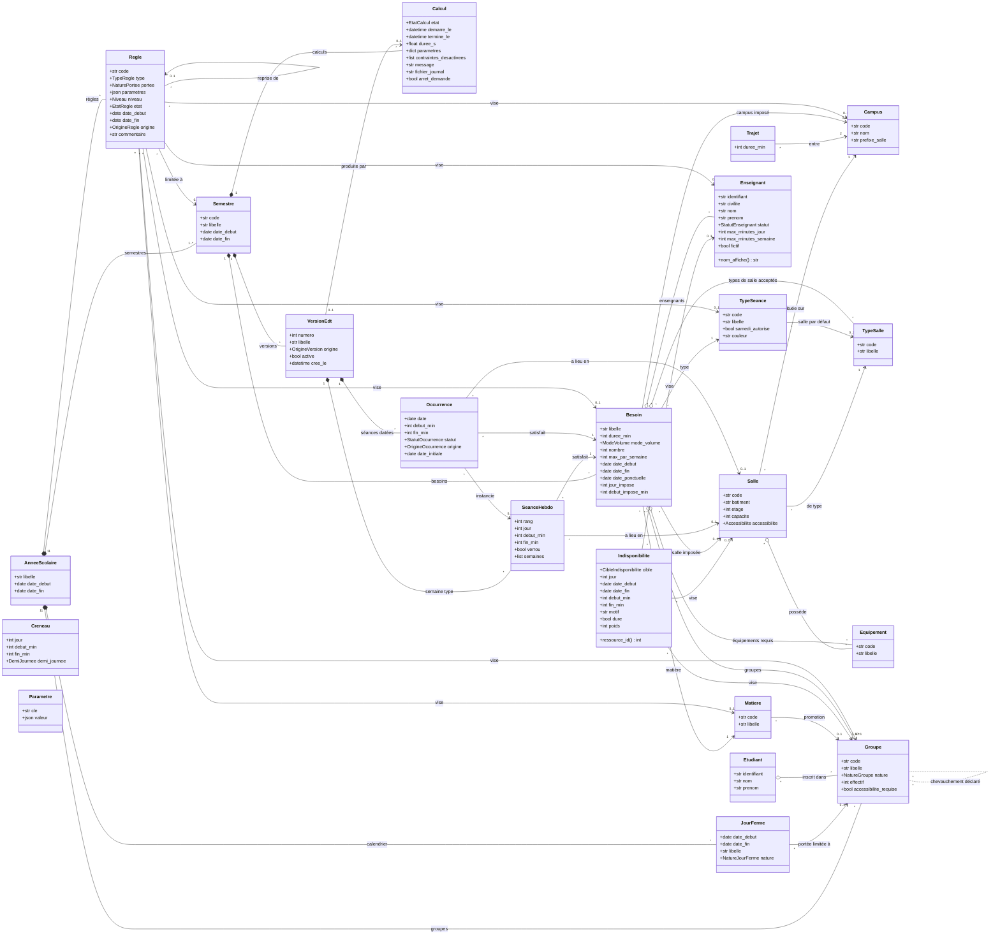

# Modèle de données

Ce document décrit les tables de l'application et sert de **diagramme de
classes UML** du projet. Il s'adresse aux développeurs. Il correspond exactement à
`src/edt/db/modeles.py` : toute modification de l'un se répercute dans
l'autre (un test vérifie que chaque table est décrite ici).

La base est un fichier SQLite (`data/edt.db` par défaut), créé par
`python -m edt init-db`. Le schéma n'a pas d'outil de migration : `init-db`
crée les tables absentes et ajoute les données par défaut manquantes
(paramètres compris), sans modifier une table ni une valeur existantes ;
`python -m edt verifier-schema` signale les colonnes qui manquent. Après un
changement de colonne, la base se recrée avec `python -m edt init-db --reset`
et se repeuple par commande. Seule reprise de données : le paramètre booléen
`dejeuner_horaires_determines`, s'il est présent, donne la valeur de
`dejeuner_mode` à l'initialisation puis est supprimé, et sert à le déduire à
la lecture.

## Conventions

- Noms de tables en français, au singulier.
- **Heures** : entiers de minutes depuis minuit (8 h 30 = 510), colonnes
  `*_min`, heure locale Europe/Paris sans fuseau. Une plage est semi-ouverte :
  début inclus, fin exclue.
- **Dates** : sans fuseau. **Jours de la semaine** : 0 (lundi) à 6 (dimanche).
- **Semaines** : numéro relatif au semestre, 1 pour la semaine qui contient
  le premier jour du semestre.
- **Énumérations** : stockées par leur valeur texte, avec une contrainte de
  contrôle ; les valeurs et leurs libellés sont dans
  `src/edt/domaine/enumerations.py`.
- **Identifiant d'une séance** : le couple (`besoin_id`, `rang`), le même
  d'une version à l'autre.

## Diagramme de classes

`Creneau` (grille horaire) et `Parametre` (réglages) n'ont pas de relation :
ce sont des listes globales. Une `Regle` (règle personnalisée,
`docs/regles-personnalisees.md`) vise une seule cible, ou l'établissement.

## Les trois étages du modèle

1. **Référentiels** : campus, salles, enseignants, groupes, étudiants,
   matières, listes configurables (types de salle, équipements, types de
   séance), grille horaire, calendrier, indisponibilités.
2. **Demande** : les `besoin`, entrée du générateur. Un besoin dit *quoi*
   enseigner, *à qui*, *par qui*, *combien* et avec quelles exigences de
   salle, mais jamais *quand* (sauf créneau imposé ou séance ponctuelle).
3. **Réponse** : une `version_edt` par génération ou par import, faite de
   `seance_hebdo` (la semaine type) puis d'`occurrence` (les séances datées,
   obtenues en instanciant la semaine type sur le calendrier). Le `calcul`
   garde la trace de chaque génération.

À côté, les **réglages** : les paramètres globaux (`parametre`) et les règles
personnalisées (`regle`), exceptions à un paramètre ou exigences propres à
une portée, rattachées à une année scolaire.

## Unicités

| Table | Unicité |
|---|---|
| `annee_scolaire` | `libelle` |
| `semestre` | (`annee_scolaire_id`, `code`) |
| `creneau` | (`jour`, `debut_min`) |
| `campus` | `code` |
| `trajet` | (`campus_a_id`, `campus_b_id`), avec `campus_a_id < campus_b_id` |
| `type_salle`, `equipement`, `type_seance` | `code` |
| `salle` | (`code`, `campus_id`) |
| `enseignant` | `identifiant` |
| `groupe` | (`code`, `annee_scolaire_id`) |
| `groupe_chevauchement` | (`groupe_a_id`, `groupe_b_id`), avec `groupe_a_id < groupe_b_id` |
| `etudiant` | `identifiant` |
| `matiere` | (`code`, `promotion_id`), et `code` seul quand la promotion est vide |
| `version_edt` | (`semestre_id`, `numero`) ; une seule version `active` par semestre |
| `seance_hebdo` | (`version_id`, `besoin_id`, `rang`) |
| `parametre` | `cle` |
| `regle` | (`annee_scolaire_id`, `code`) |
| tables d'association | la paire de clés étrangères |

## Règles de suppression

Le comportement à la suppression est porté par les clés étrangères (SQLite,
`PRAGMA foreign_keys=ON`) :

- **CASCADE** : ce qui appartient à son parent disparaît avec lui. Une année
  emporte ses semestres, ses groupes, son calendrier et ses règles ; un
  semestre emporte ses besoins, ses calculs, ses versions et les règles
  limitées à lui ; un groupe emporte ses
  sous-groupes, ses inscriptions, ses indisponibilités et les matières de sa
  promotion ; un besoin emporte ses séances placées ; une version emporte
  ses séances et ses occurrences.
- **NO ACTION** (suppression refusée) : une demande n'est jamais modifiée en
  silence. Supprimer un groupe, un enseignant, une matière, un type de
  séance, un type de salle, un équipement, une salle imposée ou un campus
  encore utilisés par un besoin (ou un campus qui a des salles) est refusé :
  l'interface affiche « opération refusée » et l'utilisateur corrige d'abord
  les besoins. Il en va de même d'un groupe, d'un enseignant, d'un campus,
  d'un type de séance, d'une matière ou d'un besoin **visé par une règle
  personnalisée** (`edt.services.regles.regles_visant` les liste). La
  vérification se fait en fin d'instruction : supprimer une année entière
  reste possible, car ses besoins et ses règles partent avec elle.
- **SET NULL** : supprimer une salle laisse les séances déjà placées, sans
  salle (le vérificateur les signale) ; supprimer un type de salle retire le
  type par défaut d'un type de séance ; supprimer un calcul laisse la version
  qu'il a produite ; supprimer une règle laisse sa reprise de l'année
  suivante, sans lien.

## Provenance des données importées

Les tables importables (`salle`, `enseignant`, `groupe`, `etudiant`,
`matiere`, `indisponibilite`, `jour_ferme`, `besoin`, `seance_hebdo`,
`occurrence`, `regle`) portent trois colonnes facultatives, vides pour une
saisie manuelle :

| Colonne | Type | Rôle |
|---|---|---|
| `source_fichier` | texte (255) | nom du fichier importé |
| `source_ligne` | entier | numéro de ligne dans ce fichier |
| `extra` | JSON | colonnes du fichier non reconnues, conservées telles quelles |

Les données importées ne sont jamais corrigées automatiquement : ce qui ne
respecte pas les règles est signalé comme anomalie.

## Données par défaut

`python -m edt init-db` pose, sans jamais modifier une ligne existante :

- la grille : du lundi au vendredi 8 h 30-10 h 30, 10 h 45-12 h 45,
  13 h 45-15 h 45, 16 h 00-18 h 00 ; le samedi les deux créneaux du matin ;
- les types de salle `AMPHI`, `COURS`, `INFO`, `TP`, `LABO` ;
- les équipements `VIDEOPROJ`, `ORDINATEURS`, `VISIO`, `ELECTRONIQUE`,
  `LABORATOIRE` ;
- les types de séance `CM`, `TD`, `TP` (samedi autorisé), `PROJET`,
  `LANGUE`, `DST`, `EXAMEN`, `AUTRE`, avec leur type de salle par défaut ;
- les paramètres globaux (`src/edt/domaine/parametres.py`) ;
- l'année scolaire en cours, ses deux semestres (premier lundi de septembre
  au dernier vendredi de janvier, premier lundi de février au dernier
  vendredi de juin) et ses onze jours fériés, fériés mobiles calculés.

Les vacances et fermetures propres à l'école ne sont pas devinées : elles se
saisissent ou viennent d'un jeu de données.

## Description des tables

Dans les tableaux, « → `table` (RÈGLE) » désigne une clé étrangère et son
comportement à la suppression de la ligne référencée.

### Tables : Calendrier

#### `annee_scolaire`

Année scolaire (par exemple « 2026-2027 »). Classe ORM : `AnneeScolaire`.

| Colonne | Type | Obligatoire | Description |
|---|---|---|---|
| `id` | entier | oui | Clé primaire |
| `libelle` | texte (32) | oui | Libellé unique, ex. « 2026-2027 » |
| `date_debut` | date | oui | Premier jour de l'année |
| `date_fin` | date | oui | Dernier jour de l'année |

Unicité : (`libelle`).

Contrôles : `date_debut <= date_fin`.

#### `semestre`

Semestre d'une année scolaire : l'unité de génération d'un emploi du temps. Classe ORM : `Semestre`.

| Colonne | Type | Obligatoire | Description |
|---|---|---|---|
| `id` | entier | oui | Clé primaire |
| `annee_scolaire_id` | entier | oui | Année de rattachement → `annee_scolaire` (CASCADE) |
| `code` | texte (16) | oui | Code court, ex. « S1 » |
| `libelle` | texte (64) | oui | Libellé affiché |
| `date_debut` | date | oui | Premier jour de cours (paramétrable) |
| `date_fin` | date | oui | Dernier jour de cours (paramétrable) |

Unicité : (`annee_scolaire_id`, `code`).

Contrôles : `date_debut <= date_fin`.

#### `jour_ferme`

Fermeture du calendrier : un jour ou une plage de dates sans cours. Classe ORM : `JourFerme`.

| Colonne | Type | Obligatoire | Description |
|---|---|---|---|
| `id` | entier | oui | Clé primaire |
| `annee_scolaire_id` | entier | oui | Année concernée → `annee_scolaire` (CASCADE) |
| `date_debut` | date | oui | Premier jour fermé |
| `date_fin` | date | oui | Dernier jour fermé (inclus) |
| `libelle` | texte (128) | oui | Ex. « Toussaint », « Partiels » |
| `nature` | énumération : `ferie`, `vacances`, `examens`, `semaine_speciale`, `autre` | oui | Férié, vacances, examens, semaine spéciale |
| `groupe_id` | entier | non | Vide = fermeture globale ; sinon groupe concerné (et ses descendants) → `groupe` (CASCADE) |
| `source_fichier`, `source_ligne`, `extra` | texte, entier, JSON | non | Provenance d'une ligne importée (voir plus haut) |

Contrôles : `date_debut <= date_fin`.

#### `creneau`

Créneau de la grille horaire (grille unique, configurable). Classe ORM : `Creneau`.

| Colonne | Type | Obligatoire | Description |
|---|---|---|---|
| `id` | entier | oui | Clé primaire |
| `jour` | entier | oui | 0 = lundi ... 6 = dimanche |
| `debut_min` | entier | oui | Début, en minutes depuis minuit |
| `fin_min` | entier | oui | Fin, en minutes depuis minuit |
| `demi_journee` | énumération : `matin`, `apres_midi` | oui | Matin ou après-midi |

Unicité : (`jour`, `debut_min`).

Contrôles : `debut_min >= 0 AND debut_min < fin_min AND fin_min <= 1440` ; `jour BETWEEN 0 AND 6`.

### Tables : Lieux

#### `campus`

Site d'enseignement (campus de l'école ou établissement voisin). Classe ORM : `Campus`.

| Colonne | Type | Obligatoire | Description |
|---|---|---|---|
| `id` | entier | oui | Clé primaire |
| `code` | texte (16) | oui | Code unique, ex. « NDC » |
| `nom` | texte (128) | oui | Nom complet |
| `prefixe_salle` | texte (16) | non | Préfixe des codes de salle du site, ex. « N », « L » |

Unicité : (`code`).

#### `trajet`

Temps de trajet entre deux campus (symétrique : une ligne par paire, a < b). Classe ORM : `Trajet`.

| Colonne | Type | Obligatoire | Description |
|---|---|---|---|
| `id` | entier | oui | Clé primaire |
| `campus_a_id` | entier | oui | Campus de plus petit identifiant → `campus` (CASCADE) |
| `campus_b_id` | entier | oui | Campus de plus grand identifiant → `campus` (CASCADE) |
| `duree_min` | entier | oui | Temps de trajet, en minutes |

Unicité : (`campus_a_id`, `campus_b_id`).

Contrôles : `campus_a_id < campus_b_id` ; `duree_min >= 0`.

#### `type_salle`

Type de salle (amphithéâtre, salle informatique...), liste configurable. Classe ORM : `TypeSalle`.

| Colonne | Type | Obligatoire | Description |
|---|---|---|---|
| `id` | entier | oui | Clé primaire |
| `code` | texte (32) | oui | Code unique, ex. « AMPHI » |
| `libelle` | texte (128) | oui | Libellé affiché |

Unicité : (`code`).

#### `equipement`

Équipement d'une salle (vidéoprojecteur, ordinateurs...), liste configurable. Classe ORM : `Equipement`.

| Colonne | Type | Obligatoire | Description |
|---|---|---|---|
| `id` | entier | oui | Clé primaire |
| `code` | texte (32) | oui | Code unique, ex. « VIDEOPROJ » |
| `libelle` | texte (128) | oui | Libellé affiché |

Unicité : (`code`).

#### `salle`

Salle de cours. Classe ORM : `Salle`.

| Colonne | Type | Obligatoire | Description |
|---|---|---|---|
| `id` | entier | oui | Clé primaire |
| `code` | texte (32) | oui | Code de la salle, ex. « N204 » |
| `campus_id` | entier | oui | Campus de la salle → `campus` (NO ACTION) |
| `batiment` | texte (64) | non | Bâtiment |
| `etage` | entier | non | Étage (0 = RDC) |
| `capacite` | entier | oui | Nombre de places |
| `type_salle_id` | entier | oui | Type de la salle → `type_salle` (NO ACTION) |
| `accessibilite` | énumération : `oui`, `non`, `inconnu` | oui | Accessible aux personnes à mobilité réduite : oui, non, inconnu |
| `source_fichier`, `source_ligne`, `extra` | texte, entier, JSON | non | Provenance d'une ligne importée (voir plus haut) |

Unicité : (`code`, `campus_id`).

Contrôles : `capacite >= 0`.

#### `salle_equipement`

Équipements présents dans une salle. Table d'association.

| Colonne | Type | Obligatoire | Description |
|---|---|---|---|
| `salle_id` | entier | oui | → `salle` (CASCADE) |
| `equipement_id` | entier | oui | → `equipement` (CASCADE) |

Unicité : (`salle_id`, `equipement_id`) : clé primaire.

### Tables : Personnes et groupes

#### `enseignant`

Enseignant, identifié par un identifiant stable. Classe ORM : `Enseignant`.

| Colonne | Type | Obligatoire | Description |
|---|---|---|---|
| `id` | entier | oui | Clé primaire |
| `identifiant` | texte (64) | oui | Identifiant stable et unique (matricule), clé de réimport |
| `civilite` | texte (16) | non | « Mme », « M. » |
| `nom` | texte (128) | oui | Nom de famille |
| `prenom` | texte (128) | non | Prénom |
| `statut` | énumération : `permanent`, `vacataire`, `exterieur` | oui | Permanent, vacataire ou extérieur |
| `max_minutes_jour` | entier | non | Maximum d'enseignement par jour, en minutes (facultatif) |
| `max_minutes_semaine` | entier | non | Maximum d'enseignement par semaine, en minutes (facultatif) |
| `fictif` | booléen | oui | Enseignant de remplacement d'une matière (enseignant inconnu à l'import) : n'entre dans aucune contrainte d'enseignant |
| `source_fichier`, `source_ligne`, `extra` | texte, entier, JSON | non | Provenance d'une ligne importée (voir plus haut) |

Unicité : (`identifiant`).

#### `groupe`

Groupe d'étudiants : nœud de l'arbre promotion > classe > demi-groupe, ou groupe à part. Classe ORM : `Groupe`.

| Colonne | Type | Obligatoire | Description |
|---|---|---|---|
| `id` | entier | oui | Clé primaire |
| `annee_scolaire_id` | entier | oui | Année du groupe → `annee_scolaire` (CASCADE) |
| `code` | texte (64) | oui | Code unique dans l'année, ex. « A1-G2 » |
| `libelle` | texte (128) | oui | Libellé affiché |
| `nature` | énumération : `promotion`, `classe`, `demi_groupe`, `transverse`, `tiers_temps` | oui | Promotion, classe, demi-groupe, transverse ou tiers-temps |
| `parent_id` | entier | non | Groupe contenant (vide pour une promotion ou un groupe à part) → `groupe` (CASCADE) |
| `effectif` | entier | oui | Nombre d'étudiants |
| `accessibilite_requise` | booléen | oui | Le groupe doit avoir cours en salle accessible |
| `source_fichier`, `source_ligne`, `extra` | texte, entier, JSON | non | Provenance d'une ligne importée (voir plus haut) |

Unicité : (`code`, `annee_scolaire_id`).

Contrôles : `parent_id IS NULL OR parent_id <> id` ; `effectif >= 0`.

#### `groupe_chevauchement`

Paires de groupes déclarés chevauchants (a < b) : ils partagent des étudiants. Table d'association.

| Colonne | Type | Obligatoire | Description |
|---|---|---|---|
| `groupe_a_id` | entier | oui | → `groupe` (CASCADE) |
| `groupe_b_id` | entier | oui | → `groupe` (CASCADE) |

Unicité : (`groupe_a_id`, `groupe_b_id`) : clé primaire.

Contrôles : `groupe_a_id < groupe_b_id`.

#### `etudiant`

Étudiant (facultatif, fictif). Aucune donnée de santé ni donnée réelle nominative. Classe ORM : `Etudiant`.

| Colonne | Type | Obligatoire | Description |
|---|---|---|---|
| `id` | entier | oui | Clé primaire |
| `identifiant` | texte (64) | oui | Identifiant stable et unique |
| `nom` | texte (128) | oui | Nom (fictif) |
| `prenom` | texte (128) | non | Prénom (fictif) |
| `source_fichier`, `source_ligne`, `extra` | texte, entier, JSON | non | Provenance d'une ligne importée (voir plus haut) |

Unicité : (`identifiant`).

#### `inscription`

Inscription d'un étudiant dans un groupe. Table d'association.

| Colonne | Type | Obligatoire | Description |
|---|---|---|---|
| `etudiant_id` | entier | oui | → `etudiant` (CASCADE) |
| `groupe_id` | entier | oui | → `groupe` (CASCADE) |

Unicité : (`etudiant_id`, `groupe_id`) : clé primaire.

### Tables : Enseignements

#### `matiere`

Matière, identifiée par son code module et sa promotion de rattachement. Classe ORM : `Matiere`.

| Colonne | Type | Obligatoire | Description |
|---|---|---|---|
| `id` | entier | oui | Clé primaire |
| `code` | texte (32) | oui | Code module, ex. « II.1102 » |
| `libelle` | texte (128) | oui | Libellé affiché |
| `promotion_id` | entier | non | Promotion de rattachement (groupe de nature promotion) → `groupe` (CASCADE) |
| `source_fichier`, `source_ligne`, `extra` | texte, entier, JSON | non | Provenance d'une ligne importée (voir plus haut) |

Unicité : (`code`, `promotion_id`) ; (`code`) quand `promotion_id IS NULL`.

#### `type_seance`

Type de séance (CM, TD, TP...), liste configurable. Classe ORM : `TypeSeance`.

| Colonne | Type | Obligatoire | Description |
|---|---|---|---|
| `id` | entier | oui | Clé primaire |
| `code` | texte (32) | oui | Code unique, ex. « TD » |
| `libelle` | texte (128) | oui | Libellé affiché |
| `samedi_autorise` | booléen | oui | Ce type de séance peut avoir lieu le samedi matin |
| `type_salle_defaut_id` | entier | non | Type de salle retenu quand le besoin n'en précise aucun → `type_salle` (SET NULL) |
| `couleur` | texte (7) | non | Couleur d'affichage, ex. « #2f6fad » |

Unicité : (`code`).

#### `indisponibilite`

Indisponibilité d'un enseignant, d'une salle ou d'un groupe. Classe ORM : `Indisponibilite`.

| Colonne | Type | Obligatoire | Description |
|---|---|---|---|
| `id` | entier | oui | Clé primaire |
| `cible` | énumération : `enseignant`, `salle`, `groupe` | oui | Enseignant, salle ou groupe |
| `enseignant_id` | entier | non | → `enseignant` (CASCADE) |
| `salle_id` | entier | non | → `salle` (CASCADE) |
| `groupe_id` | entier | non | → `groupe` (CASCADE) |
| `jour` | entier | non | Forme récurrente : jour de la semaine (0 = lundi) |
| `date_debut` | date | non | Forme datée : premier jour |
| `date_fin` | date | non | Forme datée : dernier jour (inclus) |
| `debut_min` | entier | oui | Début de la plage horaire (défaut : 0 = minuit) |
| `fin_min` | entier | oui | Fin de la plage horaire (défaut : 1440 = journée entière) |
| `motif` | texte (255) | non | Motif affiché |
| `dure` | booléen | oui | Contrainte dure (vrai à la saisie ; une indisponibilité non dure, possible seulement par import, est ignorée par le solveur et le vérificateur) |
| `poids` | entier | oui | Poids d'une préférence ; colonne lue par aucun calcul (une préférence horaire s'écrit en règle `CRENEAUX_INTERDITS` facultative) |
| `source_fichier`, `source_ligne`, `extra` | texte, entier, JSON | non | Provenance d'une ligne importée (voir plus haut) |

Contrôles : `(jour IS NOT NULL AND date_debut IS NULL AND date_fin IS NULL) OR (jour IS NULL AND date_debut IS NOT NULL AND date_fin IS NOT NULL AND date_debut <= date_fin)` ; `debut_min >= 0 AND debut_min < fin_min AND fin_min <= 1440` ; `jour IS NULL OR jour BETWEEN 0 AND 6` ; `(cible = 'enseignant' AND enseignant_id IS NOT NULL AND salle_id IS NULL AND groupe_id IS NULL) OR (cible = 'salle' AND salle_id IS NOT NULL AND enseignant_id IS NULL AND groupe_id IS NULL) OR (cible = 'groupe' AND groupe_id IS NOT NULL AND enseignant_id IS NULL AND salle_id IS NULL)`.

#### `besoin`

Besoin : la demande d'enseignement, entrée du générateur. Classe ORM : `Besoin`.

| Colonne | Type | Obligatoire | Description |
|---|---|---|---|
| `id` | entier | oui | Clé primaire |
| `semestre_id` | entier | oui | Semestre du besoin → `semestre` (CASCADE) |
| `matiere_id` | entier | oui | Matière enseignée → `matiere` (NO ACTION) |
| `type_seance_id` | entier | oui | Type de séance → `type_seance` (NO ACTION) |
| `libelle` | texte (128) | non | Précision facultative, ex. « Partiel » |
| `duree_min` | entier | oui | Durée d'une séance |
| `mode_volume` | énumération : `par_semaine`, `total`, `ponctuel` | oui | par_semaine, total ou ponctuel |
| `nombre` | entier | oui | Séances par semaine (par_semaine), total de séances (total), 1 (ponctuel) |
| `max_par_semaine` | entier | oui | Mode total : maximum de séances par semaine |
| `date_debut` | date | non | Début de la fenêtre (vide = début du semestre) |
| `date_fin` | date | non | Fin de la fenêtre (vide = fin du semestre) |
| `date_ponctuelle` | date | non | Mode ponctuel : date de la séance |
| `jour_impose` | entier | non | Créneau imposé : jour (0 = lundi), facultatif |
| `debut_impose_min` | entier | non | Créneau imposé : heure de début, facultative |
| `salle_imposee_id` | entier | non | Salle imposée → `salle` (NO ACTION) |
| `campus_impose_id` | entier | non | Campus imposé → `campus` (NO ACTION) |
| `commentaire` | texte long | non | Note libre |
| `source_fichier`, `source_ligne`, `extra` | texte, entier, JSON | non | Provenance d'une ligne importée (voir plus haut) |

Contrôles : `nombre >= 1` ; `max_par_semaine >= 1` ; `date_debut IS NULL OR date_fin IS NULL OR date_debut <= date_fin` ; `(mode_volume = 'ponctuel') = (date_ponctuelle IS NOT NULL)` ; `jour_impose IS NULL OR jour_impose BETWEEN 0 AND 6` ; `duree_min > 0 AND duree_min <= 1440` ; `mode_volume <> 'ponctuel' OR nombre = 1` ; `debut_impose_min IS NULL OR debut_impose_min BETWEEN 0 AND 1439`.

#### `besoin_groupe`

Groupes qui suivent la séance d'un besoin (1 à n). Table d'association.

| Colonne | Type | Obligatoire | Description |
|---|---|---|---|
| `besoin_id` | entier | oui | → `besoin` (CASCADE) |
| `groupe_id` | entier | oui | → `groupe` (NO ACTION) |

Unicité : (`besoin_id`, `groupe_id`) : clé primaire.

#### `besoin_enseignant`

Enseignants qui assurent la séance d'un besoin (0 à n). Table d'association.

| Colonne | Type | Obligatoire | Description |
|---|---|---|---|
| `besoin_id` | entier | oui | → `besoin` (CASCADE) |
| `enseignant_id` | entier | oui | → `enseignant` (NO ACTION) |

Unicité : (`besoin_id`, `enseignant_id`) : clé primaire.

#### `besoin_type_salle`

Types de salle acceptés par un besoin (aucun = type par défaut du type de séance). Table d'association.

| Colonne | Type | Obligatoire | Description |
|---|---|---|---|
| `besoin_id` | entier | oui | → `besoin` (CASCADE) |
| `type_salle_id` | entier | oui | → `type_salle` (NO ACTION) |

Unicité : (`besoin_id`, `type_salle_id`) : clé primaire.

#### `besoin_equipement`

Équipements requis par un besoin. Table d'association.

| Colonne | Type | Obligatoire | Description |
|---|---|---|---|
| `besoin_id` | entier | oui | → `besoin` (CASCADE) |
| `equipement_id` | entier | oui | → `equipement` (NO ACTION) |

Unicité : (`besoin_id`, `equipement_id`) : clé primaire.

### Tables : Emplois du temps

#### `calcul`

Suivi d'une génération (voir `edt.services.generation`). Classe ORM : `Calcul`.

| Colonne | Type | Obligatoire | Description |
|---|---|---|---|
| `id` | entier | oui | Clé primaire |
| `semestre_id` | entier | oui | Semestre calculé → `semestre` (CASCADE) |
| `etat` | énumération : `en_cours`, `reussi`, `infaisable`, `temps_depasse`, `arrete`, `erreur` | oui | État du calcul |
| `demarre_le` | date et heure | oui | Début (heure locale) |
| `termine_le` | date et heure | non | Fin |
| `duree_s` | décimal | non | Durée en secondes |
| `parametres` | JSON | oui | Options du calcul (temps limite, graine, objectif...) |
| `contraintes_desactivees` | JSON | oui | Codes des contraintes désactivées par l'utilisateur |
| `statistiques` | JSON | oui | Mesures renvoyées par le moteur |
| `message` | texte long | oui | Message lisible du résultat |
| `fichier_journal` | texte (512) | non | Chemin du journal dédié du calcul |
| `arret_demande` | booléen | oui | L'utilisateur a demandé l'arrêt |

#### `version_edt`

Version d'emploi du temps d'un semestre (générée ou importée comme référence). Classe ORM : `VersionEdt`.

| Colonne | Type | Obligatoire | Description |
|---|---|---|---|
| `id` | entier | oui | Clé primaire |
| `semestre_id` | entier | oui | Semestre de la version → `semestre` (CASCADE) |
| `numero` | entier | oui | Numéro d'ordre dans le semestre, dès 1 |
| `libelle` | texte (128) | oui | Libellé affiché |
| `origine` | énumération : `generee`, `reference` | oui | Générée ou référence (import) |
| `active` | booléen | oui | Version active du semestre (une seule) |
| `cree_le` | date et heure | oui | Date de création (heure locale) |
| `calcul_id` | entier | non | Calcul qui a produit la version (vide pour un import) → `calcul` (SET NULL) |
| `commentaire` | texte long | non | Note libre |

Unicité : (`semestre_id`, `numero`) ; (`semestre_id`) quand `active = 1`.

#### `seance_hebdo`

Séance hebdomadaire : élément de la semaine type d'une version. Classe ORM : `SeanceHebdo`.

| Colonne | Type | Obligatoire | Description |
|---|---|---|---|
| `id` | entier | oui | Clé primaire |
| `version_id` | entier | oui | Version propriétaire → `version_edt` (CASCADE) |
| `besoin_id` | entier | oui | Besoin satisfait par la séance → `besoin` (CASCADE) |
| `rang` | entier | oui | Rang de la séance parmi celles du besoin, dès 1 |
| `jour` | entier | oui | 0 = lundi ... 6 = dimanche |
| `debut_min` | entier | oui | Début, en minutes depuis minuit |
| `fin_min` | entier | oui | Fin, en minutes depuis minuit |
| `salle_id` | entier | non | Salle affectée (vide = salle à définir) → `salle` (SET NULL) |
| `verrou` | booléen | oui | Séance verrouillée : le calcul ne la déplace pas |
| `semaines` | JSON | oui | Semaines actives : numéros relatifs au semestre (1 = première semaine) |
| `source_fichier`, `source_ligne`, `extra` | texte, entier, JSON | non | Provenance d'une ligne importée (voir plus haut) |

Unicité : (`version_id`, `besoin_id`, `rang`).

Contrôles : `jour BETWEEN 0 AND 6` ; `rang >= 1` ; `debut_min >= 0 AND debut_min < fin_min AND fin_min <= 1440`.

#### `occurrence`

Séance datée, issue de la semaine type, d'un replacement, d'une saisie ou d'un import. Classe ORM : `Occurrence`.

| Colonne | Type | Obligatoire | Description |
|---|---|---|---|
| `id` | entier | oui | Clé primaire |
| `version_id` | entier | oui | Version propriétaire → `version_edt` (CASCADE) |
| `seance_hebdo_id` | entier | non | Séance hebdomadaire d'origine (vide pour une saisie ou un import daté) → `seance_hebdo` (CASCADE) |
| `besoin_id` | entier | oui | Besoin satisfait par la séance → `besoin` (CASCADE) |
| `date` | date | oui | Date de la séance (sans fuseau) |
| `debut_min` | entier | oui | Début, en minutes depuis minuit |
| `fin_min` | entier | oui | Fin, en minutes depuis minuit |
| `salle_id` | entier | non | Salle affectée → `salle` (SET NULL) |
| `statut` | énumération : `planifiee`, `annulee`, `deplacee`, `a_programmer` | oui | Planifiée, annulée, déplacée ou à programmer |
| `origine` | énumération : `instanciation`, `replacement`, `manuelle`, `import` | oui | Semaine type, replacement, saisie manuelle ou import |
| `date_initiale` | date | non | Date prévue par la semaine type avant déplacement |
| `commentaire` | texte long | non | Note libre |
| `source_fichier`, `source_ligne`, `extra` | texte, entier, JSON | non | Provenance d'une ligne importée (voir plus haut) |

Contrôles : `debut_min >= 0 AND debut_min < fin_min AND fin_min <= 1440`.

### Tables : Réglages

#### `parametre`

Paramètre global (clé / valeur JSON). Voir `edt.domaine.parametres`. Classe ORM : `Parametre`.

| Colonne | Type | Obligatoire | Description |
|---|---|---|---|
| `cle` | texte (64) | oui | Nom du paramètre |
| `valeur` | JSON | oui | Valeur, typée selon le paramètre (entier, booléen, choix, ensemble de jours en liste de numéros) |
| `modifie_le` | date et heure | oui | Dernière modification |

#### `regle`

Règle personnalisée d'une année scolaire : exception à un paramètre global
(réglage : jours travaillés, pause déjeuner, pause minimale) ou exigence
propre à une portée. Les types, leurs paramètres et leur résolution sont dans
`edt.domaine.regles` et `docs/regles-personnalisees.md`. Classe ORM : `Regle`.

| Colonne | Type | Obligatoire | Description |
|---|---|---|---|
| `id` | entier | oui | Clé primaire |
| `annee_scolaire_id` | entier | oui | → `annee_scolaire` (CASCADE) : année du paramétrage |
| `code` | texte (16) | oui | Identifiant métier stable dans l'année (« R007 »), attribué par le service si vide |
| `type` | énumération `TypeRegle` (14 codes) | oui | Type de règle |
| `portee` | énumération : `etablissement`, `groupe`, `enseignant`, `campus`, `type_seance`, `matiere`, `besoin` | oui | Nature de la portée |
| `groupe_id` | entier | non | → `groupe` (NO ACTION) : cible |
| `enseignant_id` | entier | non | → `enseignant` (NO ACTION) : cible |
| `campus_id` | entier | non | → `campus` (NO ACTION) : cible |
| `type_seance_id` | entier | non | → `type_seance` (NO ACTION) : cible |
| `matiere_id` | entier | non | → `matiere` (NO ACTION) : cible |
| `besoin_id` | entier | non | → `besoin` (NO ACTION) : cible |
| `parametres` | JSON | oui | Paramètres canoniques (jours en noms, heures `HH:MM`, durées en minutes, codes), validés par le schéma du type à chaque écriture |
| `niveau` | énumération : `necessaire`, `important`, `facultatif` | oui | Niveau de la règle |
| `etat` | énumération : `proposee`, `active`, `inactive` | oui | Seule une règle active est posée et vérifiée (défaut : `active`) |
| `semestre_id` | entier | non | → `semestre` (CASCADE) : semestre visé ; vide = toute l'année, sauf dates |
| `date_debut` | date | non | Période datée : premier jour |
| `date_fin` | date | non | Période datée : dernier jour (inclus) |
| `origine` | énumération : `saisie`, `import`, `assistant`, `base`, `reprise` | oui | D'où vient la règle (défaut : `saisie`) |
| `reprise_de_id` | entier | non | → `regle` (SET NULL) : règle de l'année précédente dont celle-ci est la reprise |
| `commentaire` | texte | non | Note libre |
| `cree_le` | date et heure | oui | Création |
| `modifie_le` | date et heure | oui | Dernière modification |
| `source_fichier`, `source_ligne`, `extra` | texte, entier, JSON | non | Provenance d'une ligne importée (voir plus haut) |

Contrôles : `une_seule_cible` (seule la colonne de cible de la portée est
renseignée, aucune pour l'établissement, sur le modèle de `indisponibilite`) ;
`periode_ordonnee` (`date_debut IS NULL OR date_fin IS NULL OR date_debut <=
date_fin`). Index sur chaque clé de cible et sur (`annee_scolaire_id`,
`etat`, `type`). Le service refuse en plus deux règles actives d'un même type
de réglage, de même cible et de périodes qui se recoupent.

### Tables : Assistant

#### `assistant_consommation`

Consommation de l'assistant conversationnel pour un jour. Limite connue :
l'application n'écrit ni ne lit cette table. La consommation du jour est gardée
hors de la base, dans un fichier sous le dossier des journaux
(`docs/assistant.md` § 3), pour survivre à la remise à zéro de la base, qui
supprime toutes les tables. La table reste dans le modèle pour ne pas changer
le schéma des bases existantes. Classe ORM : `AssistantConsommation`.

| Colonne | Type | Obligatoire | Description |
|---|---|---|---|
| `jour` | date | oui | Clé primaire : jour (heure du serveur) |
| `echanges` | entier | oui | Échanges commencés |
| `appels` | entier | oui | Appels au modèle |
| `jetons_entree` | entier | oui | Jetons d'entrée hors cache |
| `jetons_cache_lus` | entier | oui | Jetons lus en cache |
| `jetons_cache_ecrits` | entier | oui | Jetons écrits en cache |
| `jetons_sortie` | entier | oui | Jetons de sortie (réflexion comprise) |
| `cout_microdollars` | entier | oui | Coût estimé, en millionièmes de dollar |
| `modifie_le` | date et heure | oui | Dernière mise à jour |

Contrôle : `consommation_positive` (chaque compteur est positif ou nul).
