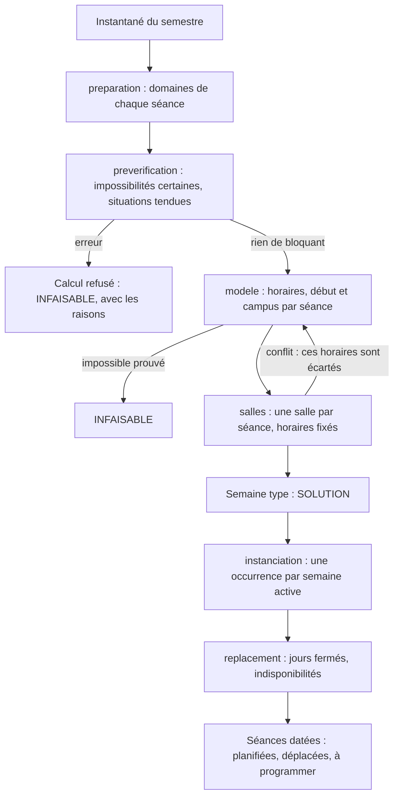

# Solveur

Le solveur place les séances d'un semestre : il produit la **semaine type**
(un jour, une heure et une salle par séance hebdomadaire), puis les **séances
datées** de tout le semestre. Il s'appuie sur OR-Tools CP-SAT.

Deux principes, hérités de la spécification :

- **aucune contrainte n'est abandonnée** pour réussir. Seul l'utilisateur
  désactive une contrainte, et le résultat le rappelle ;
- **tout ou rien** : toutes les séances sont placées, ou aucune. Quand c'est
  impossible, le moteur le dit et dit pourquoi.

Références communes : `docs/decisions.md` (sections 5, 6 et 8),
`docs/architecture.md` (« Sémantique des contraintes ») et
`docs/verification.md`. Le vérificateur (`edt.verification`) est l'oracle de
tous les tests du solveur ; l'orchestration lui soumet aussi chaque solution
avant de l'enregistrer.

## Vue d'ensemble



| Fichier | Rôle |
|---|---|
| `src/edt/solveur/contrat.py` | `OptionsSolveur`, `ResultatSolveur`, `StatutSolveur` (contrat figé) |
| `src/edt/solveur/regles.py` | règles communes : personnes partagées, indisponibilités, salles compatibles, horaires, règles de paire |
| `src/edt/solveur/preparation.py` | domaines de débuts et de salles de chaque séance, domaines vides, contradictions entre horaires fixes |
| `src/edt/solveur/preverification.py` | `pre_verifier` : charges des groupes, des enseignants et des salles |
| `src/edt/solveur/modele.py` | `ModeleHoraires` : le modèle CP-SAT des horaires |
| `src/edt/solveur/salles.py` | `affecter_salles` : le modèle CP-SAT des salles |
| `src/edt/solveur/moteur.py` | `resoudre` : enchaînement, temps limite, arrêt, messages, statistiques |
| `src/edt/solveur/instanciation.py` | `instancier` : séances datées de la semaine type |
| `src/edt/solveur/replacement.py` | `replacer` : replacement de séances datées |
| `src/edt/solveur/provisoire.py` | ancien moteur glouton du socle, gardé pour ses tests |
| `src/edt/services/instanciation.py` | `instancier_version`, `replacer_occurrences` : la couche datée en base |
| `src/edt/services/generation.py` | orchestration d'un calcul : pré-vérifications, moteur, contrôle, version, séances datées |
| `src/edt/commandes/generation.py` | `python -m edt generer`, `pre-verifier`, `instancier` |

Fonctions publiques :

```python
# edt.solveur
def resoudre(instantane, options: OptionsSolveur, arret: threading.Event | None = None) -> ResultatSolveur

# edt.solveur.preverification
def pre_verifier(instantane, contraintes_desactivees=(), *, tolerer_violations_heritees=False) -> list[Anomalie]

# edt.solveur.instanciation
def instancier(instantane, placements, contraintes_desactivees=()) -> ResultatInstanciation

# edt.solveur.replacement
def replacer(instantane, occurrences_fixes, occurrences_a_replacer,
             options: OptionsReplacement | None = None, arret=None) -> ResultatReplacement

# edt.services.generation
def pre_verifier_semestre(session, semestre_id, contraintes_desactivees=(), *,
                          version_base_id=None, tolerer_violations_heritees=False) -> list[Anomalie]

# edt.services.instanciation
def instancier_version(session, version_id, contraintes_desactivees=None) -> RapportInstanciation
def replacer_occurrences(session, version_id, occurrence_ids, date_debut=None, date_fin=None,
                         contraintes_desactivees=None) -> RapportInstanciation
```

## Formulation retenue

### Deux phases, et pourquoi

L'équipe demandait une variable de début et une variable de salle par séance
dans un seul modèle, et le passage à deux phases seulement si les mesures le
justifiaient. La première formulation a été écrite et mesurée (tableau « Première
formulation » plus bas) : elle résout le jeu moyen en 2 s mais dépasse 120 s
sur le jeu grand et sur 800 séances générées. La recherche n'y rencontre
presque aucun conflit ; elle est lente parce que chaque salle porte un
`NoOverlap` de centaines d'intervalles optionnels dont la présence reste
inconnue tant que la salle n'est pas choisie.

Le calcul se fait donc en deux phases :

1. **horaires** : un début et un **campus** par séance ;
2. **salles** : une salle par séance, les horaires étant fixés.

Le campus est décidé en phase 1 parce que les trajets entre campus lient les
horaires aux lieux. La phase 1 contient en plus une condition **nécessaire**
de capacité des salles : elle n'écarte aucune solution, mais elle fait que la
phase 2 réussit presque toujours du premier coup.

Le résultat reste **exact** :

- une solution rendue respecte toutes les contraintes actives (l'oracle le
  contrôle) ;
- si la phase 2 échoue, elle désigne un petit ensemble de séances qui, à ces
  horaires, ne peuvent pas toutes recevoir une salle. La phase 1 reçoit une
  **coupe** qui interdit cette combinaison et repart. Une coupe n'écarte que
  des horaires réellement impossibles ;
- `INFAISABLE` n'est déclaré que si CP-SAT prouve que le modèle des horaires,
  coupes comprises, n'a pas de solution. Ce modèle étant moins contraint que
  le problème complet, la preuve vaut pour le problème complet.

### Phase 1 : le modèle des horaires (`ModeleHoraires`)

**Variables.** Pour chaque séance, un booléen par **choix** possible et
exactement un choix vrai. Un choix est un couple (début, campus), accompagné
des salles de ce campus admissibles et disponibles à ce début. C'est la
variable de début à domaine pré-filtré demandée, croisée avec le campus et
écrite en « un parmi n » : avec une vingtaine de débuts sur la grille, ce
codage rend le non-chevauchement très simple (« au plus une séance en cours
à chaque instant ») et la recherche très rapide.

Un début est codé `jour × pas + minute`. Le `pas` dépasse une journée
augmentée de la plus longue séparation exigée : deux séances de jours
différents sont toujours assez éloignées sur cet axe, et « le même jour »
n'a plus besoin d'être écrit.

**Domaines pré-filtrés** (`preparation.py`, avant tout modèle) :

- débuts : verrou, jour et heure imposés, grille (`HORAIRES`, `JOURS`),
  déjeuner, indisponibilités récurrentes des enseignants et des groupes liés ;
- salles : type, salle ou campus imposé, capacité, équipements,
  accessibilité, indisponibilités récurrentes de la salle.

Un domaine vide est rapporté **avant** la résolution, en nommant la séance et
ce qui élimine ses possibilités (« 20 débuts examinés, tous écartés : 12 par
une indisponibilité de Mme Martin, 8 par la pause déjeuner »).

**Contraintes.**

- *Personnes.* Les séances sont réunies en **unités** : même ensemble de
  groupes (ou même enseignant) et mêmes semaines actives. Deux unités se
  gênent si leurs semaines se croisent et si elles partagent l'enseignant ou
  ont des groupes en conflit. Pour chaque unité et chaque instant, un booléen
  « occupée » est impliqué par les choix de ses séances en cours, chaque
  séance étant allongée de la pause. Le graphe des unités qui se gênent est
  couvert par des cliques ; sur chacune, au plus une unité est occupée à
  chaque instant. Le conflit entre groupes n'est pas transitif (deux classes
  d'une promotion ne se gênent pas, mais gênent toutes deux la promotion, et
  les groupes de langue touchent presque toutes les classes) : couvrir les
  arêtes par des cliques est exact, et passer par les unités évite de répéter
  les mêmes séances dans des centaines de contraintes presque identiques.
- *Trajets.* Pour chaque paire de séances qui partagent une personne et
  peuvent coexister, les couples de choix trop rapprochés sur deux campus
  différents sont interdits.
- *Maxima journaliers* des enseignants : somme pondérée des choix de chaque jour.
- *Capacité des salles.* La **famille** d'un choix est l'ensemble des salles
  admissibles de la séance sur le campus du choix. Une **classe** réunit les
  salles qui appartiennent exactement aux mêmes familles (elles sont
  interchangeables pour ce calcul). À chaque instant, les séances en cours
  d'une famille se répartissent entre les classes de la famille (variables
  entières de répartition), et aucune classe ne reçoit plus de séances
  qu'elle n'a de salles disponibles à cet instant. Toute affectation réelle
  donne une telle répartition : la condition est nécessaire.
- *Symétries.* Les séances interchangeables d'un même besoin (mêmes semaines,
  sans verrou) sont ordonnées par début.

### Phase 2 : le modèle des salles (`affecter_salles`)

Un booléen par (séance, salle possible à l'horaire retenu), exactement une
salle par séance, et pour chaque salle au plus une séance en cours à chaque
instant. Horaires connus, ce modèle se résout en une fraction de seconde
(0,3 s sur le jeu grand). S'il est impossible, il est résolu une seconde fois
avec une hypothèse « cette séance reçoit une salle » par séance : CP-SAT
renvoie un sous-ensemble d'hypothèses suffisant pour l'impossibilité, qui
devient la coupe de la phase 1.

Sur tous les jeux mesurés, aucune coupe n'a été nécessaire. Le test
`test_conflit_de_salles_prouve_l_impossibilite` construit le cas où il en
faut : une séance de 4 h entre deux séances de 2 h dont les salles imposées
se croisent.

## Semaines actives : traitement exact

Deux séances dont les semaines actives sont disjointes ne se gênent jamais :
elles peuvent partager créneau, salle, enseignant et groupe. Le modèle
n'est ni permissif ni prudent sur ce point :

- chaque séance porte ses semaines sous forme de masque de bits ;
- *personnes* : deux unités ne sont reliées que si leurs masques ont une
  semaine en commun ; une contrainte ne porte que sur des unités deux à deux
  reliées ;
- *salles, maxima, capacité* : les séances concernées sont découpées en
  ensembles **actifs une même semaine** (`Preparation.ensembles_par_semaines`) :
  un ensemble par semaine du semestre, doublons et sous-ensembles retirés.
  Deux séances sont dans un même ensemble si et seulement si une semaine au
  moins les réunit ; la contrainte est posée par ensemble ;
- *trajets* : seules les paires dont les masques se croisent sont examinées ;
- *objectif* : les semaines sont regroupées par ensemble de séances actives,
  et chaque situation pèse le nombre de semaines où elle se produit.

Le test `test_semaines_disjointes_partagent_creneau_salle_enseignant_et_groupe`
place deux matières courtes du même groupe et du même enseignant sur
l'unique créneau et dans l'unique salle ; le test voisin vérifie qu'une seule
semaine commune rend le problème impossible.

## Traduction des contraintes, code par code

| Code | Où | Traduction |
|---|---|---|
| `SALLE_UNIQUE` | phase 1 (capacité), phase 2 | condition nécessaire par classes de salles, puis « au plus une séance par salle et par instant » |
| `ENSEIGNANT_UNIQUE` | phase 1 | unités d'enseignant : au plus une séance en cours par instant |
| `GROUPE_UNIQUE` | phase 1 | unités de groupes et cliques d'unités en conflit |
| `PAUSE` | phase 1 | chaque séance est allongée de `pause_min` dans les contraintes de personnes |
| `CAMPUS_TRAJET` | phase 1 | couples de choix interdits pour chaque paire de séances d'une même personne |
| `DEJEUNER` | domaines | débuts qui recoupent la plage du déjeuner retirés (séances sans heure imposée) |
| `HORAIRES` | domaines | débuts de la grille, ouverture, fermeture, demi-journée du créneau de début |
| `JOURS` | domaines | jours avec créneau ; samedi si `samedi_autorise` |
| `ACCESSIBILITE`, `CAPACITE`, `TYPE_SALLE`, `EQUIPEMENT` | domaines | salles qui ne conviennent pas retirées (salle et campus imposés compris) |
| `DISPO_ENSEIGNANT`, `DISPO_GROUPE` | domaines | débuts qui recoupent une indisponibilité récurrente retirés (groupes liés compris) |
| `DISPO_SALLE` | domaines | salle retirée si elle est indisponible à tous les débuts ; sinon elle manque seulement aux choix concernés |
| `MAX_ENSEIGNANT` | pré-vérification, phase 1 | maximum par semaine : indépendant du placement, contrôlé avant le calcul ; maximum par jour : contrainte linéaire par jour et par ensemble de semaines |
| `VOLUME` | moteur | tout ou rien ; un besoin non dépliable fait refuser le calcul |
| `VERROU` | domaines | la séance n'a qu'un début (et qu'une salle si le verrou en fixe une) |
| `JOUR_FERME` | couche datée | `instancier` signale, `replacer` évite |

Règles de construction des débuts :

- un verrou fixe le début, et la durée placée est celle du verrou ;
- le jour et l'heure imposés par le besoin (ou sa date, pour un besoin
  ponctuel) sont **toujours** respectés, même si `HORAIRES` est désactivée :
  ils font partie de la demande ;
- une heure imposée dispense de la grille, du déjeuner et, si le jour est
  imposé lui aussi, de la règle des jours (un créneau imposé peut sortir de
  la grille) ;
- une séance ponctuelle sans heure imposée suit la grille de son jour. Si ce
  jour n'a aucun créneau, le calcul est refusé en demandant de préciser l'heure ;
- sans jour imposé, la règle des jours s'applique toujours.

Contraintes désactivées : chaque code retire sa traduction et elle seule.
Cas particuliers :

- `ENSEIGNANT_UNIQUE` ou `GROUPE_UNIQUE` désactivée, `PAUSE` active : deux
  séances de la personne peuvent se chevaucher ; si elles ne se chevauchent
  pas, la pause s'applique (couples de choix interdits) ;
- `HORAIRES` désactivée : les débuts ne sont plus limités à la grille. Le
  moteur propose alors un début toutes les 30 minutes, de 0 h à 24 h, en plus
  des débuts de la grille (`PAS_HORS_GRILLE`) ;
- `VERROU` désactivée : les verrous sont ignorés, les séances redeviennent
  libres et suivent la grille.

Violations héritées (`tolerer_violations_heritees`) : aucune contrainte de
paire ne s'applique entre deux séances verrouillées. En pratique les séances
verrouillées qui se contredisent, et celles dont la salle reste à choisir,
sont « isolées » : elles ne sont réunies qu'aux séances libres. Sans cette
option, des verrous contradictoires font refuser le calcul avec la liste.

## Objectif (mode optimisé)

Avec `options.optimiser`, le moteur minimise

```
poids_trous × trous + poids_changement_campus × changements de campus
+ poids_samedi × séances du samedi + poids_creneaux_extremes × séances extrêmes
```

Les quatre quantités sont comptées **semaine par semaine**, comme
`edt.verification.calculer_indicateurs` : une situation qui dure 15 semaines
compte 15 fois.

| Terme | Définition dans le modèle |
|---|---|
| trous | pour chaque groupe feuille (sans sous-groupe), avec ses séances et celles de ses ascendants, pour chaque ensemble de semaines où les mêmes séances sont actives : un créneau de la grille est un trou si une séance finit avant lui, une autre commence après lui et aucune ne le recoupe, le même jour |
| changements de campus | pour chaque groupe feuille et chaque enseignant non fictif, par jour : une pénalité par paire de campus où la personne a cours ce jour-là |
| samedi | nombre de semaines actives de chaque séance placée le samedi |
| créneaux extrêmes | nombre de semaines actives de chaque séance qui recoupe le premier ou le dernier créneau de la grille de son jour |

Écart avec le vérificateur : il compte les **changements de campus** comme
le nombre de paires de séances consécutives sur deux campus différents ; le
modèle compte une fois chaque paire de campus fréquentés dans la journée.
Les deux coïncident tant qu'une personne ne fait pas plus d'un aller entre
deux campus dans la journée (c'est le cas dès que le trajet dépasse la
pause). Les trois autres termes sont identiques. Sur les jeux moyen et grand,
la pénalité annoncée par le moteur (`statistiques["objectif"]`) était égale à
`valeur_objectif` du vérificateur.

Quand le temps limite arrive avant la preuve d'optimalité, la meilleure
solution trouvée est rendue (statut `SOLUTION`, `statistiques["optimal"]`
faux, borne inférieure dans `borne_objectif`).

## Déroulement d'un calcul

1. **Préparation** et **pré-vérifications**. Une impossibilité certaine fait
   refuser le calcul : statut `INFAISABLE`, `statistiques["refuse"]` vrai,
   message qui cite les trois premières raisons, liste complète dans
   `avertissements`.
2. **Modèle des horaires**, puis recherche, puis **salles** ; reprise si les
   salles ne suivent pas.
3. **Résultat** : placements de toutes les séances, message, statistiques.

| Statut | Sens | Message |
|---|---|---|
| `SOLUTION` | toutes les séances sont placées | « Emploi du temps trouvé : n séance(s) placée(s). » (+ pénalité, + contraintes ignorées) |
| `INFAISABLE` | impossibilité prouvée (pré-vérifications ou CP-SAT) | « Aucun emploi du temps ne peut respecter toutes les contraintes actives : c'est prouvé... » |
| `TEMPS_DEPASSE` | rien trouvé, sans preuve | « Aucun emploi du temps n'a été trouvé en n s. Ce n'est pas une preuve d'impossibilité... » |
| `ARRETE` | arrêt demandé | « Calcul arrêté à votre demande... » |

- **Temps limite** : il couvre tout le calcul, construction comprise. Une
  petite part (5 %, au plus 3 s) est réservée à la phase des salles.
- **Arrêt** : un fil de surveillance relit l'événement `arret` dix fois par
  seconde et interrompt CP-SAT ; la construction du modèle le relit entre
  ses étapes. Le moteur rend la main en moins de deux secondes.
- **Fils de calcul** : `nb_workers = 0` en utilise deux au plus (le serveur a
  deux cœurs). Un seul fil et une graine fixe donnent un résultat strictement
  reproductible, tant que le temps limite n'interrompt pas la recherche.
- **Indices** : avec `utiliser_indices`, le placement précédent de chaque
  séance (`SeanceAPlacer.indice`) est proposé à CP-SAT comme point de départ
  (début, campus, puis salle en phase 2).
- **Statistiques** : `moteur`, `nb_seances`, `nb_salles`, `nb_variables`,
  `nb_contraintes` (modèle des horaires), `duree_preparation_s`,
  `duree_construction_s`, `duree_resolution_s`, `duree_salles_s`, `duree_s`,
  `statut_cp_sat`, `nb_workers`, `graine`, `nb_conflits`, `nb_branches`,
  `nb_solutions`, `nb_coupes`, `refuse`, et en mode optimisé `objectif`,
  `borne_objectif`, `optimal`.
- **Journal** (`logging`, jamais de `print`) : taille du problème, tailles
  des domaines (minimum, médiane), durée de construction, une ligne de
  progression toutes les 5 s, chaque solution (au plus une toutes les 2 s en
  optimisation), résultat. Au niveau `DEBUG` : durée et taille de chaque
  étape du modèle, et le journal de CP-SAT.

## Pré-vérifications

`pre_verifier` est pure et rapide (0,1 s sur le jeu grand). Elle renvoie des
`Anomalie` : gravité `ERREUR` quand l'impossibilité est certaine,
`AVERTISSEMENT` au-delà de 90 % du temps disponible.

| Famille | Exemple de message |
|---|---|
| dépliage | « Projet : 5 séances demandées, mais la période n'en permet que 2... Corriger le besoin avant de lancer le calcul. » |
| séance sans horaire | « « TP » (séance 12-1) : aucun horaire possible : 20 début(s) examiné(s), tous écartés (20 par une indisponibilité de Mme Martin). » |
| séance sans salle | « « TP » (séance 12-1) : aucune salle ne convient. Sur 40 salle(s) : 12 du type demandé (Laboratoire), 30 d'au moins 45 places, 0 accessibles ; la séance requiert une salle accessible et aucune salle ne l'est. » |
| verrou intenable | « La séance verrouillée « Maths » (séance 3-1), placée le lundi 8 h 30 - 10 h 30, est verrouillée en salle N101, qui ne fait pas partie des salles d'au moins 30 places... » |
| verrous contradictoires | « Les séances verrouillées « Maths »... et « Physique »... se contredisent (« Une séance par salle »). » |
| créneau imposé à plusieurs séances | « « DST » impose le même jour et la même heure à ses séances 7-1 et 7-2... » |
| charge d'un groupe | « Le groupe A2-G1 demande 10 h de cours par semaine pour 8 h 30 disponibles : c'est impossible. » |
| charge d'un enseignant | « Mme Martin doit assurer 6 h de cours par semaine pour 4 h 15 disponibles (compte tenu de ses indisponibilités) : c'est impossible. » |
| maxima d'un enseignant | « Mme Martin doit assurer 6 h de cours par semaine pour un maximum de 4 h par semaine : c'est impossible. » |
| salles | « Les 5 séance(s) qui ne peuvent avoir lieu que dans la salle Labo demandent 10 h de cours par semaine pour 8 h 30 disponibles dans ces salles : c'est impossible. » |

Le temps disponible est celui des demi-journées de la grille, moins les
indisponibilités récurrentes et les séances à horaire déjà fixe. La charge
d'un groupe compte ses séances et celles des groupes qui le contiennent. Les
salles sont examinées par **famille** (l'ensemble des salles qui conviennent
à un besoin), ce qui couvre le type, la capacité, les équipements et
l'accessibilité d'un seul coup. Ces bornes sont nécessaires, pas
suffisantes : un calcul sans erreur de pré-vérification peut encore être
impossible, et c'est alors CP-SAT qui le prouve.

## Couche datée

### Instanciation (`instancier`)

Chaque séance de la semaine type donne une occurrence par semaine active, à
la date de son jour. Une occurrence est « à replacer » si, à sa date :

- le jour est fermé pour ses groupes (`Instantane.fermeture`) ;
- sa salle, l'un de ses enseignants non fictifs ou un groupe lié est
  indisponible, que l'indisponibilité soit récurrente ou **datée** (les
  indisponibilités datées ne restreignent pas la semaine type : c'est ici
  qu'elles comptent) ;
- la date sort du semestre.

`ResultatInstanciation(occurrences, a_replacer)` : les occurrences
maintenues, et les `OccurrenceARevoir(occurrence, code, raison)`.

### Replacement (`replacer`)

`replacer(instantane, occurrences_fixes, occurrences_a_replacer, options)`
cherche pour chaque occurrence à replacer une date, une heure et une salle
qui respectent toutes les contraintes actives, date par date, face aux
occurrences en place : calendrier, grille, indisponibilités récurrentes et
datées, unicité, pause, trajets, maxima par jour et par semaine réelle,
salle compatible et libre. Le jour et l'heure imposés par le besoin sont
gardés ; une séance ponctuelle ne change pas de date.

`OptionsReplacement` : contraintes désactivées, fenêtre de dates
(`date_debut`, `date_fin`), coût d'éloignement (`cout_semaine` = 100 par
semaine d'écart, `cout_jour` = 10 par jour, `cout_horaire` = 1 si l'heure
change). La même semaine passe donc toujours avant une semaine voisine, et à
date égale on garde l'heure puis la salle d'origine.

Méthode : les occurrences sont traitées une par une, les plus contraintes
d'abord (moins de salles compatibles, puis les plus longues) ; chacune prend
la place valide la moins coûteuse et devient fixe pour les suivantes. Ce qui
ne trouve aucune place sort avec le statut « à programmer » et la raison
chiffrée. Jamais d'échec global, jamais de perte : `ResultatReplacement`
porte une entrée `Replacement(origine, occurrence, cout, raison)` par
occurrence reçue.

Le même moteur servira au réaménagement sur imprévu : il prend déjà un
ensemble quelconque d'occurrences, une fenêtre et un coût.

### Services et commandes

- `instancier_version(session, version_id)` enregistre les séances datées
  d'une version dans la table `occurrence` : planifiée (origine « semaine
  type »), déplacée ou à programmer (origine « replacement », `date_initiale`
  et `commentaire` renseignés). Elle est idempotente et ne touche pas aux
  occurrences saisies à la main ou importées, que les séances replacées
  évitent. Les contraintes désactivées lors du calcul de la version le restent.
- `replacer_occurrences(session, version_id, occurrence_ids, date_debut,
  date_fin)` replace des séances datées désignées.
- Les deux renvoient un `RapportInstanciation` (`nb_occurrences`,
  `nb_planifiees`, `nb_replacees`, `nb_a_programmer`, `a_programmer` avec
  besoin, date d'origine et raison, `vers_dict()`).
- L'orchestration (`edt.services.generation`) enchaîne : pré-vérifications
  (un refus, besoin impossible à déplier compris, donne l'état « impossible »,
  `statistiques["refuse"]` et la liste dans
  `statistiques["impossibilites"]`), moteur, contrôle de la solution par le
  vérificateur (une erreur est un défaut du moteur : calcul en échec, rien
  n'est enregistré), enregistrement de la version, séances datées. Les
  avertissements sont dans `SuiviCalcul.avertissements`, les indicateurs du
  vérificateur dans `statistiques["indicateurs"]`, le bilan des séances
  datées dans `statistiques["instanciation"]`.

```sh
python -m edt pre-verifier --semestre 1
python -m edt generer --semestre 1 --temps-limite 120 --optimiser --graine 3 -d PAUSE
python -m edt instancier --version 4
```

`generer` rend le code 1 si le calcul n'aboutit pas ; `pre-verifier` rend le
code 1 si le calcul serait refusé.

## Mesures

Poste de développement (Windows, Python 3.11, OR-Tools 9.15, machine
partagée avec d'autres travaux pendant les mesures), **2 fils de calcul**,
graine 1, sans indices. Jeux `moyen` et `grand` de `edt.synthese` (graine 0) ;
« généré n » : `tests/solveur/generateur.py` (deux campus). Chaque solution
passe l'oracle sans erreur. Les durées varient d'une exécution à l'autre
(de l'ordre de ± 30 %).

### Première formulation (abandonnée) : un seul modèle, intervalles optionnels par salle

Une variable entière de début et un booléen par salle admissible pour chaque
séance ; `NoOverlap` par personne ; un intervalle optionnel par (séance,
salle) et un `NoOverlap` par salle.

| Jeu | Séances | Salles | Variables | Contraintes | Construction | Résolution | Issue |
|---|---|---|---|---|---|---|---|
| moyen S1 | 111 | 32 | 2 778 | 9 265 | 0,10 s | 1,7 s | solution |
| moyen S2 | 110 | 32 | 2 704 | 9 213 | 0,10 s | 1,4 s | solution |
| généré 200 | 200 | 22 | 5 087 | 12 227 | 0,13 s | 8 à 25 s selon les exécutions | solution |
| généré 800 | 800 | 82 | 42 968 | 75 282 | 0,75 s | 120 s | **pas de solution** (prétraitement de CP-SAT inachevé) |
| grand S1 | 595 | 99 | 29 842 | 90 658 | 5,7 s | 115 s | **pas de solution** (135 732 branches, 0 conflit) |

Variante essayée : un booléen par début et « au plus une séance par
instant » pour les personnes, intervalles optionnels gardés pour les salles :
200 séances en 25 s, 800 séances sans solution en 120 s. Le temps limite de
l'équipe étant dépassé, on est passé aux deux phases.

### Formulation retenue : mode faisable

| Jeu | Séances | Salles | Variables | Contraintes | Construction | Horaires | Salles | Total |
|---|---|---|---|---|---|---|---|---|
| généré 200 | 200 | 22 | 9 708 | 87 105 | 0,38 s | 1,0 s | 0,04 s | **1,5 s** |
| généré 800 | 800 | 82 | 37 894 | 374 389 | 2,54 s | 8,6 s | 0,61 s | **11,8 s** |
| moyen S1 | 111 | 32 | 5 383 | 43 365 | 0,36 s | 1,5 s | 0,02 s | **1,9 s** |
| moyen S2 | 110 | 32 | 5 623 | 46 731 | 0,39 s | 1,5 s | 0,02 s | **1,9 s** |
| grand S1 | 595 | 99 | 41 613 | 352 922 | 3,06 s | 15,1 s | 0,34 s | **18,6 s** |
| grand S2 | 569 | 99 | 37 567 | 317 223 | 2,76 s | 10,6 s | 0,45 s | **13,9 s** |

Variables et contraintes sont celles du modèle des horaires. Sur le jeu
grand, environ 270 000 contraintes sont des interdictions de trajet (trois
sites, la plupart des séances pouvant aller sur plusieurs), et l'essentiel
du temps « horaires » est le prétraitement de CP-SAT : la recherche
elle-même ne rencontre presque aucun conflit. Les pré-vérifications prennent
0,1 s. Objectifs tenus : 200 séances en moins de 30 s, jeu moyen en moins de
30 s, 800 séances et jeu grand en moins de 120 s.

Les paramètres de CP-SAT sont ceux par défaut. Un essai sans sondage, sans
détection de symétries et sans relaxation linéaire ramenait le jeu grand de
13-19 s à 5-8 s, mais faisait passer les 800 séances générées de 9 s à
16-43 s : les réglages par défaut sont les plus réguliers, on les garde.

### Formulation retenue : mode optimisé

Même problème, même temps limite que l'objectif de durée (30 s ou 120 s),
objectif activé. La colonne « Objectif » est `valeur_objectif` calculée par
le vérificateur (`calculer_indicateurs`), avec le nombre de créneaux de trou ;
elle est comparée à la solution du mode faisable et à l'emploi du temps
témoin fourni avec les jeux fictifs (un plancher glouton).

| Jeu | Séances | Variables | Contraintes | Construction | Temps limite | Total | Objectif (trous) | Mode faisable | Témoin |
|---|---|---|---|---|---|---|---|---|---|
| généré 200 | 200 | 12 192 | 147 125 | 0,56 s | 30 s | 28,6 s | **492** (0) | 14 514 (744) | - |
| généré 800 | 800 | 47 581 | 625 738 | 3,17 s | 120 s | 117,7 s | **3 444** (0) | 58 746 (3 210) | - |
| moyen S1 | 111 | 12 814 | 122 660 | 0,60 s | 30 s | 28,6 s | **405** (0) | 7 253 (450) | 2 832 (202) |
| moyen S2 | 110 | 10 858 | 98 946 | 0,70 s | 30 s | 28,5 s | **287** (0) | 5 133 (324) | 2 248 (174) |
| grand S1 | 595 | 76 537 | 756 888 | 4,24 s | 120 s | 117,6 s | **4 016** (14) | 41 947 (2 508) | 16 284 (668) |
| grand S2 | 569 | 74 407 | 704 767 | 3,92 s | 120 s | 117,8 s | **3 121** (10) | 39 256 (2 211) | 15 922 (685) |

Le mode optimisé utilise tout le temps accordé (il rend la main un peu avant
la limite, le reste étant réservé aux salles) et ne prouve pas l'optimum à
cette taille. Sur le jeu grand il divise l'objectif du témoin par quatre et
ramène les trous de 668 créneaux à 14. Le mode faisable, lui, s'arrête à la
première solution valide : elle est pleine de trous, c'est attendu.

### Mode optimisé : première solution et qualité selon le temps accordé

Un calcul par processus, 2 fils, graine 1, sans indices (plusieurs mesures
tournaient en même temps : les délais sont un peu majorés). « Première
solution » : délai entre le lancement et la première solution d'horaires.
« Mémoire » : maximum occupé par le processus Python du calcul (Windows),
instantané et vérification compris.

| Jeu | Mode | Temps limite | Première solution | Objectif final | Trous | Samedi | Mémoire |
|---|---|---|---|---|---|---|---|
| grand S1 | faisable | 120 s | 15,3 s | 41 947 | 2 508 | 528 | 0,9 Go |
| grand S1 | optimisé | 30 s | 23,1 s | 14 269 | 462 | 446 | 1,3 Go |
| grand S1 | optimisé | 60 s | 24,5 s | 5 167 | 27 | 116 | 1,4 Go |
| grand S1 | optimisé | 120 s | 25,1 s | 3 371 | 9 | 35 | 1,4 Go |
| grand S1 | optimisé | 300 s | 27,5 s | 2 810 | 7 | 6 | 1,4 Go |
| grand S2 | faisable | 120 s | 12,7 s | 39 256 | 2 211 | 558 | 0,8 Go |
| grand S2 | optimisé | 60 s | 35,3 s | 4 505 | 59 | 192 | 1,3 Go |
| grand S2 | optimisé | 120 s | 36,2 s | 3 195 | 18 | 55 | 1,4 Go |
| moyen S1 | optimisé | 60 s | 3,7 s | 399 | 0 | 0 | 0,4 Go |

Ce qu'il faut en retenir pour régler l'application :

- en mode optimisé, la première solution arrive **1,6 à 2,8 fois plus tard**
  qu'en mode faisable sur le jeu grand : le modèle est deux fois plus gros
  et son prétraitement plus long. Cette première solution est médiocre
  (pénalité 123 263 sur le grand S1, pire que le mode faisable) ; la qualité
  vient dans les secondes qui suivent ;
- si le temps limite tombe **avant** cette première solution, le moteur rend
  `TEMPS_DEPASSE` et rien n'est enregistré : il ne se replie pas sur une
  solution du mode faisable. Dès qu'une solution existe, c'est la meilleure
  trouvée qui est rendue ;
- le temps limite du mode optimisé doit donc valoir plusieurs fois le délai
  de première solution : à 2,5 fois ce délai (60 s ici) les trous ont presque
  disparu, à 5 fois (120 s) le samedi aussi ;
- donner la solution du mode faisable comme indice n'avance pas la première
  solution du mode optimisé (essai sur le grand S1 : première solution à 38 s,
  pénalité 122 967, alors que l'indice valait 41 947). L'indice ne couvre que
  les choix des séances, pas les variables auxiliaires de l'objectif. Un
  calcul « faisable d'abord, amélioration ensuite » demanderait une évolution
  du moteur.

### Couche datée

Instanciation puis replacement de la solution du mode faisable (les nombres
dépendent de la semaine type obtenue) :

| Jeu | Occurrences | À replacer | Replacées | À programmer | Instanciation | Replacement |
|---|---|---|---|---|---|---|
| moyen S1 | 1 196 | 8 | 8 | 0 | 0,02 s | 0,04 s |
| moyen S2 | 996 | 67 | 62 | 5 | 0,02 s | 0,08 s |
| grand S1 | 7 045 | 78 | 76 | 2 | 0,19 s | 0,14 s |
| grand S2 | 6 920 | 344 | 293 | 51 | 0,35 s | 0,92 s |

Les séances « à programmer » sont celles que leurs propres contraintes
enferment : un devoir surveillé hebdomadaire au jour et à l'heure imposés
qui tombe le lundi de Pâques ne peut aller que les autres lundis à la même
heure, où il a déjà lieu ; un vacataire présent un seul jour par semaine,
déjà à son maximum horaire, n'a pas d'autre jour. La raison chiffrée est
jointe à chacune.

## Mesures à refaire sur le serveur

Toutes les mesures ci-dessus viennent d'un poste de développement. Le serveur
de production a 2 cœurs et 3,7 Go de mémoire : les durées y seront plus
longues, et c'est là que se règlent le temps limite par défaut et le choix du
mode. À relever sur place, sur le jeu grand, pour chaque semestre :

| Mesure | Mode faisable | Mode optimisé, 120 s | Mode optimisé, 300 s |
|---|---|---|---|
| Durée totale du calcul | à mesurer | à mesurer | à mesurer |
| Construction du modèle des horaires | à mesurer | à mesurer | à mesurer |
| Délai avant la première solution | à mesurer | à mesurer | à mesurer |
| Objectif final (trous, samedi) | à mesurer | à mesurer | à mesurer |
| Mémoire maximale du processus | à mesurer | à mesurer | à mesurer |
| Instanciation et replacement | à mesurer | - | - |

Repères du poste de développement, grand S1 : 16 s et 0,9 Go en mode
faisable ; première solution à 25 s, objectif 3 371 en 120 s et 1,4 Go en
mode optimisé.

Comment relever ces chiffres (base de mesure à part, pas celle de la
démonstration) :

```sh
python -m edt init-db --reset
python -m edt jeu --taille grand --graine 0
/usr/bin/time -v python -m edt generer --semestre 1 --sans-optimiser \
    --temps-limite 120 --graine 1 --sans-indices --sans-activer
/usr/bin/time -v python -m edt generer --semestre 1 --optimiser \
    --temps-limite 120 --graine 1 --sans-indices --sans-activer
/usr/bin/time -v python -m edt generer --semestre 1 --optimiser \
    --temps-limite 300 --graine 1 --sans-indices --sans-activer
```

- **durée totale** : ligne « Calcul n° ... : Réussi en ... s » ;
- **construction** et **première solution** : dans le journal du calcul, dont
  la commande affiche le chemin, lignes « Modèle des horaires construit en
  ... s » et « Horaires trouvés après ... s » (mode faisable) ou « Horaires
  n° 1 après ... s » (mode optimisé) ;
- **objectif final** : ligne « Qualité : objectif ..., ... créneau(x) de
  trou, ... séance(s) le samedi » ;
- **mémoire** : ligne « Maximum resident set size » de `/usr/bin/time -v`
  (en kilo-octets). Par l'interface, le calcul tourne dans le processus du
  serveur web : sa mémoire s'ajoute à celle du serveur ;
- **instanciation** : fin du message du calcul (« n séance(s) datée(s) : ... »)
  et ligne « Instanciation de la version ... » du journal, qui donne la durée ;
- refaire les mêmes commandes avec `--semestre 2`, et vérifier pendant un
  calcul lancé depuis l'interface que les pages répondent encore (le moteur
  occupe les deux cœurs).

À décider d'après ces chiffres : le temps limite par défaut (`temps_limite_s`)
doit laisser au mode optimisé au moins trois fois son délai de première
solution ; si la mémoire du mode optimisé approche la limite de la machine,
garder le mode faisable par défaut et réserver l'optimisation à la relance
longue.

## Limites connues

- **Taille du modèle des horaires.** Les interdictions de trajet sont
  posées par paire de séances : leur nombre croît avec le nombre de paires de
  séances d'une même personne et avec le nombre de sites éloignés. Avec trois
  sites et 600 séances, c'est le poste principal. Un établissement nettement
  plus grand (plus de 1 500 séances par semestre, ou davantage de sites)
  demanderait une écriture plus compacte de cette règle, ou le découpage par
  promotion prévu en plan B par l'équipe.
- **Serveur de production.** Les mesures viennent d'un poste de
  développement. Sur le serveur (2 cœurs, plus lents), les durées seront plus
  longues, d'un facteur qui reste à mesurer (voir « Mesures à refaire sur le
  serveur »).
- **Mode optimisé et temps limite court.** La première solution du mode
  optimisé arrive plus tard que celle du mode faisable ; si le temps limite
  tombe avant, le calcul rend « pas trouvé dans le temps imparti » alors que
  le mode faisable aurait abouti.
- **Coupes de salles.** Une coupe n'interdit qu'une combinaison d'horaires.
  Un jeu où les salles manqueraient de façon répétée, sans que la condition
  de capacité le voie (séances longues à cheval sur plusieurs créneaux,
  salles imposées), demanderait plusieurs reprises.
- **Preuve d'optimalité.** Sur un établissement complet, le mode optimisé
  rend la meilleure solution trouvée dans le temps imparti, sans preuve.
- **Changements de campus.** L'objectif les approche (voir « Objectif »).
- **Sans `HORAIRES`.** Les débuts proposés sont au pas de 30 minutes : une
  solution qui exigerait un début à 8 h 10 n'est pas vue, et « impossible »
  s'entend alors à ce pas près. Le modèle grossit beaucoup (48 débuts par
  jour) : ce mode sert aux essais, pas à un établissement complet.
- **Violations héritées.** Le vérificateur ne connaît pas l'option : une
  solution obtenue en tolérant des verrous contradictoires garde, pour lui,
  les erreurs entre ces verrous. L'orchestration les écarte du contrôle.
- **Replacement glouton.** Chaque occurrence prend la meilleure place pour
  elle, sans remettre en cause les précédentes : le coût total n'est pas
  garanti minimal, et une occurrence peut rester « à programmer » alors
  qu'un autre ordre l'aurait placée.
- **Semaines modifiées par un replacement.** Une séance déplacée dans une
  semaine voisine s'ajoute au volume de cette semaine ; `max_par_semaine`
  d'un besoin en mode « total » n'est pas recontrôlé à cet endroit.

## Comment ajouter une contrainte

1. Ajouter le code au catalogue (`edt/domaine/contraintes.py`) et la règle au
   vérificateur (`docs/verification.md`, « Ajouter une règle »), avec ses tests.
2. Choisir où elle se traduit, du plus simple au plus coûteux :
   - **elle ne concerne qu'une séance** (un horaire, une salle) : filtrer le
     domaine. Débuts : `Regles.refus_horaire` ou `Preparation._debuts_libres`,
     en renvoyant la raison de l'élimination (elle sert au message de domaine
     vide). Salles : `Regles.exigences_de_salle`, qui sert aussi aux messages
     et au replacement ;
   - **elle lie deux séances d'une même personne** : `Regles.codes_violes`
     (utilisé pour les verrous et la couche datée) et
     `ModeleHoraires._choix_incompatibles` (couples de choix interdits) ;
   - **elle limite un cumul** (comme les maxima) : une méthode de
     `ModeleHoraires` qui pose une contrainte linéaire sur les booléens de
     choix, par ensemble de `Preparation.ensembles_par_semaines` ;
   - **elle concerne les salles entre elles** : `salles._construire`.
3. Entourer la traduction de `if regles.active(C.MA_CONTRAINTE)` : désactivée,
   elle doit disparaître entièrement, et elle seule.
4. L'appliquer aussi date par date dans `replacement.py` (`_placer` ou
   `_Planning`) et, si elle peut empêcher une occurrence, dans
   `instanciation.empechement`.
5. Si elle peut rendre un calcul impossible de façon évidente, ajouter une
   pré-vérification chiffrée dans `preverification.py`.
6. Tests dans `tests/solveur/test_contraintes.py` : un petit problème où la
   contrainte est déterminante (impossible quand elle est active, résolu
   quand elle est désactivée), une assertion directe, et l'oracle
   (`verifier_solution`). Relancer `pytest tests/solveur -m perf` : une
   contrainte mal écrite peut multiplier le temps de calcul.
