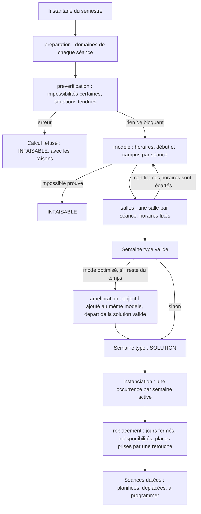

# Solveur

Le solveur place les séances d'un semestre : il produit la **semaine type**
(un jour, une heure et une salle par séance hebdomadaire), puis les **séances
datées** de tout le semestre. Il s'appuie sur OR-Tools CP-SAT.

Deux principes, hérités de la spécification :

- **aucune contrainte n'est abandonnée** pour réussir. Seul l'utilisateur
  choisit le **niveau** de chaque contrainte (nécessaire, important,
  facultatif) ou l'ignore, et le résultat rappelle ses choix et chaque
  entorse consentie ;
- **tout ou rien** : toutes les séances sont placées, ou aucune. Quand c'est
  impossible, le moteur le dit et dit pourquoi.

Références communes : `docs/decisions.md` (sections 5, 6 et 8),
`docs/architecture.md` (« Sémantique des contraintes ») et
`docs/verification.md`. Le vérificateur (`edt.verification`) est l'oracle de
tous les tests du solveur ; l'orchestration lui soumet aussi chaque solution
avant de l'enregistrer.

## Vue d'ensemble



Une solution valide trouvée n'est **jamais perdue** : ni le temps limite ni
un arrêt demandé pendant l'amélioration ne la font disparaître (voir
« Déroulement d'un calcul »).

| Fichier | Rôle |
|---|---|
| `src/edt/solveur/contrat.py` | `OptionsSolveur`, `ResultatSolveur`, `StatutSolveur` (contrat figé) |
| `src/edt/solveur/regles.py` | règles communes : personnes partagées, indisponibilités, salles compatibles, horaires, règles de paire |
| `src/edt/solveur/preparation.py` | domaines de débuts et de salles de chaque séance, domaines vides, contradictions entre horaires fixes |
| `src/edt/solveur/preverification.py` | `pre_verifier` : charges des groupes, des enseignants et des salles |
| `src/edt/solveur/modele.py` | `ModeleHoraires` : le modèle CP-SAT des horaires |
| `src/edt/solveur/salles.py` | `affecter_salles` : le modèle CP-SAT des salles |
| `src/edt/solveur/moteur.py` | `resoudre` : enchaînement, temps limite, arrêt, messages, statistiques |
| `src/edt/solveur/instanciation.py` | `instancier` : séances datées de la semaine type |
| `src/edt/solveur/replacement.py` | `replacer` : replacement de séances datées |
| `src/edt/solveur/provisoire.py` | ancien moteur glouton du socle, gardé pour ses tests |
| `src/edt/services/instanciation.py` | `instancier_version`, `replacer_occurrences` : la couche datée en base |
| `src/edt/services/generation.py` | orchestration d'un calcul : pré-vérifications, moteur, contrôle, version, séances datées |
| `src/edt/commandes/generation.py` | `python -m edt generer`, `pre-verifier`, `instancier` |

Fonctions publiques :

```python
# edt.solveur
def resoudre(instantane, options: OptionsSolveur, arret: threading.Event | None = None) -> ResultatSolveur

# edt.solveur.preverification
def pre_verifier(instantane, contraintes_desactivees=(), *, tolerer_violations_heritees=False,
                 niveaux=None) -> list[Anomalie]

# edt.solveur.instanciation
def instancier(instantane, placements, contraintes_desactivees=(), en_place=(), niveaux=None) -> ResultatInstanciation

# edt.solveur.replacement
def replacer(instantane, occurrences_fixes, occurrences_a_replacer,
             options: OptionsReplacement | None = None, arret=None) -> ResultatReplacement

# edt.services.generation
def pre_verifier_semestre(session, semestre_id, contraintes_desactivees=(), *, niveaux=None,
                          version_base_id=None, tolerer_violations_heritees=False) -> list[Anomalie]

# edt.services.instanciation
def instancier_version(session, version_id, contraintes_desactivees=None) -> RapportInstanciation
def replacer_occurrences(session, version_id, occurrence_ids, date_debut=None, date_fin=None,
                         contraintes_desactivees=None) -> RapportInstanciation
```

## Formulation retenue

### Deux phases, et pourquoi

L'équipe demandait une variable de début et une variable de salle par séance
dans un seul modèle, et le passage à deux phases seulement si les mesures le
justifiaient. La première formulation a été écrite et mesurée (tableau « Première
formulation » plus bas) : elle résout le jeu moyen en 2 s mais dépasse 120 s
sur le jeu grand et sur 800 séances générées. La recherche n'y rencontre
presque aucun conflit ; elle est lente parce que chaque salle porte un
`NoOverlap` de centaines d'intervalles optionnels dont la présence reste
inconnue tant que la salle n'est pas choisie.

Le calcul se fait donc en deux phases :

1. **horaires** : un début et un **campus** par séance ;
2. **salles** : une salle par séance, les horaires étant fixés.

Le campus est décidé en phase 1 parce que les trajets entre campus lient les
horaires aux lieux. La phase 1 contient en plus une condition **nécessaire**
de capacité des salles : elle n'écarte aucune solution, mais elle fait que la
phase 2 réussit presque toujours du premier coup.

Le résultat reste **exact** :

- une solution rendue respecte toutes les contraintes actives (l'oracle le
  contrôle) ;
- si la phase 2 échoue, elle désigne un petit ensemble de séances qui, à ces
  horaires, ne peuvent pas toutes recevoir une salle. La phase 1 reçoit une
  **coupe** qui interdit cette combinaison et repart. Une coupe n'écarte que
  des horaires réellement impossibles ;
- `INFAISABLE` n'est déclaré que si CP-SAT prouve que le modèle des horaires,
  coupes comprises, n'a pas de solution. Ce modèle étant moins contraint que
  le problème complet, la preuve vaut pour le problème complet.

### Phase 1 : le modèle des horaires (`ModeleHoraires`)

**Variables.** Pour chaque séance, un booléen par **choix** possible et
exactement un choix vrai. Un choix est un couple (début, campus), accompagné
des salles de ce campus admissibles et disponibles à ce début. C'est la
variable de début à domaine pré-filtré demandée, croisée avec le campus et
écrite en « un parmi n » : avec une vingtaine de débuts sur la grille, ce
codage rend le non-chevauchement très simple (« au plus une séance en cours
à chaque instant ») et la recherche très rapide.

Un début est codé `jour × pas + minute`. Le `pas` dépasse une journée
augmentée de la plus longue séparation exigée : deux séances de jours
différents sont toujours assez éloignées sur cet axe, et « le même jour »
n'a plus besoin d'être écrit.

**Domaines pré-filtrés** (`preparation.py`, avant tout modèle) :

- débuts : verrou, jour et heure imposés, grille (`HORAIRES`, `JOURS`),
  déjeuner, indisponibilités récurrentes des enseignants et des groupes liés ;
- salles : type, salle ou campus imposé, capacité, équipements,
  accessibilité, indisponibilités récurrentes de la salle.

Un domaine vide est rapporté **avant** la résolution, en nommant la séance et
ce qui élimine ses possibilités (« 20 débuts examinés, tous écartés : 12 par
une indisponibilité de Mme Martin, 8 par la pause déjeuner »).

**Contraintes.**

- *Personnes.* Les séances sont réunies en **unités** : même ensemble de
  groupes (ou même enseignant) et mêmes semaines actives. Une séance sans
  groupe n'entre dans aucune unité de groupes (sinon toutes les séances sans
  groupe formeraient une unité fictive « aucun groupe », au plus une en
  cours : infaisabilité « prouvée » à tort). Deux unités se
  gênent si leurs semaines se croisent et si elles partagent l'enseignant ou
  ont des groupes en conflit. Pour chaque unité et chaque instant, un booléen
  « occupée » est impliqué par les choix de ses séances en cours, chaque
  séance étant allongée de la pause. Le graphe des unités qui se gênent est
  couvert par des cliques ; sur chacune, au plus une unité est occupée à
  chaque instant. Le conflit entre groupes n'est pas transitif (deux classes
  d'une promotion ne se gênent pas, mais gênent toutes deux la promotion, et
  les groupes de langue touchent presque toutes les classes) : couvrir les
  arêtes par des cliques est exact, et passer par les unités évite de répéter
  les mêmes séances dans des centaines de contraintes presque identiques.
- *Trajets.* Pour chaque paire de séances qui partagent une personne et
  peuvent coexister, les couples de choix trop rapprochés sur deux campus
  différents sont interdits. Comme dans le vérificateur, la règle ne porte
  que sur deux séances qui **ne se chevauchent pas** : le chevauchement est
  l'affaire des contraintes d'unicité.
- *Maxima journaliers* des enseignants : somme pondérée des choix de chaque jour.
- *Capacité des salles.* La **famille** d'un choix est l'ensemble des salles
  admissibles de la séance sur le campus du choix. Une **classe** réunit les
  salles qui appartiennent exactement aux mêmes familles (elles sont
  interchangeables pour ce calcul). À chaque instant, les séances en cours
  d'une famille se répartissent entre les classes de la famille (variables
  entières de répartition), et aucune classe ne reçoit plus de séances
  qu'elle n'a de salles disponibles à cet instant. Toute affectation réelle
  donne une telle répartition : la condition est nécessaire.
- *Symétries.* Les séances interchangeables d'un même besoin (mêmes semaines,
  sans verrou) sont ordonnées par début.

### Phase 2 : le modèle des salles (`affecter_salles`)

Un booléen par (séance, salle possible à l'horaire retenu), exactement une
salle par séance, et pour chaque salle au plus une séance en cours à chaque
instant. Horaires connus, ce modèle se résout en une fraction de seconde
(0,3 s sur le jeu grand). S'il est impossible, il est résolu une seconde fois
avec une hypothèse « cette séance reçoit une salle » par séance : CP-SAT
renvoie un sous-ensemble d'hypothèses suffisant pour l'impossibilité, qui
devient la coupe de la phase 1.

Sur tous les jeux mesurés, aucune coupe n'a été nécessaire. Le test
`test_conflit_de_salles_prouve_l_impossibilite` construit le cas où il en
faut : une séance de 4 h entre deux séances de 2 h dont les salles imposées
se croisent.

## Semaines actives : traitement exact

Deux séances dont les semaines actives sont disjointes ne se gênent jamais :
elles peuvent partager créneau, salle, enseignant et groupe. Le modèle
n'est ni permissif ni prudent sur ce point :

- chaque séance porte ses semaines sous forme de masque de bits ;
- *personnes* : deux unités ne sont reliées que si leurs masques ont une
  semaine en commun ; une contrainte ne porte que sur des unités deux à deux
  reliées ;
- *salles, maxima, capacité* : les séances concernées sont découpées en
  ensembles **actifs une même semaine** (`Preparation.ensembles_par_semaines`) :
  un ensemble par semaine du semestre, doublons et sous-ensembles retirés.
  Deux séances sont dans un même ensemble si et seulement si une semaine au
  moins les réunit ; la contrainte est posée par ensemble ;
- *trajets* : seules les paires dont les masques se croisent sont examinées ;
- *objectif* : les semaines sont regroupées par ensemble de séances actives,
  et chaque situation pèse le nombre de semaines où elle se produit.

Le test `test_semaines_disjointes_partagent_creneau_salle_enseignant_et_groupe`
place deux matières courtes du même groupe et du même enseignant sur
l'unique créneau et dans l'unique salle ; le test voisin vérifie qu'une seule
semaine commune rend le problème impossible.

## Traduction des contraintes, code par code

| Code | Où | Traduction |
|---|---|---|
| `SALLE_UNIQUE` | phase 1 (capacité), phase 2 | condition nécessaire par classes de salles, puis « au plus une séance par salle et par instant » |
| `ENSEIGNANT_UNIQUE` | phase 1 | unités d'enseignant : au plus une séance en cours par instant |
| `GROUPE_UNIQUE` | phase 1 | unités de groupes et cliques d'unités en conflit |
| `PAUSE` | phase 1 | les plages des contraintes de personnes sont allongées de la plus petite pause dure en vigueur ; toute pause plus longue (règle `PAUSE_MINIMALE` d'une personne) passe par des couples de choix interdits ou pénalisés, par paire et par source |
| `CAMPUS_TRAJET` | phase 1 | couples de choix interdits pour chaque paire de séances d'une même personne qui se suivent sans se chevaucher |
| `DEJEUNER` | domaines, phase 1 | mode fixe : débuts qui recoupent la plage du déjeuner retirés (séances sans heure imposée) ; mode libre : une position de pause libre par personne et par jour (voir « Pause déjeuner ») ; mode « aucun » : rien |
| `HORAIRES` | domaines | débuts de la grille, ouverture, fermeture, demi-journée du créneau de début |
| `JOURS` | domaines | jours de la grille parmi les jours permis de la séance (`Instantane.reglages` : standard `jours_travailles`, plus le samedi si le type de séance l'autorise, et règles `JOURS_TRAVAILLES` retenues, campus compris) ; un jour sans aucun créneau n'est jamais un jour de cours, même `HORAIRES` ignorée (lecture du vérificateur) |
| `ACCESSIBILITE`, `CAPACITE`, `TYPE_SALLE`, `EQUIPEMENT` | domaines | salles qui ne conviennent pas retirées (salle et campus imposés compris) |
| `DISPO_ENSEIGNANT`, `DISPO_GROUPE` | domaines | débuts qui recoupent une indisponibilité récurrente retirés (groupes liés compris) |
| `DISPO_SALLE` | domaines | salle retirée si elle est indisponible à tous les débuts ; sinon elle manque seulement aux choix concernés |
| `MAX_ENSEIGNANT` | pré-vérification, phase 1 | maximum par semaine : indépendant du placement, contrôlé avant le calcul ; maximum par jour : contrainte linéaire par jour et par ensemble de semaines |
| `VOLUME` | moteur | tout ou rien ; un besoin non dépliable fait refuser le calcul |
| `VERROU` | domaines | la séance n'a qu'un début (et qu'une salle si le verrou en fixe une) |
| `JOUR_FERME` | couche datée | `instancier` signale, `replacer` évite |

Règles de construction des débuts :

- un verrou fixe le début, et la durée placée est celle du verrou. Un verrou
  incohérent (jour hors de 0 à 6, plage vide ou après minuit), d'une autre
  durée que son besoin ou sur une salle inconnue est **refusé en le nommant**,
  que `HORAIRES` soit active ou non : jamais de verrou appliqué en silence
  avec une autre durée ;
- le jour et l'heure imposés par le besoin (ou sa date, pour un besoin
  ponctuel) sont **toujours** respectés, même si `HORAIRES` est désactivée :
  ils font partie de la demande ;
- une heure imposée dispense de la grille, du déjeuner et, si le jour est
  imposé lui aussi, de la règle des jours (un créneau imposé peut sortir de
  la grille) ;
- une séance ponctuelle sans heure imposée suit la grille de son jour. Si ce
  jour n'a aucun créneau, le calcul est refusé en demandant de préciser l'heure ;
- sans jour imposé, la règle des jours s'applique toujours.

Contraintes désactivées : chaque code retire sa traduction et elle seule.
Cas particuliers :

- `ENSEIGNANT_UNIQUE` ou `GROUPE_UNIQUE` désactivée : deux séances de la
  personne peuvent se chevaucher, même sur deux campus ; si elles ne se
  chevauchent pas, la pause et le trajet s'appliquent (couples de choix
  interdits). C'est la lecture du vérificateur (`docs/verification.md`) :
  avant cet alignement, le moteur déclarait « impossible » des problèmes que
  le vérificateur acceptait ;
- `HORAIRES` désactivée : les débuts ne sont plus limités à la grille. Le
  moteur propose alors un début toutes les 30 minutes, de 0 h à 24 h, en plus
  des débuts de la grille (`PAS_HORS_GRILLE`), mais seulement les jours qui
  ont un créneau tant que `JOURS` est active ; aucune séance ne finit après
  minuit, quel que soit le réglage ;
- `VERROU` désactivée : les verrous sont ignorés, les séances redeviennent
  libres et suivent la grille. Dans la version enregistrée, seule une séance
  **restée à la place de son verrou** garde sa marque « verrouillée » : le
  verrou ne suit pas une séance que le moteur a déplacée, sinon les calculs
  suivants figeraient une place que personne n'a choisie.

### Niveaux des contraintes

Chaque contrainte présente dans `OptionsSolveur.niveaux` a un niveau
(`edt.domaine.contraintes.Niveau`) ; une clé absente est une contrainte
ignorée, ni posée ni vérifiée.

- **nécessaire** : contrainte **dure**, traduite comme ci-dessus ; rien ne la
  viole, et une impossibilité certaine refuse le calcul ;
- **important** et **facultatif** : contrainte **souple**. Elle n'élimine
  plus aucune possibilité ; chaque **entorse** est une variable du modèle qui
  coûte `POIDS_NIVEAU[niveau]` dans l'objectif (1 000 pour une règle
  importante, 20 pour une règle facultative). Le moteur minimise ce coût
  **dans tous les modes** : sans « optimiser », l'amélioration ne porte que
  sur les entorses, n'a lieu que si la solution valide en comporte et
  s'arrête dès qu'elles sont nulles ou qu'elle ne progresse plus ; avec
  « optimiser », les termes de confort s'y ajoutent.

Six contraintes définissent le problème et restent toujours nécessaires
(`SALLE_UNIQUE`, `ENSEIGNANT_UNIQUE`, `GROUPE_UNIQUE`, `VERROU`,
`JOUR_FERME`, `VOLUME`). Par défaut, `PAUSE`, `DEJEUNER`, `EQUIPEMENT` et
`MAX_ENSEIGNANT` sont importantes, les autres nécessaires.

**Unité d'entorse et lieu de traitement, contrainte par contrainte :**

| Code | Unité d'entorse | Où |
|---|---|---|
| `HORAIRES` | une séance placée hors de sa demi-journée ou des heures d'ouverture (les débuts restent ceux de la grille) | phase 1, étiquette du début |
| `JOURS` | une séance placée un jour non permis (samedi non autorisé, jour sans créneau si `HORAIRES` est ignorée) | phase 1, étiquette du début |
| `DEJEUNER` | mode fixe : une séance qui recoupe la plage du déjeuner ; mode libre : une personne (groupe ou enseignant), un jour et un ensemble de semaines sans N minutes libres d'un seul tenant dans la fenêtre | phase 1, étiquette du début (fixe) ou littéral par personne et jour (libre) |
| `DISPO_ENSEIGNANT`, `DISPO_GROUPE` | une séance placée pendant une indisponibilité récurrente (une séance verrouillée là compte aussi) | phase 1, étiquette du début |
| `PAUSE` | une paire de séances d'une même personne, le même jour, séparées de moins que la pause (une entorse par paire, quel que soit le nombre de semaines) | phase 1, littéral par paire |
| `CAMPUS_TRAJET` | une paire de séances d'une même personne, le même jour, sur deux campus, séparées de moins que le trajet | phase 1, littéral par paire |
| `MAX_ENSEIGNANT` | une heure entamée au-delà du maximum **journalier**, par jour et par ensemble de semaines actives ; les heures au-delà du maximum **hebdomadaire** ne dépendent pas du placement : comptées d'avance par les pré-vérifications (avertissement), par semaine | phase 1, entier par jour ; pré-vérifications |
| `EQUIPEMENT`, `CAPACITE`, `TYPE_SALLE`, `ACCESSIBILITE` | une exigence non satisfaite par la salle d'une séance | phase 2, coût de la salle |
| `DISPO_SALLE` | une séance dans une salle indisponible à cet horaire | phase 2, coût de la salle |

Ce qui change dans le modèle : une pause souple n'allonge plus les plages
des contraintes de personnes (les paires trop proches deviennent des
littéraux d'entorse) ; une exigence de salle souple ne retire aucune salle
des domaines (la condition de capacité de la phase 1 compte donc toutes les
salles) ; les débuts qui enfreignent une règle d'horaire souple restent
dans le domaine avec leur étiquette. `ModeleHoraires.bilan` compte les
entorses de la phase 1 à partir des seuls choix, `edt.solveur.salles` celles
de la phase 2.

**Résultat.** `statistiques["entorses"]` donne `{code: nombre}` (vide s'il
n'y en a aucune) et le message les dit en clair, par niveau : « 2 entorses à
des règles importantes (pause entre deux séances : 2). 1 entorse à une règle
facultative (jours de cours : 1). » ; rien s'il n'y en a aucune. Le contrôle
par le vérificateur ne porte que sur les contraintes nécessaires.

**Couche datée.** Une contrainte souple n'empêche rien à l'instanciation :
la semaine type l'a arbitrée, déplacer chaque semaine une séance placée en
connaissance de cause n'aurait pas de sens. Au replacement, une place qui
enfreint une règle souple reste permise mais son coût s'ajoute à
l'éloignement (1 000 vaut dix semaines, 20 vaut deux jours) : une règle
importante fait préférer une autre semaine, une règle facultative une autre
place proche.

**Limites.** Les horaires sont choisis sans connaître le coût des salles :
une entorse à `EQUIPEMENT` (ou `CAPACITE`, `TYPE_SALLE`, `ACCESSIBILITE`,
`DISPO_SALLE`) peut être payée là où d'autres horaires l'auraient évitée ; la
phase 2 l'évite seulement quand les horaires le permettent. Le moteur
compare toutefois ses solutions au **coût complet** (objectif et entorses
des horaires, plus `POIDS_NIVEAU` par entorse de salle) : l'amélioration est
lancée dès qu'il y a une entorse, de salle comprise ; des horaires mieux
notés dont les salles coûtent plus cher sont écartés au profit des
précédents ; et `optimal` n'est affirmé que sans entorse de salle. Le maximum
journalier souple est compté par ensemble de semaines : une séance active
dans deux ensembles peut compter deux fois. Au replacement, un maximum
d'enseignant souple dépassé coûte une entorse, pas une par heure.

Violations héritées (`tolerer_violations_heritees`) : aucune contrainte de
paire ne s'applique entre deux séances verrouillées. En pratique les séances
verrouillées qui se contredisent, et celles dont la salle reste à choisir,
sont « isolées » : elles ne sont réunies qu'aux séances libres. Sans cette
option, des verrous contradictoires font refuser le calcul avec la liste.

### Pause déjeuner

`Parametres.dejeuner_mode` choisit l'un de trois modes (contrat dans
`docs/architecture.md`) ; la règle `DEJEUNER` les traduit tous les trois.

| Mode | Règle | Traduction |
|---|---|---|
| **fixe** | aucune séance ne recoupe la plage `[dejeuner_debut_min, dejeuner_fin_min[` (`plage_dejeuner`) | domaines : les débuts qui la recoupent sont retirés (dure) ou étiquetés (souple), par `Regles.violations_horaire` |
| **libre** | pour chaque groupe et chaque enseignant, chaque jour où une séance recoupe la fenêtre `[X, Y[` (`fenetre_dejeuner` = `(X, Y, N)`), il reste un intervalle libre d'au moins N minutes d'un seul tenant dans `[X, Y[` ; un jour sans séance dans la fenêtre est satisfait | phase 1, `ModeleHoraires._pause_dejeuner_libre` (ci-dessous) ; couche datée, `Regles.pause_dejeuner_tenue` |
| **aucun** | rien | rien |

**Les personnes.** Un enseignant : ses séances (enseignants fictifs
exclus). Un groupe : les séances qui occupent **tous** ses étudiants, c'est-à-
dire celles de ses groupes liés **moins ses sous-groupes** (`Regles.occupants`,
par `Groupe.parent_id`). Un sous-groupe ne mobilise qu'une partie des
étudiants : compter ses séances priverait à tort la classe de pause quand
ses demi-groupes déjeunent en décalé (TD de A-1 de 12 h à 13 h, TD de A-2 de
13 h à 14 h : la classe a bien sa pause, et chaque demi-groupe aussi, avec
les séances de la classe). Chaque sous-groupe porte sa propre règle. C'est
la lecture du vérificateur (`docs/verification.md`). Les groupes qui se
chevauchent sans se contenir (chevauchement déclaré, étudiant commun)
comptent l'un pour l'autre, comme pour `GROUPE_UNIQUE` : c'est une
approximation prudente, faute de connaître les étudiants communs.

**Discrétisation (exacte).** Pour une personne, un jour et un ensemble de
semaines actives (`Preparation.ensembles_par_semaines`), le modèle énumère
les **positions de pause** `[p, p + N[` avec `p` = X ou la fin possible
d'une de ses séances, pour `X < p ≤ Y − N`. C'est exact : un intervalle libre
d'au moins N minutes commence toujours à X ou à la fin d'une séance. Pour
chaque séance et chaque position, un littéral « la séance recoupe la
position » (`_au_moins_un` de ses choix qui la recoupent : une implication
par choix), partagé entre toutes les personnes de la séance et entre les
positions aux mêmes choix ; pour chaque personne, jour et position, un
littéral « occupée » (`_au_moins_un` de ces littéraux : une implication par
séance). Règle dure : clause « une position non occupée » ; règle souple :
un littéral d'entorse vrai si toutes les positions sont occupées
(`_sauf_si`), pesant `POIDS_NIVEAU` dans l'objectif. Un jour sans séance
dans la fenêtre n'occupe aucune position : la règle y est satisfaite
d'elle-même, sans condition supplémentaire. Rien n'est posé pour une journée
où aucune séance ne peut recouper la fenêtre, ni quand une position ne peut
être recoupée par aucun choix (une grille qui ménage la pause, comme la
grille par défaut avec 12 h 45-13 h 45, ne coûte donc rien). Les personnes
au même emploi du temps (un groupe et
son unique enseignant, par exemple) partagent la contrainte mais comptent
chacune pour une entorse. Une séance qui, à elle seule, ne laisserait pas N
minutes dans la fenêtre est écartée dès la préparation quand la règle est
dure (`Regles.violations_horaire`, message « la pause déjeuner » des
pré-vérifications) ; souple, elle n'est pas étiquetée pour ne pas compter
deux fois : l'entorse est celle de la journée.

**Unité d'entorse** : une personne, un jour, un ensemble de semaines sans
pause suffisante, exactement l'anomalie du vérificateur (une par personne et
par jour). `statistiques["entorses"]["DEJEUNER"]` les additionne aux
entorses du mode fixe (il n'y a jamais les deux à la fois).

**Couche datée.** `instancier` ne regarde pas la pause libre (la semaine
type l'a arbitrée). `replacer` refuse une place qui priverait un groupe
(ceux que la séance occupe, `Regles.groupes_occupes`) ou un enseignant de
sa pause ce jour-là, compte tenu des occurrences en place (règle dure,
raison « la pause déjeuner de ses groupes ou de ses enseignants ») ; souple,
la place coûte `POIDS_NIVEAU` par personne privée.

**Taille.** Le pas de la grille n'intervient pas : seules comptent les fins
de séance possibles dans la fenêtre. Sur la grille par défaut (créneaux de
8 h 30, 10 h 45, 13 h 45 et 16 h), la position 12 h 45-13 h 45 ne peut être
recoupée par aucune séance : rien n'est posé, le modèle est identique au
mode fixe. Sur une grille serrée (créneaux de 12 h et 13 h en plus), le jeu
grand S1 pose 3 300 littéraux d'entorse et 5 900 littéraux de séance : le
modèle passe de 489 000 à 754 000 contraintes (voir « Mesures : pause
déjeuner libre »).

### Règles personnalisées

Les règles personnalisées (`docs/regles-personnalisees.md`, `edt.domaine.regles`)
arrivent résolues dans l'instantané (`Instantane.regles`), avec les emplois du
temps des personnes (`Instantane.emplois` : un groupe feuille et les séances
de sa lignée, un enseignant non fictif et les siennes) et les réglages
(`Instantane.reglages` : jours permis de chaque séance, pause déjeuner et
pause minimale de chaque personne, chaque valeur avec sa **source**, une
règle ou le paramètre global). Le solveur ne lit plus directement
`Besoin.samedi_autorise`, `plage_dejeuner`, `fenetre_dejeuner` ni `pause_min`.

**Niveaux du calcul.** `OptionsSolveur.niveaux_regles` (identifiant de règle →
niveau) dit, pour ce calcul, le niveau de chaque règle retenue ; une règle
active absente du dictionnaire est **ignorée** : traitée comme si elle
n'existait pas, le standard reprenant sa place pour un réglage (jours,
déjeuner, pause). `None` (défaut) garde chaque règle active à son propre
niveau. `edt.solveur.personnalisees.appliquer_niveaux` construit
l'instantané du calcul (les seules règles retenues, à leur niveau retenu) :
`Regles`, la préparation, le modèle et la couche datée lisent celui-là. Le
service copie chaque règle du semestre dans `calcul.parametres["regles"]`
(code, type, portée, paramètres, phrase et niveau retenu, `null` pour une
règle ignorée) et enregistre `niveaux_regles` ; le vérificateur contrôle la
solution aux mêmes niveaux (`SuiviCalcul.regles`, `SuiviCalcul.niveaux_regles`).
En ligne de commande : `--regle CODE=niveau` et `--sans-regle CODE`
(`generer`, `pre-verifier`).

**Imputation.** Toute violation est une `Regles.Violation` : le code du
catalogue (`REGLE` pour une règle) et la règle enfreinte, s'il y en a une.
Dur ou souple se décide au niveau de la **source** ; une entorse souple coûte
`POIDS_NIVEAU[niveau de la source]` et compte sous `statistiques["entorses"]`
(contraintes du catalogue) ou `statistiques["entorses_regles"]` (par code de
règle). Le message les dit : « 2 entorses à la règle R007 (Le groupe A1 ne
travaille pas le samedi). ».

**Poseurs** (`edt.solveur.personnalisees` pour les types de sorte « séance »
et les réglages de personne, `edt.solveur.regles_emploi` pour les types
d'emploi du temps et de relation ; registre `enregistrer("solveur", type)`,
`types_non_couverts("solveur")` est vide). Garde-fou : une règle active d'un
type ajouté sans poseur fait refuser le calcul en la nommant.

| Type | Où | Dur | Souple | Unité d'entorse |
|---|---|---|---|---|
| `JOURS_TRAVAILLES` | domaines (préparation) | les jours fermés à la séance sont retirés ; quand une règle vise un campus, jour par jour et campus par campus : fermé partout, le jour est retiré ; fermé sur un campus, les salles de ce campus perdent ces débuts | pénalité sur chaque choix (début, ou début et campus), sans variable | une séance placée un jour que la règle retenue exclut |
| `PLAGE_HORAIRE`, `CRENEAUX_INTERDITS` | domaines | les débuts qui débordent ou recoupent la plage sont retirés | pénalité par début | une séance qui déborde ou recoupe |
| `CAMPUS` | domaines | les salles des campus refusés sont retirées | pénalité par choix (début, campus) dans la phase des horaires | une séance sur un campus refusé |
| `SALLES` | domaines (dur), phase des salles (souple) | les salles refusées sont retirées | coût de la salle dans l'objectif de la phase des salles (`SeancePreparee.entorses_salles`) | une séance dans une salle refusée |
| `PAUSE_DEJEUNER` | réglage de la personne : domaines (fixe) ou `_pause_dejeuner` (libre) | comme le déjeuner de l'établissement, avec les bornes de la règle | de même, l'entorse imputée à la règle | fixe : une séance qui recoupe la plage ; libre : une personne, un jour, un ensemble de semaines sans pause |
| `PAUSE_MINIMALE` | réglage de la personne : `_pauses_et_trajets` | couples de choix interdits au-delà de la pause garantie par l'allongement des plages | un littéral par paire de séances et par source | une paire de séances de la personne trop rapprochées |
| `MAX_PAR_JOUR` | `_regles_personnalisees` | par personne, jour et configuration de semaines : Σ durée (ou nombre) des choix du jour ≤ maximum | un booléen par inégalité relâchée (`_depasse`), un par (personne, jour) | une personne et un jour en défaut |
| `CAMPUS_PAR_JOUR` | idem | booléens de présence par campus du jour ; « pas deux campus » par paire de campus | Σ présences ≤ 1 relâchée | une personne et un jour sur deux campus |
| `MATIERES_PAR_JOUR` | idem | booléens de présence par matière du jour ; Σ ≤ maximum | relâchée | un groupe et un jour avec trop de matières |
| `JOURNEES_LIBRES` | idem | booléens « occupée » par candidate (demi-journée ou journée) ; Σ occupées ≤ candidates − nombre, par configuration | relâchée, un par personne | une personne sans assez de demi-journées (ou journées) libres une semaine au moins |
| `SANS_TROU` | idem | booléens de trou de l'objectif (`ModeleHoraires.trous`, partagés avec le confort) ; Σ ≤ maximum par configuration | relâchée, un par personne | une personne avec trop de créneaux de trou une semaine au moins |
| `ORDRE_SEMAINE` | idem | par paire (avant, après) d'une même matière aux semaines communes : début(avant) − début(après) ≤ −1 sur les débuts codés (jour puis heure) | relâchée | une paire dans le mauvais ordre |
| `REPARTITION_MATIERE` | idem | même jour : Σ jours présents ≤ 1 par (groupe, matière, configuration) ; jours différents : au plus un choix de la matière par jour | relâchée | un couple (groupe, matière, semaines) sur plusieurs jours ; un jour avec plus d'une séance |

Pour ces sept types, `_depasse` pose « constante + Σ coef × choix ≤ maximum »
en dur, ou la relâche en souple par un booléen d'entorse `e` et une marge
(`≤ maximum + marge × e`), dont `bilan` recalcule la valeur (nature
« depasse »). Les semaines suivent la définition du vérificateur : chaque
séance est ramenée aux semaines de la règle, puis les semaines sont regroupées
par ensemble de séances actives ensemble (`_configurations`) ; une entorse
par jour ou par personne réunit les configurations (« une semaine au moins »),
comme l'anomalie du vérificateur qui détaille les semaines. Définitions
communes : le matin va jusqu'au début de la plage du déjeuner, une séance
occupe chaque demi-journée qu'elle recoupe ; les jours travaillés de
`JOURNEES_LIBRES` sans `parmi` sont le standard, un jour vaut ses deux
demi-journées ; un créneau de trou est celui de l'indicateur `trous_creneaux` ;
« après » commence strictement plus tard dans la semaine.

Les domaines d'une séance dépendent de son besoin **et** des règles qui la
concernent (une règle datée ne vise que les séances dont les semaines
croisent sa période) : deux séances d'un même besoin aux mêmes règles
partagent leurs domaines. Un domaine vidé par une règle est une
impossibilité certaine qui nomme la règle (« aucun horaire possible : ... 4
par la règle R007 (...) ») ; une infaisabilité qui ne tient qu'à la
combinaison de plusieurs séances reste prouvée par CP-SAT sans nommer la
règle.

**Personnes.** Les pauses (déjeuner, minimale) sont celles de chaque
personne de `Instantane.emplois` : un groupe feuille suit ses séances et
celles de ses ascendants, un enseignant les siennes. Entre deux séances, la
pause exigée est celle de chaque personne commune (`Regles.exigences_de_pause`) ;
deux personnes au même réglage et à la même source n'en font qu'une, et un
groupe et son enseignant au même standard ne comptent qu'une entorse par
paire. L'allongement des plages des contraintes d'unicité garantit la plus
petite pause **dure** en vigueur (`Regles.pause_garantie`) ; le reste passe
par des couples de choix. Comme pour le vérificateur, deux groupes seulement
chevauchants (sans personne commune) n'exigent plus de pause entre eux.

**Couche datée.** `instancier` et `replacer` reçoivent `niveaux_regles`
(ceux de la version : `edt.services.niveaux.niveaux_regles_de_version`) ; le
replacement juge chaque candidate selon les règles de la séance (jours,
campus de la salle compris, horaires, campus et salle) et la pause déjeuner
de chaque personne, en dur (refus) ou en souple (coût) ; les sept types
d'emploi du temps et de relation sont évalués, salle choisie, par les
vérificateurs datés sur la semaine réelle de la candidate
(`_Planning.regles_emploi_enfreintes`), avec leurs définitions ; une règle
à période datée ne compte que les jours qu'elle couvre
(`RegleResolue.couvre`). Les règles de jours sont résolues à la date de chaque candidate
(`Reglages.jours_de(seance_id, date)`) : hors de la période d'une ouverture
datée, le standard reprend sa place. Les réglages de personne (déjeuner,
pause) ne sont pas datables (contrat) : rien à filtrer.

**Écart avec le vérificateur.** Une entorse par personne : deux personnes au
même emploi du temps (deux demi-groupes sans séance propre) comptent deux
entorses là où le vérificateur réunit les personnes dans la même situation en
une seule anomalie (`entorses_par_regle` compte les anomalies).

## Objectif (mode optimisé)

Avec `options.optimiser`, le calcul se fait **en deux temps** :

1. une **solution valide**, cherchée sur le modèle sans objectif, exactement
   comme en mode faisable et dans le même délai ;
2. l'**amélioration**, dans le temps qui reste : l'objectif est ajouté au
   même modèle (`ModeleHoraires.poser_objectif`) et la recherche repart de la
   solution valide. Elle s'arrête d'elle-même quand elle ne progresse plus,
   sans attendre le temps limite.

L'objectif minimisé est

```
poids_trous × trous + poids_changement_campus × changements de campus
+ poids_samedi × séances du samedi + poids_creneaux_extremes × séances extrêmes
```

Les quatre quantités sont comptées **semaine par semaine**, comme
`edt.verification.calculer_indicateurs` : une situation qui dure 15 semaines
compte 15 fois.

| Terme | Définition dans le modèle |
|---|---|
| trous | pour chaque groupe feuille (sans sous-groupe), avec ses séances et celles de ses ascendants, pour chaque ensemble de semaines où les mêmes séances sont actives : un créneau de la grille est un trou si une séance finit avant lui, une autre commence après lui et aucune ne le recoupe, le même jour |
| changements de campus | pour chaque groupe feuille et chaque enseignant non fictif, par jour : une pénalité par paire de campus où la personne a cours ce jour-là |
| samedi | nombre de semaines actives de chaque séance placée le samedi |
| créneaux extrêmes | nombre de semaines actives de chaque séance qui recoupe le premier ou le dernier créneau de la grille de son jour |

Deux groupes feuilles qui ont le même emploi du temps (deux demi-groupes
sans séance propre) comptent chacun pour leurs trous, comme dans le
vérificateur.

### Repartir de la solution valide

Donner à CP-SAT les seuls choix des séances ne suffit pas. L'objectif
s'appuie sur des variables auxiliaires (« ce créneau est un trou pour ce
groupe », « ce groupe a cours sur ces deux campus ce jour-là ») ; un indice
qui ne les renseigne pas n'est pas repris. C'était le défaut du premier
moteur : la première solution du mode optimisé arrivait à 38 s avec une
pénalité de 122 967 alors que l'indice fourni valait 41 947.

`poser_objectif` note donc la définition de chaque variable auxiliaire
(« vraie si l'un de ces choix est fait », « vraie si aucun ne l'est »), et
`partir_de` en déduit leur valeur dans la solution valide : CP-SAT reçoit un
indice **complet**, une valeur pour chaque variable du modèle. Son journal le
confirme (« The solution hint is complete and is feasible ») et la première
solution de l'amélioration est la solution valide elle-même. Le test
`test_l_amelioration_part_de_la_solution_valide` le vérifie.

Le prétraitement de CP-SAT est **allégé pour l'amélioration seulement** (pas
de sondage, pas de détection de symétries, une seule passe). Avec les
réglages par défaut il occupait 17 à 28 s sur le jeu grand avant que la
recherche reparte, si bien qu'un calcul de 60 s n'améliorait rien (voir
« Mesures »).

Il n'y a qu'**un modèle en mémoire** : l'objectif s'ajoute au modèle des
horaires, et la première recherche est libérée avant que la seconde
commence.

### Bilan d'une solution et écart avec le vérificateur

`ModeleHoraires.bilan(choix)` calcule l'objectif, les trous et les séances
du samedi d'une solution à partir des seuls choix des séances. C'est ce que
dit le message du calcul et ce que portent `statistiques["objectif"]`,
`["trous"]` et `["samedis"]`. Les trous et les samedis sont **exactement**
ceux du vérificateur (`trous_creneaux`, `seances_samedi`).

Seuls les **changements de campus** peuvent s'en écarter : le vérificateur
compte les paires de séances consécutives sur deux campus différents ; le
modèle compte une fois chaque paire de campus fréquentés dans la journée.
Les deux coïncident tant qu'une personne ne fait pas plus d'un aller entre
deux campus dans la journée. Sur les mesures ci-dessous, les deux objectifs sont
égaux pour presque toutes les solutions améliorées (1 % d'écart au plus) et
s'écartent de 0,2 % à 4 % sur les premières solutions valides, où les
changements de campus sont nombreux (49 058 pour le moteur contre 48 968
pour le vérificateur sur le grand S1, 3 050 contre 3 190 sur le moyen S2).

Quand le temps limite arrive avant la preuve d'optimalité, la meilleure
solution trouvée est rendue (statut `SOLUTION`, `statistiques["optimal"]`
faux, borne inférieure dans `borne_objectif`).

## Déroulement d'un calcul

1. **Préparation** et **pré-vérifications**. Une impossibilité certaine fait
   refuser le calcul : statut `INFAISABLE`, `statistiques["refuse"]` vrai,
   message qui cite les trois premières raisons, liste complète dans
   `avertissements`.
2. **Modèle des horaires**, sans objectif.
3. **Une solution valide** : recherche des horaires, puis **salles** ;
   reprise si les salles ne suivent pas. À ce moment une solution
   enregistrable existe : `statistiques["duree_premiere_solution_s"]` donne
   le délai écoulé.
4. **Amélioration**, s'il reste au moins 1 s (`TEMPS_MIN_AMELIORATION_S`),
   en mode optimisé ou dès que la solution valide comporte des entorses à
   des contraintes souples : l'objectif (entorses, et confort en mode
   optimisé) est ajouté au modèle et la recherche repart de la solution
   valide, jusqu'à la preuve d'optimalité, à la stagnation (plus de
   progrès), au temps limite ou à l'arrêt demandé.
   Les horaires améliorés reçoivent des salles, des mieux notés aux moins
   bien (20 gardés), tant que leur note peut battre le coût complet de la
   solution retenue (note des horaires plus entorses des salles) : des
   horaires dont les salles ne suivent pas, ou coûtent plus d'entorses
   qu'ils ne font gagner, sont écartés et les précédents essayés ; à défaut
   la solution valide de l'étape 3 est rendue.
5. **Résultat** : placements de toutes les séances, message, statistiques.

### Une solution trouvée n'est jamais perdue

Dès que l'étape 3 a abouti, le calcul rend `SOLUTION`, quoi qu'il arrive
ensuite.

| Ce qui arrive | Statut | Fin du message |
|---|---|---|
| le temps limite tombe avant l'étape 3 | `TEMPS_DEPASSE` | « Aucun emploi du temps n'a été trouvé en n s. Ce n'est pas une preuve d'impossibilité... » |
| le temps limite tombe juste après l'étape 3 | `SOLUTION` (la solution valide) | « Le temps a manqué pour l'améliorer : relancer avec plus de temps donnera un emploi du temps plus confortable. » |
| le temps limite tombe pendant l'amélioration | `SOLUTION` (la meilleure trouvée) | « L'amélioration s'est arrêtée au temps limite : relancer plus longtemps peut encore l'affiner. » |
| l'optimum est prouvé | `SOLUTION` | « On ne peut pas faire mieux avec les préférences actuelles. » ; s'il reste des entorses de salle : « Les horaires ne peuvent pas être mieux notés ; les entorses qui restent viennent des salles. » ; si les horaires les mieux notés ont été écartés à cause de leurs salles : « Des horaires mieux notés existent, mais leurs salles coûteraient des entorses : ceux-ci sont gardés. » |
| l'amélioration ne progresse plus | `SOLUTION` (la meilleure trouvée) | « L'amélioration s'est arrêtée d'elle-même : plus de progrès depuis N s. » |
| arrêt demandé avant l'étape 3 | `ARRETE` | « Calcul arrêté à votre demande avant qu'un emploi du temps soit trouvé : rien n'a été enregistré. » |
| arrêt demandé après l'étape 3 | `SOLUTION` (la meilleure trouvée) | « Calcul arrêté à votre demande : la meilleure solution trouvée a été conservée. » |

Arrêt avec solution : la phrase est aussi dans `avertissements`, et
`statistiques["arrete_par_utilisateur"]` vaut vrai. Pour le service
(`edt.services.generation`), c'est un calcul **réussi** : état `REUSSI`,
version enregistrée et instanciée, `SuiviCalcul.arret_demande` vrai. L'état
`ARRETE` ne désigne plus qu'un arrêt sans solution.

Pour toute solution, `statistiques["raison_arret"]` dit pourquoi la
recherche s'est arrêtée là :

| `raison_arret` | Sens |
|---|---|
| `premiere_solution` | pas d'amélioration demandée (mode faisable) |
| `optimum_prouve` | les horaires les mieux notés sont prouvés ; `optimal` dit si l'emploi du temps l'est aussi, salles comprises |
| `stagnation` | plus de progrès ; `duree_sans_progres_s` donne la durée du silence |
| `temps_limite` | l'amélioration avançait encore au temps limite |
| `temps_manquant` | le temps limite est tombé avant que l'amélioration commence |
| `arret_utilisateur` | arrêt demandé, solution conservée |

**Recherche rendue en retard.** Sur un gros modèle et une machine chargée,
CP-SAT rend parfois la main quelques secondes après son temps imparti, donc
après le temps limite du calcul. Les meilleurs horaires améliorés reçoivent
quand même leurs salles (10 s au plus leur sont garanties, une seconde
suffit en pratique) : le calcul dépasse alors son temps limite d'une seconde
ou deux, au lieu de rendre la première solution valide et de perdre toute
l'amélioration. Le journal le signale (« La recherche a rendu la main ... s
après le temps limite »).

### L'amélioration s'arrête d'elle-même

Un petit établissement atteint vite son palier : sur le jeu moyen, trous et
samedis sont à zéro en 6 s et plus rien ne bouge après une vingtaine de
secondes. Attendre le temps limite (300 s par défaut) ne sert à rien.
L'amélioration s'arrête donc quand **aucune solution meilleure n'est venue
depuis**

```
max(10 s, un tiers du temps écoulé depuis le lancement du calcul)
```

(`delai_de_stagnation`, constantes `STAGNATION_MIN_S` et `STAGNATION_PART`
de `moteur.py`). Le fil de surveillance le constate dix fois par seconde ;
le compte part de la première solution de l'amélioration, pas du chargement
du modèle. Le message dit « L'amélioration s'est arrêtée d'elle-même : plus
de progrès depuis N s. » et `raison_arret` vaut `stagnation`.

Pourquoi deux termes (mesures : « Arrêt sur stagnation » plus bas) :

- **10 s** suffisent à constater le palier d'un petit problème, dont les
  améliorations se suivent à moins de deux secondes tant qu'il progresse.
  Avec 20 s le jeu moyen met de 32 à 60 s à rendre la main, avec 10 s de 17
  à 36 s, pour le même bilan (aucun trou, aucun samedi) ;
- **un tiers du temps écoulé** protège les gros problèmes, qui progressent
  par à-coups de plus en plus espacés. Sur le jeu grand, le plus long
  silence entre deux améliorations vaut d'ordinaire 7 à 12 % du temps
  écoulé, et 19 % dans le pire cas relevé (28 s vers 147 s). Un délai fixe
  ne tient pas : 10 ou 15 s coupent le jeu grand en pleine progression, 20 s
  ne le laissent passer que de justesse. Ce terme suit de lui-même la
  vitesse de la machine : sur un serveur deux fois plus lent, silences et
  patience doublent ensemble.

Ce que la règle ne garantit pas : un petit problème trouve parfois une
dernière amélioration après un long silence (jeu moyen : 6 s de silence
vers 15 s, puis 10 % de mieux sur l'objectif). Elle peut être coupée, plus
souvent sur une machine lente. Les trous et les samedis, eux, étaient déjà
à zéro : la perte porte sur les changements de campus et les créneaux
extrêmes.

**Reproductibilité.** Ce critère lit l'horloge, comme le temps limite. À un
fil et à graine égale la recherche est la même, mais l'instant où elle est
coupée dépend de la machine et de sa charge : deux exécutions peuvent rendre
deux solutions. Rien ne change pour le mode faisable, ni pour un calcul qui
va jusqu'à l'optimum prouvé. `OptionsSolveur.arret_sur_stagnation` (vrai par
défaut, enregistré avec les options du calcul) désactive le critère : c'est
le réglage des tests (`tests/solveur/fabrique.py`), et celui à prendre pour
comparer deux exécutions à temps limite égal.

### Statuts et messages

| Statut | Sens | Message |
|---|---|---|
| `SOLUTION` | toutes les séances sont placées | « Emploi du temps trouvé : n séance(s) placée(s). », puis en mode optimisé « Bilan sur l'ensemble du semestre : x créneau(x) libre(s) entre deux cours dans les journées des groupes et y séance(s) le samedi. », la fin du tableau précédent, et les contraintes ignorées |
| `INFAISABLE` | impossibilité prouvée (pré-vérifications ou CP-SAT) | « Aucun emploi du temps ne peut respecter toutes les contraintes actives : c'est prouvé... » |
| `TEMPS_DEPASSE` | rien trouvé, sans preuve | « Aucun emploi du temps n'a été trouvé en n s. Ce n'est pas une preuve d'impossibilité... » |
| `ARRETE` | arrêt demandé avant toute solution | « Calcul arrêté à votre demande avant qu'un emploi du temps soit trouvé : rien n'a été enregistré. » |

Le message d'un calcul réussi s'adresse au responsable de planning : il ne
contient ni « pénalité » ni « objectif ». Un poids mis à zéro retire la
mesure correspondante du bilan. En mode faisable le moteur ne calcule pas de
bilan ; la commande `generer` l'affiche alors d'après les indicateurs du
vérificateur, avec la même phrase.

### Réglages et suivi

- **Temps limite** : il couvre tout le calcul, construction comprise. Une
  petite part (5 %, au plus 3 s) est réservée à la phase des salles. C'est
  un plafond : en mode optimisé le calcul s'arrête avant s'il prouve
  l'optimum ou ne progresse plus. `OptionsSolveur` refuse (`ErreurDonneesInvalides`)
  un temps limite qui n'est pas un nombre fini entre 0 exclu et
  `TEMPS_LIMITE_MAX_S` (24 h) : NaN, infini ou 10⁹ s donneraient un calcul
  sans fin, et une échéance d'abandon impossible à calculer. Même garde sur
  les fils (`NB_WORKERS_MAX`, 64) ; la graine est un entier quelconque,
  ramenée dans les bornes de CP-SAT par le moteur (modulo 2³¹ − 1).
- **Arrêt** : un fil de surveillance relit l'événement `arret` dix fois par
  seconde et interrompt CP-SAT ; la construction du modèle le relit entre
  ses étapes. Le moteur rend la main en moins de deux secondes, avant la
  première solution comme pendant l'amélioration.
- **Niveaux de règles** : un identifiant de règle inconnu de l'instantané
  (règle supprimée, désactivée ou d'une autre année) est signalé dans les
  avertissements et absent de `ResultatSolveur.niveaux_regles`, jamais
  ignoré en silence.
- **Fils de calcul** : `nb_workers = 0` en utilise deux au plus (le serveur a
  deux cœurs). Quel que soit le réglage, le moteur n'en prend **jamais plus
  que la machine n'a de cœurs** : chaque fil de CP-SAT garde sa copie du
  modèle, et la revue a mesuré 12,8 Go avec 64 fils contre 1,3 Go avec 2.
- **Graine** : `options.graine` fixe le tirage de CP-SAT et l'ordre dans
  lequel il examine les variables (`permute_variable_randomly`), pour les
  horaires comme pour les salles. Même graine et un seul fil : même
  solution, tant que l'horloge n'interrompt pas la recherche (temps limite,
  ou arrêt sur stagnation en mode optimisé). Autre
  graine : autre solution, même avec un seul fil et sur un petit problème
  (jeu minimal, jeu moyen). C'est ce qui sert à « proposer une autre
  solution ».
- **Indices** : avec `utiliser_indices`, le placement précédent de chaque
  séance (`SeanceAPlacer.indice`) est proposé à CP-SAT comme point de départ
  (début, campus, puis salle en phase 2).
- **Statistiques** : `moteur`, `nb_seances`, `nb_salles`, `nb_variables`,
  `nb_contraintes` (modèle des horaires, objectif compris quand il a été
  ajouté), `duree_preparation_s`, `duree_construction_s`,
  `duree_premiere_solution_s`, `duree_resolution_s`, `duree_salles_s`,
  `duree_s`, `statut_cp_sat`, `nb_workers` (fils réellement utilisés),
  `graine`, `nb_conflits`, `nb_branches`, `nb_solutions`, `nb_coupes`,
  `refuse`, `arrete_par_utilisateur`, `raison_arret` et `entorses` (pour
  une solution) ; et quand l'amélioration a eu lieu
  `objectif_premiere_solution`, `borne_objectif` (sur l'objectif complet,
  entorses comprises), et en mode optimisé `objectif` (confort seul),
  `trous`, `samedis`, `optimal`, `duree_sans_progres_s` (arrêt sur
  stagnation).
- **Journal** (`logging`, jamais de `print`) : taille du problème, tailles
  des domaines (minimum, médiane), durée de construction, une ligne de
  progression toutes les 5 s, « Emploi du temps valide trouvé après ... s »,
  « Amélioration : départ à l'objectif ... », chaque amélioration (au plus
  une toutes les 2 s), « Plus de progrès depuis ... s : l'amélioration
  s'arrête d'elle-même », résultat. Au niveau `DEBUG` : durée et taille de
  chaque étape du modèle, et le journal de CP-SAT.

## Pré-vérifications

`pre_verifier` est pure et rapide (0,1 s sur le jeu grand). Elle renvoie des
`Anomalie` : gravité `ERREUR` quand l'impossibilité est certaine,
`AVERTISSEMENT` au-delà de 90 % du temps disponible.

| Famille | Exemple de message |
|---|---|
| dépliage | « Projet : 5 séances demandées, mais la période n'en permet que 2... Corriger le besoin avant de lancer le calcul. » |
| séance sans horaire | « « TP » (séance 12-1) : aucun horaire possible : 20 début(s) examiné(s), tous écartés (20 par une indisponibilité de Mme Martin). » |
| séance sans salle | « « TP » (séance 12-1) : aucune salle ne convient. Sur 40 salle(s) : 12 du type demandé (Laboratoire), 30 d'au moins 45 places, 0 accessibles ; la séance requiert une salle accessible et aucune salle ne l'est. » |
| verrou intenable | « La séance verrouillée « Maths » (séance 3-1), placée le lundi 8 h 30 - 10 h 30, est verrouillée en salle N101, qui ne fait pas partie des salles d'au moins 30 places... » |
| verrous contradictoires | « Les séances verrouillées « Maths »... et « Physique »... se contredisent (« Une séance par salle »). » |
| créneau imposé à plusieurs séances | « « DST » impose le même jour et la même heure à ses séances 7-1 et 7-2... » |
| charge d'un groupe | « Le groupe A2-G1 demande 10 h de cours par semaine pour 8 h 30 disponibles : c'est impossible. » |
| charge d'un enseignant | « Mme Martin doit assurer 6 h de cours par semaine pour 4 h 15 disponibles (compte tenu de ses indisponibilités) : c'est impossible. » |
| maxima d'un enseignant | « Mme Martin doit assurer 6 h de cours par semaine pour un maximum de 4 h par semaine : c'est impossible. » |
| salles | « Les 5 séance(s) qui ne peuvent avoir lieu que dans la salle Labo demandent 10 h de cours par semaine pour 8 h 30 disponibles dans ces salles : c'est impossible. » |

Le temps disponible est celui des demi-journées de la grille, moins les
indisponibilités récurrentes et les séances à horaire déjà fixe. Une séance
sans aucun horaire possible (domaine vide, verrou intenable ou incohérent)
est déjà une impossibilité à elle seule : elle n'entre dans **aucune** borne
de charge, sinon « ... pour 0 min disponibles : c'est impossible » viendrait
s'ajouter à tort pour son groupe et son enseignant. Les verrous
contradictoires portent le conseil de cocher « tolérer les violations
héritées » : c'est ce message que le service affiche quand il refuse. La charge
d'un groupe compte ses séances et celles des groupes qui le contiennent. Les
salles sont examinées par **famille** (l'ensemble des salles qui conviennent
à un besoin), ce qui couvre le type, la capacité, les équipements et
l'accessibilité d'un seul coup. Ces bornes sont nécessaires, pas
suffisantes : un calcul sans erreur de pré-vérification peut encore être
impossible, et c'est alors CP-SAT qui le prouve.

## Couche datée

### Instanciation (`instancier`)

Chaque séance de la semaine type donne une occurrence par semaine active, à
la date de son jour. Une occurrence est « à replacer » si, à sa date :

- le jour est fermé pour ses groupes (`Instantane.fermeture`) ;
- sa salle, l'un de ses enseignants non fictifs ou un groupe lié est
  indisponible, que l'indisponibilité soit récurrente ou **datée** (les
  indisponibilités datées ne restreignent pas la semaine type : c'est ici
  qu'elles comptent) ;
- la date sort du semestre ;
- sa place est déjà prise par une séance **en place** que l'appelant
  transmet (`en_place` : séances saisies à la main ou importées) : même
  salle, même groupe ou même enseignant au même moment, pause ou trajet non
  tenus. La raison dit « place prise par une séance saisie à la main
  (libellé, date, horaire) ». La semaine type, valide seule, ne crée ainsi
  aucune double réservation avec une retouche.

`ResultatInstanciation(occurrences, a_replacer)` : les occurrences
maintenues, et les `OccurrenceARevoir(occurrence, code, raison)`.

Un placement hors bornes (jour hors de 0 à 6, début ≥ fin, fin après
minuit : semaine type importée mal formée) lève `ErreurDonneesInvalides` en
nommant la séance, avant toute occurrence : rien ne déborde sur le lendemain.
Un semestre qui commence en milieu de semaine donne, pour les jours qui
précèdent, des occurrences « en dehors du semestre » replacées dans la même
semaine ; un semestre d'un seul jour replace ce qu'il peut ce jour-là et met
le reste « à programmer », raison à l'appui.

### Replacement (`replacer`)

`replacer(instantane, occurrences_fixes, occurrences_a_replacer, options)`
cherche pour chaque occurrence à replacer une date, une heure et une salle
qui respectent toutes les contraintes actives, date par date, face aux
occurrences en place : calendrier, grille, indisponibilités récurrentes et
datées, unicité, pause, trajets, pause déjeuner (plage fixe ou pause libre
de chaque groupe et enseignant ce jour-là), maxima par jour et par semaine
réelle, salle compatible et libre, règles personnalisées (jours, horaires,
campus et salles de la séance ; règles d'emploi du temps et de relation :
la candidate, salle choisie, est soumise avec les occurrences en place de
la même semaine réelle aux vérificateurs datés de `edt.verification`, une
anomalie qui la cite valant refus en dur ou coût en souple ; le choix de la
salle tient compte de `CAMPUS_PAR_JOUR`). Le jour et l'heure imposés par le
besoin sont gardés ; une séance ponctuelle ne change pas de date.

`OptionsReplacement` : contraintes désactivées, fenêtre de dates
(`date_debut`, `date_fin`), coût d'éloignement (`cout_semaine` = 100 par
semaine d'écart, `cout_jour` = 10 par jour, `cout_horaire` = 1 si l'heure
change). La même semaine passe donc toujours avant une semaine voisine, et à
date égale on garde l'heure puis la salle d'origine.

Méthode : les occurrences sont traitées une par une, les plus contraintes
d'abord (moins de salles compatibles, puis les plus longues) ; chacune prend
la place valide la moins coûteuse et devient fixe pour les suivantes. Ce qui
ne trouve aucune place sort avec le statut « à programmer » et la raison
chiffrée. Jamais d'échec global, jamais de perte : `ResultatReplacement`
porte une entrée `Replacement(origine, occurrence, cout, raison)` par
occurrence reçue.

Le même moteur servira au réaménagement sur imprévu : il prend déjà un
ensemble quelconque d'occurrences, une fenêtre et un coût.

### Services et commandes

- `instancier_version(session, version_id)` enregistre les séances datées
  d'une version dans la table `occurrence` : planifiée (origine « semaine
  type »), déplacée ou à programmer (origine « replacement », `date_initiale`
  et `commentaire` renseignés). Elle est idempotente et ne touche pas aux
  occurrences saisies à la main ou importées (les « retouches »). Les
  contraintes désactivées lors du calcul de la version le restent. Trois
  règles protègent les retouches :
  - **pas de doublon** : une séance hebdomadaire n'est pas recréée dans une
    semaine déjà couverte par une retouche liée à cette même séance
    (origine « manuelle » ou « import », `seance_hebdo_id` renseigné). La
    semaine couverte est celle de `date_initiale` si elle existe, sinon
    celle de `date` : une séance déplacée à la main dans une autre semaine
    couvre sa semaine d'origine. Une séance annulée à la main couvre aussi
    sa semaine (elle ne revient pas). Le rapport les compte dans
    `nb_couvertes` ;
  - **pas de double réservation** : les retouches sont transmises à
    `instancier` (`en_place`) ; une séance de la semaine type qui en heurte
    une est replacée ailleurs, raison à l'appui ;
  - **version importée** : si des séances datées de la version ont été
    importées sans lien avec une séance hebdomadaire (import « référence »),
    les recalculer depuis la semaine type doublerait tout le semestre.
    `instancier_version` lève alors `ErreurRegleMetier` (« Les séances datées
    de la version ... ont été importées ... Rien n'a été modifié. ») avant
    toute suppression.
- `replacer_occurrences(session, version_id, occurrence_ids, date_debut,
  date_fin)` replace des séances datées désignées.
- Les deux renvoient un `RapportInstanciation` (`nb_occurrences`,
  `nb_planifiees`, `nb_replacees`, `nb_a_programmer`, `nb_conservees`,
  `nb_couvertes`, `a_programmer` avec besoin, date d'origine et raison,
  `vers_dict()`).
- L'orchestration (`edt.services.generation`) enchaîne : pré-vérifications
  (un refus, besoin impossible à déplier compris, donne l'état « impossible »,
  `statistiques["refuse"]` et la liste dans
  `statistiques["impossibilites"]`), moteur, contrôle de la solution par le
  vérificateur (une erreur est un défaut du moteur : calcul en échec, rien
  n'est enregistré), enregistrement de la version, séances datées. Les
  avertissements sont dans `SuiviCalcul.avertissements`, les indicateurs du
  vérificateur dans `statistiques["indicateurs"]`, le bilan des séances
  datées dans `statistiques["instanciation"]`. Garde-fous, chacun figé par un
  test de la banque des cas limites (`tests/solveur/test_services.py`) :
  - **semestre sans séance** : refusé (état « erreur », « aucune séance à
    placer »), aucune version vide n'est créée ni activée à la place de la
    version active ;
  - **données modifiées pendant le calcul** (salle ou besoin supprimé) :
    l'enregistrement de la version échoue sur une clé étrangère, dit en clair
    (« Les données du semestre ont changé pendant le calcul ... Relancer le
    calcul. »), jamais « erreur inattendue » ;
  - **journal dédié indisponible** (`<EDT_LOG_DIR>/generations` inaccessible) :
    le calcul a lieu quand même, `fichier_journal` reste vide et un
    avertissement renvoie à `edt.log` et à `EDT_LOG_DIR` ;
  - **moteur de remplacement fautif** : placement sans salle ou sur une salle
    inconnue refusé avant tout enregistrement, comme un placement manquant ;
  - **identifiant hors bornes** (2⁷⁰, que SQLite ne sait pas chercher) :
    « introuvable » pour le suivi, l'arrêt, le lancement, les pré-vérifications,
    l'instanciation et le replacement (`identifiant_valide`), jamais
    `OverflowError` ;
  - **lancement pendant un chargement de jeu ou une remise à zéro**
    (`edt.services.jeux.operation_en_cours`) : refusé (`ErreurRegleMetier`),
    comme l'inverse l'est déjà ;
  - **deux processus qui lancent la même seconde** (commande et serveur) :
    après l'insertion de sa ligne, qui prend le verrou d'écriture de SQLite,
    `lancer_calcul` recompte les calculs « en cours » ; celui qui écrit en
    second voit la ligne du premier et se retire (`ErreurCalculEnCours`).

```sh
python -m edt pre-verifier --semestre 1
python -m edt generer --semestre 1 --temps-limite 120 --optimiser --graine 3 -d PAUSE
python -m edt generer --semestre 1 --niveau PAUSE=facultatif --niveau EQUIPEMENT=necessaire
python -m edt instancier --version 4
```

`--niveau CODE=niveau` (répétable) fixe le niveau d'une contrainte
(`necessaire`, `important`, `facultatif`) ; `-d CODE` l'ignore. Le
récapitulatif affiché avant le calcul ne cite que les règles qui s'écartent
de leur niveau par défaut.

`generer` rend le code 1 si le calcul n'aboutit pas ; `pre-verifier` rend le
code 1 si le calcul serait refusé.

### Calcul abandonné par son processus

Un calcul appartient au processus qui l'a lancé : le serveur web, ou une
commande `python -m edt generer`. Si ce processus disparaît (commande
interrompue, serveur arrêté ou tué), la ligne `calcul` resterait « en cours »
et bloquerait tous les calculs suivants, puisqu'il n'y en a qu'un à la fois.

Mécanisme retenu (`edt.services.generation`) :

- au lancement, le **numéro du processus** est noté avec le calcul
  (`statistiques["pid"]`, remplacé à la fin par les statistiques du moteur),
  ainsi que l'**instant de départ en secondes depuis l'époque**
  (`statistiques["demarre_epoch"]`, `time.time()`). Le temps écoulé et
  l'échéance d'abandon se lisent sur cette époque, insensible aux changements
  d'heure (un passage à l'heure d'été ne clôt plus un calcul vivant une heure
  trop tôt) ; `demarre_le`, heure locale, reste pour l'affichage et pour les
  calculs enregistrés avant cette clé ;
- chaque fois que l'on s'intéresse aux calculs en cours (`lancer_calcul`,
  `calcul_en_cours`, `demander_arret`, et `cloturer_calculs_interrompus` au
  démarrage du serveur), un calcul resté « en cours » est **clos en erreur**
  (« Calcul interrompu par l'arrêt de l'application. ») si plus rien ne
  l'exécute : son fil a disparu de ce processus, ou le processus noté
  n'existe plus, ou le calcul a dépassé son temps limite de plus de dix
  minutes (`DELAI_DE_GRACE_S`, pour le cas rare d'un numéro de processus
  réattribué à un autre programme) ;
- un calcul **vivant d'un autre processus n'est jamais clos** : une commande
  `generer` lancée sur le serveur pendant que le service calcule est refusée
  (« Un calcul est déjà en cours ») et ne touche pas au calcul du service ;
- la clôture renseigne `duree_s` (le temps couru depuis le lancement, pas
  « 0 s »), et si une **version du calcul existe sans aucune séance datée**
  (processus tué entre l'enregistrement de la version et l'instanciation),
  le message le dit et donne la commande `instancier --version` à relancer ;
  l'orchestration fait de même pour un calcul fini en erreur, interruption
  (`KeyboardInterrupt`) comprise ;
- une **ligne corrompue** (statistiques ou paramètres qui ne sont pas des
  dictionnaires, temps limite en texte, avertissements en texte) ne fait
  planter ni le suivi ni le lancement : un calcul « en cours » au suivi
  illisible est clos (« son suivi enregistré était illisible »), les champs
  illisibles sont tenus pour vides avec un avertissement dans le journal ;
- l'**écriture de l'état final** est retentée trois fois à une seconde
  d'intervalle (`NB_ESSAIS_CLOTURE`, `DELAI_ENTRE_ESSAIS_S`) si la base est
  verrouillée par une longue écriture, avant d'être abandonnée en le
  journalisant ;
- `generer` interrompue au clavier (Ctrl+C) demande l'arrêt du calcul et
  attend sa fin : un emploi du temps déjà trouvé est enregistré, sinon le
  calcul finit « arrêté ». Un second Ctrl+C quitte tout de suite ; le calcul
  est alors clos au lancement suivant.

Limites :

- le bouton « Arrêter » n'atteint que les calculs du processus qui reçoit la
  demande. Un calcul lancé en ligne de commande ne s'arrête pas depuis
  l'interface : la demande est notée et journalisée, et le calcul va à son
  terme, borné par son temps limite ;
- le mécanisme suppose que le service et les commandes voient les mêmes
  numéros de processus (même machine, pas d'isolation des processus). C'est
  le cas de l'unité systemd fournie et de la commande `sudo edt ...` du
  serveur.

### Réglages par défaut et bornes

| Paramètre | Défaut | Bornes | Raison |
|---|---|---|---|
| `objectif_actif` | oui | - | un calcul optimisé rend au pire la solution du mode faisable, dans le même délai : il n'y a plus de raison de s'en priver |
| `temps_limite_s` | 300 s | 1 à 900 s | sur le serveur, la première solution du jeu grand arrive vers 30 à 45 s ; il faut ensuite trois à quatre minutes pour que les trous disparaissent (voir « Mesures sur le serveur »). C'est un plafond : un petit établissement rend la main en quelques dizaines de secondes (arrêt sur stagnation) |
| `temps_limite_long_s` | 900 s | 1 à 1 800 s | durée du bouton de relance longue |
| `nb_workers` | 0 (deux fils au plus) | 0 à 8 | le moteur n'utilise de toute façon jamais plus de fils que de cœurs |

Le site est public : ces bornes empêchent un visiteur d'enregistrer un
réglage que la machine ne supporte pas (un calcul de plusieurs heures, ou
64 fils qui multiplient la mémoire par dix). Une valeur enregistrée avant le
resserrement des bornes ne fait pas planter la lecture des paramètres : elle
est ramenée à la borne, avec un avertissement dans le journal
(`edt.services.parametres.lire_parametres`).

**Changer ces réglages sur une base existante.** `init-db` n'insère que les
paramètres absents : il ne modifie jamais une valeur déjà enregistrée, et un
nouveau défaut ne s'applique donc qu'à une base neuve. Il n'existe pas de
commande pour régler un paramètre. Sur une base existante :

- par l'interface : écran « Paramètres », rubriques « Calcul » et « Qualité de
  l'emploi du temps », puis « Enregistrer les paramètres ». Le retour aux
  valeurs par défaut (`POST /parametres/defaut`) remet **tous** les
  paramètres aux défauts du code, horaires et poids compris ;
- sans toucher aux autres réglages, avec les variables d'environnement du
  service (`EDT_DB_URL`) :

```sh
python -c "
from edt.db.moteur import session_base
from edt.services.parametres import ecrire_parametres
with session_base() as session:
    ecrire_parametres(session, {'objectif_actif': True, 'temps_limite_s': 300, 'temps_limite_long_s': 900})
"
```

## Mesures

Poste de développement (Windows, Python 3.11, OR-Tools 9.15), **2 fils de
calcul**, graine 1, sans indices, **un calcul à la fois**. Jeux `moyen` et
`grand` de `edt.synthese` (graine 0) ; « généré n » :
`tests/solveur/generateur.py` (deux campus). Chaque solution passe l'oracle
sans erreur. Les durées varient d'une exécution à l'autre (de l'ordre de
± 30 %, davantage quand la machine est occupée par ailleurs). Les tableaux
du moteur retenu ont été relevés le 05/10/2026 sur le code livré.

### Première formulation (abandonnée) : un seul modèle, intervalles optionnels par salle

Une variable entière de début et un booléen par salle admissible pour chaque
séance ; `NoOverlap` par personne ; un intervalle optionnel par (séance,
salle) et un `NoOverlap` par salle.

| Jeu | Séances | Salles | Variables | Contraintes | Construction | Résolution | Issue |
|---|---|---|---|---|---|---|---|
| moyen S1 | 111 | 32 | 2 778 | 9 265 | 0,10 s | 1,7 s | solution |
| moyen S2 | 110 | 32 | 2 704 | 9 213 | 0,10 s | 1,4 s | solution |
| généré 200 | 200 | 22 | 5 087 | 12 227 | 0,13 s | 8 à 25 s selon les exécutions | solution |
| généré 800 | 800 | 82 | 42 968 | 75 282 | 0,75 s | 120 s | **pas de solution** (prétraitement de CP-SAT inachevé) |
| grand S1 | 595 | 99 | 29 842 | 90 658 | 5,7 s | 115 s | **pas de solution** (135 732 branches, 0 conflit) |

Variante essayée : un booléen par début et « au plus une séance par
instant » pour les personnes, intervalles optionnels gardés pour les salles :
200 séances en 25 s, 800 séances sans solution en 120 s. Le temps limite de
l'équipe étant dépassé, on est passé aux deux phases.

### Formulation retenue : mode faisable

| Jeu | Séances | Salles | Variables | Contraintes | Construction | Horaires | Salles | Total | Objectif (trous ; samedi) |
|---|---|---|---|---|---|---|---|---|---|
| généré 200 | 200 | 22 | 9 708 | 87 105 | 0,37 s | 1,0 s | 0,03 s | **1,5 s** | 14 430 (732 ; 72) |
| généré 800 | 800 | 82 | 37 894 | 374 389 | 1,55 s | 10,7 s | 0,62 s | **13,0 s** | 55 890 (2 934 ; 444) |
| moyen S1 | 111 | 32 | 5 383 | 43 365 | 0,36 s | 1,5 s | 0,02 s | **1,9 s** | 9 105 (598 ; 128) |
| moyen S2 | 110 | 32 | 5 623 | 46 731 | 0,37 s | 1,5 s | 0,01 s | **1,9 s** | 3 190 (152 ; 121) |
| grand S1 | 595 | 99 | 41 613 | 352 922 | 2,73 s | 16,3 s | 0,33 s | **19,5 s** | 48 968 (2 874 ; 485) |
| grand S2 | 569 | 99 | 37 567 | 317 223 | 2,55 s | 17,4 s | 0,36 s | **20,4 s** | 35 892 (1 663 ; 516) |

Variables et contraintes sont celles du modèle des horaires. Sur le jeu
grand, environ 270 000 contraintes sont des interdictions de trajet (trois
sites, la plupart des séances pouvant aller sur plusieurs), et l'essentiel
du temps « horaires » est le prétraitement de CP-SAT : la recherche
elle-même ne rencontre presque aucun conflit. Les pré-vérifications prennent
0,1 s. Objectifs tenus : 200 séances en moins de 30 s, jeu moyen en moins de
30 s, 800 séances et jeu grand en moins de 120 s. La colonne « Objectif » est
celle du vérificateur (`calculer_indicateurs`) : la première solution valide
est pleine de trous, c'est attendu, et c'est d'elle que part l'amélioration.

Pour cette première recherche, les paramètres de CP-SAT sont ceux par
défaut (seul l'ordre des variables dépend de la graine). Un essai sans
sondage, sans détection de symétries et sans relaxation linéaire ramenait le
jeu grand de 13-19 s à 5-8 s, mais faisait passer les 800 séances générées
de 9 s à 16-43 s : les réglages par défaut sont les plus réguliers, on les
garde.

### Formulation retenue : mode optimisé, jeu grand selon le temps accordé

Calcul en deux temps. « Première solution » : délai entre le lancement et la
première solution **enregistrable** (horaires et salles) ; c'est aussi ce
que rend le calcul si le temps limite ou un arrêt tombe juste après.
« Départ de l'amélioration » : moment où CP-SAT, objectif ajouté, a repris la
solution valide comme point de départ. « Objectif final », trous et samedi
sont ceux du vérificateur. « Mémoire » : maximum occupé par le processus
Python du calcul (Windows), instantané et vérification compris.

| Jeu | Temps limite | Première solution | Départ de l'amélioration | Objectif final | Trous | Samedi | Mémoire |
|---|---|---|---|---|---|---|---|
| grand S1 | mode faisable | 22,2 s | - | 48 968 | 2 874 | 485 | 0,87 Go |
| grand S1 | 60 s | 22,1 s | 27,7 s | **6 113** | 116 | 270 | 1,22 Go |
| grand S1 | 120 s | 22,3 s | 27,9 s | **3 256** | 44 | 36 | 1,29 Go |
| grand S1 | 180 s | 22,5 s | 27,9 s | **2 829** | 3 | 12 | 1,30 Go |
| grand S2 | mode faisable | 20,2 s | - | 35 892 | 1 663 | 516 | 0,79 Go |
| grand S2 | 60 s | 20,4 s | 25,7 s | **9 190** | 135 | 327 | 1,16 Go |
| grand S2 | 120 s | 20,5 s | 25,7 s | **3 836** | 1 | 146 | 1,19 Go |
| grand S2 | 180 s | 18,9 s | 24,2 s | **3 538** | 0 | 66 | 1,23 Go |

Ce qu'il faut en retenir :

- la première solution enregistrable arrive **au délai du mode faisable**,
  quel que soit le temps limite. Un temps limite supérieur à ce délai donne
  toujours un emploi du temps ;
- l'amélioration reprend la solution valide 5 à 6 s plus tard (le temps de
  charger le modèle avec son objectif), puis progresse vite : en 60 s les
  trous sont divisés par 12 à 25, en 120 s ils ont presque disparu, en 180 s
  le samedi se vide à son tour ;
- la mémoire reste entre 1,2 et 1,3 Go : un seul modèle, la première
  recherche étant libérée avant l'amélioration ;
- une première série, relevée le même jour sur la machine plus occupée
  (première solution vers 25 s), donnait pour le grand S1 7 012, 3 406 et
  2 626 à 60, 120 et 180 s, et pour le grand S2 9 346, 3 582 et 3 521 : à
  temps limite égal, le résultat peut varier d'une quinzaine de pour cent
  d'une exécution à l'autre.

### Formulation retenue : mode optimisé, autres jeux

Même temps limite que l'objectif de durée (30 s ou 120 s). L'objectif final
est comparé à celui de la première solution valide (colonne « Mode faisable »
du tableau précédent) et à l'emploi du temps témoin fourni avec les jeux
fictifs (un plancher glouton).

| Jeu | Séances | Variables | Contraintes | Temps limite | Première solution | Total | Objectif final (trous ; samedi) | Témoin (trous) |
|---|---|---|---|---|---|---|---|---|
| généré 200 | 200 | 12 192 | 147 125 | 30 s | 1,5 s | 28,6 s | **552** (0 ; 0) | - |
| généré 800 | 800 | 47 581 | 625 738 | 120 s | 13,5 s | 117,9 s | **4 134** (12 ; 12) | - |
| moyen S1 | 111 | 12 814 | 122 660 | 30 s | 1,8 s | 28,6 s | **433** (0 ; 0) | 2 832 (202) |
| moyen S2 | 110 | 10 858 | 98 946 | 30 s | 1,8 s | 28,7 s | **287** (0 ; 0) | 2 248 (174) |
| grand S1 | 595 | 76 537 | 756 888 | 120 s | 22,3 s | 117,7 s | **3 256** (44 ; 36) | 16 284 (668) |
| grand S2 | 569 | 74 407 | 704 767 | 120 s | 20,5 s | 117,7 s | **3 836** (1 ; 146) | 15 922 (685) |

Variables et contraintes sont celles du modèle une fois l'objectif ajouté.
Le mode optimisé utilise tout le temps accordé (il rend la main un peu avant
la limite, le reste étant réservé aux salles) et ne prouve pas l'optimum à
cette taille. Sur le jeu grand il divise l'objectif du témoin par quatre ou
cinq.

### Arrêt sur stagnation : règle retenue et mesures

Relevé le 05/10/2026 sur le poste de développement, 2 fils, graine 1, sans
indices, un calcul à la fois.

**Trajectoires sans la règle.** Chaque amélioration a été relevée avec son
instant, critère désactivé :

| Jeu (temps limite) | Trous et samedis à zéro | Dernière amélioration | Plus long silence entre deux améliorations | Part du temps écoulé |
|---|---|---|---|---|
| moyen S1 (90 s) | 5,6 s | 16,2 s, puis plus rien | 6,0 s à 14 s | 43 % |
| moyen S2 (90 s) | 6,2 s | 17,6 s, puis plus rien | 6,0 s à 16 s | 38 % |
| généré 200 (60 s) | 18,5 s | 51,9 s, progresse encore | 11,9 s à 45 s | 26 % |
| généré 800 (180 s) | 135,7 s | 176 s, progresse encore | 11,7 s à 162 s | 7 % |
| grand S1 (300 s) | jamais (0 trou à 174 s, 23 samedis à la fin) | 284 s, progresse encore | 18,5 s à 258 s | 7 % |
| grand S2 (300 s) | jamais (8 trous, 138 samedis à la fin) | 292 s, progresse encore | 15,0 s à 182 s ; 17,9 s à 254 s | 8 % ; 7 % |

Deux régimes : un petit problème se tait vite et pour de bon ; un gros
progresse jusqu'au bout, avec des silences qui s'allongent avec le temps.

**Règles rejouées sur ces trajectoires.** Instant d'arrêt (et objectif
rendu quand il diffère de celui du temps limite) :

| Règle : aucune amélioration depuis... | moyen S1 | moyen S2 | généré 200 | généré 800 | grand S1 | grand S2 |
|---|---|---|---|---|---|---|
| 10 s | 26 s | 28 s | 43 s (600) | **148 s** (3 132) | **202 s** (2 686 ; 47 samedis) | **177 s** (3 786 ; 18 trous, 172 samedis) |
| 15 s | 31 s | 33 s | limite | limite | **231 s** (2 638 ; 53 samedis) | **182 s** (3 786 ; 18 trous, 172 samedis) |
| 20 s | 36 s | 38 s | limite | limite | limite, de justesse | limite, de justesse |
| max(10 s, un quart du temps écoulé) | 26 s | 28 s | 45 s (600) | limite | limite | limite |
| **max(10 s, un tiers du temps écoulé)** | 26 s | 28 s | limite | limite | limite | limite |
| max(20 s, un tiers) | 36 s | 38 s | limite | limite | limite | limite |
| sans règle (temps limite) | 90 s : 399 | 90 s : 287 | 60 s : 492 | 180 s : 2 844 | 300 s : 2 556 (0 trou, 23 samedis) | 300 s : 3 143 (8 trous, 138 samedis) |

Un délai fixe court coupe le jeu grand en pleine progression ; la part du
temps écoulé l'en protège. Un tiers plutôt qu'un quart : sur les dix
exécutions du jeu grand relevées ce jour-là (dont trois pendant que la
machine tournait 3,4 fois plus lentement), le plus long silence a atteint
une fois 19 % du temps écoulé (28 s à 147 s), soit 77 % de la patience d'un
quart, et 58 % de celle d'un tiers. Les neuf autres restent sous 40 %.

**Palier de 10, 15 ou 20 s : exécutions réelles du jeu moyen**, temps limite
de 300 s, durée totale et objectif rendu ; aucun trou ni samedi dans tous
les cas. Série relevée avec une part d'un quart, qui ne joue qu'au-delà de
40 s :

| Palier | moyen S1 | moyen S2 |
|---|---|---|
| **10 s** | 17,5 à 24,3 s ; 433 à 450 (5 exécutions) | 15,6 à 35,1 s ; 287 à 322 (4 exécutions) |
| 15 s | 24,3 s et 28,6 s ; 439 et 433 | 25,1 s et 39,8 s ; 294 et 287 |
| 20 s | 32,2 s et 32,5 s ; 433 et 433 | 60,1 s et 46,9 s ; 287 et 287 |

Le palier de 10 s rend la main à peu près deux fois plus tôt que celui de
20 s. Il lui arrive de couper avant une dernière amélioration (322 au lieu
de 287 sur le moyen S2) : c'est le prix accepté pour un petit établissement,
dont le bilan visible ne change pas.

**Avec la règle retenue** (10 s, un tiers), réglages par défaut du moteur :

| Jeu | Temps limite | Durée totale | Raison de l'arrêt | Objectif | Trous | Samedi |
|---|---|---|---|---|---|---|
| moyen S1 | 300 s | 17,3 à 28,9 s (3 exécutions) | stagnation (10 s sans progrès) | 433 à 439 | 0 | 0 |
| moyen S2 | 300 s | 23,5 à 36,3 s (3 exécutions) | stagnation (10 à 12 s) | 287 à 294 | 0 | 0 |
| généré 200 | 300 s | 45,9 s et 58,4 s | stagnation (15 s et 20 s) | 480 et 420 | 0 | 0 |
| généré 800 | 300 s | 297,9 s | temps limite | 2 592 | 0 | 0 |
| grand S1 | 180 s | 177,7 s | temps limite | 2 371 | 0 | 12 |
| grand S1 | 300 s | 297,8 s | temps limite | 2 487 | 2 | 6 |
| grand S2 | 180 s | 177,8 s | temps limite | 3 343 | 0 | 98 |
| grand S2 | 300 s | 297,7 s | temps limite | 3 093 | 0 | 138 |

Les quatre lignes du jeu grand ont été relevées avec une part d'un quart,
plus sévère : la règle ne s'y est pas déclenchée, elle ne l'aurait pas fait
davantage avec un tiers. Sur le jeu grand la recherche avance encore au
temps limite, comme avant, et la qualité est celle des mesures précédentes
(grand S1 à 180 s : 2 371, aucun trou, 12 samedis, contre 2 829, 3 trous et
12 samedis). À temps limite égal le résultat varie pourtant beaucoup d'une
exécution à l'autre : le même soir, le grand S1 à 180 s a aussi donné 2 401
(2 trous, 12 samedis) et 4 458 (45 trous, 117 samedis), sans que la règle
intervienne. La recherche à deux fils n'est pas déterministe, et la machine
est plus ou moins occupée.

### Niveaux par défaut (quatre règles souples) et entorse forcée

Relevé le 06/10/2026 sur le poste de développement, 2 fils, graine 1, sans
indices, arrêt sur stagnation, niveaux par défaut (`PAUSE`, `DEJEUNER`,
`EQUIPEMENT` et `MAX_ENSEIGNANT` importantes, le reste nécessaire) :

| Jeu | Temps limite | Première solution | Durée totale | Raison de l'arrêt | Entorses | Objectif | Trous | Samedi |
|---|---|---|---|---|---|---|---|---|
| moyen S1 | 300 s | 1,5 s | 35,5 s | stagnation (12 s) | aucune | 429 | 3 | 0 |
| moyen S2 | 300 s | 1,7 s | 26,1 s | stagnation (10 s) | aucune | 322 | 0 | 0 |
| grand S1 | 300 s | 41,8 s | 300,6 s | temps limite | aucune | 3 674 | 10 | 77 |
| grand S2 | 300 s | 45,0 s | 300,2 s | temps limite | aucune | 5 906 | 195 | 203 |
| moyen S1, M. Rodrigues (6 séances par semaine) présent le lundi seulement, `DISPO_ENSEIGNANT` importante et `PAUSE` facultative | 300 s | 4,5 s | 48,3 s | stagnation (16 s) | disponibilité des enseignants : 3 | 411 | 0 | 6 |

Avec `DISPO_ENSEIGNANT` nécessaire, le dernier cas est refusé par les
pré-vérifications (« 12 h de cours la semaine 1 pour 8 h 30 disponibles »).
Avec la règle importante, le calcul aboutit et compte ses entorses (le
minimum théorique est 2 : quatre créneaux le lundi pour six séances) ; les
séances datées de l'enseignant ne sont pas replacées pour autant.

Sur les jeux fictifs, la première solution valide ne comporte aucune
entorse : la grille laisse 15 minutes entre deux créneaux (la pause), le
déjeuner tombe entre deux créneaux, les salles équipées suffisent et les
maxima des enseignants ne sont pas atteints (une exception : la toute
première solution du grand S1 dépassait de 2 h le maximum journalier d'un
enseignant, l'amélioration l'a corrigée en quelques secondes et l'a prouvé).
Le modèle a la même taille qu'avec toutes les contraintes dures, à cent
variables près, et se construit dans le même temps (1,4 s sur le grand S1).

**Réserve sur les durées.** Ce jour-là le poste était deux à trois fois plus
lent que la veille (trois agents y travaillaient en parallèle) : toutes
contraintes nécessaires, la première solution du grand S1 arrivait en
71,8 s au lieu de 22 s. Dans les mêmes conditions, les niveaux par défaut
l'ont donnée en 42,8 s (grand S2 : 70,4 s contre 55,9 s) : une pause souple
n'allonge plus les plages des contraintes de personnes, et la première
recherche en est plutôt facilitée. Le budget « première solution en moins
de 40 s » tient donc dès que le poste retrouve sa vitesse ; la qualité à
300 s du grand est à relire sur un poste au calme.


### Prétraitement de l'amélioration : réglage retenu

Essais sur le grand S1 (machine occupée, première solution vers 25 s) :

| Prétraitement de CP-SAT pour l'amélioration | Reprise de la solution valide | Objectif à 60 s | Objectif à 120 s |
|---|---|---|---|
| réglages par défaut | 17,5 s après la première solution | aucune amélioration | 3 586 |
| **allégé** (pas de sondage, pas de symétries, une passe) | 6 s après | 9 340 | 2 669 et 3 662 (deux exécutions) |
| désactivé | - | - | 5 322 |

Le prétraitement complet coûte trop cher au début, là où le temps compte ;
sans prétraitement du tout, la recherche est nettement moins bonne.

### Ancien moteur (objectif posé dès le départ) : pour mémoire

Jusqu'à la version précédente, le mode optimisé cherchait directement sur le
modèle avec objectif. Mesures de l'époque, même poste :

| Jeu | Temps limite | Première solution | Objectif final | Trous | Samedi | Mémoire |
|---|---|---|---|---|---|---|
| grand S1 | 30 s | 23,1 s | 14 269 | 462 | 446 | 1,3 Go |
| grand S1 | 60 s | 24,5 s | 5 167 | 27 | 116 | 1,4 Go |
| grand S1 | 120 s | 25,1 s | 3 371 | 9 | 35 | 1,4 Go |
| grand S1 | 300 s | 27,5 s | 2 810 | 7 | 6 | 1,4 Go |
| grand S2 | 60 s | 35,3 s | 4 505 | 59 | 192 | 1,3 Go |
| grand S2 | 120 s | 36,2 s | 3 195 | 18 | 55 | 1,4 Go |

Ses défauts, qui ont motivé le calcul en deux temps :

- la première solution arrivait 1,6 à 2,8 fois plus tard qu'en mode
  faisable, et elle était médiocre (pénalité 123 263 sur le grand S1) ;
- si le temps limite tombait **avant** cette première solution, le calcul
  rendait `TEMPS_DEPASSE` et rien n'était enregistré, alors que le mode
  faisable aurait abouti.

Ce que le calcul en deux temps coûte en échange : avec un temps limite
court, la qualité finale est un peu en retrait (grand S1 à 60 s : 6 113
contre 5 167 ; grand S2 à 60 s : 9 190 contre 4 505), parce que
l'amélioration ne commence qu'après la solution valide et que son
prétraitement est allégé. À 120 s l'écart se resserre (grand S1 : 3 256
contre 3 371 ; grand S2 : 3 836 contre 3 195), et le nouveau moteur garantit
un résultat dès que la première solution existe.

### Mesures : pause déjeuner libre

Mode libre : fenêtre 12 h-14 h, pause de 60 min ; mode fixe : plage
12 h 45-13 h 45 (défaut). Réglages par défaut (sans « optimiser », fils
choisis par le moteur, niveaux par défaut : `DEJEUNER` importante), temps
limite 120 s, graine 1, un processus neuf par mesure, poste de développement
chargé par trois autres agents (le jeu grand y trouve sa première solution
en 35 à 45 s au calme). Jeux fictifs `moyen` S1 (111 séances) et `grand` S1
(595 séances). « Grille serrée » : les créneaux par défaut plus 12 h-14 h et
13 h-15 h chaque jour, pour que la pause soit vraiment en jeu.

| Jeu | Grille | Mode | Variables / contraintes | Construction | 1re solution (entorses au départ) | Durée, arrêt | Entorses finales | Trous |
|---|---|---|---|---|---|---|---|---|
| moyen S1 | défaut | fixe | 5 400 / 43 365 | 0,16 s | 1,4 s (0) | 1,4 s, première solution | 0 | 350 |
| moyen S1 | défaut | libre | 5 400 / 43 365 | 0,20 s | 1,5 s (0) | 1,5 s, première solution | 0 | 350 |
| grand S1 | défaut | fixe | 41 732 / 352 951 | 1,3 s | 42,5 s (MAX_ENSEIGNANT 2) | 59,0 s, optimum prouvé | 0 | 1 640 |
| grand S1 | défaut | libre | 41 732 / 352 951 | 1,5 s | 43,4 s (MAX_ENSEIGNANT 2) | 59,9 s, optimum prouvé | 0 | 1 640 |
| moyen S1 | serrée | fixe | 8 440 / 61 087 | 0,24 s | 2,4 s (DEJEUNER 6) | 6,8 s, optimum prouvé | 0 | 690 |
| moyen S1 | serrée | libre | 12 061 / 114 255 | 0,43 s | 3,2 s (DEJEUNER 56) | 8,0 s, optimum prouvé | 0 | 436 |
| grand S1 | serrée | fixe | 61 247 / 489 074 | 1,9 s | 82,9 s (DEJEUNER 16, MAX 2) | 119,5 s, temps limite | DEJEUNER 5, MAX 2 | 4 790 |
| grand S1 | serrée | libre | 78 252 / 753 917 | 5,7 s | 89,3 s (DEJEUNER 407, MAX 2) | 119,6 s, temps limite | DEJEUNER 389 | 2 703 |

Lecture :

- sur la grille par défaut, le mode libre ne pose rien (3 504 journées
  examinées sur le jeu grand, 0 contrainte) : même modèle, mêmes temps, même
  solution que le mode fixe. Le budget « première solution du jeu grand en
  moins de 45 s » est tenu dans les deux modes, machine chargée ;
- sur la grille serrée, la pause est en jeu : la première solution, trouvée
  sans objectif, viole beaucoup de pauses (une par groupe, enseignant et
  jour), et c'est l'amélioration qui les retire. Le jeu moyen y arrive en
  8 s (optimum prouvé, 0 entorse) ; le jeu grand, dont la première solution
  prend déjà 83 s en mode fixe sur cette grille, n'a que 30 s d'amélioration
  avant le temps limite de 120 s : il en reste 389. Un temps limite de
  plusieurs minutes est nécessaire sur ce jeu et cette grille, en mode fixe
  comme en mode libre ;
- les trous ne sont pas comparables entre les lignes : sans « optimiser »,
  ils ne sont pas minimisés ;
- la première écriture (un littéral « occupée » par personne, jour et
  position, défini directement sur les choix de chaque séance, soit une
  implication par choix et par personne) donnait sur le jeu grand serré
  2 621 988 contraintes, 29 s de construction et aucune solution en 120 s.
  Le partage par séance (`seance_sur`) divise ces contraintes par 3,5.

### Règles personnalisées

Jeux fictifs `moyen` S1 (111 séances, 11 règles actives) et `grand` S1 (602
séances, 13 règles actives, des quatorze types : jours, horaires, créneaux
interdits, campus, salles, déjeuner, pause, campus par jour, maximum par
jour, journées libres, répartition), réglages par défaut (sans « optimiser »,
fils choisis par le moteur, niveaux par défaut), temps limite 120 s, graine 1,
un processus neuf par mesure, poste de développement au calme. « Sans » :
toutes les règles ignorées (`niveaux_regles={}`) ; « toutes » : chaque règle
active à son niveau. Le vérificateur, aux mêmes niveaux, ne relève aucune
erreur ni aucune entorse à une règle sur les quatre solutions.

| Jeu | Règles | Variables / contraintes | Construction | 1re solution (entorses au départ) | Durée, arrêt | Entorses finales | Objectif, trous |
|---|---|---|---|---|---|---|---|
| moyen S1 | sans | 5 562 / 44 628 | 0,21 s | 1,8 s | 1,8 s, première solution | 0 | 7 513, 458 |
| moyen S1 | toutes (11) | 2 861 / 7 274 | 0,09 s | 0,5 s | 0,5 s, première solution | 0 | 4 407, 355 |
| grand S1 | sans | 37 444 / 369 039 | 1,6 s | 17,3 s (MAX_ENSEIGNANT 2) | 21,6 s, optimum prouvé | 0 | 43 924, 2 489 |
| grand S1 | toutes (13) | 33 143 / 305 949 | 1,4 s | 16,2 s (R010 `MAX_PAR_JOUR` 2) | 20,2 s, optimum prouvé | 0 | 26 384, 1 327 |

Lecture : les types de sorte « séance » ne coûtent rien et réduisent même le
modèle (les règles `CAMPUS` et `PLAGE_HORAIRE` nécessaires retirent des choix :
sur le jeu moyen, un seul campus reste en jeu et les couples de trajet
disparaissent) ; les réglages par personne et les règles d'emploi du temps
(`PAUSE_DEJEUNER` libre d'une classe, `PAUSE_MINIMALE`, `CAMPUS_PAR_JOUR`
d'une promotion, `MAX_PAR_JOUR`, `JOURNEES_LIBRES` de deux vacataires,
`REPARTITION_MATIERE`) ajoutent quelques centaines de variables (sur le jeu
grand : 33 143 variables avec toutes les règles contre 32 946 avec les seuls
types de sorte séance et de réglage). La première solution, trouvée sans
objectif, peut enfreindre une règle souple (deux jours au-delà du maximum de
la promotion A5) ; l'amélioration la retire en quelques secondes. Le budget
« première solution du jeu grand en moins de 45 s » est tenu avec toutes les
règles (16 s). Les trous et l'objectif ne sont pas comparables entre les
lignes (sans « optimiser », ils ne sont pas minimisés).

### Couche datée

Instanciation puis replacement de la solution du mode faisable (les nombres
dépendent de la semaine type obtenue) :

| Jeu | Occurrences | À replacer | Replacées | À programmer | Instanciation | Replacement |
|---|---|---|---|---|---|---|
| moyen S1 | 1 196 | 8 | 8 | 0 | 0,02 s | 0,01 s |
| moyen S2 | 996 | 62 | 61 | 1 | 0,02 s | 0,04 s |
| grand S1 | 7 045 | 77 | 65 | 12 | 0,20 s | 0,31 s |
| grand S2 | 6 920 | 368 | 319 | 49 | 0,22 s | 0,49 s |

Les séances « à programmer » sont celles que leurs propres contraintes
enferment : un devoir surveillé hebdomadaire au jour et à l'heure imposés
qui tombe le lundi de Pâques ne peut aller que les autres lundis à la même
heure, où il a déjà lieu ; un vacataire présent un seul jour par semaine,
déjà à son maximum horaire, n'a pas d'autre jour. La raison chiffrée est
jointe à chacune.

## Mesures sur le serveur

Le serveur de production a 2 cœurs et 3,7 Go de mémoire ; le service est
limité à 3 Go (`MemoryMax=3G`) et le calcul tourne dans son processus.
Mesures relevées sur place par le pilote le 05/10/2026, jeu grand (graine
0), `generer --graine 1 --sans-indices --sans-activer`, **avec le moteur
précédent** (objectif posé dès le départ, avant le calcul en deux temps) :

| Mesure | S1 faisable | S1 optimisé, 120 s | S1 optimisé, 300 s | S2 faisable |
|---|---|---|---|---|
| Durée totale du calcul | 43 s | 120,7 s | 300,3 s | 26,8 s |
| Construction du modèle des horaires | 4,7 s (41 613 variables, 352 922 contraintes) | 7,7 s (76 537 variables, 756 888 contraintes) | 6,4 s | 4,1 s |
| Délai avant la première solution | 39,3 s | 58,8 s (pénalité 124 915) | 49,0 s | 23,5 s |
| Objectif final (trous ; samedi) | 41 947 (2 508 ; 528) | 6 203 (142 ; 261) | 3 063 (33 ; 30) | 39 256 (2 211 ; 558) |
| Mémoire maximale du processus | 1,04 Go | 1,71 Go | 1,75 Go | 0,95 Go |
| Séances datées replacées ; à programmer | 76 ; 2 | 70 ; 4 | 55 ; 3 | 293 ; 51 |

Ce qu'on en retient :

- le serveur est **2,2 à 2,6 fois plus lent** que le poste de développement ;
- à 120 s le résultat n'est pas présentable (142 créneaux de trou, 261
  séances le samedi) ; à 300 s il l'est (33 ; 30) ;
- d'où les réglages par défaut : calcul de 300 s, relance longue de 900 s
  (voir « Réglages par défaut et bornes »).

Ce que le calcul en deux temps doit changer à ces chiffres, d'après les
mesures du poste de développement :

- la première solution enregistrable du mode optimisé arrive au délai du mode
  faisable (39 s pour le S1, au lieu de 49 à 59 s) et n'est plus jamais
  perdue ;
- l'amélioration part de la solution valide (objectif de l'ordre de 49 000
  pour le S1) et non d'une première solution à 124 915 ;
- la mémoire du mode optimisé baisse un peu (sur le poste : 1,2 à 1,3 Go au lieu de 1,3 à 1,4 Go).

### À refaire sur le serveur avec le moteur en deux temps

Mêmes mesures, pour chaque semestre, en mode faisable puis en mode optimisé
à 120 s, 300 s et 900 s, sur une base de mesure à part (pas celle de la
démonstration) :

```sh
python -m edt init-db --reset
python -m edt jeu --taille grand --graine 0
/usr/bin/time -v python -m edt generer --semestre 1 --sans-optimiser \
    --temps-limite 120 --graine 1 --sans-indices --sans-activer
/usr/bin/time -v python -m edt generer --semestre 1 --optimiser \
    --temps-limite 120 --graine 1 --sans-indices --sans-activer
/usr/bin/time -v python -m edt generer --semestre 1 --optimiser \
    --temps-limite 300 --graine 1 --sans-indices --sans-activer
/usr/bin/time -v python -m edt generer --semestre 1 --optimiser \
    --temps-limite 900 --graine 1 --sans-indices --sans-activer
```

Aucun calcul ne doit tourner dans le service pendant ces mesures : il n'y en
a qu'un à la fois, et la commande serait refusée.

- **durée totale** : ligne « Calcul n° ... : Réussi en ... s » ;
- **construction** et **première solution** : dans le journal du calcul, dont
  la commande affiche le chemin, lignes « Modèle des horaires construit en
  ... s » et « Emploi du temps valide trouvé après ... s » (les deux modes) ;
  en mode optimisé, « Amélioration : départ à l'objectif ... » marque le
  début de l'amélioration ;
- **qualité finale** : ligne « Bilan sur l'ensemble du semestre : ...
  créneau(x) libre(s) entre deux cours ... et ... séance(s) le samedi », et
  dans le journal « Solution contrôlée par le vérificateur : aucune erreur ;
  objectif ..., ... créneau(x) de trou » ;
- **mémoire** : ligne « Maximum resident set size » de `/usr/bin/time -v`
  (en kilo-octets). Par l'interface, le calcul tourne dans le processus du
  serveur web : sa mémoire s'ajoute à celle du serveur ;
- **instanciation** : fin du message du calcul (« n séance(s) datée(s) : ... »)
  et ligne « Instanciation de la version ... » du journal, qui donne la durée ;
- refaire les mêmes commandes avec `--semestre 2`, et vérifier pendant un
  calcul lancé depuis l'interface que les pages répondent encore (le moteur
  occupe les deux cœurs).

À vérifier d'après ces chiffres : que 300 s suffisent toujours à un résultat
présentable (sinon relever `temps_limite_s`, borné à 900 s), et que la
mémoire du mode optimisé, ajoutée à celle du service, reste loin des 3 Go.

## Limites connues

- **Taille du modèle des horaires.** Les interdictions de trajet sont
  posées par paire de séances : leur nombre croît avec le nombre de paires de
  séances d'une même personne et avec le nombre de sites éloignés. Avec trois
  sites et 600 séances, c'est le poste principal. Un établissement nettement
  plus grand (plus de 1 500 séances par semestre, ou davantage de sites)
  demanderait une écriture plus compacte de cette règle, ou le découpage par
  promotion prévu en plan B par l'équipe.
- **Serveur de production.** Le serveur (2 cœurs) est 2,2 à 2,6 fois plus
  lent que le poste de développement (voir « Mesures sur le serveur »). Les
  mesures du serveur datent du moteur précédent : celles du calcul en deux
  temps restent à y relever.
- **Temps limite plus court que la première solution.** Si le temps limite
  tombe avant la première solution valide (une quarantaine de secondes sur
  le serveur pour le jeu grand), le calcul rend « pas trouvé dans le temps
  imparti », en mode optimisé comme en mode faisable. Au-delà, le mode
  optimisé rend au moins la solution valide.
- **Contraintes souples et salles.** Les horaires sont choisis sans
  connaître le coût des salles (le campus, lui, est fixé en phase 1) : une
  exigence de salle souple peut être enfreinte là où d'autres horaires
  l'auraient évitée. Le moteur compare ses solutions au coût complet et ne
  dit jamais « optimal » tant qu'une entorse de salle subsiste, mais il ne
  relance pas la recherche des horaires pour l'éviter (voir « Niveaux des
  contraintes »).
- **Arrêt sur stagnation.** La règle ne voit que le temps passé sans
  progrès. Elle peut couper un petit problème avant une dernière
  amélioration tardive (une dizaine de pour cent de l'objectif, sans effet
  sur les trous ni les samedis dans les mesures), et son résultat dépend de
  la vitesse de la machine. Une relance longue s'arrête sur le même
  critère : après « plus de progrès », c'est « proposer une autre solution »
  qui peut donner autre chose, pas un temps limite plus long.
- **Temps limite et retard de CP-SAT.** Le calcul peut dépasser son temps
  limite d'une seconde ou deux quand la recherche rend la main en retard
  (voir « Une solution trouvée n'est jamais perdue »).
- **Qualité variable à temps limite égal.** Sur le jeu grand, deux
  exécutions identiques peuvent finir à 2 400 comme à 4 500 d'objectif en
  180 s (voir « Arrêt sur stagnation : règle retenue et mesures »).
- **Amélioration et salles.** Les horaires améliorés reçoivent leurs salles
  après coup. Si elles ne suivent pas, ou coûtent plus d'entorses que les
  horaires ne font gagner, le moteur essaie les horaires précédents (20
  gardés) mais ne relance pas l'amélioration : au pire, c'est la solution
  valide du départ qui est rendue. Le journal le dit (« Horaires améliorés
  ... écartés : les salles ne suivent pas », « ... leurs salles coûtent ...
  d'entorses »).
- **Prétraitement allégé de l'amélioration.** Il fait gagner les premières
  dizaines de secondes, celles qui comptent avec un temps limite de quelques
  minutes. Sur un calcul très long, le prétraitement complet de CP-SAT
  pourrait finir par donner mieux : ce n'est pas mesuré.
- **Coupes de salles.** Une coupe n'interdit qu'une combinaison d'horaires.
  Un jeu où les salles manqueraient de façon répétée, sans que la condition
  de capacité le voie (séances longues à cheval sur plusieurs créneaux,
  salles imposées), demanderait plusieurs reprises.
- **Preuve d'optimalité.** Sur un établissement complet, le mode optimisé
  rend la meilleure solution trouvée dans le temps imparti, sans preuve.
- **Changements de campus.** L'objectif les approche (voir « Bilan d'une
  solution et écart avec le vérificateur »).
- **Arrêt d'un calcul d'un autre processus.** Le bouton « Arrêter » n'atteint
  pas un calcul lancé en ligne de commande (voir « Calcul abandonné par son
  processus »).
- **Sans `HORAIRES`.** Les débuts proposés sont au pas de 30 minutes : une
  solution qui exigerait un début à 8 h 10 n'est pas vue, et « impossible »
  s'entend alors à ce pas près. Le modèle grossit beaucoup (48 débuts par
  jour) : ce mode sert aux essais, pas à un établissement complet.
- **Violations héritées.** Le vérificateur ne connaît pas l'option : une
  solution obtenue en tolérant des verrous contradictoires garde, pour lui,
  les erreurs entre ces verrous. L'orchestration les écarte du contrôle.
- **Replacement glouton.** Chaque occurrence prend la meilleure place pour
  elle, sans remettre en cause les précédentes : le coût total n'est pas
  garanti minimal, et une occurrence peut rester « à programmer » alors
  qu'un autre ordre l'aurait placée.
- **Semaines modifiées par un replacement.** Une séance déplacée dans une
  semaine voisine s'ajoute au volume de cette semaine ; `max_par_semaine`
  d'un besoin en mode « total » n'est pas recontrôlé à cet endroit.
- **Replacement et règles d'emploi du temps.** La salle d'une candidate est
  choisie avant l'évaluation des règles d'emploi du temps (sauf
  `CAMPUS_PAR_JOUR`, vue au choix de la salle) : une place refusée par une
  règle nécessaire l'est pour cette salle, sans essayer les autres salles de
  la même heure. Chaque candidate coûte une vérification datée des
  occurrences de la semaine qui partagent une personne avec elle, seulement
  quand une règle de ces types concerne la séance.
- **Règles personnalisées et pré-vérifications.** Les bornes de charge des
  pré-vérifications ne retirent pas le temps fermé par une règle d'horaires
  ou de jours : une impossibilité qui tient à plusieurs séances (quatre
  séances pour trois créneaux après 10 h) est prouvée par CP-SAT, sans
  nommer la règle.
- **Import en cours.** `lancer_calcul` refuse un calcul pendant un
  chargement de jeu ou une remise à zéro, mais aucun marqueur « import en
  cours » n'existe encore côté import : un calcul lancé pendant un import de
  données passe (test `xfail` transmis au lot import et export).
- **Heure locale des calculs.** `demarre_le` et `termine_le` restent des
  heures locales naïves (affichage) ; seuls le temps écoulé et l'échéance
  d'abandon lisent l'époque. Un calcul enregistré avant la clé
  `demarre_epoch` garde l'ancienne lecture.
- **Pause déjeuner libre et groupes qui se chevauchent.** Deux groupes
  déclarés chevauchants (ou avec un étudiant commun) comptent chacun les
  séances de l'autre : un étudiant qui n'est que dans l'un des deux peut
  avoir sa pause alors que la règle dit le contraire. Les sous-groupes d'une
  hiérarchie, eux, sont traités exactement.

## Banque de tests des cas limites

Les tests qui figent les cas limites du lot portent le marqueur
`@pytest.mark.cas_limite` et une docstring « Cas : ... Risque : ... » (le
scénario, puis ce qui casserait sans le test). Ils vivent avec les tests du
module concerné, dans une section « Cas limites » en fin de fichier :

| Fichier | Cas couverts |
|---|---|
| `tests/solveur/test_contraintes.py` | séances sans groupe, séance finissant après minuit |
| `tests/solveur/test_preverification.py` | charges parasites d'une séance sans horaire, verrous incohérents, indisponibilités incohérentes, grille vide |
| `tests/solveur/test_moteur.py` | bornes des options, tout verrouillé, arrêt avant la première solution, paramètres extrêmes |
| `tests/solveur/test_regles.py` | niveau d'une règle inconnue |
| `tests/solveur/test_couche_datee.py` | placement hors bornes, semestre en milieu de semaine ou d'un jour |
| `tests/solveur/test_services.py` | options hors bornes en ligne de commande, identifiants hors bornes, données modifiées pendant le calcul, semestre sans besoin, journal indisponible, suivi corrompu, version sans séances datées, clôture, lancement pendant un chargement, deux processus (`perf`), moteur fautif, verrous tolérés, écriture finale retentée, saut d'horloge |

```sh
pytest -m "cas_limite and not perf"    # la banque, test long exclu
pytest -m cas_limite                   # tout, les deux processus qui lancent en même temps compris
```

Aides réutilisables : `Fabrique.verrou(..., fin=)` (verrou incohérent),
`tests/solveur/conftest.py` (`lanceur`, `processus_vivant`), et dans
`test_services.py` `_calcul_fictif` (ligne de calcul telle quelle) et
`_calcul_en_cours_d_un_autre_processus`. Un défaut qui relève d'un autre lot
est figé par un test `@pytest.mark.xfail(strict=True, reason="à corriger par
le lot ... : fichier")` : il passe au rouge « inattendu » dès que le lot
corrige, et le marqueur se retire alors.

## Comment ajouter une contrainte

1. Ajouter le code au catalogue (`edt/domaine/contraintes.py`) et la règle au
   vérificateur (`docs/verification.md`, « Ajouter une règle »), avec ses tests.
2. Choisir où elle se traduit, du plus simple au plus coûteux :
   - **elle ne concerne qu'une séance** (un horaire, une salle) : filtrer le
     domaine. Débuts : `Regles.refus_horaire` ou `Preparation._debuts_libres`,
     en renvoyant la raison de l'élimination (elle sert au message de domaine
     vide). Salles : `Regles.exigences_de_salle`, qui sert aussi aux messages
     et au replacement ;
   - **elle lie deux séances d'une même personne** : `Regles.codes_violes`
     (utilisé pour les verrous et la couche datée) et
     `ModeleHoraires._choix_incompatibles` (couples de choix interdits) ;
   - **elle limite un cumul** (comme les maxima) : une méthode de
     `ModeleHoraires` qui pose une contrainte linéaire sur les booléens de
     choix, par ensemble de `Preparation.ensembles_par_semaines` ;
   - **elle concerne les salles entre elles** : `salles._construire`.
3. Entourer la traduction de `if regles.active(C.MA_CONTRAINTE)` : désactivée,
   elle doit disparaître entièrement, et elle seule.
4. L'appliquer aussi date par date dans `replacement.py` (`_placer` ou
   `_Planning`) et, si elle peut empêcher une occurrence, dans
   `instanciation.empechement`.
5. Si elle peut rendre un calcul impossible de façon évidente, ajouter une
   pré-vérification chiffrée dans `preverification.py`.
6. Tests dans `tests/solveur/test_contraintes.py` : un petit problème où la
   contrainte est déterminante (impossible quand elle est active, résolu
   quand elle est désactivée), une assertion directe, et l'oracle
   (`verifier_solution`). Relancer `pytest tests/solveur -m perf` : une
   contrainte mal écrite peut multiplier le temps de calcul.
