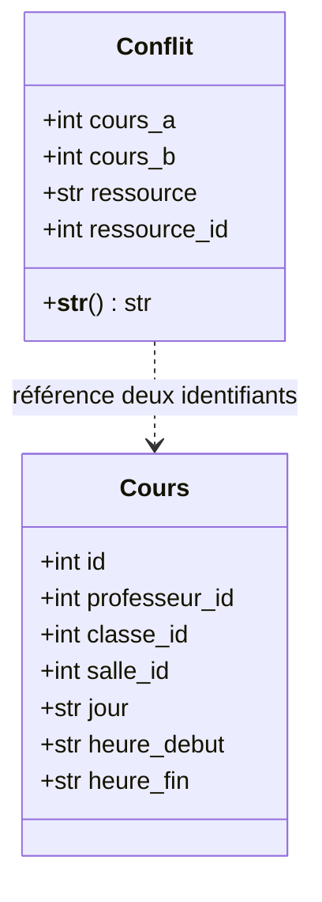

# Vérification des chevauchements

Ce module fournit un contrôle indépendant du futur générateur. Il applique les
trois règles existantes d'exclusivité des salles, professeurs et classes.
Il n'ajoute pas de règle métier à la spécification.

Les deux classes sont des objets immuables. `detecter_conflits(cours)` valide
les entrées puis retourne une liste de `Conflit`. Une paire de cours peut produire
trois conflits si les trois ressources sont communes. La fonction compare chaque
paire, soit une complexité quadratique adaptée à une première version modeste.

`verifier_base(chemin)` charge les cours depuis SQLite, ferme la connexion puis
appelle ce contrôle. Le mode SQLite `ro` interdit l'écriture. Les tests utilisent
une base temporaire et vérifient que son contenu reste identique.

Les jours sont comparés sans tenir compte de la casse et des espaces aux
extrémités. Les synonymes, les dates et les noms de jours ne sont pas convertis
les uns vers les autres. La validité des références aux autres tables reste un
contrôle à ajouter ultérieurement.
