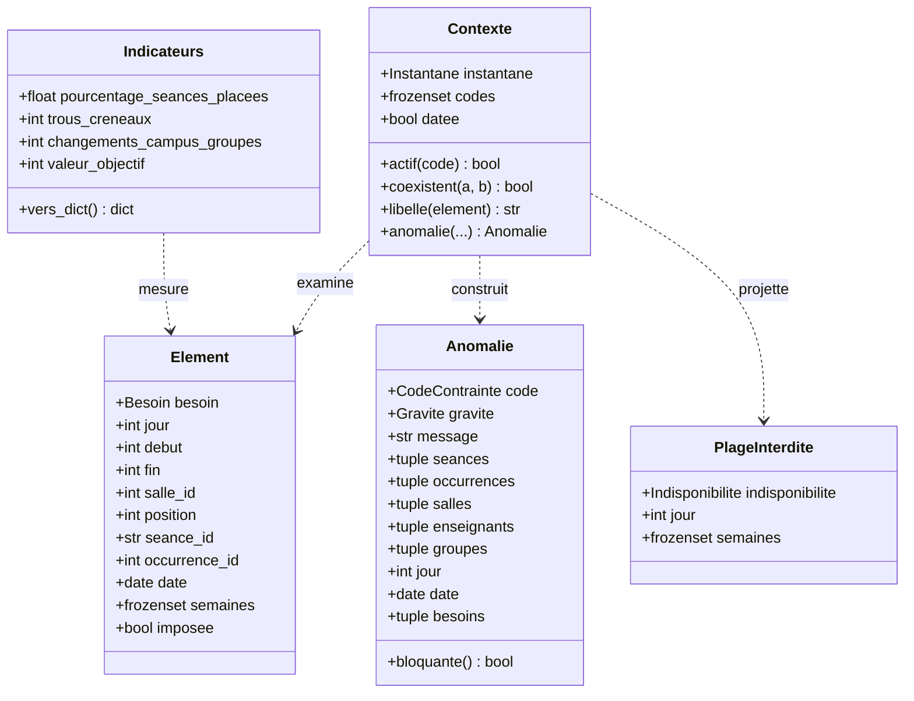

# Vérificateur d'emploi du temps

Ce module généralise le premier vérificateur de chevauchements de l'équipe
(`verifier_conflits.py`, écrit par Hugo et fusionné par la PR n° 1). Son
principe, ses règles d'unicité des salles, des enseignants et des classes, et
ses scénarios de test (ressources distinctes, chaque ressource en conflit,
jours distincts, séances contiguës, inclusion et égalité des intervalles,
entrées invalides, identifiant dupliqué, planning vide) sont repris ici,
transposés au modèle du semestre (`Instantane`), et étendus à tout le
catalogue des contraintes.

Code : `src/edt/verification/`. Tests : `tests/verification/`.

## Rôle

Le vérificateur liste les **anomalies** d'un emploi du temps. Une liste vide
signifie « emploi du temps valide ». Il est indépendant du solveur (il n'en
importe rien) et ne lit pas la base : il ne connaît que l'instantané du
semestre et ce qu'on lui donne à vérifier. Il sert :

- d'**oracle** à tous les tests du solveur ;
- à valider une **modification manuelle** avant de l'enregistrer ;
- à **auditer** un emploi du temps importé ;
- à alimenter le **panneau des anomalies** de l'interface.

```python
from edt.verification import calculer_indicateurs, verifier, verifier_occurrences

anomalies = verifier(instantane, placements)                     # semaine type
anomalies = verifier(instantane, placements, ["SALLE_UNIQUE"])   # une seule contrainte
anomalies = verifier_occurrences(instantane, occurrences)        # séances datées
valide = not any(anomalie.bloquante for anomalie in anomalies)
indicateurs = calculer_indicateurs(instantane, placements, anomalies)
```

## Principes

- **Fonctions pures** : rien n'est modifié, aucune erreur n'est levée pour
  signaler une violation (elle est renvoyée).
- Une erreur métier (`edt.erreurs`) n'est levée que si l'entrée est trop
  incohérente pour être vérifiée : code de contrainte inconnu, placement mal
  formé (jour hors de 0 à 6, heure hors de la journée, fin qui ne suit pas le
  début, salle inconnue), occurrence mal formée (de même, plus identifiant en
  double ou séance d'un autre besoin), indisponibilité sans jour ni période.
  Le message liste **tous** les défauts (`details`), pas seulement le premier.
- `contraintes_actives=None` vérifie tous les codes actifs par défaut du
  catalogue ; sinon seulement les codes fournis (validés). Jamais de code hors
  catalogue.
- Une violation entre deux séances produit **une** anomalie par code, qui cite
  les deux séances dans l'ordre chronologique (pas deux anomalies symétriques).
- La liste est **triée** de façon déterministe (gravité, ordre du catalogue,
  date ou jour, séances, puis message) et ne dépend pas de l'ordre des
  placements reçus.
- Rien n'est écarté en silence : une séance placée deux fois est signalée et
  ses deux placements sont vérifiés ; un placement d'une séance inconnue est
  signalé (`VOLUME`) ou, si `VOLUME` n'est pas demandé, journalisé en
  avertissement.
- Chaque appel écrit une ligne de journal (`logging`, niveau INFO) : nombre de
  placements, d'anomalies, de bloquantes, durée.

## Définitions communes (identiques à celles du solveur)

- Deux séances **coexistent** si elles ont lieu le même jour de la semaine et
  si leurs **semaines actives** (`SeanceAPlacer.semaines`) se croisent. Dans la
  couche datée : si elles ont lieu à la même date.
- Elles **se chevauchent** si, en plus, leurs plages `[debut, fin[` se
  recoupent. Deux séances contiguës (8 h 30 - 10 h 30 puis 10 h 30 - 12 h 30) ne
  se chevauchent pas.
- Elles **partagent une personne** si elles ont un enseignant **non fictif**
  en commun, ou si leurs besoins sont en conflit de groupes
  (`Instantane.besoins_en_conflit_de_groupes` : même groupe, groupe et
  ascendant, groupes déclarés chevauchants, étudiant commun).
- Une séance est **imposée** si son besoin a un début imposé, s'il est
  ponctuel, ou si la séance porte un verrou.
- Un enseignant fictif n'entre dans aucune contrainte d'enseignant.

## Règles et gravités

| Code | Règle telle qu'implémentée | Gravités |
|---|---|---|
| `SALLE_UNIQUE` | Deux séances qui se chevauchent n'ont pas la même salle (non nulle). | Erreur |
| `ENSEIGNANT_UNIQUE` | Deux séances qui se chevauchent n'ont pas d'enseignant non fictif commun. | Erreur |
| `GROUPE_UNIQUE` | Deux séances qui se chevauchent n'ont pas de besoins en conflit de groupes. | Erreur |
| `PAUSE` | Deux séances qui coexistent, partagent une personne et ne se chevauchent pas sont séparées d'au moins `pause_min` (fin de la première, début de la seconde). Les salles ne comptent pas. Écart égal : valide. | Erreur |
| `CAMPUS_TRAJET` | Idem, quand les deux séances ont une salle sur deux campus différents : écart d'au moins `Instantane.trajet(a, b)` (matrice, sinon `trajet_defaut_min`). Écart égal : valide. | Erreur |
| `DEJEUNER` | La séance ne recoupe pas `[dejeuner_debut_min, dejeuner_fin_min[` (rien si cette plage est vide). | Erreur ; Information si imposée |
| `HORAIRES` | (a) début ≥ ouverture et fin ≤ fermeture ; (b) début parmi `debuts_de_creneau(jour)` ; (c) fin ≤ fin du dernier créneau de la demi-journée du créneau de début, ce jour-là ; (d) `fin - debut` = durée du besoin ; (e) jour imposé, début imposé, date ponctuelle respectés. Une anomalie par séance et par gravité, qui énumère les écarts. | (a)(b)(c) : Erreur, Information si imposée ; (d)(e) : toujours Erreur |
| `JOURS` | Le jour a au moins un créneau dans la grille ; le samedi est réservé aux besoins `samedi_autorise`. | Erreur ; Information si imposée |
| `ACCESSIBILITE` | Si le besoin requiert l'accessibilité, `Instantane.salle_accessible(salle)` est vrai. | Erreur |
| `CAPACITE` | Capacité de la salle ≥ effectif du besoin. | Erreur |
| `TYPE_SALLE` | Type de la salle parmi les types acceptés (liste vide : tous) ; salle imposée respectée ; campus imposé respecté. | Erreur |
| `EQUIPEMENT` | La salle a tous les équipements requis. | Erreur |
| `DISPO_ENSEIGNANT` | Aucune indisponibilité **dure** d'un enseignant non fictif de la séance ne recoupe la séance (même jour, plages qui se recoupent, semaines qui se croisent). | Erreur |
| `DISPO_SALLE` | Idem pour la salle de la séance. | Erreur |
| `DISPO_GROUPE` | Idem pour chaque groupe du besoin et chaque groupe lié (`groupes_lies`) : l'indisponibilité d'une promotion vaut pour ses demi-groupes et inversement. | Erreur |
| `MAX_ENSEIGNANT` | Pour chaque enseignant non fictif, somme des durées placées par semaine ≤ `max_minutes_semaine` et par (semaine, jour) ≤ `max_minutes_jour`. Une anomalie par enseignant pour l'hebdomadaire, une par enseignant et par jour de la semaine type pour le journalier, qui détaillent les semaines en cause. Égalité permise. | Erreur |
| `VOLUME` | Chaque séance de l'instantané a exactement un placement ; un placement désigne une séance connue ; chaque problème de dépliage est rapporté tel quel avec son propre code (`VOLUME` ou `JOUR_FERME`). | Erreur |
| `VOLUME` | Séance placée sans salle : « salle à définir » ; aucune règle de salle ne s'applique à elle. | Avertissement |
| `VERROU` | Une séance verrouillée est placée au jour et aux heures du verrou, et dans sa salle si le verrou en fixe une. | Erreur |
| `JOUR_FERME` | Couche datée seulement (voir plus bas). | Erreur |

### Indisponibilités sur la semaine type

Une indisponibilité est ramenée à la semaine type par
`edt.verification.indisponibilites.projeter` :

- récurrente (`jour`) : ce jour, toutes les semaines du semestre ;
- datée (`date_debut`..`date_fin`) : pour chaque jour de la semaine couvert,
  les seules semaines du semestre où ce jour tombe dans la période.

Une séance active les semaines 5 à 15 n'est donc pas gênée par une absence
datée de la semaine 3. Les indisponibilités dont `dure` est faux (préférences
des versions suivantes) sont ignorées.

## Couche datée (`verifier_occurrences`)

Mêmes règles, avec ces différences :

- deux occurrences **coexistent** si elles ont lieu à la même date ;
- seules les occurrences **planifiées** ou **déplacées**
  (`statut.occupe_les_ressources`) sont vérifiées et occupent salle,
  enseignants et groupes ; une occurrence **annulée** est ignorée ; une
  occurrence **à programmer** donne un avertissement `VOLUME` ;
- indisponibilités évaluées à la date (`Indisponibilite.concerne(date)`) ;
- maxima par date réelle et par semaine réelle (lundi à dimanche), une
  anomalie par dépassement ;
- `JOUR_FERME` : une occurrence qui a lieu à une date où
  `Instantane.fermeture(date, besoin)` renvoie une fermeture est une erreur
  (une séance ponctuelle reste permise pendant des examens ou une semaine
  spéciale) ;
- `HORAIRES` (e) : un besoin ponctuel impose sa date ; un besoin à jour
  imposé impose le jour de la semaine ;
- `VERROU` : seule une occurrence **planifiée** d'une séance verrouillée doit
  être au jour de la semaine, aux heures et dans la salle du verrou ; une
  occurrence déplacée a, par définition, quitté sa place ;
- `VOLUME` : une occurrence d'un besoin inconnu est une erreur (elle n'est
  pas vérifiée) ; une occurrence rattachée à une séance hebdomadaire absente
  du semestre est un avertissement (elle est vérifiée sans son verrou). Le
  nombre d'occurrences par séance n'est pas contrôlé : la liste reçue peut
  n'être qu'une partie du semestre.

## L'anomalie

`Anomalie` (`src/edt/verification/contrat.py`) porte le code, la gravité, un
message en français complet et les identifiants utiles à l'interface pour
surligner : `seances`, `occurrences`, `salles`, `enseignants`, `groupes`,
`besoins`, et `jour` (semaine type) ou `date` (couche datée). Les ressources
renseignées sont celles **en cause** : la salle pour `SALLE_UNIQUE`, les
enseignants communs pour `ENSEIGNANT_UNIQUE`, les groupes en conflit pour
`GROUPE_UNIQUE`, la ressource indisponible pour `DISPO_*` ; toutes les
ressources de la séance pour les règles qui portent sur une séance
(`HORAIRES`, `JOURS`, `DEJEUNER`, `VERROU`...). `bloquante` est vrai pour la
gravité « erreur ».

Exemples de messages :

- « La salle N204 accueille deux séances en même temps le mardi de 10 h 45 à
  12 h 45 : Mathématiques TD (A1-G1) et Physique TD (A1-G2). »
- « Les groupes A1 et A1-G1, qui ont des étudiants en commun, ont deux séances
  en même temps le mardi de 8 h 30 à 10 h 30 (semaines 1 à 7) : ... »
- « Mme Martin n'a que 10 min de pause le mardi entre Mathématiques TD
  (A1-G1), qui finit à 10 h 30, et Physique TD (A1-G2), qui commence à
  10 h 40 ; il faut au moins 15 min. »
- « Mme Martin doit changer de campus le mardi en 15 min seulement : ... ; le
  trajet demande 1 h. »
- « La séance DST Mathématiques (A2) le lundi de 8 h 00 à 12 h 00 sort de la
  grille horaire : elle commence avant l'ouverture (8 h 30) ; ... Son créneau
  est imposé : l'écart est signalé pour information. »
- « Mme Martin dépasse son maximum de 16 h de cours par semaine : 18 h de
  cours les semaines 1 à 10 ; 20 h de cours la semaine 11. »

## Organisation et algorithme



- `semaine_type.verifier` et `datee.verifier_occurrences` valident l'entrée,
  traitent `VOLUME` et `VERROU`, puis ramènent placements et occurrences à une
  liste d'`Element` (vue commune aux deux couches) ;
- `regles_seance` : règles d'une séance ; `regles_paires` : règles entre deux
  séances ; `regles_enseignants` : maxima ; `messages` : mise en forme ;
- **paires** : les séances sont regroupées par jour (ou date) ; dans un jour,
  chaque séance n'est comparée qu'aux séances qui partagent avec elle une
  salle, un enseignant non fictif ou un groupe lié (index par ressource), et
  chaque paire n'est examinée qu'une fois. Le coût suit le nombre de séances
  qui partagent une ressource, pas le carré du nombre de séances.

Mesure (test `perf`, `tests/verification/test_performance.py`) : une semaine
type valide de 1 000 séances (cinq promotions, deux campus) est vérifiée en
une quarantaine de millisecondes sur un poste de développement ; le seuil du
test est de 2 secondes.

## Indicateurs (`calculer_indicateurs`)

`calculer_indicateurs(instantane, placements, anomalies=None)` renvoie un
`Indicateurs` figé, sérialisable par `vers_dict()`. Si `anomalies` est
absent, `verifier` est appelé avec les contraintes par défaut. Les
placements d'une séance inconnue sont ignorés (le vérificateur les signale) ;
une séance placée deux fois compte deux fois dans les mesures d'occupation.

**Unité des préférences.** Les quatre termes de l'objectif sont comptés
**semaine par semaine** sur tout le semestre : une situation qui se répète sur
15 semaines compte 15 fois, une situation propre aux semaines 1 à 7 compte
7 fois. C'est la seule façon exacte de traiter les modules courts (semaines
actives disjointes). `nb_semaines` permet d'afficher une moyenne
hebdomadaire.

**Emploi du temps d'un groupe.** Pour les trous et les changements de campus,
on prend l'emploi du temps des **étudiants** d'un groupe : les séances du
groupe et de ses ascendants (classe, promotion). On le calcule pour chaque
groupe **feuille** de l'arbre (sans sous-groupe), ce qui évite de compter deux
fois la même journée. Limite connue : sans liste d'étudiants, les séances d'un
groupe transverse (langue, option) ne sont pas vues dans la journée des
demi-groupes.

| Indicateur | Définition exacte |
|---|---|
| `nb_seances`, `nb_seances_placees` | Séances de l'instantané ; séances distinctes qui ont au moins un placement. |
| `pourcentage_seances_placees` | `100 × nb_seances_placees / nb_seances` ; `None` s'il n'y a aucune séance. |
| `nb_anomalies_bloquantes`, `anomalies_bloquantes_par_code` | Anomalies de gravité « erreur », au total et par code (ordre du catalogue, codes à zéro omis). |
| `pourcentage_utilisation_salles` | `100 × Σ (fin − debut) × nb de semaines actives` sur les placements avec salle, divisé par `nb de salles × Σ (durée des créneaux de la grille) × nb_semaines`. `None` si rien n'est offert. Les minutes hors grille d'un créneau imposé comptent au numérateur ; les indisponibilités de salle ne réduisent pas le dénominateur. |
| `utilisation_par_salle` | Même calcul pour chaque salle (couples `(salle_id, pourcentage)`). |
| `trous_minutes_journee` | Pour chaque groupe feuille, chaque jour, chaque semaine : minutes de `[début de la première séance, fin de la dernière[` couvertes ni par une séance ni par la plage du déjeuner. Somme sur tout le semestre. Les pauses réglementaires de 15 min comptent. |
| `trous_minutes_demi_journee` | Même calcul, séparément pour le matin (séances qui commencent avant `dejeuner_debut_min`) et l'après-midi (les autres), donc sans l'intervalle entre les deux. |
| `trous_creneaux` | Pour chaque groupe feuille, chaque jour, chaque semaine : nombre de créneaux de la grille entièrement compris entre le début de la première séance et la fin de la dernière, et recoupés par aucune séance. Terme « trous » de l'objectif. |
| `changements_campus_groupes` | Pour chaque groupe feuille, chaque jour, chaque semaine : séances avec salle triées par heure de début, nombre de paires consécutives sur deux campus différents. Somme sur le semestre. |
| `changements_campus_enseignants` | Même calcul pour chaque enseignant non fictif. |
| `seances_samedi` | Somme, sur les placements du samedi, du nombre de semaines actives. |
| `seances_creneaux_extremes` | Somme, sur les placements qui recoupent le premier créneau (début le plus tôt) ou le dernier créneau (fin la plus tardive) de la grille de leur jour, du nombre de semaines actives. Une séance qui couvre les deux compte une fois. |
| `valeur_objectif` | `poids_trous × trous_creneaux + poids_changement_campus × (changements_campus_groupes + changements_campus_enseignants) + poids_samedi × seances_samedi + poids_creneaux_extremes × seances_creneaux_extremes`, avec les poids des paramètres (10, 5, 2, 1 par défaut). |

Le terme « trous » de l'objectif se compte en **créneaux libres**, comme le
décrit le catalogue des préférences (`PREFERENCES` : « créneaux libres entre
deux séances d'un groupe ») : en minutes, avec un poids de 10, il écraserait
les trois autres termes. Les trous en minutes restent disponibles pour le
tableau de bord.

## Ajouter une règle

1. Ajouter le code au catalogue (`src/edt/domaine/contraintes.py`), par PR,
   et le décrire dans `docs/decisions.md`.
2. L'implémenter dans le module qui correspond à sa forme :
   - porte sur une séance : une fonction `_ma_regle(ctx, element)` dans
     `regles_seance.py`, appelée par `verifier_seances` ;
   - porte sur deux séances : un cas dans `regles_paires._chevauchement` ou
     `_enchainement` (et, si une nouvelle ressource crée des paires, un index
     dans `_verifier_jour`) ;
   - porte sur un ensemble (cumul, volume) : un module comme
     `regles_enseignants.py`, appelé par `semaine_type.verifier` et
     `datee.verifier_occurrences`.
3. Commencer par `if not ctx.actif(CodeContrainte.MA_REGLE): return`, produire
   les anomalies avec `ctx.anomalie(...)` (identifiants triés, jour ou date via
   `ctx.reperes(element)`), écrire le message avec les outils de
   `messages.py` et de `Contexte` (`libelle`, `moment`, `quand`,
   `precision_semaines`).
4. Ajouter dans `tests/verification/` un cas valide, un cas en violation et
   les cas limites qui comptent (égalité, semaines disjointes, enseignant
   fictif, séance imposée, contrainte désactivée), avec la fabrique
   `tests/verification/fabrique.py`.
5. Implémenter la même règle dans le solveur, avec la même sémantique.
6. Compléter le tableau des règles ci-dessus.
