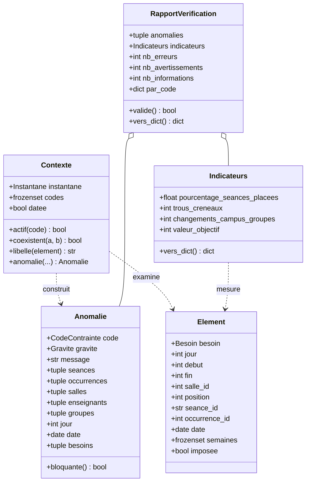

# Vérificateur d'emploi du temps

Ce document décrit le vérificateur d'emploi du temps : ses règles, la forme
de ses anomalies, son algorithme, ses indicateurs, sa prise en compte des
niveaux et des règles personnalisées, son service et sa commande. Il
s'adresse aux développeurs.

Le vérificateur part des règles d'unicité des salles, des enseignants et des
groupes, avec leurs scénarios de test (ressources distinctes, chaque
ressource en conflit, jours distincts, séances contiguës, inclusion et
égalité des intervalles, entrées invalides, identifiant dupliqué, planning
vide), et les étend à tout le catalogue des contraintes, sur le modèle du
semestre (`Instantane`).

Code : `src/edt/verification/` (vérificateur pur), `src/edt/services/verification.py`
(service sur la base), `src/edt/commandes/verification.py` (commande
`python -m edt verifier`). Tests : `tests/unitaires/verification/` et `tests/integration/verification/`.

## Rôle

Le vérificateur liste les **anomalies** d'un emploi du temps. Une liste vide
signifie « emploi du temps valide ». Il est indépendant du solveur (il n'en
importe rien) et ne lit pas la base : il ne connaît que l'instantané du
semestre et ce qu'on lui donne à vérifier. Il sert :

- d'**oracle** à tous les tests du solveur ;
- à valider une **modification manuelle** avant de l'enregistrer ;
- à **auditer** un emploi du temps importé ;
- à alimenter le **panneau des anomalies** de l'interface.

```python
from edt.verification import calculer_indicateurs, verifier, verifier_occurrences

anomalies = verifier(instantane, placements)                     # semaine type
anomalies = verifier(instantane, placements, ["SALLE_UNIQUE"])   # une seule contrainte
anomalies = verifier_occurrences(instantane, occurrences)        # séances datées
anomalies = verifier(instantane, placements, niveaux=niveaux)    # avec les niveaux d'un calcul
valide = not any(anomalie.bloquante for anomalie in anomalies)
indicateurs = calculer_indicateurs(instantane, placements, anomalies)
```

## Principes

- **Fonctions pures** : rien n'est modifié, aucune erreur n'est levée pour
  signaler une violation (elle est renvoyée).
- Une erreur métier (`edt.erreurs`) n'est levée que si l'entrée est trop
  incohérente pour être vérifiée : code de contrainte inconnu, placement mal
  formé (jour hors de 0 à 6, heure hors de la journée, fin qui ne suit pas le
  début, identifiant de salle qui n'est pas un entier), occurrence mal formée
  (de même, plus date qui n'est pas exactement un `datetime.date`,
  identifiant en double ou séance d'un autre besoin), indisponibilité sans
  jour ni période, arbre des groupes qui boucle (l'erreur nomme les groupes
  de la boucle : sans groupe feuille, les règles par personne se tairaient).
  Le message liste **tous** les défauts (`details`), pas seulement le premier.
- Une salle **inconnue** de l'instantané (supprimée depuis le calcul, base
  importée) n'est pas un défaut de structure : la séance est vérifiée comme
  une séance sans salle (avertissement « salle à définir » qui nomme la salle
  disparue ; journalisé en avertissement même si `VOLUME` n'est pas vérifiée).
- Un identifiant de séance ne se lit qu'en chiffres ASCII (« 12-1 », pas
  « ²-1 ») : un identifiant illisible désigne une séance inconnue, jamais une
  `ValueError`.
- `contraintes_actives=None` vérifie tous les codes actifs par défaut du
  catalogue ; sinon seulement les codes fournis (validés). Jamais de code hors
  catalogue. Aucun code (liste vide, niveaux vides) : rien n'est vérifié, et
  la liste vide renvoyée s'accompagne d'un avertissement du journal (les
  services de vérification refusent ce cas).
- Une violation entre deux séances produit **une** anomalie par code, qui cite
  les deux séances dans l'ordre chronologique (pas deux anomalies symétriques).
- La liste est **triée** de façon déterministe (gravité, ordre du catalogue,
  date ou jour, séances, puis message) et ne dépend pas de l'ordre des
  placements reçus.
- Rien n'est écarté en silence : une séance placée deux fois est signalée et
  ses deux placements sont vérifiés face aux autres séances (deux copies qui
  se chevauchent ne sont pas en conflit « avec elles-mêmes » : le doublon est
  signalé une fois, par `VOLUME` ; sans `VOLUME`, leurs conflits restent
  signalés) ; un placement d'une séance inconnue est signalé (`VOLUME`) ou,
  si `VOLUME` n'est pas demandé, journalisé en avertissement.
- Chaque appel écrit une ligne de journal (`logging`, niveau INFO) : nombre de
  placements, d'anomalies, de bloquantes, durée.

## Définitions communes (identiques à celles du solveur)

- Deux séances **coexistent** si elles ont lieu le même jour de la semaine et
  si leurs **semaines actives** (`SeanceAPlacer.semaines`) se croisent. Dans la
  couche datée : si elles ont lieu à la même date.
- Elles **se chevauchent** si, en plus, leurs plages `[debut, fin[` se
  recoupent. Deux séances contiguës (8 h 30 - 10 h 30 puis 10 h 30 - 12 h 30) ne
  se chevauchent pas.
- Elles **partagent une personne** si elles ont un enseignant **non fictif**
  en commun, ou si leurs besoins sont en conflit de groupes
  (`Instantane.besoins_en_conflit_de_groupes` : même groupe, groupe et
  ascendant, groupes déclarés chevauchants, étudiant commun).
- Une séance est **imposée** si son besoin a un début imposé, s'il est
  ponctuel, ou si elle porte un verrou **et est restée à sa place** (même jour
  de la semaine et même début que le verrou). Le verrou fixe la place de la
  semaine type, pas une place choisie ensuite à la main : une séance
  verrouillée déplacée (semaine type ou séance datée) n'a plus droit aux
  écarts admis (`edt.verification.contexte.creneau_impose`).
- Un enseignant fictif n'entre dans aucune contrainte d'enseignant.

## Règles et gravités

| Code | Règle telle qu'implémentée | Gravités |
|---|---|---|
| `SALLE_UNIQUE` | Deux séances qui se chevauchent n'ont pas la même salle (non nulle). | Erreur |
| `ENSEIGNANT_UNIQUE` | Deux séances qui se chevauchent n'ont pas d'enseignant non fictif commun. | Erreur |
| `GROUPE_UNIQUE` | Deux séances qui se chevauchent n'ont pas de besoins en conflit de groupes. | Erreur |
| `PAUSE` | Deux séances qui coexistent, partagent une personne et ne se chevauchent pas sont séparées d'au moins `pause_min` (fin de la première, début de la seconde). Les salles ne comptent pas. Écart égal : valide. | Erreur |
| `CAMPUS_TRAJET` | Idem, quand les deux séances ont une salle sur deux campus différents : écart d'au moins `Instantane.trajet(a, b)` (matrice, sinon `trajet_defaut_min`). Écart égal : valide. | Erreur |
| `DEJEUNER` | Selon `dejeuner_mode` (voir « Pause déjeuner » plus bas). **Fixe** (`plage_dejeuner`) : la séance ne recoupe pas la plage réservée `[X, Y[`. **Libre** (`fenetre_dejeuner`) : chaque jour où une personne a une séance qui recoupe la fenêtre `[X, Y]`, elle y a un intervalle libre d'au moins N minutes. **Aucun** : la règle ne s'applique pas, rien n'est relevé même si `DEJEUNER` est active. | Erreur ; Information si imposée (en mode libre : si toutes les séances en cause sont imposées) |
| `HORAIRES` | (a) début ≥ ouverture et fin ≤ fermeture ; (b) début parmi `debuts_de_creneau(jour)` ; (c) fin ≤ fin du dernier créneau de la demi-journée du créneau de début, ce jour-là ; (d) `fin - debut` = durée du besoin ; (e) jour imposé, début imposé, date ponctuelle respectés. Une anomalie par séance et par gravité, qui énumère les écarts. | (a)(b)(c) : Erreur, Information si imposée ; (d)(e) : toujours Erreur |
| `JOURS` | Le jour est un jour travaillé de l'établissement (le standard) ; le samedi est réservé aux besoins `samedi_autorise`. Un jour sans créneau dans la grille relève de `HORAIRES` (b) seulement : la même cause n'est pas signalée deux fois. | Erreur ; Information si imposée |
| `ACCESSIBILITE` | Si le besoin requiert l'accessibilité, `Instantane.salle_accessible(salle)` est vrai. | Erreur |
| `CAPACITE` | Capacité de la salle ≥ effectif du besoin. | Erreur |
| `TYPE_SALLE` | Type de la salle parmi les types acceptés (liste vide : tous) ; salle imposée respectée ; campus imposé respecté. Le message nomme les types (`Instantane.libelle_type_salle`). | Erreur |
| `EQUIPEMENT` | La salle a tous les équipements requis. Le message nomme ceux qui manquent (`Instantane.libelle_equipement`). | Erreur |
| `DISPO_ENSEIGNANT` | Aucune indisponibilité **dure** et **récurrente** d'un enseignant non fictif de la séance ne recoupe la séance (même jour, plages qui se recoupent), quelles que soient ses semaines actives. Les indisponibilités datées relèvent de la couche datée. | Erreur |
| `DISPO_SALLE` | Idem pour la salle de la séance. | Erreur |
| `DISPO_GROUPE` | Idem pour chaque groupe du besoin et chaque groupe lié (`groupes_lies`) : l'indisponibilité d'une promotion vaut pour ses demi-groupes et inversement. | Erreur |
| `MAX_ENSEIGNANT` | Pour chaque enseignant non fictif, somme des durées placées par semaine ≤ `max_minutes_semaine` et par (semaine, jour) ≤ `max_minutes_jour`. Une anomalie par enseignant pour l'hebdomadaire, une par enseignant et par jour de la semaine type pour le journalier, qui détaillent les semaines en cause. Égalité permise. | Erreur |
| `VOLUME` | Chaque séance de l'instantané a exactement un placement ; un placement désigne une séance connue ; chaque problème de dépliage est rapporté tel quel avec son propre code (`VOLUME` ou `JOUR_FERME`). | Erreur |
| `VOLUME` | Séance placée sans salle, ou dans une salle qui n'existe plus (nommée dans le message) : « salle à définir » ; aucune règle de salle ne s'applique à elle. Dans la couche datée, un avertissement par séance, qui cite toutes ses séances datées sans salle. | Avertissement |
| `VERROU` | Une séance verrouillée est placée au jour et aux heures du verrou, et dans sa salle si le verrou en fixe une. | Erreur |
| `JOUR_FERME` | Couche datée seulement (voir plus bas) : date fermée pour le besoin, ou hors des dates du semestre. | Erreur |

Un placement d'une séance que les besoins ne demandent plus (cas typique :
semestre ou période d'un besoin raccourcis après le calcul) nomme le besoin,
donne la cause probable et conseille de relancer le calcul, par exemple « La
séance n° 3 de « CM Physique - A1 », placée le lundi de 8 h 30 à 10 h 30 en
salle N016, n'est plus demandée : la période du besoin ou celle du semestre a
été raccourcie, ou le nombre de séances demandées a diminué. Relancer le
calcul pour remettre l'emploi du temps en accord avec les besoins. »
L'identifiant technique reste dans le champ `seances`, pas dans le message.

### Pause déjeuner

Les paramètres (`edt.domaine.parametres`) offrent trois modes ; le
vérificateur ne lit que `plage_dejeuner`, `fenetre_dejeuner` et
`dejeuner_actif`.

- **Fixe** (`plage_dejeuner = (X, Y)`) : règle par séance
  (`regles_seance`) ; toute séance qui recoupe `[X, Y[` donne une anomalie.
- **Libre** (`fenetre_dejeuner = (X, Y, N)`) : règle par personne et par jour
  (`regles_dejeuner`). Pour chaque groupe et chaque enseignant non fictif,
  chaque jour où il a au moins une séance qui recoupe la fenêtre `[X, Y]`, il
  faut un intervalle libre d'au moins N minutes consécutives inclus dans
  `[X, Y]` ; un jour sans séance dans la fenêtre est satisfait.
  - Emploi du temps d'un **groupe** : ses séances et celles des groupes qui
    lui sont liés (`groupes_lies` : ascendants, groupes déclarés
    chevauchants, groupes partageant un étudiant), **sauf ses descendants**.
    Une séance d'un sous-groupe ne concerne qu'une partie des étudiants : la
    compter priverait à tort la promotion de pause quand ses demi-groupes
    déjeunent en décalé. Chaque sous-groupe est vérifié pour lui-même, avec
    les séances de ses ascendants.
  - Semaine type : par ensemble de semaines actives (deux séances aux
    semaines disjointes ne se gênent pas) ; couche datée : par date.
  - **Une anomalie par personne et par jour**, rattachée aux séances qui
    recoupent la fenêtre dans les semaines en défaut, avec la plus longue
    plage libre trouvée. Des groupes dans la même situation (mêmes séances,
    mêmes semaines) donnent une seule anomalie : le message nomme les plus
    généraux (pas un groupe dont un ascendant est nommé), le champ `groupes`
    les liste tous. Exemple : « Le groupe A1-G1 n'a pas de pause déjeuner
    d'au moins 1 h entre 12 h 00 et 14 h 00 le mardi (au plus 30 min libres
    d'affilée) : Cours 1 (A1-G1) de 11 h 00 à 13 h 00 et Cours 2 (A1-G1) de
    13 h 30 à 15 h 30. »
  - Gravité : erreur, ou information si toutes les séances en cause sont
    imposées ; avec des niveaux, elle suit ensuite le niveau de `DEJEUNER`.
- **Aucun** : rien n'est vérifié.

### Indisponibilités sur la semaine type

Conformément à l'en-tête de `edt/domaine/instantane.py` et à
`docs/architecture.md` (« Sémantique des contraintes »), seules les
indisponibilités **récurrentes** (`Instantane.indisponibilites_recurrentes`)
comptent sur la semaine type : chacune interdit, toutes les semaines, la plage
`[debut, fin[` de son jour. Une séance placée ce jour-là sur une plage qui la
recoupe est en violation, quelles que soient ses semaines actives.

Les indisponibilités **datées** ne sont pas vérifiées sur la semaine type :
sinon une salle fermée une semaine interdirait son créneau tout le semestre.
L'occurrence qui tombe dessus est signalée par la couche datée, puis replacée
ou mise « à programmer ». Les indisponibilités dont `dure` est faux
(possibles seulement par import, colonne `dure` à « non ») sont ignorées
dans les deux couches.

## Couche datée (`verifier_occurrences`)

Mêmes règles, avec ces différences :

- deux occurrences **coexistent** si elles ont lieu à la même date ;
- seules les occurrences **planifiées** ou **déplacées**
  (`statut.occupe_les_ressources`) sont vérifiées et occupent salle,
  enseignants et groupes ; une occurrence **annulée** est ignorée ; une
  occurrence **à programmer** donne un avertissement `VOLUME` ;
- toutes les indisponibilités dures, récurrentes et datées
  (`Instantane.indisponibilites_de`), évaluées à la date
  (`Indisponibilite.concerne(date)`) ;
- maxima par date réelle et par semaine réelle (lundi à dimanche), une
  anomalie par dépassement ;
- `JOUR_FERME` : une occurrence qui a lieu à une date où
  `Instantane.fermeture(date, besoin)` renvoie une fermeture est une erreur
  (une séance ponctuelle reste permise pendant des examens ou une semaine
  spéciale) ; de même une occurrence **hors du semestre** (avant `date_debut`
  ou après `date_fin` : semestre raccourci, import qui déborde, samedi qui
  suit un vendredi de fin), comme pour l'instanciation, qui n'y place jamais
  de séance ; le message donne les dates du semestre ;
- `HORAIRES` (e) : un besoin ponctuel impose sa date ; un besoin à jour
  imposé impose le jour de la semaine ;
- `VERROU` : seule une occurrence **planifiée** d'une séance verrouillée doit
  être au jour de la semaine, aux heures et dans la salle du verrou ; une
  occurrence déplacée a, par définition, quitté sa place ;
- `VOLUME` : une occurrence d'un besoin inconnu est une erreur (elle n'est
  pas vérifiée) ; une occurrence rattachée à une séance hebdomadaire absente
  du semestre est un avertissement (elle est vérifiée sans son verrou). Le
  nombre d'occurrences par séance n'est pas contrôlé : la liste reçue peut
  n'être qu'une partie du semestre. Plusieurs occurrences d'une même séance
  qui se chevauchent à la même date sont un **doublon** : une erreur qui les
  cite toutes (« … a lieu 2 fois en même temps le … : garder une seule de ces
  séances datées »), sans conflit « avec elle-même » ; deux occurrences d'une
  même séance à des heures disjointes (rattrapage) n'en sont pas un ;
- « salle à définir » (`VOLUME`, avertissement) : **un** avertissement par
  séance (et par salle disparue), qui cite toutes ses occurrences sans salle
  et leur période (« … n'a pas encore de salle pour 15 séances datées, du …
  au … ») : une salle supprimée ne noie pas le panneau des anomalies ;
- la date d'une occurrence doit être exactement un `datetime.date` : un
  `datetime` (date et heure) ne se compare pas aux dates et ne leur est
  jamais égal, il est refusé (`ErreurDonneesInvalides`).

## L'anomalie

`Anomalie` (`src/edt/verification/contrat.py`) porte le code, la gravité, un
message en français complet et les identifiants utiles à l'interface pour
surligner : `seances`, `occurrences`, `salles`, `enseignants`, `groupes`,
`besoins`, et `jour` (semaine type) ou `date` (couche datée), ainsi que
`niveau` (niveau appliqué à la contrainte, `None` sans niveaux). Les ressources
renseignées sont celles **en cause** : la salle pour `SALLE_UNIQUE`, les
enseignants communs pour `ENSEIGNANT_UNIQUE`, les groupes en conflit pour
`GROUPE_UNIQUE`, la ressource indisponible pour `DISPO_*` ; toutes les
ressources de la séance pour les règles qui portent sur une séance
(`HORAIRES`, `JOURS`, `DEJEUNER`, `VERROU`...). `bloquante` est vrai pour la
gravité « erreur ».

Une séance est nommée par le libellé de son besoin. Le socle termine ce
libellé par les groupes (« CM Mathématiques - A1 ») : il est repris tel quel,
avec le rang si le besoin a plusieurs séances (« CM Physique - A1 (n° 2) »).
Un libellé qui ne cite pas ses groupes (instantané construit à la main) est
complété : « Mathématiques TD (A1-G1) ». Les types de salle et les
équipements sont nommés par les listes de l'instantané ; s'il ne les porte
pas (instantané construit à la main), leur numéro est affiché.

Exemples de messages :

- « La salle N204 accueille deux séances en même temps le mardi de 10 h 45 à
  12 h 45 : Mathématiques TD (A1-G1) et Physique TD (A1-G2). »
- « Les groupes A1 et A1-G1, qui ont des étudiants en commun, ont deux séances
  en même temps le mardi de 8 h 30 à 10 h 30 (semaines 1 à 7) : ... »
- « Mme Martin n'a que 10 min de pause le mardi entre Mathématiques TD
  (A1-G1), qui finit à 10 h 30, et Physique TD (A1-G2), qui commence à
  10 h 40 ; il faut au moins 15 min. »
- « Mme Martin doit changer de campus le mardi en 15 min seulement : ... ; le
  trajet demande 1 h. »
- « La séance DST Mathématiques (A2) le lundi de 8 h 00 à 12 h 00 sort de la
  grille horaire : elle commence avant l'ouverture (8 h 30) ; ... Son créneau
  est imposé : l'écart est signalé pour information. »
- « Mme Martin dépasse son maximum de 16 h de cours par semaine : 18 h de
  cours les semaines 1 à 10 ; 20 h de cours la semaine 11. »
- « La salle L115 est indisponible le vendredi 6 novembre 2026 toute la
  journée (Travaux), pendant la séance TP Électronique - A1-G1 prévue de
  8 h 30 à 10 h 30. »

## Organisation et algorithme



- `semaine_type.verifier` et `datee.verifier_occurrences` valident l'entrée,
  traitent `VOLUME` et `VERROU`, puis ramènent placements et occurrences à une
  liste d'`Element` (vue commune aux deux couches) ;
- `regles_seance` : règles d'une séance ; `regles_paires` : règles entre deux
  séances ; `regles_enseignants` : maxima ; `messages` : mise en forme ;
- **paires** : les séances sont regroupées par jour (ou date) ; dans un jour,
  chaque séance n'est comparée qu'aux séances qui partagent avec elle une
  salle, un enseignant non fictif ou un groupe lié (index par ressource), et
  chaque paire n'est examinée qu'une fois. Le coût suit le nombre de séances
  qui partagent une ressource, pas le carré du nombre de séances.

Mesure (test `perf`, `tests/unitaires/verification/test_performance.py`) : une semaine
type valide de 1 000 séances (cinq promotions, deux campus) est vérifiée en
une quarantaine de millisecondes sur un poste de développement ; le seuil du
test est de 2 secondes.

## Indicateurs (`calculer_indicateurs`)

`calculer_indicateurs(instantane, placements, anomalies=None)` renvoie un
`Indicateurs` figé, sérialisable par `vers_dict()`. Si `anomalies` est
absent, `verifier` est appelé avec les contraintes par défaut. Les
placements d'une séance inconnue sont ignorés (le vérificateur les signale) ;
une séance placée deux fois compte deux fois dans les mesures d'occupation ;
une salle disparue ne compte pas dans l'utilisation des salles. Comme le
vérificateur, le calcul lève `ErreurDonneesInvalides` si l'arbre des groupes
boucle. Une grille vide donne une utilisation des salles `None` (aucune
minute offerte), sans division par zéro.

**Unité des préférences.** Les quatre termes de l'objectif sont comptés
**semaine par semaine** sur tout le semestre : une situation qui se répète sur
15 semaines compte 15 fois, une situation propre aux semaines 1 à 7 compte
7 fois. C'est la seule façon exacte de traiter les modules courts (semaines
actives disjointes). `nb_semaines` permet d'afficher une moyenne
hebdomadaire.

**Emploi du temps d'un groupe.** Pour les trous et les changements de campus,
on prend l'emploi du temps des **étudiants** d'un groupe : les séances du
groupe et de ses ascendants (classe, promotion). On le calcule pour chaque
groupe **feuille** de l'arbre (sans sous-groupe), ce qui évite de compter deux
fois la même journée. Limite connue : sans liste d'étudiants, les séances d'un
groupe transverse (langue, option) ne sont pas vues dans la journée des
demi-groupes.

| Indicateur | Définition exacte |
|---|---|
| `nb_seances`, `nb_seances_placees` | Séances de l'instantané ; séances distinctes qui ont au moins un placement. |
| `pourcentage_seances_placees` | `100 × nb_seances_placees / nb_seances` ; `None` s'il n'y a aucune séance. |
| `nb_anomalies_bloquantes`, `anomalies_bloquantes_par_code` | Anomalies de gravité « erreur », au total et par code (ordre du catalogue, codes à zéro omis). |
| `pourcentage_utilisation_salles` | `100 × Σ (fin − debut) × nb de semaines actives` sur les placements avec salle, divisé par `nb de salles × Σ (durée des créneaux de la grille) × nb_semaines`. `None` si rien n'est offert. Les minutes hors grille d'un créneau imposé comptent au numérateur ; les indisponibilités de salle ne réduisent pas le dénominateur. |
| `utilisation_par_salle` | Même calcul pour chaque salle (couples `(salle_id, pourcentage)`). |
| `trous_minutes_journee` | Pour chaque groupe feuille, chaque jour, chaque semaine : minutes de `[début de la première séance, fin de la dernière[` couvertes ni par une séance ni par la pause déjeuner. Somme sur tout le semestre. Les pauses réglementaires de 15 min comptent. Pause déjeuner retirée : en mode **fixe**, la plage réservée ; en mode **libre**, les N premières minutes libres (dans l'ordre chronologique) de la fenêtre `[X, Y]` restreinte à la journée, le temps libre au-delà restant un trou ; en mode **aucun**, rien (une heure libre à midi est un trou ordinaire). |
| `trous_minutes_demi_journee` | Même calcul, séparément pour le matin (séances qui commencent avant `dejeuner_debut_min`) et l'après-midi (les autres), donc sans l'intervalle entre les deux ; la même pause déjeuner est retirée. La séparation reste `dejeuner_debut_min` quel que soit le mode. |
| `trous_creneaux` | Pour chaque groupe feuille, chaque jour, chaque semaine : nombre de créneaux de la grille entièrement compris entre le début de la première séance et la fin de la dernière, et recoupés par aucune séance. Terme « trous » de l'objectif. Ne dépend pas du mode de déjeuner : la pause se loge dans le temps libre de la fenêtre, et avec la grille par défaut l'interclasse de midi lui suffit (limite : une grille qui place un créneau entier dans la fenêtre le compte comme trou s'il est libre). |
| `changements_campus_groupes` | Pour chaque groupe feuille, chaque jour, chaque semaine : séances avec salle triées par heure de début, nombre de paires consécutives sur deux campus différents. Somme sur le semestre. |
| `changements_campus_enseignants` | Même calcul pour chaque enseignant non fictif. |
| `seances_samedi` | Somme, sur les placements du samedi, du nombre de semaines actives. |
| `seances_creneaux_extremes` | Somme, sur les placements qui recoupent le premier créneau (début le plus tôt) ou le dernier créneau (fin la plus tardive) de la grille de leur jour, du nombre de semaines actives. Une séance qui couvre les deux compte une fois. |
| `valeur_objectif` | `poids_trous × trous_creneaux + poids_changement_campus × (changements_campus_groupes + changements_campus_enseignants) + poids_samedi × seances_samedi + poids_creneaux_extremes × seances_creneaux_extremes`, avec les poids des paramètres (10, 5, 2, 1 par défaut). |

Le terme « trous » de l'objectif se compte en **créneaux libres**, semaine par
semaine, comme le décrit le catalogue des préférences (`PREFERENCES` :
« créneaux libres entre deux séances d'un groupe »). Raison : en minutes,
avec un poids de 10, il écraserait les trois autres termes. Les trous en
minutes restent un indicateur d'affichage.

## Niveaux des contraintes

Avant un calcul, l'utilisateur choisit le **niveau** de chaque contrainte
(`edt.domaine.contraintes.Niveau`) : **nécessaire** (contrainte dure),
**important** (le moteur ne l'enfreint que faute de choix) ou **facultatif**
(souhait). Six contraintes définissent le problème et restent toujours
nécessaires (`SALLE_UNIQUE`, `ENSEIGNANT_UNIQUE`, `GROUPE_UNIQUE`, `VERROU`,
`JOUR_FERME`, `VOLUME`). Les niveaux retenus forment un `Niveaux`
(`dict[CodeContrainte, Niveau]`).

`verifier(..., *, niveaux=None)` et `verifier_occurrences(..., *, niveaux=None)` :

- **une clé absente est une contrainte ignorée**, ni posée ni vérifiée :
  seules les contraintes présentes dans `niveaux` sont vérifiées, et
  `contraintes_actives` est ignoré ;
- la gravité suit le niveau, **plafonnée** par celle que la règle donne
  déjà (`edt.verification.niveaux.GRAVITE_DU_NIVEAU`) :

  | Niveau | Gravité d'une entorse | Début du message |
  |---|---|---|
  | nécessaire | erreur | (rien) |
  | important | avertissement | « Entorse à une règle importante : » |
  | facultatif | information | « Entorse à une règle facultative : » |

  Le plafond garde les écarts admis : l'information d'une séance imposée
  hors grille reste une information même si `HORAIRES` est nécessaire, et
  l'avertissement « salle à définir » (`VOLUME`) n'est pas remonté en erreur ;
- `Anomalie.niveau` porte le niveau appliqué ; le début du message vient
  de `edt.verification.PREFIXES_ENTORSE` (stable, l'interface peut s'y fier)
  et, après les deux-points, un début de phrase du vérificateur passe en
  minuscule (« La séance », « La salle », « Le groupe », « Les groupes » :
  « … : la salle N204… ») ; tout autre début garde sa majuscule, nom propre
  compris (« … : Mme Martin… », « … : Le Gall… ») ;
- un niveau autre que « nécessaire » sur une contrainte non modifiable, un
  code ou un niveau inconnu lèvent `ErreurDonneesInvalides`.

Sans `niveaux`, rien ne change : les contraintes de `contraintes_actives`
(par défaut, toutes) sont vérifiées en dur et `Anomalie.niveau` vaut `None`.
Une anomalie « bloquante » reste une anomalie de gravité « erreur » : une
entorse à une règle importante ou facultative n'invalide pas l'emploi du temps.

### Origine des niveaux d'une version (`edt.services.niveaux`)

- `niveaux_du_calcul(parametres, contraintes_desactivees)` (pur) :
  `parametres["niveaux"]` (code → « necessaire », « important » ou
  « facultatif », écrit par le service de génération dans `Calcul.parametres`) passé
  par `normaliser_niveaux` (codes absents : niveau par défaut), puis sans les
  `contraintes_desactivees` éventuellement enregistrées en plus ; à défaut,
  calcul enregistré sans niveaux : `niveaux_depuis_desactivees` (niveaux par
  défaut sans les contraintes désactivées) ; à défaut, `niveaux_par_defaut()`.
  Des niveaux enregistrés illisibles lèvent `ErreurDonneesInvalides`.
- `niveaux_de_version(session, version_id)` : ceux du calcul qui a produit
  la version (`VersionEdt.calcul_id`) ; une version de référence ou importée
  prend les niveaux par défaut, comme une version générée dont le calcul a
  été supprimé (avec un avertissement dans le journal).

Chaque résolution est journalisée en DEBUG avec son origine. Une version
dont le calcul n'a enregistré ni niveaux ni contrainte désactivée est donc
vérifiée aux niveaux par défaut : les entorses aux contraintes importantes
par défaut (`PAUSE`, `DEJEUNER`, `EQUIPEMENT`, `MAX_ENSEIGNANT`) y sont des
avertissements, pas des erreurs.

## Règles personnalisées (code `REGLE`)

Catalogue et sémantique des types : [regles-personnalisees.md](regles-personnalisees.md). Les règles
actives de l'année (`Instantane.regles`, déjà résolues) sont vérifiées par
un vérificateur par type, déclaré dans le registre du domaine
(`@enregistrer("verificateur", TypeRegle.X)`, vue `VERIFICATEURS`) :
`edt.verification.regles_personnalisees` pour les types de sorte séance et
les réglages de déjeuner et de pause, `edt.verification.regles_emploi` pour
les autres types d'emploi du temps et les relations. Les quatorze types sont
couverts (`types_non_couverts("verificateur")` est vide). Garde-fou : une
règle d'un type ajouté sans vérificateur donnerait un **avertissement** « pas
encore vérifié automatiquement » (jamais de silence, jamais bloquant).

**Quelles règles, à quel niveau.** Les règles sont vérifiées si `REGLE` l'est
(clé de `niveaux`, ou code de `contraintes_actives`, ou contraintes par
défaut). `niveaux_regles` (`dict[int, Niveau]`, argument nommé de `verifier`,
`verifier_occurrences`, `calculer_indicateurs` et des services) dit
lesquelles et à quel niveau ; sans lui, chaque règle à son niveau. **Une règle
absente est ignorée, comme si elle n'existait pas** : pour une règle de
réglage (jours, déjeuner, pause), le standard reprend sa place pour sa portée
(le vérificateur travaille alors sur un instantané sans elle). La gravité
d'une anomalie `REGLE` suit **toujours** le niveau de sa règle (nécessaire :
erreur, important : avertissement, facultatif : information), avec le même
plafond et le même début de message que les contraintes du catalogue ; ses
champs `regle_id`, `regle_code` et `regle_phrase` nomment la règle.

**Message** : « Règle R007 (phrase de la règle) : l'écart. » Unité d'une
anomalie (une par entorse, au sens du § 2.2 de la conception) : une par
séance (types de sorte séance), une par personne et par jour, une par
personne et par semaine, ou une par paire, selon le type (tableau
ci-dessous). Des personnes dans la même situation (mêmes séances, mêmes
semaines, même constat) sont réunies en une anomalie ; le message nomme alors
un ascendant dont toutes les feuilles sont concernées (« le groupe A1 »), et
le champ `groupes` les liste toutes. Une séance imposée (début imposé,
ponctuelle, verrou resté à sa place) qui s'écarte d'une règle de jours,
d'horaires ou de déjeuner donne une information.

**Pas de double signalement** : les jours, le déjeuner et la pause de chaque
séance ou personne sont lus dans `Instantane.reglages`, avec leur source.
`JOURS`, `DEJEUNER` et `PAUSE` ne relèvent que les entorses au **standard** ;
quand la valeur vient d'une règle, c'est la règle qui relève l'entorse, à son
niveau. Les emplois du temps (déjeuner libre, pause, indicateurs) sont ceux de
`Instantane.emplois` : un groupe feuille suit ses séances et celles de ses
ascendants, un enseignant non fictif les siennes.

| Type | Entorse vérifiée (unité de l'anomalie) |
|---|---|
| `JOURS_TRAVAILLES` | séance placée un jour qu'exclut la règle **retenue** pour elle par la précédence (`ReglesJours.entorses`, campus de la salle compris) |
| `PLAGE_HORAIRE` | séance qui commence avant `debut` ou finit après `fin`, les jours visés (tous si vide) |
| `CRENEAUX_INTERDITS` | séance qui recoupe `[debut, fin[` un jour visé |
| `CAMPUS` | séance sur un campus non imposé (ou interdit) ; séance sans salle : non vérifiée |
| `SALLES` | séance hors des salles imposées (ou dans une salle interdite) ; sans salle : non vérifiée |
| `PAUSE_DEJEUNER` | personne dont le déjeuner vient de la règle, un jour sans pause conforme : mode fixe, une séance recoupe la plage ; mode libre, pas `duree` minutes libres d'affilée dans la fenêtre un jour où elle a cours dans la fenêtre |
| `PAUSE_MINIMALE` | paire de séances d'une personne réglée par la règle, sans chevauchement, séparées de moins de `duree` |
| `MAX_PAR_JOUR` | jour où une personne a plus de `maximum` minutes de cours (ou séances) ; par personne et par jour, semaines détaillées |
| `CAMPUS_PAR_JOUR` | jour où une personne a cours sur au moins deux campus (séances avec salle) ; par personne et par jour |
| `MATIERES_PAR_JOUR` | jour où un groupe a plus de `maximum` matières différentes ; par personne et par jour |
| `JOURNEES_LIBRES` | semaine où une personne a moins de `nombre` demi-journées (ou journées) libres parmi les candidates : les moments de `parmi`, sinon les jours travaillés de l'établissement (matin et après-midi de chacun) ; par personne et par semaine |
| `SANS_TROU` | semaine où une personne a plus de `maximum` créneaux de trou (définition de l'indicateur `trous_creneaux`) ; par personne et par semaine |
| `ORDRE_SEMAINE` | paire d'une même matière, la même semaine, où la séance « après » ne commence pas strictement après la séance « avant » (jour puis heure) ; par paire |
| `REPARTITION_MATIERE` | même jour : séances d'une matière d'un groupe sur plus d'un jour dans la semaine (par groupe, matière et semaine) ; jours différents : plus d'une séance de la matière le même jour (par jour) |

Définitions communes au solveur : le **matin** va jusqu'au début de la plage
du déjeuner (`dejeuner_debut_min`), l'**après-midi** commence là, et une
séance occupe chaque demi-journée qu'elle recoupe ; les **jours travaillés**
de `JOURNEES_LIBRES` sans `parmi` sont le standard de l'établissement ; un
moment de `parmi` sans demi-journée (« lundi ») vaut ses deux demi-journées.
Semaines : sur la semaine type, chaque séance est ramenée aux semaines de la
règle, puis les semaines sont regroupées par ensemble de séances actives
ensemble (deux séances aux semaines disjointes ne se gênent pas) ; les
règles par semaine donnent une anomalie par personne qui détaille les
semaines en défaut (« 1 libre les semaines 1 à 15 »). Sur les séances
datées : par date pour les règles par jour, par semaine réelle (lundi au
dimanche, repère : son lundi) pour les règles par semaine et les relations.

Période : sur la semaine type, une règle vaut pour les semaines actives de la
séance qu'elle couvre (précisées dans le message) ; sur les séances datées,
au jour près (`RegleResolue.couvre`, dans une semaine couverte). Les règles
de sorte séance concernent un besoin entier, ce qui
couvre aussi une séance datée sans séance hebdomadaire ; une portée campus ne
vaut que pour les séances placées sur ce campus.

Jours d'une séance datée : ils viennent de `Instantane.reglages.jours_de(séance,
date)`, qui ne retient que les règles `JOURS_TRAVAILLES` couvrant la date ;
hors de la période d'une règle, le standard reprend sa place (case « samedi
autorisé » comprise) et une entorse relève alors de `JOURS`. Les réglages de
personne (`PAUSE_DEJEUNER`, `PAUSE_MINIMALE`) ne sont pas datables
(`DefinitionType.periode_datable` faux : toute l'année ou un semestre, une
règle datée est refusée à la validation) : ils valent tout le semestre et
leur vérification ne restreint aucune période.

**Niveaux d'une version** (`edt.services.niveaux`) :
`niveaux_regles_de_version(session, version_id)` prend les règles
**actuelles** (actives de l'année) et `niveaux_regles_du_calcul` (pur) leur
donne un niveau d'après `calcul.parametres["regles"]` (liste `{id, code,
type, portee, parametres, niveau, phrase}` écrite par le service de génération) :

- calcul sans cette copie, ou version de référence : chaque règle à son niveau ;
- règle copiée : le niveau choisi alors (`niveau` vide : non appliquée, ignorée) ;
- règle absente de la copie : à son niveau si elle a été créée ou modifiée
  (activation comprise) après le début du calcul, sinon ignorée (elle
  existait et n'a pas été appliquée) ;
- règle copiée mais absente des règles actives (supprimée ou désactivée
  depuis) : ignorée, et ses identifiants sont journalisés (INFO), pour
  expliquer qu'une entorse signalée lors d'une vérification précédente ne le
  soit plus.

Indicateur : `entorses_par_regle`, nombre d'anomalies de chaque règle.

## Service (`edt.services.verification`)

Fonctions typées, appelées par la commande et par l'interface. Elles lisent
la base (`charger_instantane`, `charger_placements`, `charger_occurrences`),
délèguent au vérificateur pur et **n'écrivent rien**. L'instantané d'une
version est chargé avec cette version comme version de base : les verrous
vérifiés sont ceux de la version.

```python
def verifier_version(
    session, version_id, contraintes_actives=None, *, niveaux=None
) -> RapportVerification
def verifier_occurrences_version(
    session, version_id, date_debut=None, date_fin=None, contraintes_actives=None, *, niveaux=None
) -> RapportVerification
def verifier_modification(
    session, version_id, seance_id, jour, debut, fin, salle_id, *,
    contraintes_actives=None, niveaux=None,
) -> RapportVerification
def anomalies_introduites(avant, apres, seance_id) -> list[Anomalie]
def version_a_verifier(session, version_id=None, semestre_id=None) -> int
```

Niveaux appliqués, pour les trois fonctions : `niveaux` s'il est donné ;
sinon **les niveaux du calcul de la version** (`niveaux_de_version`), ce que
fait l'interface (À traiter, accueil, grille) et la commande. Avec
`contraintes_actives` (option `-c` de la commande), ces niveaux sont
**restreints** aux codes demandés, les autres contraintes n'étant pas
vérifiées : restreindre la vérification ne change pas la gravité d'une
entorse (une règle importante reste un avertissement, avec ou sans `-c`). Un
code demandé que le calcul avait ignoré est vérifié à son niveau par défaut
du catalogue, ce qui est journalisé (INFO). La vérification en dur
(`niveau` à `None`) n'existe plus qu'au niveau du vérificateur pur, appelé
sans `niveaux`.

- `verifier_version` : semaine type de la version et ses indicateurs.
- `verifier_occurrences_version` : séances datées de la version. Avec une
  période (bornes incluses, chacune facultative), la vérification porte sur
  les semaines entières qui la recoupent, pour que les maxima hebdomadaires
  soient complets, et seules les anomalies qui citent une séance de la
  période sont gardées. Pas d'indicateurs.
- `verifier_modification` : les anomalies que **introduirait** le placement
  de la séance `seance_id` à cette place. La semaine type est vérifiée telle
  qu'elle est enregistrée (avant), puis avec le placement de la séance
  remplacé, ou ajouté si elle n'était pas placée (après). Seules les
  anomalies d'après qui citent la séance et sont **nouvelles ou aggravées**
  sont renvoyées (`anomalies_introduites`) : deux anomalies se correspondent
  quand elles ont le même code et citent les mêmes séances ; celles d'après
  sont gardées si elles sont plus nombreuses ou plus graves qu'avant. Une
  violation déjà présente et sans rapport avec le déplacement (maximum
  hebdomadaire, contrainte décochée au calcul) ne fige donc pas la séance ;
  elle reste signalée par `verifier_version`. Contraintes vérifiées : celles
  actives par défaut, ou `contraintes_actives` (par exemple celles du calcul
  qui a produit la version). Rien n'est enregistré. Pas d'indicateurs.
- `version_a_verifier` : la version donnée ; sinon la version active du
  semestre donné ; sinon celle du semestre proposé par défaut
  (`semestre_par_defaut`). `ErreurIntrouvable` si rien ne correspond.

Cas limites, pour les trois fonctions :

- **aucune contrainte à vérifier** (liste vide, niveaux vides, ou calcul qui
  les ignorait toutes) : `ErreurDonneesInvalides` « Aucune contrainte à
  vérifier… » ; un rapport « valide » qui n'aurait rien vérifié tromperait ;
- **niveaux enregistrés illisibles** (contrainte désactivée au code inconnu
  dans le calcul, copie des règles mal formée) :
  `ErreurDonneesInvalides` qui nomme le calcul et la version, avec le message
  d'origine en détail ;
- **version sans aucune séance datée** (`verifier_occurrences_version`) :
  avertissement `VOLUME` « La version « … » n'a aucune séance datée :
  produire ses séances datées (instanciation sur le calendrier) pour vérifier
  le calendrier réel. » si `VOLUME` est vérifiée, sinon un avertissement du
  journal ; `nb_examines` vaut 0 ;
- **période aux bornes du calendrier** (`date.min`, `date.max`) : la semaine
  de la borne est complétée sans dépasser le 31 décembre 9999 ;
- **salle inconnue proposée** à `verifier_modification` : `ErreurIntrouvable`
  (une salle disparue d'une version enregistrée vaut, elle, « salle à
  définir »).
- **identifiant hors des bornes de la base** (version ou semestre nul,
  négatif ou au-delà de 2**63 - 1) : `ErreurIntrouvable` « … n'existe pas »
  (garde commune `edt.db.moteur.identifiant_valide`), jamais `OverflowError`.

`RapportVerification` est une dataclass figée : `anomalies`, `indicateurs`
(ou `None`), `nb_erreurs`, `nb_avertissements`, `nb_informations`,
`par_code` (nombre d'anomalies de toutes gravités par code, dans l'ordre du
catalogue), la propriété `valide` (aucune erreur), le contexte (`version_id`,
`version`, `semestre_id`, `semestre`, `objet`, `contraintes`, `nb_examines`,
`periode`), `niveaux` (niveaux appliqués, ou `None` pour une vérification en
dur) et `vers_dict()` pour le JSON (chaque anomalie y porte son `niveau`).
Avec des niveaux, `nb_avertissements` compte les entorses aux règles
importantes et `nb_informations` les entorses aux règles facultatives (plus
les écarts admis). Chaque vérification écrit une ligne de journal (niveau
INFO).

## Commande `python -m edt verifier`

```sh
python -m edt verifier                          # semaine type, version active du semestre en cours
python -m edt verifier --semestre 1             # version active du semestre 1
python -m edt verifier --version 4 -c SALLE_UNIQUE -c PAUSE
python -m edt verifier --version 4 --datees --du 2026-11-02 --au 2026-11-08
python -m edt verifier --version 4 --json       # rapport complet en JSON
```

La sortie donne l'en-tête (version, semestre, nombre de contraintes et
d'éléments examinés), les anomalies groupées par gravité avec leur code, les
indicateurs (semaine type) et le verdict. Codes de sortie :

| Code | Sens |
|---|---|
| 0 | aucune anomalie de gravité « erreur » : emploi du temps valide |
| 1 | au moins une erreur |
| 2 | vérification impossible : version ou semestre introuvable, pas de version active, code de contrainte inconnu, donnée enregistrée mal formée, `--du`/`--au` sans `--datees`, ou aucune séance datée à vérifier (une liste vide ne vaut pas « valide ») |

## Tests et banque des cas limites

Les tests du vérificateur sont dans `tests/unitaires/verification/`
(vérificateur et services appelés par leurs fonctions Python) et
`tests/integration/verification/` (commande `verifier` par la ligne de
commande). Aides partagées :

- `tests/outils/verification/fabrique.py` : instantanés écrits à la main,
  sans base, pour le vérificateur pur (dates repères `MARDI_6_OCT`,
  `MARDI_13_OCT`) ;
- `tests/outils/verification/versions.py` et `tests/unitaires/verification/conftest.py` :
  l'emploi du temps saisi à la main du jeu minimal et les fixtures des
  services (`version_id`, `version_sans_seances_datees`,
  `salle_n204_supprimee`, `salle_n204_orpheline`).

Les tests des **cas limites** portent le marqueur `cas_limite` et une
docstring « Cas : … Risque : … » ; ils sont listés dans le catalogue de
[banque-de-tests.md](banque-de-tests.md).

```sh
python -m pytest tests/unitaires/verification tests/integration/verification
python -m pytest -m cas_limite tests/unitaires/verification tests/integration/verification
```

## Ajouter une règle

1. Ajouter le code au catalogue (`src/edt/domaine/contraintes.py`) et le
   décrire dans [decisions.md](decisions.md).
2. L'implémenter dans le module qui correspond à sa forme :
   - porte sur une séance : une fonction `_ma_regle(ctx, element)` dans
     `regles_seance.py`, appelée par `verifier_seances` ;
   - porte sur deux séances : un cas dans `regles_paires._chevauchement` ou
     `_enchainement` (et, si une nouvelle ressource crée des paires, un index
     dans `_verifier_jour`) ;
   - porte sur un ensemble (cumul, volume) : un module comme
     `regles_enseignants.py`, appelé par `semaine_type.verifier` et
     `datee.verifier_occurrences`.
3. Commencer par `if not ctx.actif(CodeContrainte.MA_REGLE): return`, produire
   les anomalies avec `ctx.anomalie(...)` (identifiants triés, jour ou date via
   `ctx.reperes(element)`), écrire le message avec les outils de
   `messages.py` et de `Contexte` (`libelle`, `moment`, `quand`,
   `precision_semaines`).
4. Ajouter dans `tests/unitaires/verification/` un cas valide, un cas en violation et
   les cas limites qui comptent (égalité, semaines disjointes, enseignant
   fictif, séance imposée, contrainte désactivée), avec la fabrique
   `tests/outils/verification/fabrique.py` ; chaque cas limite porte le marqueur
   `cas_limite` et sa docstring « Cas : … Risque : … ».
5. Implémenter la même règle dans le solveur, avec la même sémantique
   ([solveur.md](solveur.md), « Ajouter une contrainte »).
6. Compléter le tableau des règles ci-dessus.
