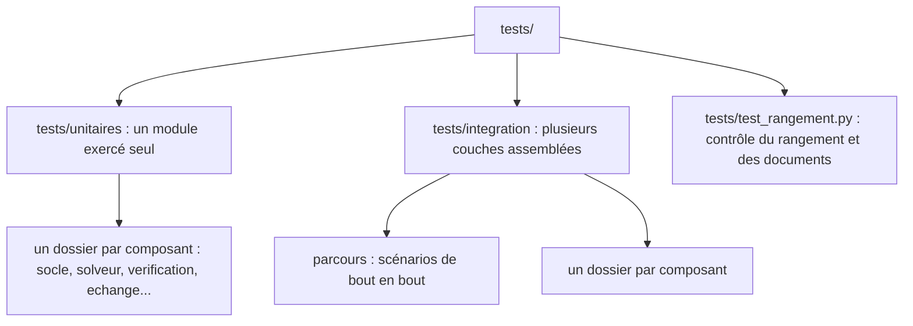
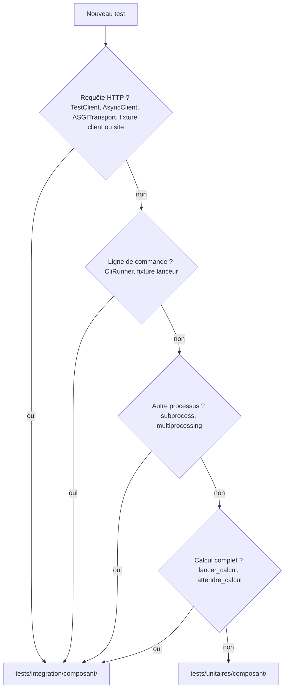
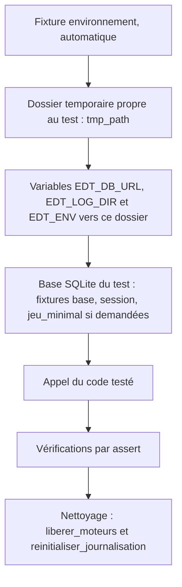

# Tests

Les tests du projet sont rangés en deux familles : **tests unitaires**
(`tests/unitaires/`) et **tests d'intégration** (`tests/integration/`). Chaque
famille est découpée par composant de l'application. Le classement suit une
règle unique, contrôlée automatiquement.

Pour aller plus loin : [`tests/unitaires/README.md`](unitaires/README.md)
(chaque fichier de tests unitaires et ce qu'il vérifie) et
[`tests/integration/README.md`](integration/README.md) (chaîne traversée,
parcours de bout en bout, chaque fichier de tests d'intégration). La recette
de l'application par les tests d'intégration (fiches, campagnes, résultats)
est le [cahier de recette](../docs/livrets/4-cahier-de-recette.md), livret 4.



## 1. Unitaire ou intégration : la règle

La règle ci-dessous fait foi. Elle est appliquée par
`tests/outils/classement.py` et vérifiée par `tests/test_rangement.py`.

- Test d'INTÉGRATION : il traverse plusieurs couches de l'application. Soit il
  passe par une interface (requête HTTP par le client de test : `TestClient`,
  `AsyncClient`, `ASGITransport`, y compris par les fixtures `client` ou
  `site` ; ligne de commande par `CliRunner`, y compris par une fixture
  `lanceur` ; autre processus : `subprocess`, `multiprocessing`), soit il
  enchaîne tout le calcul par le service de génération (`lancer_calcul`,
  `attendre_calcul`, y compris par une aide ou une fixture).
- Test UNITAIRE : tout le reste. Il exerce un seul module par ses fonctions
  Python, au besoin sur une base SQLite temporaire ; le solveur appelé
  directement sur des données en mémoire reste unitaire.

Exemple de test unitaire (`tests/unitaires/socle/test_calendrier.py`) : une
fonction du calendrier, appelée directement.

```python
def test_feries_d_une_periode_a_cheval_sur_deux_annees():
    feries = jours_feries_entre(dt.date(2026, 12, 1), dt.date(2027, 1, 31))
    assert [jour for jour, _ in feries] == [dt.date(2026, 12, 25), dt.date(2027, 1, 1)]
```

Exemple de test d'intégration (`tests/integration/socle/test_web.py`) : une
vraie requête HTTP traverse l'application web, ses routes et la base.

```python
def test_accueil_reste_lisible_sans_base_initialisee(environnement):
    client = TestClient(module_app.creer_app())

    reponse = client.get("/")
    assert reponse.status_code == 200
    assert "pas encore initialisée" in reponse.text
```

Un même fichier peut exister des deux côtés (par exemple
`tests/unitaires/socle/test_web.py` et `tests/integration/socle/test_web.py`) :
le premier appelle des fonctions du module web, le second passe par HTTP.

## 2. Arborescence

```
tests/
├── conftest.py            fixtures communes (base temporaire, jeu minimal, client web)
│                          et pose des marqueurs « unitaire » / « integration »
├── test_rangement.py      contrôle automatique du rangement (voir section 7)
├── README.md              ce document
├── unitaires/             un module exercé seul, par ses fonctions Python
│   ├── README.md          ce que vérifie chaque fichier, exemple commenté
│   ├── assistant/   banc_tests/  echange/  exploitation/  socle/   solveur/
│   └── synthese/    verification/  web_donnees/  web_edt/
├── integration/           plusieurs couches assemblées (HTTP, commande, processus, calcul complet)
│   ├── README.md          chaîne traversée, parcours, fichiers par composant
│   ├── parcours/          scénarios de bout en bout
│   ├── assistant/   banc_tests/  echange/  exploitation/  socle/   solveur/
│   └── synthese/    verification/  web_donnees/  web_edt/
└── outils/                aides et fixtures partagées (aucun test)
    ├── classement.py      classeur unitaire / intégration
    ├── catalogue.py       catalogue des cas limites (docs/banque-de-tests.md)
    ├── parcours/          aides des parcours
    └── assistant/ banc_tests/ echange/ exploitation/ socle/ solveur/ synthese/
        verification/ web_donnees/ web_edt/
```

Chaque dossier de composant peut avoir son `conftest.py` (fixtures propres à
ce côté). Les dossiers contiennent un `__init__.py`.

## 3. Composants et nombres de tests

Chaque famille est découpée en composants :

- `assistant` : assistant en langage courant (consignes, outils, boucle
  d'échange, limites, propositions, panneau et commande), avec un faux client ;
- `banc_tests` : tests lancés depuis l'application (catalogue, garde-fous,
  résultats, écrans, commande `tests`, vrai sous-processus pytest) ;
- `socle` : domaine (règles, paramètres, dépliage, calendrier), base et schéma,
  configuration, journaux, services transverses, ligne de commande, cycle de
  vie du serveur ;
- `solveur` : préparation du problème, modèle CP-SAT, salles, moteur, séances
  datées, pré-vérification, service de génération ;
- `verification` : vérificateur indépendant (règles du catalogue et règles
  personnalisées, semaine type et séances datées), indicateurs, services de
  vérification ;
- `web_donnees` : écrans de l'espace « Données » (formulaires génériques,
  besoins, règles, paramètres, jeux, suppression, concurrence) ;
- `web_edt` : page Générer et emploi du temps (calculs, suivi, grille,
  retouches, Points à traiter, accueil) ;
- `echange` : import et export (gabarit, lecture XLSX et CSV, rapport
  d'import, exports CSV et iCal, feuille des règles) ;
- `synthese` : générateur de données fictives (jeux petit, moyen et grand,
  emploi du temps témoin, règles d'exemple) ;
- `exploitation` : scripts de déploiement, unité systemd, configuration nginx,
  commandes d'administration (sauvegarde, diagnostic) ;
- `parcours` (intégration seulement) : scénarios de bout en bout (web, ligne
  de commande, aller-retour des données, règle personnalisée, retouche, jeu
  fictif).

Nombre de fonctions de test (`test_*`) par composant et par famille, compté
dans le code ; une fonction paramétrée compte une fois. Le détail par fichier
est dans [`tests/unitaires/README.md`](unitaires/README.md) et
[`tests/integration/README.md`](integration/README.md).

<!-- tests-vue-d-ensemble : début de la partie générée par `python -m tests.outils.classement --ecrire`, ne pas modifier à la main -->

| Composant | Unitaires | Intégration | Total |
|---|---:|---:|---:|
| `assistant` | 141 | 31 | 172 |
| `banc_tests` | 43 | 22 | 65 |
| `echange` | 149 | 41 | 190 |
| `exploitation` | 40 | 32 | 72 |
| `parcours` | — | 6 | 6 |
| `socle` | 222 | 79 | 301 |
| `solveur` | 196 | 54 | 250 |
| `synthese` | 62 | 6 | 68 |
| `verification` | 235 | 6 | 241 |
| `web_donnees` | 12 | 127 | 139 |
| `web_edt` | 37 | 143 | 180 |
| **Total** | **1 137** | **547** | **1 684** |
| dont cas limites (`cas_limite`) | 324 | 214 | 538 |
| dont tests de charge (`perf`) | 20 | 4 | 24 |

S'y ajoute le contrôle du rangement, `tests/test_rangement.py` : 11 fonctions.

<!-- tests-vue-d-ensemble : fin de la partie générée -->

Ce tableau et ceux des deux autres documents sont produits à partir du code
des tests ; `tests/test_rangement.py` échoue s'ils ne sont plus à jour. Après
l'ajout, le retrait ou le renommage d'un test ou d'un fichier de tests, depuis
la racine du dépôt :

```sh
python -m tests.outils.classement --ecrire   # réécrit les parties générées des trois documents
python -m tests.outils.classement            # totaux par côté et par composant, tests mal rangés
```

La description d'un fichier dans ces tableaux est la première phrase de la
docstring de son module ; le titre d'un composant est la première phrase de la
docstring de son `__init__.py` (à défaut, le nom du dossier). Un fichier de
tests sans docstring de module fait échouer le contrôle.

Le nombre de cas collectés par pytest (une fonction paramétrée en donne
plusieurs) s'obtient par :

```sh
python -m pytest --collect-only -q
```

## 4. Lancer les tests

Depuis la racine du dépôt :

```sh
python -m pytest                              # tout (tests de charge compris)
python -m pytest -m "not perf"                # tout sauf les tests de charge
python -m pytest tests/unitaires              # les tests unitaires
python -m pytest tests/integration            # les tests d'intégration
python -m pytest -m unitaire                  # idem par marqueur
python -m pytest -m integration               # idem par marqueur
python -m pytest tests/integration/parcours   # les parcours de bout en bout
python -m pytest tests/unitaires/solveur      # un composant, un côté
python -m pytest -m cas_limite                # les cas limites (docs/banque-de-tests.md)
python -m pytest -m perf                      # les tests de charge (longs)
python -m pytest tests/test_rangement.py      # le contrôle du rangement
```

Les marqueurs `unitaire` et `integration` sont posés d'après le dossier par
`tests/conftest.py` ; un test n'a pas à les porter lui-même. Ils se combinent
avec les autres : `-m "integration and cas_limite"`, `-m "unitaire and not perf"`.

L'intégration continue (`.github/workflows/ci.yml`) enchaîne, sous Python 3.11,
3.13 et 3.14 : `ruff check`, `ruff format --check`, contrôle du rangement,
tests unitaires, tests d'intégration ; les tests de charge en sont exclus.

Les tests se lancent aussi depuis l'application, onglets « Tests unitaires »
et « Tests d'intégration » (un test, un fichier, un composant ou toute la
famille, avec le résultat et la date de chaque test), ou par la commande
`python -m edt tests [--famille unitaires|integration] [--composant <nom>] [--test <clé>]`,
qui enregistre les mêmes résultats (voir `docs/interface.md`, section 15).

## 5. Où ranger un nouveau test



Chaque question vaut aussi quand le nom est utilisé par une fixture ou par une
aide (du module ou de `tests/outils/`).

1. Appliquer la règle de la section 1. Si le test utilise, directement ou par
   une fixture ou une aide, un client HTTP, `CliRunner`, un autre processus ou
   `lancer_calcul` / `attendre_calcul`, il va dans `tests/integration/`.
   Sinon, il va dans `tests/unitaires/`.
2. Choisir le dossier du composant concerné (`socle`, `solveur`...). Un
   scénario de bout en bout qui traverse plusieurs composants va dans
   `tests/integration/parcours/`.
3. Nommer le fichier `test_<sujet>.py` et la fonction en français, d'après le
   comportement vérifié.

Aucun fichier `test_*.py` n'est accepté hors de `tests/unitaires/` et
`tests/integration/` (sauf `tests/test_rangement.py`).

## 6. Aides partagées

Les fixtures et fonctions d'aide utilisées par plusieurs fichiers vivent dans
`tests/outils/<composant>/`. Un `conftest.py` les importe par leur nom pour
les rendre disponibles comme fixtures. Un module de tests n'importe jamais un
autre module de tests (`test_*.py`) ni un `conftest.py` : il importe depuis
`tests/outils/`.

Cycle de vie d'un test, d'après `tests/conftest.py` :



Aucun test ne touche `data/` ni `logs/` : la base et les journaux vivent dans
le dossier temporaire, effacé par pytest.

Fixtures communes à tous les tests (`tests/conftest.py`) :

- `environnement` (automatique) : base SQLite et journaux dans un dossier
  temporaire propre au test ;
- `base`, `session` : base initialisée et session ouverte dessus ;
- `jeu_minimal` : base chargée du petit jeu de démonstration ;
- `client` : client HTTP de l'application web (fait d'un test un test
  d'intégration).

## 7. Contrôle automatique du classement

`tests/test_rangement.py` vérifie à chaque exécution que :

- chaque test de `tests/unitaires/` est unitaire selon la règle, et chaque
  test de `tests/integration/` est d'intégration ; en cas d'erreur, le message
  nomme le test, la preuve trouvée et le dossier où le déplacer ;
- aucun fichier de tests n'existe hors de ces deux dossiers ;
- aucun module de tests n'importe un autre module de tests ;
- le classeur reconnaît bien chaque forme de preuve (usage direct, par une
  fixture, par une aide du module, par une aide importée) et le cas unitaire ;
- les nombres et les tableaux de fichiers de ce document, de
  `tests/unitaires/README.md` et de `tests/integration/README.md` sont à jour
  (section 3), et chaque fichier de tests a une docstring de module : ces
  documents ne peuvent ni oublier un fichier ni afficher un nombre périmé.

Le classeur (`tests/outils/classement.py`) lit le code sans l'exécuter. Pour
chaque test, il suit les fixtures (module, `conftest.py` du dossier et des
dossiers parents), les fonctions d'aide du module et les aides importées de
`tests/`. Les noms qui font preuve sont listés dans sa constante `PREUVES`.
