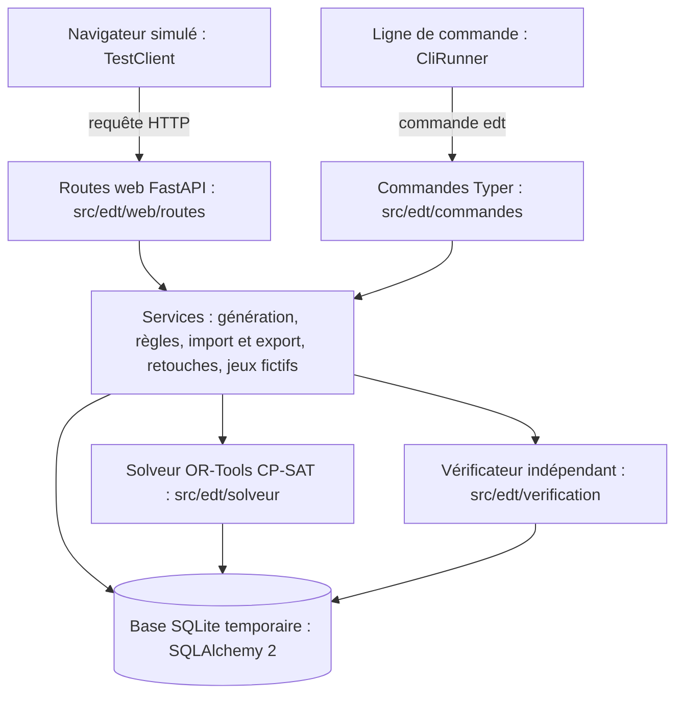
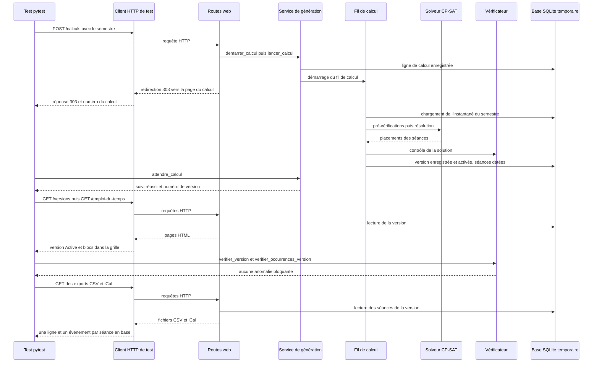

# Tests d'intégration

Un test d'intégration fait tourner **plusieurs couches réelles de
l'application ensemble**, sur une vraie base SQLite temporaire. Il passe par
une interface (requête HTTP par le client de test, ligne de commande par
`CliRunner`, autre processus) ou enchaîne tout le calcul par le service de
génération (`lancer_calcul`, `attendre_calcul`).

Ce dossier compte **419 fonctions de test, soit 518 cas collectés**, dont 202
cas limites et 3 tests de charge :

- **`parcours/`** : six scénarios de bout en bout, comme un utilisateur se
  servirait de l'application. C'est le point d'entrée pour un lecteur pressé
  (section 4) ;
- **un dossier par composant** (`socle/`, `solveur/`, `verification/`,
  `web_donnees/`, `web_edt/`, `echange/`, `synthese/`, `exploitation/`) : les
  écrans de chaque composant par HTTP, ses commandes par `CliRunner`, ses
  calculs complets (section 6).

La règle de classement, la vue d'ensemble et les tests unitaires sont décrits
dans [`tests/README.md`](../README.md) et
[`tests/unitaires/README.md`](../unitaires/README.md).

## 1. Pourquoi des tests d'intégration

Les tests unitaires montrent que chaque pièce marche seule. Ils ne disent pas
si les pièces marchent **ensemble** : une route web peut appeler un service
avec un mauvais identifiant, un export peut oublier des séances que la base
contient, une règle peut être bien enregistrée mais jamais lue par le solveur.

Les tests d'intégration répondent à trois questions :

1. **Le parcours de l'utilisateur fonctionne-t-il de bout en bout ?** Du
   formulaire « Générer » jusqu'au fichier iCal téléchargé.
2. **Les composants se comprennent-ils ?** Ce que le solveur produit, le
   vérificateur l'accepte ; ce que l'export écrit, l'import le relit.
3. **Les retouches gardent-elles la cohérence ?** Une modification à la main
   ne doit pas casser l'emploi du temps.

## 2. La chaîne traversée



| Couche | Code | Parcours qui la traversent |
|---|---|---|
| Web (routes, gabarits HTML) | `src/edt/web/` | a, c, e |
| Ligne de commande | `src/edt/cli.py`, `src/edt/commandes/` | b |
| Services | `src/edt/services/` | tous |
| Solveur CP-SAT | `src/edt/solveur/` | a, b, d, e, f |
| Vérificateur | `src/edt/verification/` | a, b, d, e, f |
| Import / export | `src/edt/echange/` | a, b, c |
| Générateur de données fictives | `src/edt/synthese/` | f |
| Base SQLite | `src/edt/db/` | tous |

Dans les parcours, **rien n'est simulé** : aucun `monkeypatch` du solveur ni
du vérificateur. La seule chose coupée (fixture `sans_prechauffage` de
`parcours/conftest.py`) est le préchauffage des écrans, un fil
d'arrière-plan qui calcule d'avance les pages après un calcul et qui
survivrait à la base temporaire du test.

## 3. Un parcours complet, pas à pas

Le parcours web ([`parcours/test_parcours_web.py`](parcours/test_parcours_web.py)),
tel que le code l'exécute :



## 4. Les six parcours : point d'entrée

Chaque parcours porte un docstring en trois parties : **Scénario**,
**Étapes**, **Ce que cela prouve**. Données : le jeu minimal (2 campus,
6 salles, 5 enseignants, 9 groupes, 6 matières, 16 besoins, 17 séances par
semaine) ou le jeu fictif « petit ».

| Fichier | Scénario | Couches traversées | Ce qu'il prouve | Durée mesurée |
|---|---|---|---|---|
| [`parcours/test_parcours_web.py`](parcours/test_parcours_web.py) | a. calcul lancé depuis le site, consulté, exporté | web, services, solveur, vérificateur, export, base | une version active, affichée, valide et exportée en entier | 0,5 s |
| [`parcours/test_parcours_ligne_de_commande.py`](parcours/test_parcours_ligne_de_commande.py) | b. `init-db`, `jeu-minimal`, `generer`, `verifier`, `exporter-edt` | ligne de commande, services, solveur, vérificateur, export, base | les commandes s'enchaînent sur la même base sans le site | 0,3 s |
| [`parcours/test_aller_retour_donnees.py`](parcours/test_aller_retour_donnees.py) | c. classeur exporté puis importé dans une base neuve | web, import et export, services, base | le format d'échange est réimportable sans perte | 0,6 s (plus 0,7 s de préparation) |
| [`parcours/test_regle_personnalisee.py`](parcours/test_regle_personnalisee.py) | d. « A1-G1 ne travaille pas le lundi » | services, solveur, vérificateur, base | une règle saisie est imposée puis contrôlée | moins de 0,3 s |
| [`parcours/test_retouche_manuelle.py`](parcours/test_retouche_manuelle.py) | e. séance datée annulée par le site | services, solveur, web, vérificateur, base | une retouche laisse l'emploi du temps cohérent | 0,3 s |
| [`parcours/test_jeu_fictif_realiste.py`](parcours/test_jeu_fictif_realiste.py) | f. jeu fictif « petit » calculé et vérifié | générateur de données, solveur, vérificateur, base | un établissement plus riche est calculé sans anomalie bloquante | 0,4 s |

Durées de l'appel du test, mesurées le 16 novembre 2026 (Windows 11,
Python 3.11.9) par la commande de la section 4.7. Les six parcours tournent
en moins de 4 s au total, hors premier chargement des bibliothèques (quelques
secondes de plus). Aucun ne dépasse 30 s : aucun n'est marqué `perf`, tous
tournent dans la CI.

Les tests ne vérifient jamais *où* le solveur a placé un cours (cela peut
changer d'une machine à l'autre) mais des **propriétés** : une version active
existe, zéro anomalie bloquante, les comptes sont égaux, la règle est respectée.

### 4.1 a. Parcours web complet

1. `POST /calculs` (formulaire « Générer ») ; le vrai solveur calcule.
2. `GET /versions` : une version porte l'étiquette « Active ».
3. `GET /emploi-du-temps` : la grille contient des séances.
4. Vérificateur : semaine type et séances datées sans anomalie bloquante.
5. `GET /export/emploi-du-temps.csv` et `.ics` : autant de lignes et
   d'événements que de séances en base.

Prouve que la chaîne web → services → solveur → vérificateur → base → export
fonctionne d'un bout à l'autre, et que l'export est fidèle à la base.

### 4.2 b. Parcours en ligne de commande

`init-db` → `jeu-minimal` → `generer --sans-optimiser` → `verifier` (code de
sortie 0) → `exporter-edt --sortie edt.csv` (fichier écrit, non vide). Le
semestre et la version sont relus en base, jamais écrits en dur. Prouve qu'un
administrateur peut produire un emploi du temps sans le site.

### 4.3 c. Aller-retour des données

Classeur téléchargé par `GET /export/donnees.xlsx`, base neuve initialisée à
côté, import par le service de l'écran « Import », puis comparaison des
comptes de salles, enseignants, groupes, matières et besoins. Prouve que le
format d'échange est réellement réimportable, sans rejet ni perte.

### 4.4 d. Règle personnalisée de bout en bout

Règle créée par le service des règles : « la classe A1-G1 ne travaille pas le
lundi » (type `JOURS_TRAVAILLES`, niveau nécessaire). Après un vrai calcul :
le rapport du vérificateur est valide, la règle figure parmi les règles
vérifiées, aucune anomalie ne la cite, et aucune séance de A1-G1 n'est un
lundi. Prouve qu'une règle saisie est lue, imposée puis contrôlée.

Contre-épreuve : en déplaçant une séance de A1-G1 au lundi dans la base après
le calcul, le vérificateur rend un rapport invalide dont l'anomalie cite la
règle (« Règle R005 (La classe A1-G1 ne travaille pas le lundi) : … »). Le
test sait donc échouer.

### 4.5 e. Retouche manuelle

Après un calcul, une séance datée est annulée par la route web
`POST /emploi-du-temps/occurrences/{id}/annuler` (motif « grève »). La base
montre la séance annulée avec son motif, exactement une annulation de plus,
et le vérificateur des séances datées ne trouve aucune anomalie bloquante.
L'annulation a été préférée au déplacement : un déplacement peut être refusé
selon la place que le solveur a choisie, ce qui rendrait le test dépendant de
la solution. Le déplacement est couvert par
[`web_edt/test_emploi_du_temps.py`](web_edt/test_emploi_du_temps.py).

### 4.6 f. Données fictives réalistes

Chargement du jeu « petit » (une promotion de 1re année, deux classes, deux
sites, salles spécialisées, vacataires, une absence d'enseignant, partiels ;
23 besoins) par le service de l'écran « Jeux de démonstration », calcul de
chacun de ses semestres, vérification de la semaine type et des séances
datées (283 séances datées) sans anomalie bloquante. L'optimisation est
coupée (paramètre `objectif_actif`) : on veut un emploi du temps valide, pas
le meilleur.

### 4.7 Sortie réelle de pytest

`python -m pytest tests/integration/parcours -v -p no:cacheprovider --durations=6`,
le 16 novembre 2026 (Windows 11, Python 3.11.9) :

```
collecting ... collected 6 items

tests/integration/parcours/test_aller_retour_donnees.py::test_export_puis_import_dans_une_base_neuve PASSED [ 16%]
tests/integration/parcours/test_jeu_fictif_realiste.py::test_jeu_petit_calcule_et_verifie PASSED [ 33%]
tests/integration/parcours/test_parcours_ligne_de_commande.py::test_parcours_ligne_de_commande PASSED [ 50%]
tests/integration/parcours/test_parcours_web.py::test_parcours_web_du_calcul_a_l_export PASSED [ 66%]
tests/integration/parcours/test_regle_personnalisee.py::test_regle_jours_travailles_respectee_de_bout_en_bout PASSED [ 83%]
tests/integration/parcours/test_retouche_manuelle.py::test_annuler_une_seance_datee_par_le_site PASSED [100%]

============================= slowest 6 durations =============================
0.73s setup    tests/integration/parcours/test_aller_retour_donnees.py::test_export_puis_import_dans_une_base_neuve
0.63s call     tests/integration/parcours/test_aller_retour_donnees.py::test_export_puis_import_dans_une_base_neuve
0.53s call     tests/integration/parcours/test_parcours_web.py::test_parcours_web_du_calcul_a_l_export
0.43s call     tests/integration/parcours/test_jeu_fictif_realiste.py::test_jeu_petit_calcule_et_verifie
0.32s call     tests/integration/parcours/test_retouche_manuelle.py::test_annuler_une_seance_datee_par_le_site
0.27s call     tests/integration/parcours/test_parcours_ligne_de_commande.py::test_parcours_ligne_de_commande
============================== 6 passed in 3.61s ==============================
```

## 5. Un exemple expliqué pas à pas

Fichier [`parcours/test_regle_personnalisee.py`](parcours/test_regle_personnalisee.py),
corps du test (docstring omis) :

```python
with session_base() as session:
    annee = session.get(m.AnneeScolaire, jeu_minimal.annee_scolaire_id).libelle
    regle = regles.creer(
        session,
        {
            "type": "JOURS_TRAVAILLES",
            "annee": annee,
            "portee": {"nature": "groupe", "cible": "A1-G1"},
            "parametres": {"jours": ["mardi", "mercredi", "jeudi", "vendredi"]},
            "niveau": "necessaire",
        },
    )

version = calculer(jeu_minimal.semestre_id).version_id

with session_base() as session:
    rapport = verifier_version(session, version)
    jours_a1_g1 = session.scalars(
        select(m.SeanceHebdo.jour).where(
            m.SeanceHebdo.version_id == version,
            m.SeanceHebdo.besoin.has(m.Besoin.groupes.any(code="A1-G1")),
        )
    ).all()
assert rapport.valide
assert regle.id in rapport.niveaux_regles  # la règle a bien été vérifiée
assert not [a for a in rapport.anomalies if a.regle_id == regle.id]
assert jours_a1_g1 and LUNDI not in jours_a1_g1
```

1. **Ce qu'on prépare.** La fixture `jeu_minimal` charge un petit
   établissement dans la base temporaire du test. Le service des règles crée
   la règle « A1-G1 ne travaille que du mardi au vendredi », au niveau
   nécessaire, comme le ferait l'écran « Règles ».
2. **Ce qu'on appelle.** `calculer` (`tests/outils/parcours/aides.py`) lance
   un vrai calcul par `lancer_calcul` et l'attend par `attendre_calcul` :
   chargement de l'instantané, solveur, contrôle, enregistrement de la
   version. C'est ce calcul complet qui fait de ce test un test
   d'intégration.
3. **Ce qu'on vérifie.** Le vérificateur juge la version valide, a bien
   contrôlé la règle et ne lui trouve aucune entorse ; la base, relue
   directement, ne contient aucune séance de A1-G1 un lundi.
4. **Pourquoi le test échouerait si le défaut revenait.** Si la règle
   n'était plus transmise au solveur, ou plus posée par lui, des séances de
   A1-G1 pourraient tomber un lundi : la dernière assertion échouerait. Si le
   vérificateur ne la contrôlait plus, `regle.id` manquerait dans
   `rapport.niveaux_regles`.

## 6. Ce que vérifie chaque fichier, par composant

Nombres mesurés sur le dépôt. « Fonctions » compte les fonctions `test_*` du
fichier, « Cas » les tests collectés par pytest. Recalculer :

```sh
python -m tests.outils.classement                      # fonctions par composant
python -m pytest --collect-only -q tests/integration   # cas, fichier par fichier
```

### `parcours/` : scénarios de bout en bout (6 fonctions, 6 cas)

Voir la section 4 : [`parcours/test_parcours_web.py`](parcours/test_parcours_web.py),
[`parcours/test_parcours_ligne_de_commande.py`](parcours/test_parcours_ligne_de_commande.py),
[`parcours/test_aller_retour_donnees.py`](parcours/test_aller_retour_donnees.py),
[`parcours/test_regle_personnalisee.py`](parcours/test_regle_personnalisee.py),
[`parcours/test_retouche_manuelle.py`](parcours/test_retouche_manuelle.py),
[`parcours/test_jeu_fictif_realiste.py`](parcours/test_jeu_fictif_realiste.py)
(une fonction et un cas chacun).

### `socle/` : Commandes et application web du socle (64 fonctions, 80 cas)

| Fichier | Ce qu'il vérifie | Fonctions | Cas |
|---|---|---:|---:|
| [`socle/test_cli.py`](socle/test_cli.py) | commandes du socle et mécanisme d'extension, par `CliRunner` | 15 | 20 |
| [`socle/test_config.py`](socle/test_config.py) | `doctor` signale une adresse d'écoute introuvable | 1 | 1 |
| [`socle/test_generation.py`](socle/test_generation.py) | orchestration d'un calcul : succès, calcul déjà en cours, arrêt, échecs | 12 | 12 |
| [`socle/test_instantane.py`](socle/test_instantane.py) | identifiants hors des entiers SQLite côté commandes | 2 | 7 |
| [`socle/test_journal.py`](socle/test_journal.py) | fichier journal non ouvrable signalé par `doctor` | 1 | 1 |
| [`socle/test_moteur.py`](socle/test_moteur.py) | URL de base refusées par la ligne de commande | 2 | 5 |
| [`socle/test_parametres.py`](socle/test_parametres.py) | l'écran des paramètres reste ouvrable avec une valeur corrompue | 1 | 1 |
| [`socle/test_schema.py`](socle/test_schema.py) | schéma périmé vu par `init-db`, `verifier-schema`, `doctor` et `/sante` | 9 | 9 |
| [`socle/test_web.py`](socle/test_web.py) | accueil, santé, erreurs lisibles, cycle de vie du serveur, par HTTP | 21 | 24 |

### `solveur/` : Calculs complets et commandes du solveur (47 fonctions, 51 cas)

| Fichier | Ce qu'il vérifie | Fonctions | Cas |
|---|---|---:|---:|
| [`solveur/test_niveaux.py`](solveur/test_niveaux.py) | niveaux de règles de bout en bout : calcul, suivi, ligne de commande | 6 | 10 |
| [`solveur/test_regles.py`](solveur/test_regles.py) | règles personnalisées de bout en bout : calcul, suivi, ligne de commande | 3 | 3 |
| [`solveur/test_services.py`](solveur/test_services.py) | génération complète, instanciation et replacement sur le jeu minimal | 38 | 38 |

### `verification/` : Commande du vérificateur (6 fonctions, 10 cas)

| Fichier | Ce qu'il vérifie | Fonctions | Cas |
|---|---|---:|---:|
| [`verification/test_commande.py`](verification/test_commande.py) | commande `verifier` lancée par `CliRunner` : codes de sortie, options | 6 | 10 |

### `web_donnees/` : Écrans de l'espace « Données », par HTTP (116 fonctions, 142 cas)

| Fichier | Ce qu'il vérifie | Fonctions | Cas |
|---|---|---:|---:|
| [`web_donnees/test_besoins.py`](web_donnees/test_besoins.py) | écran des besoins : modes de volume, filtres, duplication | 9 | 9 |
| [`web_donnees/test_cas_limites.py`](web_donnees/test_cas_limites.py) | calcul en cours, dates aberrantes, adresses et en-têtes fabriqués | 13 | 19 |
| [`web_donnees/test_concurrence.py`](web_donnees/test_concurrence.py) | un seul chargement de jeu ou une seule remise à zéro à la fois | 3 | 3 |
| [`web_donnees/test_entites.py`](web_donnees/test_entites.py) | pour chaque entité : la liste répond, le formulaire s'ouvre, une création passe | 6 | 19 |
| [`web_donnees/test_generique.py`](web_donnees/test_generique.py) | liste (tri, recherche, filtres, pagination), formulaire, suppression | 9 | 9 |
| [`web_donnees/test_jeux.py`](web_donnees/test_jeux.py) | page des jeux : établissement fictif, refus pendant un calcul, remise à zéro | 5 | 5 |
| [`web_donnees/test_mise_en_page.py`](web_donnees/test_mise_en_page.py) | onglets, sous-navigation, panneau Assistant | 5 | 5 |
| [`web_donnees/test_parametres.py`](web_donnees/test_parametres.py) | écran des paramètres : bornes contrôlées, valeurs par défaut | 9 | 9 |
| [`web_donnees/test_performance.py`](web_donnees/test_performance.py) | temps et taille des pages sur l'établissement complet (`perf`) | 2 | 2 |
| [`web_donnees/test_regles.py`](web_donnees/test_regles.py) | règles personnalisées : liste, ajout guidé, modification, suppression | 24 | 24 |
| [`web_donnees/test_saisies_extremes.py`](web_donnees/test_saisies_extremes.py) | saisies aberrantes : jamais d'erreur 500, toujours un message | 16 | 23 |
| [`web_donnees/test_sans_trace.py`](web_donnees/test_sans_trace.py) | aucune page n'affiche de trace technique | 2 | 2 |
| [`web_donnees/test_suppression.py`](web_donnees/test_suppression.py) | suppression : confirmation, refus avec liens, conséquences expliquées | 13 | 13 |

### `web_edt/` : Écrans Générer et emploi du temps, par HTTP (119 fonctions, 145 cas)

| Fichier | Ce qu'il vérifie | Fonctions | Cas |
|---|---|---:|---:|
| [`web_edt/test_a_traiter.py`](web_edt/test_a_traiter.py) | onglet « À traiter » : anomalies, liens vers les séances | 6 | 6 |
| [`web_edt/test_accueil.py`](web_edt/test_accueil.py) | accueil : prochaine étape, version active, points à traiter | 10 | 11 |
| [`web_edt/test_calculs.py`](web_edt/test_calculs.py) | onglet « Générer » : lancement, suivi, messages de fin, versions | 13 | 14 |
| [`web_edt/test_cas_limites.py`](web_edt/test_cas_limites.py) | adresses mal copiées, liens périmés, cookies forgés : jamais d'erreur 500 | 24 | 37 |
| [`web_edt/test_dejeuner.py`](web_edt/test_dejeuner.py) | pause déjeuner à trois modes saisie au lancement | 8 | 8 |
| [`web_edt/test_emploi_du_temps.py`](web_edt/test_emploi_du_temps.py) | grille, groupes liés, déplacements et annulations vérifiés | 20 | 31 |
| [`web_edt/test_niveaux_web.py`](web_edt/test_niveaux_web.py) | niveaux de règles sur « Générer », le suivi et l'historique | 11 | 11 |
| [`web_edt/test_raccords.py`](web_edt/test_raccords.py) | pré-vérifications et instanciation d'une version issue d'un calcul complet | 1 | 1 |
| [`web_edt/test_regles_web.py`](web_edt/test_regles_web.py) | règles personnalisées sur les écrans : Générer, suivi, grille, anomalies | 13 | 13 |
| [`web_edt/test_revue.py`](web_edt/test_revue.py) | constats de la revue d'ensemble et mémoire des écrans | 13 | 13 |

### `echange/` : Import et export par le site et la ligne de commande (32 fonctions, 38 cas)

| Fichier | Ce qu'il vérifie | Fonctions | Cas |
|---|---|---:|---:|
| [`echange/test_bornes.py`](echange/test_bornes.py) | fichiers hostiles envoyés au site, pages bornées | 6 | 6 |
| [`echange/test_commandes.py`](echange/test_commandes.py) | commandes `gabarit`, `importer`, `exporter-donnees`, `exporter-edt` | 8 | 10 |
| [`echange/test_export_edt.py`](echange/test_export_edt.py) | export CSV et iCal d'une version calculée, relu par `icalendar` | 5 | 7 |
| [`echange/test_web.py`](echange/test_web.py) | écrans d'import et d'export : dépôt, simulation, application, téléchargements | 13 | 15 |

### `synthese/` : Commande des jeux fictifs (6 fonctions, 8 cas)

| Fichier | Ce qu'il vérifie | Fonctions | Cas |
|---|---|---:|---:|
| [`synthese/test_cas_limites.py`](synthese/test_cas_limites.py) | une graine ou une année refusée ne vide jamais la base | 1 | 3 |
| [`synthese/test_commande.py`](synthese/test_commande.py) | commande `python -m edt jeu` | 5 | 5 |

### `exploitation/` : Contrats du déploiement (23 fonctions, 38 cas)

| Fichier | Ce qu'il vérifie | Fonctions | Cas |
|---|---|---:|---:|
| [`exploitation/test_commandes_exploitation.py`](exploitation/test_commandes_exploitation.py) | commandes et service : `init-db` relançable, codes de sortie, sauvegardes | 18 | 22 |
| [`exploitation/test_scripts_deploiement.py`](exploitation/test_scripts_deploiement.py) | scripts de déploiement exécutés hors du serveur (bash, awk, Python) | 5 | 16 |

### `banc_tests/` : Lancement des tests depuis l'application (19 fonctions, 19 cas)

| Fichier | Ce qu'il vérifie | Fonctions | Cas |
|---|---|---:|---:|
| [`banc_tests/test_commande.py`](banc_tests/test_commande.py) | commande `python -m edt tests` sur le dépôt factice : code de sortie, échecs affichés, résultats enregistrés | 3 | 3 |
| [`banc_tests/test_ecrans.py`](banc_tests/test_ecrans.py) | écrans « Tests unitaires » et « Tests d'intégration » par HTTP : onglets, schéma, lancement, suivi en direct, refus | 9 | 9 |
| [`banc_tests/test_execution.py`](banc_tests/test_execution.py) | exécution réelle des tests d'un dépôt factice dans un sous-processus pytest : résultats, arrêt, durée maximale | 7 | 7 |

## 7. Stratégie de test du projet

| Niveau | Où | Comment le lancer | Rôle |
|---|---|---|---|
| Unitaire | `tests/unitaires/<composant>/`, marqueur `unitaire` | `python -m pytest tests/unitaires` | un module à la fois, par ses fonctions Python |
| Intégration | `tests/integration/<composant>/` et `tests/integration/parcours/`, marqueur `integration` | `python -m pytest tests/integration` | plusieurs couches réelles assemblées ; parcours de bout en bout |
| Cas limites | dans les deux familles, marqueur `cas_limite` | `python -m pytest -m cas_limite` | pannes plausibles et saisies piégées ([banque de tests](../../docs/banque-de-tests.md)) |
| Charge | dans les deux familles, marqueur `perf` | `python -m pytest -m perf` | gros jeux (moyen, grand), durées et mémoire ; exclus de la CI courante |

Nombres collectés le 16 novembre 2026 (`python -m pytest --collect-only -q`,
avec `tests/unitaires`, `tests/integration`, `-m cas_limite`, `-m perf`) :

| Niveau | Nombre de tests | Ce qu'il couvre | Ce qu'il ne couvre pas |
|---|---|---|---|
| Unitaire (`tests/unitaires/`) | 1 187 (dont 24 `perf`) | chaque fonction, règle ou service pris isolément | l'enchaînement des couches |
| Intégration (`tests/integration/`) | 518 (dont 3 `perf`), dont les 6 parcours | écrans par HTTP, commandes, autres processus, calculs complets ; accord solveur et vérificateur ; aller-retour des données | l'apparence et le JavaScript |
| Contrôle du rangement (`tests/test_rangement.py`) | 15 | classement de chaque test, fichiers égarés, imports entre modules de tests, citation de chaque fichier dans ces documents | le contenu des tests |
| **Total** | **1 720** | | |
| dont cas limites (`cas_limite`) | 549 (347 unitaires, 202 d'intégration ; 10 aussi `perf`) | saisies extrêmes, concurrence, pannes de fichiers ou de base, identifiants hors bornes | le parcours normal d'un utilisateur |
| dont charge (`perf`) | 27 | jeux moyen et grand, durées et mémoire | exclus de la CI courante |

La CI (`.github/workflows/ci.yml`) enchaîne trois étapes : contrôle du
rangement, tests unitaires, tests d'intégration, hors tests de charge :
1 686 tests (15 de contrôle, 1 156 unitaires, 515 d'intégration).

Règles communes à tous les tests (voir [banque de tests](../../docs/banque-de-tests.md),
« Conventions ») : noms en français, base SQLite dans un dossier temporaire
propre à chaque test, aucune dépendance à l'horloge ni à l'ordre des tests,
jamais de solution particulière du solveur attendue en dur.

## 8. Ce que ces tests ne couvrent pas

- **Pas de vrai navigateur** : `TestClient` envoie de vraies requêtes HTTP à
  l'application et lit le HTML rendu, mais n'exécute ni JavaScript ni HTMX et
  ne juge pas l'apparence. Un test dans un navigateur (Playwright, par
  exemple) serait l'étape suivante.
- **Pas de site déployé** : tout tourne en mémoire, sans serveur, sans réseau,
  sans le VPS (`https://pts.jorund.xyz`) ni nginx ; les fichiers de
  déploiement sont contrôlés à part (`exploitation/` ici et dans
  `tests/unitaires/exploitation/` : scripts, unité systemd, nginx).
- **Petits jeux seulement** dans les parcours : jeu minimal et jeu « petit »,
  pour rester sous quelques secondes ; les gros jeux sont dans les tests de
  charge (`-m perf`).
- **Optimisation coupée** : les parcours cherchent un emploi du temps valide,
  pas le meilleur ; la qualité de l'optimisation est mesurée par les tests du
  solveur et de charge.
- **Propriétés, pas solutions** : les tests n'attendent jamais un placement
  précis ; une régression qui garderait un emploi du temps valide mais moins
  bon ne serait pas vue ici.

## 9. Lancer et ajouter

```sh
python -m pytest tests/integration/parcours -v    # les six parcours seulement
python -m pytest tests/integration                # tous les tests d'intégration
python -m pytest -m integration                   # idem, par marqueur
python -m pytest tests/integration -m "not perf"  # sans les tests de charge (comme la CI)
python -m pytest tests/integration/web_edt        # un composant
```

Ajouter un parcours en cinq lignes :

```python
@pytest.mark.integration
def test_mon_scenario(jeu_minimal, client):
    """Scénario : ...  Étapes : 1. ... 2. ...  Ce que cela prouve : ..."""
    version = calculer(jeu_minimal.semestre_id).version_id  # vrai calcul
    assert client.get(f"/emploi-du-temps?version_id={version}").status_code == 200
```

Créer `test_<nom>.py` dans `tests/integration/parcours/`, importer `pytest` et
`from tests.outils.parcours.aides import calculer`, garder le docstring en
trois parties, et n'asserter que des propriétés. Un test d'intégration propre
à un composant va dans le dossier de ce composant.

Chaque fichier `test_*.py` de ce dossier doit être cité dans ce document :
`tests/test_rangement.py` le vérifie.
