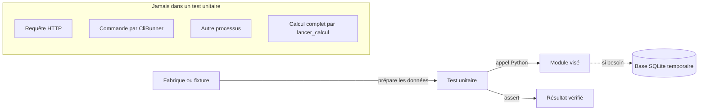
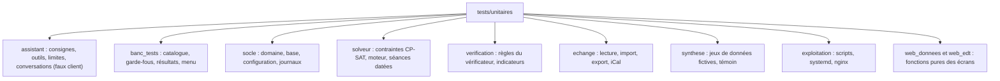

# Tests unitaires

Un test unitaire exerce **un seul module par ses fonctions Python**. Il
n'envoie aucune requête HTTP, ne lance aucune commande par `CliRunner`,
aucun autre processus, et n'enchaîne pas le calcul complet par le service de
génération. Il peut utiliser une base SQLite temporaire. Le solveur appelé
directement sur des données en mémoire reste unitaire.

Les nombres de tests et le détail par fichier sont en section 3. La règle
complète, la vue d'ensemble et les tests d'intégration sont décrits dans
[`tests/README.md`](../README.md) et
[`tests/integration/README.md`](../integration/README.md).

## 1. Ce qu'un test unitaire met en jeu



Le test prépare ses données (fabrique en mémoire ou base temporaire), appelle
une fonction du module visé, puis vérifie le résultat. Rien d'autre n'entre en
jeu : un échec désigne donc directement le module fautif.

## 2. Composants testés



## 3. Ce que vérifie chaque fichier

Nombres de fonctions de test (`test_*`), comptés dans le code : une fonction
paramétrée compte une fois. La description d'un fichier est la première
phrase de la docstring de son module. Cette section est produite par
`python -m tests.outils.classement --ecrire` (voir [`tests/README.md`](../README.md), section 3) ; le nombre
de cas collectés par pytest s'obtient par
`python -m pytest --collect-only -q tests/unitaires`.

<!-- tests-unitaires : début de la partie générée par `python -m tests.outils.classement --ecrire`, ne pas modifier à la main -->

Ce dossier compte **1 137 fonctions de test** dans 10 composants, dont 324 marquées `cas_limite` et 20 marquées `perf`.

### `assistant/` : Assistant en langage courant (141 fonctions)

| Fichier | Ce qu'il vérifie | Fonctions |
|---|---|---:|
| [`assistant/test_boucle.py`](assistant/test_boucle.py) | Boucle d'un échange avec le faux client : arrêts, outils, historique, bornes, arguments | 22 |
| [`assistant/test_configuration.py`](assistant/test_configuration.py) | Configuration de l'assistant : défauts, variables invalides, clé absente ou en double | 11 |
| [`assistant/test_consignes.py`](assistant/test_consignes.py) | Consignes système : figées, sans donnée variable, avec tout le catalogue des règles | 4 |
| [`assistant/test_conversations.py`](assistant/test_conversations.py) | Conversations et propositions : échange dans son fil, limites, confirmation, refus, secret | 34 |
| [`assistant/test_erreurs_api.py`](assistant/test_erreurs_api.py) | Matrice des erreurs du service : chaque cas, son message, son journal, sa pause | 3 |
| [`assistant/test_limites.py`](assistant/test_limites.py) | Limites et coûts : prix d'un appel, réservation, compteurs du jour en base et en mémoire | 12 |
| [`assistant/test_occupation.py`](assistant/test_occupation.py) | Occupation d'un créneau : plage d'un moment, salles libres, séances d'une ressource | 17 |
| [`assistant/test_outils.py`](assistant/test_outils.py) | Outils de l'assistant : schémas, outils de lecture, propositions sans écriture | 29 |
| [`assistant/test_validations.py`](assistant/test_validations.py) | Validations sans écriture utilisées par les propositions de l'assistant | 9 |

### `banc_tests/` : Tests unitaires du banc de tests : catalogue, cibles, résultats, garde-fous, menu (43 fonctions)

| Fichier | Ce qu'il vérifie | Fonctions |
|---|---|---:|
| [`banc_tests/test_catalogue.py`](banc_tests/test_catalogue.py) | Catalogue des tests lu sans les exécuter, racine du dépôt et cibles tirées du catalogue | 9 |
| [`banc_tests/test_garde_fous.py`](banc_tests/test_garde_fous.py) | Garde-fous du lancement des tests, vérifiés sans lancer de sous-processus : réglages, refus, verrou, environnement | 17 |
| [`banc_tests/test_menu_et_tableau.py`](banc_tests/test_menu_et_tableau.py) | Onglets des tests dans le menu, et tableau d'une famille : état affiché de chaque test et comptes | 9 |
| [`banc_tests/test_resultats.py`](banc_tests/test_resultats.py) | Regroupement des comptes rendus de pytest par fonction de test, et historique des résultats sur disque | 8 |

### `echange/` : Import et export (149 fonctions)

| Fichier | Ce qu'il vérifie | Fonctions |
|---|---|---:|
| [`echange/test_bornes.py`](echange/test_bornes.py) | Bornes contre les fichiers hostiles : archive bombe, fichier trop long | 22 |
| [`echange/test_export_edt.py`](echange/test_export_edt.py) | Export d'un emploi du temps importé en mode référence : iCal et CSV datés, relus et réimportés | 4 |
| [`echange/test_format.py`](echange/test_format.py) | Le format d'échange : gabarit XLSX et ZIP, documentation générée depuis la description | 5 |
| [`echange/test_ical.py`](echange/test_ical.py) | Adaptateur iCal : événements simples, récurrences, exceptions, remplacements, changement d'heure | 19 |
| [`echange/test_import_donnees.py`](echange/test_import_donnees.py) | Import des données de l'établissement : aller-retour, import partiel, simulation, réimport | 32 |
| [`echange/test_import_edt.py`](echange/test_import_edt.py) | Import d'un emploi du temps existant (trois modes) | 14 |
| [`echange/test_lecture.py`](echange/test_lecture.py) | Lecture tolérante : encodages, séparateurs, dates, heures, oui/non, codes, classeurs | 41 |
| [`echange/test_regles.py`](echange/test_regles.py) | Feuille « regles » du format d'échange : gabarit, import, export, réimport, tout remplacer | 12 |

### `exploitation/` : Exploitation et déploiement (40 fonctions)

| Fichier | Ce qu'il vérifie | Fonctions |
|---|---|---:|
| [`exploitation/test_commandes_exploitation.py`](exploitation/test_commandes_exploitation.py) | Contrats de l'application dont dépend le déploiement, vérifiés sans passer par une interface | 2 |
| [`exploitation/test_scripts_deploiement.py`](exploitation/test_scripts_deploiement.py) | Scripts de déploiement : syntaxe, fins de ligne, cohérence entre fichiers, garde-fous | 22 |
| [`exploitation/test_systemd_nginx.py`](exploitation/test_systemd_nginx.py) | Unités systemd, configuration nginx et pages d'erreur : cohérence avec l'application et le guide | 16 |

### `socle/` : Domaine, base et services transverses (222 fonctions)

| Fichier | Ce qu'il vérifie | Fonctions |
|---|---|---:|
| [`socle/test_base.py`](socle/test_base.py) | Initialisation de la base, unicités et règles de suppression | 15 |
| [`socle/test_calendrier.py`](socle/test_calendrier.py) | Calendrier (Pâques, fériés, semaines) et conversions d'heures | 8 |
| [`socle/test_catalogue.py`](socle/test_catalogue.py) | Catalogue des cas limites de `docs/banque-de-tests.md` : document à jour, « Cas » et « Risque » de chaque cas limite, générateur | 7 |
| [`socle/test_charge.py`](socle/test_charge.py) | Charge : chargement de l'instantané d'un établissement complet (test marqué `perf`) | 1 |
| [`socle/test_cli.py`](socle/test_cli.py) | Fonctions du module de commandes appelées directement : extension refusée, point d'entrée, sorties UTF-8 | 5 |
| [`socle/test_config.py`](socle/test_config.py) | Configuration : variables EDT_* invalides refusées, valeurs vides au défaut, doctor | 2 |
| [`socle/test_conflits_groupes.py`](socle/test_conflits_groupes.py) | Relation de conflit entre groupes : hiérarchie, chevauchement déclaré, étudiant commun | 7 |
| [`socle/test_contrats.py`](socle/test_contrats.py) | Contrats partagés : catalogue des contraintes, vérificateur, solveur, paramètres | 10 |
| [`socle/test_dejeuner.py`](socle/test_dejeuner.py) | Pause déjeuner : trois modes, validation, propriétés, reprise de la clé booléenne | 14 |
| [`socle/test_depliage.py`](socle/test_depliage.py) | Dépliage des besoins en séances hebdomadaires (les trois modes de volume) | 12 |
| [`socle/test_instantane.py`](socle/test_instantane.py) | Chargement de l'instantané d'un semestre depuis la base | 11 |
| [`socle/test_jeux.py`](socle/test_jeux.py) | Jeux fictifs et remise à zéro : panne après remise à zéro, schéma périmé, marqueur | 13 |
| [`socle/test_journal.py`](socle/test_journal.py) | Journalisation : fichier non ouvrable, rotation partagée entre processus, purge des calculs | 6 |
| [`socle/test_moteur.py`](socle/test_moteur.py) | Moteur de base : URL acceptées, transactions SQLite, identifiants, verrous d'écriture | 10 |
| [`socle/test_niveaux.py`](socle/test_niveaux.py) | Niveaux des contraintes (nécessaire, important, facultatif) : contrat du catalogue | 7 |
| [`socle/test_parametres.py`](socle/test_parametres.py) | Un paramètre corrompu en base reste réparable | 1 |
| [`socle/test_recette.py`](socle/test_recette.py) | Cahier de recette (livret 4) : parties générées à jour, fiches valides, couverture, outil | 15 |
| [`socle/test_regles.py`](socle/test_regles.py) | Règles personnalisées, côté domaine : catalogue, validation, phrases, résolution | 31 |
| [`socle/test_regles_service.py`](socle/test_regles_service.py) | Règles personnalisées, côté base et service : table, chargement, écriture, propositions | 29 |
| [`socle/test_schema.py`](socle/test_schema.py) | Schéma périmé détecté (colonnes, index, unicités) | 12 |
| [`socle/test_web.py`](socle/test_web.py) | Application web : fonctions appelées directement (module de routes sans routeur refusé, macros des gabarits) | 6 |

### `solveur/` : Solveur CP-SAT et préparation du calcul (196 fonctions)

| Fichier | Ce qu'il vérifie | Fonctions |
|---|---|---:|
| [`solveur/test_charge.py`](solveur/test_charge.py) | Durées de calcul sur des instantanés générés et les jeux moyen et grand (`perf`) | 7 |
| [`solveur/test_contraintes.py`](solveur/test_contraintes.py) | Une contrainte, un test : chaque contrainte est déterminante sur un petit problème | 48 |
| [`solveur/test_couche_datee.py`](solveur/test_couche_datee.py) | Couche datée : instanciation de la semaine type, puis replacement des séances empêchées | 16 |
| [`solveur/test_dejeuner.py`](solveur/test_dejeuner.py) | Pause déjeuner dans le solveur : mode libre borné et mode « aucun » | 11 |
| [`solveur/test_moteur.py`](solveur/test_moteur.py) | Le moteur dans son ensemble : issues, semaines actives, reproductibilité, objectif, arrêt | 31 |
| [`solveur/test_niveaux.py`](solveur/test_niveaux.py) | Niveaux de règles : des options du calcul jusqu'au suivi et à la commande | 23 |
| [`solveur/test_preverification.py`](solveur/test_preverification.py) | Pré-vérifications : impossibilités certaines et situations tendues, dites en clair | 19 |
| [`solveur/test_regles.py`](solveur/test_regles.py) | Règles personnalisées dans le solveur : poseurs, réglages par personne, niveaux | 33 |
| [`solveur/test_services.py`](solveur/test_services.py) | Services du solveur sans calcul complet : pré-vérifications, graines, identifiants, clôture | 8 |

### `synthese/` : Générateur de données fictives (62 fonctions)

| Fichier | Ce qu'il vérifie | Fonctions |
|---|---|---:|
| [`synthese/test_cas_limites.py`](synthese/test_cas_limites.py) | Entrées refusées lisiblement et avant toute écriture | 25 |
| [`synthese/test_commande.py`](synthese/test_commande.py) | Service `edt.services.jeux` exercé directement (sans passer par la commande) | 3 |
| [`synthese/test_generation.py`](synthese/test_generation.py) | Génération des jeux fictifs : configuration, déterminisme, unicités, effectifs, rapport | 10 |
| [`synthese/test_performance.py`](synthese/test_performance.py) | Durée de génération du jeu « grand » (test de charge, exclu de la CI courante) | 1 |
| [`synthese/test_realisme.py`](synthese/test_realisme.py) | Présence des cas réalistes demandés, sur le jeu « grand » (le seul qui les couvre tous) | 9 |
| [`synthese/test_regles.py`](synthese/test_regles.py) | Règles personnalisées des jeux fictifs : présence, phrases, validité, respect par le témoin | 7 |
| [`synthese/test_temoin.py`](synthese/test_temoin.py) | Le témoin est un emploi du temps valide, aligné sur l'instantané officiel du semestre | 4 |
| [`synthese/test_verificateur.py`](synthese/test_verificateur.py) | Le témoin de chaque jeu passe le vérificateur officiel sans erreur ni avertissement | 3 |

### `verification/` : Vérificateur indépendant (235 fonctions)

| Fichier | Ce qu'il vérifie | Fonctions |
|---|---|---:|
| [`verification/test_bout_en_bout.py`](verification/test_bout_en_bout.py) | De bout en bout : un petit emploi du temps valide, écrit à la main, ne donne aucune anomalie | 2 |
| [`verification/test_commande.py`](verification/test_commande.py) | Point d'entrée `cli.main` de la commande `verifier`, appelé en Python sur le jeu minimal | 1 |
| [`verification/test_datee.py`](verification/test_datee.py) | Vérification des séances datées (`verifier_occurrences`) | 23 |
| [`verification/test_dejeuner_libre.py`](verification/test_dejeuner_libre.py) | Pause déjeuner « libre bornée » (mode libre de `DEJEUNER`) : semaine type et couche datée | 14 |
| [`verification/test_disponibilites.py`](verification/test_disponibilites.py) | Indisponibilités des enseignants, des salles et des groupes | 9 |
| [`verification/test_horaires.py`](verification/test_horaires.py) | Règles de temps d'une séance : DEJEUNER, HORAIRES, JOURS | 21 |
| [`verification/test_indicateurs.py`](verification/test_indicateurs.py) | Indicateurs : `calculer_indicateurs`, valeurs calculées à la main | 8 |
| [`verification/test_niveaux.py`](verification/test_niveaux.py) | Niveaux des contraintes dans le vérificateur pur (`niveaux=` de `verifier` et `verifier_occurrences`) | 10 |
| [`verification/test_paires.py`](verification/test_paires.py) | Règles entre deux séances : salle, enseignant, groupe, pause, trajet entre campus | 33 |
| [`verification/test_performance.py`](verification/test_performance.py) | Charge : un établissement complet d'environ 1 000 séances hebdomadaires (test marqué `perf`) | 4 |
| [`verification/test_regles_emploi.py`](verification/test_regles_emploi.py) | Règles personnalisées sur l'emploi du temps par jour ou par semaine, et relations entre séances | 14 |
| [`verification/test_regles_personnalisees.py`](verification/test_regles_personnalisees.py) | Règles personnalisées (code `REGLE`) : un vérificateur par type | 20 |
| [`verification/test_salles.py`](verification/test_salles.py) | Règles de salle : accessibilité, capacité, type, équipement | 12 |
| [`verification/test_service.py`](verification/test_service.py) | Service de vérification sur le jeu minimal (base SQLite temporaire) | 20 |
| [`verification/test_service_niveaux.py`](verification/test_service_niveaux.py) | Niveaux d'un calcul et d'une version (`edt.services.niveaux`) et leur usage par le service | 14 |
| [`verification/test_service_regles.py`](verification/test_service_regles.py) | Règles personnalisées dans les services : niveaux d'une version et vérification d'une version | 10 |
| [`verification/test_volume_verrou_maxima.py`](verification/test_volume_verrou_maxima.py) | Volume, verrous, maxima horaires, choix des contraintes vérifiées | 20 |

### `web_donnees/` : Services des écrans de données (12 fonctions)

| Fichier | Ce qu'il vérifie | Fonctions |
|---|---|---:|
| [`web_donnees/test_besoins.py`](web_donnees/test_besoins.py) | Charge hebdomadaire par groupe et groupes des besoins, calculées par le service des enseignements | 2 |
| [`web_donnees/test_concurrence.py`](web_donnees/test_concurrence.py) | Un seul chargement de jeu fictif ou une seule remise à zéro à la fois, vérifié sur le service | 1 |
| [`web_donnees/test_generique.py`](web_donnees/test_generique.py) | Mécanisme générique, côté service : modification partielle, refus détaillé par champ, identifiants | 3 |
| [`web_donnees/test_mise_en_page.py`](web_donnees/test_mise_en_page.py) | Mise en page commune, sans client web : construction du menu à onglets et blocs du gabarit de base | 4 |
| [`web_donnees/test_saisies_extremes.py`](web_donnees/test_saisies_extremes.py) | Un entier démesuré passé au service est refusé avec un message | 1 |
| [`web_donnees/test_suppression.py`](web_donnees/test_suppression.py) | Suppression, côté service : les conséquences d'une suppression sont expliquées | 1 |

### `web_edt/` : Fonctions pures des écrans de l'emploi du temps (37 fonctions)

| Fichier | Ce qu'il vérifie | Fonctions |
|---|---|---:|
| [`web_edt/test_accueil.py`](web_edt/test_accueil.py) | Accueil : la prochaine étape calculée par le tableau de bord, sur une base temporaire | 3 |
| [`web_edt/test_anomalies.py`](web_edt/test_anomalies.py) | Liste « Points à traiter » : séances datées qui ne font que répéter la semaine type | 1 |
| [`web_edt/test_cas_limites.py`](web_edt/test_cas_limites.py) | Cas limites des services des écrans de l'emploi du temps : bornes des identifiants | 1 |
| [`web_edt/test_cible_par_defaut.py`](web_edt/test_cible_par_defaut.py) | Emploi du temps ouvert par défaut : une classe dont la grille est remplie | 1 |
| [`web_edt/test_disposition.py`](web_edt/test_disposition.py) | Disposition des blocs dans la grille (fonction pure) et mises en forme françaises | 9 |
| [`web_edt/test_formulaire_seance.py`](web_edt/test_formulaire_seance.py) | Formulaire de déplacement d'une séance : heures de début annoncées « possible » ou « refusé » | 5 |
| [`web_edt/test_memoire.py`](web_edt/test_memoire.py) | Mémoire des écrans : un même calcul demandé par deux fils n'est fait qu'une fois | 2 |
| [`web_edt/test_raccords.py`](web_edt/test_raccords.py) | Raccords : absence explicite, lecture du rapport, panne journalisée | 8 |
| [`web_edt/test_regles_web.py`](web_edt/test_regles_web.py) | Page Générer : anomalie sans règle citée, résumés des sections, préchauffage des écrans | 7 |

<!-- tests-unitaires : fin de la partie générée -->

## 4. Un exemple expliqué pas à pas

Fichier [`solveur/test_contraintes.py`](solveur/test_contraintes.py) : chaque
contrainte du solveur y est éprouvée sur un petit problème construit en
mémoire.

```python
def test_salle_unique_deux_seances_ne_partagent_pas_la_salle():
    f = Fabrique(creneaux=MATINEE)
    f.salle("N101")
    f.besoin([f.groupe("A1")], [f.enseignant()])
    f.besoin([f.groupe("A2")], [f.enseignant()])
    instantane = f.instantane()
    places = verifier_solution(instantane, resoudre(instantane, OPTIONS))
    assert not chevauchent(places["1-1"], places["2-1"])
```

1. **Préparation.** La fabrique (`tests/outils/solveur/fabrique.py`)
   décrit un établissement minimal : une matinée de créneaux, une seule
   salle, deux groupes qui ont chacun une séance avec leur propre enseignant.
   `f.instantane()` produit l'instantané, la donnée d'entrée du solveur. Aucune
   base n'est créée.
2. **Appel.** `resoudre(instantane, OPTIONS)` : le solveur CP-SAT,
   appelé directement.
3. **Vérification.** `verifier_solution` est l'oracle : il exige une
   solution complète et la fait contrôler par le vérificateur officiel. La
   dernière ligne vérifie la règle elle-même : les deux séances, qui
   partagent la seule salle, ne se chevauchent pas.
4. **Pourquoi le test échouerait si le défaut revenait.** Si la contrainte
   « une séance par salle » disparaissait du modèle, le solveur pourrait
   placer les deux séances au même moment dans la salle N101 : l'oracle
   relèverait l'anomalie et l'assertion finale échouerait.

Le test voisin `test_salle_unique` traite le cas inverse : avec un seul
créneau, le problème est impossible et le message doit le dire.

## 5. Lire un test

- **Fixtures communes** (`tests/conftest.py`) : `environnement` (automatique)
  isole chaque test dans un dossier temporaire avec sa propre base SQLite ;
  `base` initialise cette base ; `session` ouvre une session dessus ;
  `jeu_minimal` charge un petit établissement de démonstration ; `aujourdhui`
  fixe la date de référence (5 octobre 2026).
- **Fixtures du dossier** : chaque composant peut avoir un `conftest.py`
  (par exemple `verification/conftest.py` : versions saisies à la main).
- **Aides partagées** (`tests/outils/<composant>/`) : fabriques de données
  en mémoire (`tests/outils/solveur/fabrique.py`,
  `tests/outils/verification/fabrique.py`), constantes et fonctions de
  contrôle. Un test les importe par `from tests.outils... import ...`.
- **Marqueurs** : `unitaire` est posé d'office d'après le dossier ;
  `cas_limite` signale un cas limite (docstring « Cas : … Risque : … ») ;
  `perf` signale un test de charge, exclu de la CI.
- **Noms** : en français, ils disent le comportement vérifié.

## 6. Lancer

```sh
python -m pytest tests/unitaires                  # tous les tests unitaires
python -m pytest -m unitaire                      # idem, par marqueur
python -m pytest tests/unitaires -m "not perf"    # sans les tests de charge (comme la CI)
python -m pytest tests/unitaires/solveur          # un composant
python -m pytest tests/unitaires/solveur/test_contraintes.py -k salle   # un fichier, un mot du nom
```

Un nouveau fichier `test_*.py` commence par une docstring de module dont la
première phrase dit ce qu'il vérifie ; `python -m tests.outils.classement --ecrire` l'ajoute
ensuite aux tableaux de la section 3. `tests/test_rangement.py` échoue tant que
ces tableaux ne sont pas à jour.
