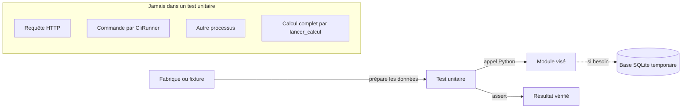
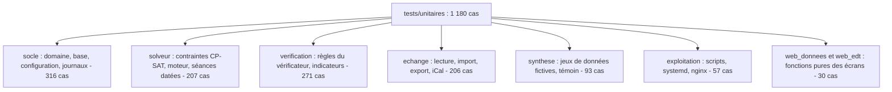

# Tests unitaires

Un test unitaire exerce **un seul module par ses fonctions Python**. Il
n'envoie aucune requête HTTP, ne lance aucune commande par `CliRunner`,
aucun autre processus, et n'enchaîne pas le calcul complet par le service de
génération. Il peut utiliser une base SQLite temporaire. Le solveur appelé
directement sur des données en mémoire reste unitaire.

Ce dossier compte **860 fonctions de test, soit 1 180 cas collectés** (une
fonction paramétrée donne plusieurs cas), dont 347 cas limites et 24 tests de
charge. La règle complète, la vue d'ensemble et les tests d'intégration sont
décrits dans [`tests/README.md`](../README.md) et
[`tests/integration/README.md`](../integration/README.md).

## 1. Ce qu'un test unitaire met en jeu



Le test prépare ses données (fabrique en mémoire ou base temporaire), appelle
une fonction du module visé, puis vérifie le résultat. Rien d'autre n'entre en
jeu : un échec désigne donc directement le module fautif.

## 2. Composants testés



## 3. Ce que vérifie chaque fichier

Nombres mesurés sur le dépôt. « Fonctions » compte les fonctions `test_*` du
fichier, « Cas » les tests collectés par pytest. Recalculer :

```sh
python -m tests.outils.classement                    # fonctions par composant
python -m pytest --collect-only -q tests/unitaires   # cas, fichier par fichier
```

### `socle/` : Domaine, base et services transverses (183 fonctions, 316 cas)

| Fichier | Ce qu'il vérifie | Fonctions | Cas |
|---|---|---:|---:|
| [`socle/test_base.py`](socle/test_base.py) | initialisation de la base, unicités, règles de suppression, normalisation des codes | 14 | 32 |
| [`socle/test_calendrier.py`](socle/test_calendrier.py) | Pâques, jours fériés, semaines d'une période, conversions d'heures | 8 | 16 |
| [`socle/test_charge.py`](socle/test_charge.py) | chargement rapide de l'instantané d'un établissement complet (`perf`) | 1 | 1 |
| [`socle/test_cli.py`](socle/test_cli.py) | fonctions du module de commandes appelées directement : extension refusée, point d'entrée, sorties UTF-8 | 4 | 4 |
| [`socle/test_config.py`](socle/test_config.py) | variables `EDT_*` invalides refusées, valeurs vides ramenées au défaut | 2 | 11 |
| [`socle/test_conflits_groupes.py`](socle/test_conflits_groupes.py) | conflits entre groupes : hiérarchie, chevauchement déclaré, étudiant commun | 6 | 6 |
| [`socle/test_contrats.py`](socle/test_contrats.py) | contrats partagés entre catalogue des contraintes, vérificateur, solveur et paramètres | 10 | 10 |
| [`socle/test_dejeuner.py`](socle/test_dejeuner.py) | pause déjeuner : trois modes, validation, lecture d'une ancienne base | 14 | 16 |
| [`socle/test_depliage.py`](socle/test_depliage.py) | dépliage des besoins en séances hebdomadaires (trois modes de volume) | 12 | 12 |
| [`socle/test_instantane.py`](socle/test_instantane.py) | chargement de l'instantané d'un semestre depuis la base | 11 | 18 |
| [`socle/test_jeux.py`](socle/test_jeux.py) | jeux fictifs et remise à zéro : panne, schéma périmé, verrou entre processus | 8 | 9 |
| [`socle/test_journal.py`](socle/test_journal.py) | journalisation : fichier non ouvrable, rotation, purge des journaux de calcul | 4 | 4 |
| [`socle/test_moteur.py`](socle/test_moteur.py) | moteur de base : URL acceptées, transactions SQLite, identifiants, verrous d'écriture | 9 | 13 |
| [`socle/test_niveaux.py`](socle/test_niveaux.py) | niveaux des contraintes (nécessaire, important, facultatif) dans le catalogue | 7 | 13 |
| [`socle/test_parametres.py`](socle/test_parametres.py) | un paramètre corrompu en base reste réparable | 1 | 1 |
| [`socle/test_regles.py`](socle/test_regles.py) | règles personnalisées côté domaine : catalogue, validation, phrases, résolution | 31 | 80 |
| [`socle/test_regles_service.py`](socle/test_regles_service.py) | règles personnalisées côté service : table, chargement, écriture, propositions | 29 | 58 |
| [`socle/test_schema.py`](socle/test_schema.py) | schéma périmé détecté (colonnes, index, unicités) | 10 | 10 |
| [`socle/test_web.py`](socle/test_web.py) | fonctions de l'application web appelées directement (module de routes, macros) | 2 | 2 |

### `solveur/` : Solveur CP-SAT et préparation du calcul (188 fonctions, 207 cas)

| Fichier | Ce qu'il vérifie | Fonctions | Cas |
|---|---|---:|---:|
| [`solveur/test_charge.py`](solveur/test_charge.py) | durées de calcul sur des instantanés générés et les jeux moyen et grand (`perf`) | 7 | 11 |
| [`solveur/test_contraintes.py`](solveur/test_contraintes.py) | une contrainte, un test : chaque contrainte change l'issue d'un petit problème | 47 | 48 |
| [`solveur/test_couche_datee.py`](solveur/test_couche_datee.py) | instanciation de la semaine type et replacement des séances empêchées | 16 | 16 |
| [`solveur/test_dejeuner.py`](solveur/test_dejeuner.py) | pause déjeuner dans le solveur : mode libre borné et mode « aucun » | 11 | 11 |
| [`solveur/test_moteur.py`](solveur/test_moteur.py) | le moteur dans son ensemble : issues, semaines actives, reproductibilité, objectif, arrêt | 26 | 36 |
| [`solveur/test_niveaux.py`](solveur/test_niveaux.py) | circulation des niveaux de règles, des options du calcul jusqu'au suivi | 23 | 26 |
| [`solveur/test_preverification.py`](solveur/test_preverification.py) | pré-vérifications : impossibilités certaines et situations tendues | 19 | 19 |
| [`solveur/test_regles.py`](solveur/test_regles.py) | règles personnalisées dans le solveur : interdiction si nécessaire, comptage si souple | 33 | 34 |
| [`solveur/test_services.py`](solveur/test_services.py) | services du solveur sans calcul complet : pré-vérifications, graines, identifiants, clôture | 6 | 6 |

### `verification/` : Vérificateur indépendant (231 fonctions, 271 cas)

| Fichier | Ce qu'il vérifie | Fonctions | Cas |
|---|---|---:|---:|
| [`verification/test_bout_en_bout.py`](verification/test_bout_en_bout.py) | un petit emploi du temps valide écrit à la main ne donne aucune anomalie | 2 | 2 |
| [`verification/test_commande.py`](verification/test_commande.py) | point d'entrée `cli.main` de la commande `verifier` appelé en Python | 1 | 1 |
| [`verification/test_datee.py`](verification/test_datee.py) | vérification des séances datées (`verifier_occurrences`) | 23 | 27 |
| [`verification/test_dejeuner_libre.py`](verification/test_dejeuner_libre.py) | pause déjeuner libre bornée : semaine type et séances datées | 13 | 13 |
| [`verification/test_disponibilites.py`](verification/test_disponibilites.py) | indisponibilités des enseignants, des salles et des groupes | 9 | 9 |
| [`verification/test_horaires.py`](verification/test_horaires.py) | règles de temps d'une séance : déjeuner, horaires, jours | 21 | 21 |
| [`verification/test_indicateurs.py`](verification/test_indicateurs.py) | indicateurs de qualité, comparés à des valeurs calculées à la main | 8 | 8 |
| [`verification/test_niveaux.py`](verification/test_niveaux.py) | niveaux des contraintes dans le vérificateur pur | 10 | 12 |
| [`verification/test_paires.py`](verification/test_paires.py) | règles entre deux séances : salle, enseignant, groupe, pause, trajet entre campus | 33 | 44 |
| [`verification/test_performance.py`](verification/test_performance.py) | vérification d'un établissement d'environ 1 000 séances (`perf`) | 4 | 4 |
| [`verification/test_regles_emploi.py`](verification/test_regles_emploi.py) | règles personnalisées sur l'emploi du temps d'un jour ou d'une semaine | 14 | 26 |
| [`verification/test_regles_personnalisees.py`](verification/test_regles_personnalisees.py) | un vérificateur par type de règle personnalisée | 20 | 23 |
| [`verification/test_salles.py`](verification/test_salles.py) | règles de salle : accessibilité, capacité, type, équipement | 12 | 12 |
| [`verification/test_service.py`](verification/test_service.py) | service de vérification sur le jeu minimal (base temporaire) | 16 | 16 |
| [`verification/test_service_niveaux.py`](verification/test_service_niveaux.py) | niveaux d'un calcul et d'une version et leur usage par le service | 14 | 16 |
| [`verification/test_service_regles.py`](verification/test_service_regles.py) | règles personnalisées dans les services de vérification | 10 | 14 |
| [`verification/test_volume_verrou_maxima.py`](verification/test_volume_verrou_maxima.py) | volume, verrous, maxima horaires, choix des contraintes vérifiées | 21 | 23 |

### `web_donnees/` : Services des écrans de données (11 fonctions, 11 cas)

| Fichier | Ce qu'il vérifie | Fonctions | Cas |
|---|---|---:|---:|
| [`web_donnees/test_besoins.py`](web_donnees/test_besoins.py) | charge hebdomadaire par groupe calculée par le service des enseignements | 2 | 2 |
| [`web_donnees/test_concurrence.py`](web_donnees/test_concurrence.py) | un seul chargement de jeu ou une seule remise à zéro à la fois, sur le service | 1 | 1 |
| [`web_donnees/test_generique.py`](web_donnees/test_generique.py) | service générique : modification partielle, refus détaillé par champ | 3 | 3 |
| [`web_donnees/test_mise_en_page.py`](web_donnees/test_mise_en_page.py) | construction du menu à onglets et blocs du gabarit, sans client web | 3 | 3 |
| [`web_donnees/test_saisies_extremes.py`](web_donnees/test_saisies_extremes.py) | un entier démesuré passé au service est refusé avec un message | 1 | 1 |
| [`web_donnees/test_suppression.py`](web_donnees/test_suppression.py) | conséquences d'une suppression expliquées par le service | 1 | 1 |

### `web_edt/` : Fonctions pures des écrans de l'emploi du temps (19 fonctions, 19 cas)

| Fichier | Ce qu'il vérifie | Fonctions | Cas |
|---|---|---:|---:|
| [`web_edt/test_accueil.py`](web_edt/test_accueil.py) | prochaine étape calculée par le tableau de bord | 2 | 2 |
| [`web_edt/test_cas_limites.py`](web_edt/test_cas_limites.py) | bornes des identifiants dans les services des écrans | 1 | 1 |
| [`web_edt/test_disposition.py`](web_edt/test_disposition.py) | disposition des blocs dans la grille et mises en forme françaises | 9 | 9 |
| [`web_edt/test_raccords.py`](web_edt/test_raccords.py) | raccords vers les autres composants : absence explicite, rapport, panne journalisée | 6 | 6 |
| [`web_edt/test_regles_web.py`](web_edt/test_regles_web.py) | présentation d'une anomalie qui ne cite pas de règle | 1 | 1 |

### `echange/` : Import et export (139 fonctions, 206 cas)

| Fichier | Ce qu'il vérifie | Fonctions | Cas |
|---|---|---:|---:|
| [`echange/test_bornes.py`](echange/test_bornes.py) | bornes contre les fichiers hostiles : archive bombe, fichier trop long | 22 | 27 |
| [`echange/test_export_edt.py`](echange/test_export_edt.py) | export CSV et iCal d'un emploi du temps importé, relu et réimporté | 4 | 4 |
| [`echange/test_format.py`](echange/test_format.py) | format d'échange : gabarit XLSX et ZIP, documentation générée | 5 | 5 |
| [`echange/test_ical.py`](echange/test_ical.py) | adaptateur iCal : récurrences, exceptions, changement d'heure | 18 | 36 |
| [`echange/test_import_donnees.py`](echange/test_import_donnees.py) | import des données : aller-retour, import partiel, simulation, réimport | 29 | 31 |
| [`echange/test_import_edt.py`](echange/test_import_edt.py) | import d'un emploi du temps existant (trois modes) | 12 | 12 |
| [`echange/test_lecture.py`](echange/test_lecture.py) | lecture tolérante : encodages, séparateurs, dates, heures, classeurs | 37 | 79 |
| [`echange/test_regles.py`](echange/test_regles.py) | feuille des règles du format d'échange : gabarit, import, export | 12 | 12 |

### `synthese/` : Générateur de données fictives (59 fonctions, 93 cas)

| Fichier | Ce qu'il vérifie | Fonctions | Cas |
|---|---|---:|---:|
| [`synthese/test_cas_limites.py`](synthese/test_cas_limites.py) | entrées refusées lisiblement et avant toute écriture | 22 | 41 |
| [`synthese/test_commande.py`](synthese/test_commande.py) | service des jeux fictifs exercé directement | 3 | 3 |
| [`synthese/test_generation.py`](synthese/test_generation.py) | génération : configuration, déterminisme, unicités, effectifs | 10 | 15 |
| [`synthese/test_performance.py`](synthese/test_performance.py) | durée de génération du jeu grand (`perf`) | 1 | 1 |
| [`synthese/test_realisme.py`](synthese/test_realisme.py) | présence des cas réalistes demandés dans le jeu grand | 9 | 9 |
| [`synthese/test_regles.py`](synthese/test_regles.py) | règles d'exemple des jeux : présence, phrases, validité | 7 | 12 |
| [`synthese/test_temoin.py`](synthese/test_temoin.py) | le témoin est un emploi du temps valide, aligné sur l'instantané | 4 | 6 |
| [`synthese/test_verificateur.py`](synthese/test_verificateur.py) | le témoin de chaque jeu passe le vérificateur sans erreur | 3 | 6 |

### `exploitation/` : Exploitation et déploiement (30 fonctions, 57 cas)

| Fichier | Ce qu'il vérifie | Fonctions | Cas |
|---|---|---:|---:|
| [`exploitation/test_commandes_exploitation.py`](exploitation/test_commandes_exploitation.py) | contrats dont dépend le déploiement, vérifiés sans interface | 2 | 2 |
| [`exploitation/test_scripts_deploiement.py`](exploitation/test_scripts_deploiement.py) | scripts de déploiement lus : syntaxe, fins de ligne, cohérence | 15 | 39 |
| [`exploitation/test_systemd_nginx.py`](exploitation/test_systemd_nginx.py) | unités systemd, configuration nginx et pages d'erreur cohérentes avec l'application | 13 | 16 |

## 4. Un exemple expliqué pas à pas

Fichier [`solveur/test_contraintes.py`](solveur/test_contraintes.py) : chaque
contrainte du solveur y est éprouvée sur un petit problème construit en
mémoire.

```python
def test_salle_unique_deux_seances_ne_partagent_pas_la_salle():
    f = Fabrique(creneaux=MATINEE)
    f.salle("N101")
    f.besoin([f.groupe("A1")], [f.enseignant()])
    f.besoin([f.groupe("A2")], [f.enseignant()])
    instantane = f.instantane()
    places = verifier_solution(instantane, resoudre(instantane, OPTIONS))
    assert not chevauchent(places["1-1"], places["2-1"])
```

1. **Ce qu'on prépare.** La fabrique (`tests/outils/solveur/fabrique.py`)
   décrit un établissement minimal : une matinée de créneaux, une seule
   salle, deux groupes qui ont chacun une séance avec leur propre enseignant.
   `f.instantane()` produit l'instantané, la donnée d'entrée du solveur. Aucune
   base n'est créée.
2. **Ce qu'on appelle.** `resoudre(instantane, OPTIONS)` : le solveur CP-SAT,
   appelé directement.
3. **Ce qu'on vérifie.** `verifier_solution` est l'oracle : il exige une
   solution complète et la fait contrôler par le vérificateur officiel. La
   dernière ligne vérifie la règle elle-même : les deux séances, qui
   partagent la seule salle, ne se chevauchent pas.
4. **Pourquoi le test échouerait si le défaut revenait.** Si la contrainte
   « une séance par salle » disparaissait du modèle, le solveur pourrait
   placer les deux séances au même moment dans la salle N101 : l'oracle
   relèverait l'anomalie et l'assertion finale échouerait.

Le test voisin `test_salle_unique` traite le cas inverse : avec un seul
créneau, le problème est impossible et le message doit le dire.

## 5. Lire un test

- **Fixtures communes** (`tests/conftest.py`) : `environnement` (automatique)
  isole chaque test dans un dossier temporaire avec sa propre base SQLite ;
  `base` initialise cette base ; `session` ouvre une session dessus ;
  `jeu_minimal` charge un petit établissement de démonstration ; `aujourdhui`
  fixe la date de référence (5 octobre 2026).
- **Fixtures du dossier** : chaque composant peut avoir un `conftest.py`
  (par exemple `verification/conftest.py` : versions saisies à la main).
- **Aides partagées** (`tests/outils/<composant>/`) : fabriques de données
  en mémoire (`tests/outils/solveur/fabrique.py`,
  `tests/outils/verification/fabrique.py`), constantes et fonctions de
  contrôle. Un test les importe par `from tests.outils... import ...`.
- **Marqueurs** : `unitaire` est posé d'office d'après le dossier ;
  `cas_limite` signale un cas limite (docstring « Cas : … Risque : … ») ;
  `perf` signale un test de charge, exclu de la CI.
- **Noms** : en français, ils disent le comportement vérifié.

## 6. Lancer

```sh
python -m pytest tests/unitaires                  # tous les tests unitaires
python -m pytest -m unitaire                      # idem, par marqueur
python -m pytest tests/unitaires -m "not perf"    # sans les tests de charge (comme la CI)
python -m pytest tests/unitaires/solveur          # un composant
python -m pytest tests/unitaires/solveur/test_contraintes.py -k salle   # un fichier, un mot du nom
```

Chaque fichier `test_*.py` de ce dossier doit figurer dans les tableaux de la
section 3 : `tests/test_rangement.py` le vérifie.
